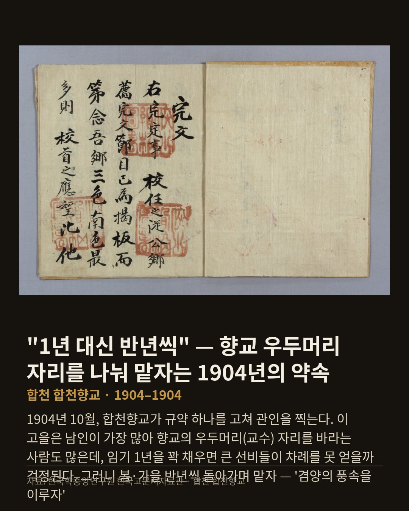
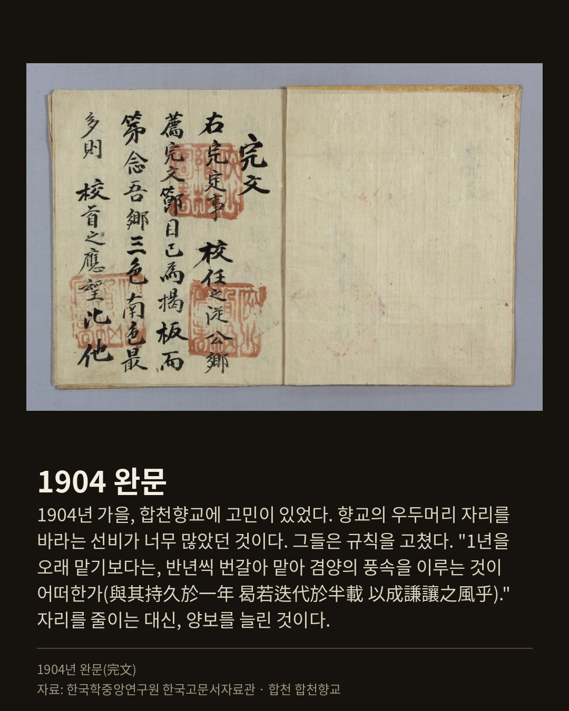
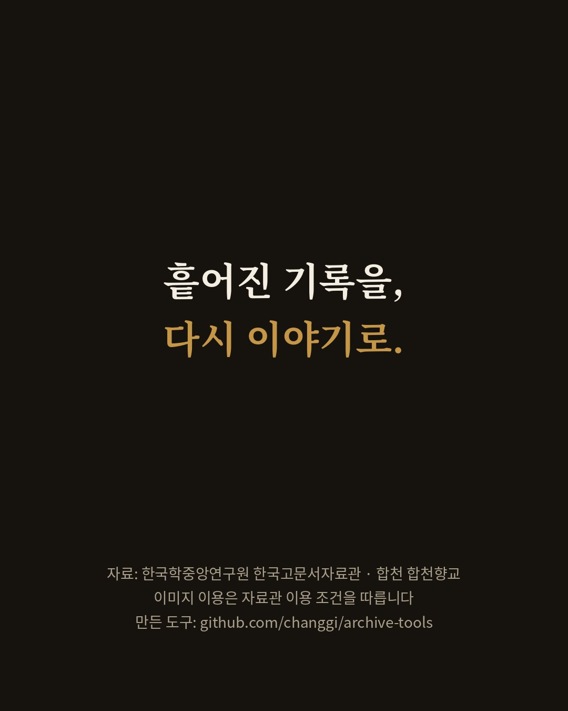

# EP.85 "1년 대신 반년씩" — 향교 우두머리 자리를 나눠 맡자는 1904년의 약속

합천 합천향교 (향교) · 1904년 10월, 합천향교가 규약 하나를 고쳐 관인을 찍는다. 이 고을은 남인이 가장 많아 향교의 우두머리(교수) 자리를 바라는 사람도 많은데, 임기 1년을 꽉 채우면 큰 선비들이 차례를 못 얻을까 걱정된다. 그러니 봄·가을 반년씩 돌아가며 맡자 — '겸양의 풍속을 이루자'

- 🌐 [전시 웹페이지](https://changgi.github.io/archive-tools/examples/hapcheon-hyanggyo/exhibit.html) (한자 위 한글 독음 · 원문 해석) · [수업 활동지](https://changgi.github.io/archive-tools/examples/hapcheon-hyanggyo/handout.html)
- 🎬 영상: [릴스 9:16](https://changgi.github.io/archive-tools/examples/media/ep85-hapcheon-hyanggyo_reel.mp4) · [가로 16:9](https://changgi.github.io/archive-tools/examples/media/ep85-hapcheon-hyanggyo_wide.mp4) · 홍보 글: [`promo.md`](promo.md)
- 카드뉴스: [`cards/`](cards/) · SNS 글: [`sns.txt`](sns.txt) · 판독·해석 표: [`selection.csv`](selection.csv)


<!-- DELIVERY -->
## 전달 에디팅 — 이 기록을 이렇게 전합니다

- **핵심 정서** — 양보
- **한 문장** — 갈등을 줄이는 방법으로 '겸양의 풍속'을 제도로 만든 지역 공동체의 지혜.
- **열기** — 자리를 원하는 사람이 너무 많을 때, 이 향교는 이렇게 했습니다.
- **펼치기** — 완문 (1904년) — 남인이 많아 생긴 경쟁 → 1년 대신 반년 → '겸양'이라는 결론으로 문제 해결의 흐름을 보여 주었습니다.
- **절정** — "1년을 오래 맡기보다는, 반년씩 번갈아 맡아 겸양의 풍속을 이루는 것이 어떠한가(與其持久於一年 曷若迭代於半載 以成謙讓之風乎)" — 화면·공간에서 이 한 줄만 크게, 소리를 줄여 집중
- **여운** — 우리 조직에 '반년씩 돌아가며' 규칙이 있다면, 무엇이 달라질까요? — 질문으로 끝내고 답은 보는 사람에게
- **감각과 물질** — 1년 대신 반년 — 의자 두 개를 번갈아 앉는 설치 · 규약을 판에 새기고 관람객이 자기 규칙을 써 보는 벽
- **통로와 매개** — 온라인: 릴스(열기) → 카드뉴스(펼치기) → 전시 웹페이지(절정·원문) → 비하인드 카드(여운) / 오프라인: 원본 크기 복제·낭독·참여 벽 / 남기기: 활동지·질문 카드
- **여운 장치** — "우리 조직의 반년 규칙"
- **전달 에디팅 전** — 1건의 문서를 1904년 연대순으로 놓고 문서명 · 유형 · 해설을 붙인다 — 정확하지만, 지나가면 잊힌다.
- **전달 에디팅 후** — 핵심 정서는 「양보」. 「자리를 원하는 사람이 너무 많을 때, 이 향교는 이렇게 했습니다.」로 열고, 문서를 한 장의 집중로 펼친 뒤, "1년을 오래 맡기보다는, 반년씩 번갈아 맡아 겸양의 풍속을 이루는 것이 어떠한가(與其持久於一年 曷若迭代於半載 以成謙讓之風乎)"에서 멈춘다. 1년 대신 반년 — 의자 두 개를 번갈아 앉는 설치. 마지막엔 「"우리 조직의 반년 규칙"」로 보는 사람이 자기 이야기를 남기고 떠나게 한다.

전문: [`delivery.md`](delivery.md)
<!-- /DELIVERY -->

<!-- CURATOR -->
## 비하인드 — 큐레이터 노트

- **왜 이 문서들인가** — 향교 우두머리 자리를 원하는 사람이 너무 많아 '반년씩 돌아가며 맡자'고 정한 1904년 완문이 흥미로웠습니다.
- **전하고 싶은 것** — 갈등을 줄이는 방법으로 '겸양의 풍속'을 제도로 만든 지역 공동체의 지혜.
- **이렇게 보이길 바랐다** — 남인이 많아 생긴 경쟁 → 1년 대신 반년 → '겸양'이라는 결론으로 문제 해결의 흐름을 보여 주었습니다.
- **이렇게 써 주세요** — 지역 공동체의 자치 규약, 갈등 조정을 다루는 시민 교육에 쓰세요.
- **만들며 있었던 일** — 1904년 완문의 표지와 본문 면을 구분해 대표 면을 바꿨습니다. '望比而從年'은 판독·해석이 불확실합니다.
- **남겨 둔 질문** — 우리 조직에 '반년씩 돌아가며' 규칙이 있다면, 무엇이 달라질까요?
- **제작 기록** — 문서 1건 · 1904년 · 원본 사진 7면(문서 전체) · 원문 판독 1건 · 번역 1건

전문: [`curator.md`](curator.md)
<!-- /CURATOR -->

## 이야기 — 사료가 말하는 대로

자리를 원하는 사람이 너무 많을 때, 이 향교는 이렇게 했습니다.

> **1904 완문** — 1904년 가을, 합천향교에 고민이 있었다. 향교의 우두머리 자리를 바라는 선비가 너무 많았던 것이다. 그들은 규칙을 고쳤다. "1년을 오래 맡기보다는, 반년씩 번갈아 맡아 겸양의 풍속을 이루는 것이 어떠한가(與其持久於一年 曷若迭代於半載 以成謙讓之風乎)." 자리를 줄이는 대신, 양보를 늘린 것이다.

| 표지 | 1번 카드 | 마무리 |
|---|---|---|
|  |  |  |

## 선별 문서 (1점)

| # | 연도 | 유형 | 문서명 | 원본 |
|---|---|---|---|---|
| 1 | 1904 | 완문 | 1904년 완문(完文) | [원본 보기](https://archive.aks.ac.kr/viewer/viewer.do#imgnode.do?itemId=book&gubun=booktree&depth=6&upPath=02%5E0248%5EL024805%5EL024805F02%5EL024805F0204&dataId=G002%2BAKS%2BKSM-XD.1904.4889-20101008.B019a_031_00038_YYY&itemType=) |

## 원문 판독과 해석

### 1. 1904년 완문(完文)

**원문 판독**

```
(표지) 甲辰　完文　甲辰十月二十七日
(1면)
完文
右完定事 校任之從公鄕
薦完之節目 已爲揭板 而
第念吾鄕三色 南色最
多 則校首之應望 比他
(2면)
等尤多 而望比而從年
已有板上節目 然時任
之一年持滿 若如他等
則宏儒碩望 恐有未
及之慮 與其持久於一
年 曷若迭代於半載
以成謙讓之風乎 從玆
以往 春秋兩薦 互相
遞代 以爲相推輪任 永
久勿替 貳任則一年
(이하 다음 면 · 합천군 관인 여러 과)
```

**원문 해석** 완문. 위는 완정(확정)하는 일이다. 향교 임원(교임)을 공정한 고을 추천에 따라 정하는 절목은 이미 현판에 걸어 두었다. 그런데 생각건대 우리 고을의 세 당색 가운데 남인(남색)이 가장 많으니, 교수(校首) 자리를 바라는 사람이 다른 당색보다 더욱 많다. 해마다 [추천하는] 일은 이미 현판의 절목에 있으나, 지금처럼 임원이 1년을 꽉 채운다면 다른 당색과 같아져, 학식 높고 명망 있는 선비들이 미처 차례를 얻지 못할 염려가 있다. 1년을 오래 맡기보다는 반년씩 번갈아 맡아 겸양의 풍속을 이루는 것이 어떠한가. 이제부터는 봄·가을 두 번 추천하여 서로 교대하고, 서로 밀어주며 돌아가며 맡는 것을 영구히 바꾸지 말 것이다. 두 번째 임원(이임)은 1년으로 하되 …

**해제** 완문(完文)은 관청이나 단체가 어떤 결정을 확정해 증빙으로 내주는 문서입니다. 1904년(광무 8) 합천향교가 향교의 우두머리인 교수(校首, 도유사)의 임기를 1년에서 반년으로 줄여 봄·가을로 교대하게 하고, 합천군 관인을 찍어 확정했습니다. '三色'은 당시 지역 사족의 당색(남인·노론·소론 등)을 가리키는 말로, 합천에는 남인이 많아 자리 경쟁이 심했다는 사정이 드러납니다. 조선 말기 향촌 사회의 운영 방식과 당색 문제를 보여 주는 자료입니다. '望比而從年'은 판독·해석이 불확실합니다.

판독·해석·이야기는 이미지에 근거한 초안이며(검토 전 "초안" 표시), 정확한 판독은 원문 확인이 필요합니다. □는 읽지 못한 글자, (?)는 불확실한 글자입니다.
이미지: 한국학중앙연구원 한국고문서자료관 소장·제공. "원본" 링크를 누르면 자료관 뷰어에서 그 문서가 열립니다. 재사용은 자료관에 문의하세요(소장처 동의 필요).
