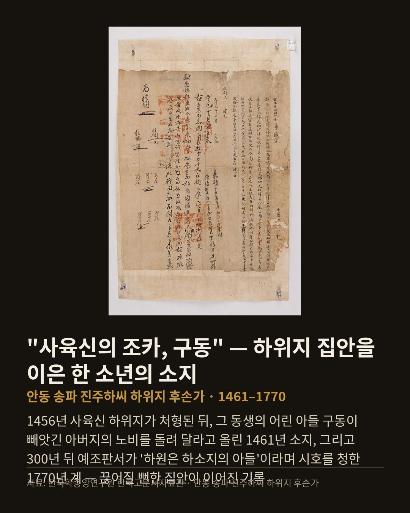
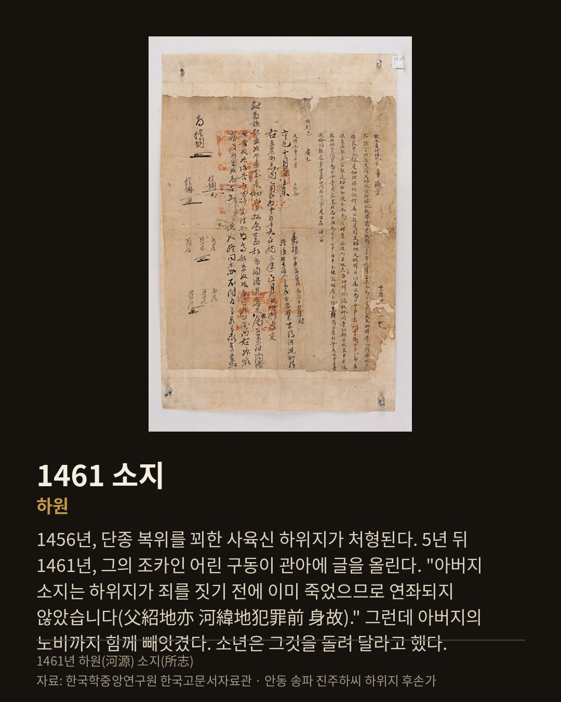
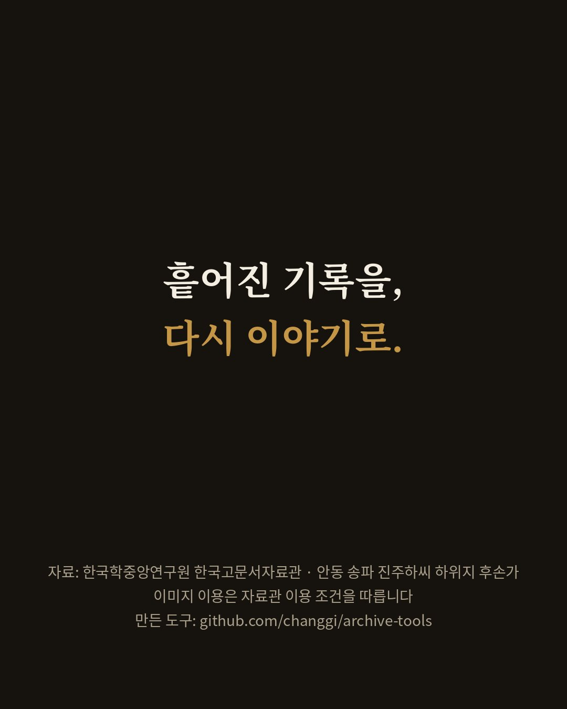

# EP.42 "사육신의 조카, 구동" — 하위지 집안을 이은 한 소년의 소지

안동 송파 진주하씨 하위지 후손가 (문중) · 1456년 사육신 하위지가 처형된 뒤, 그 동생의 어린 아들 구동이 빼앗긴 아버지의 노비를 돌려 달라고 올린 1461년 소지, 그리고 300년 뒤 예조판서가 '하원은 하소지의 아들'이라며 시호를 청한 1770년 계 — 끊어질 뻔한 집안이 이어진 기록

- 🌐 [전시 웹페이지](https://changgi.github.io/archive-tools/examples/hawiji/exhibit.html) (한자 위 한글 독음 · 원문 해석) · [수업 활동지](https://changgi.github.io/archive-tools/examples/hawiji/handout.html)
- 🎬 영상: [릴스 9:16](https://changgi.github.io/archive-tools/examples/media/ep42-hawiji_reel.mp4) · [가로 16:9](https://changgi.github.io/archive-tools/examples/media/ep42-hawiji_wide.mp4) · 홍보 글: [`promo.md`](promo.md)
- 카드뉴스: [`cards/`](cards/) · SNS 글: [`sns.txt`](sns.txt) · 판독·해석 표: [`selection.csv`](selection.csv)


<!-- CURATOR -->
## 비하인드 — 큐레이터 노트

- **왜 이 문서들인가** — 사육신 하위지의 조카가 '아버지는 죄를 짓기 전에 이미 죽었다'며 노비를 돌려 달라고 올린 1461년 소지가 있었습니다.
- **전하고 싶은 것** — 멸문의 화 속에서도 집안을 이으려 한 한 소년의 기록이 남아 있었다는 것.
- **이렇게 보이길 바랐다** — 1461년 조카의 소지 → 1770년의 계(啓)로, 300년 동안 끊긴 줄 알았던 집안의 끈을 보여 주었습니다.
- **이렇게 써 주세요** — 계유정난과 사육신, 연좌제를 다루는 수업에 쓰세요.
- **남겨 둔 질문** — 구동은 그 노비를 돌려받았을까요?
- **제작 기록** — 문서 2건 · 1461–1770년 · 원본 사진 4면(문서 전체) · 원문 판독 2건 · 번역 2건 · 못 읽은 글자 □ 4 · 불확실 (?) 11 · 해제에 "확인 필요"를 단 문서 1건

전문: [`curator.md`](curator.md)
<!-- /CURATOR -->

## 이야기 — 사료가 말하는 대로

사육신 하위지의 집안은 끊긴 줄 알았습니다. 300년 동안.

> **1461 소지** — 1456년, 단종 복위를 꾀한 사육신 하위지가 처형된다. 5년 뒤 1461년, 그의 조카인 어린 구동이 관아에 글을 올린다. "아버지 소지는 하위지가 죄를 짓기 전에 이미 죽었으므로 연좌되지 않았습니다(父紹地亦 河緯地犯罪前 身故)." 그런데 아버지의 노비까지 함께 빼앗겼다. 소년은 그것을 돌려 달라고 했다.
> **1770 계** — 300년 뒤 1770년, 영조 앞에서 예조판서가 아뢴다. 하위지에게는 후손이 없다고 잘못 알려져 시호조차 전하지 못했다고. 그리고 한 이름을 말한다. "하원은 곧 소지의 아들입니다(河源卽上所云紹地之子)." 1461년 노비를 돌려 달라던 소년 구동, 그가 사육신의 집안을 이은 사람이었다.

| 표지 | 1번 카드 | 마무리 |
|---|---|---|
|  |  |  |

## 선별 문서 (2점)

| # | 연도 | 유형 | 문서명 | 원본 |
|---|---|---|---|---|
| 1 | 1461 | 소지 | 1461년 하원(河源) 소지(所志) | [원본 보기](https://archive.aks.ac.kr/viewer/viewer.do#imgnode.do?itemId=book&gubun=booktree&depth=6&upPath=01%5E0167%5EL016709%5EL016709F02%5EL016709F0202&dataId=G002%2BAKS%2BKSM-XB.1461.0000-20101008.B036a_056_00015_XXX&itemType=) |
| 2 | 1770 | 계 | 1770년 한광회(韓光會) 계(啓) | [원본 보기](https://archive.aks.ac.kr/viewer/viewer.do#imgnode.do?itemId=book&gubun=booktree&depth=6&upPath=01%5E0167%5EL016709%5EL016709F02%5EL016709F0202&dataId=G002%2BAKS%2BKSM-XB.1770.0000-20101008.B036a_056_00005_XXX&itemType=) |

## 원문 판독과 해석

### 1. 1461년 하원(河源) 소지(所志)

**원문 판독**

```
故生員河紹地子 龜童
右謹言所志矣段 父紹地亦 河緯地犯罪前 身故爲乎(?) 亦用(?)以緣坐不冬爲白有去乙 父矣奴婢等乙 河緯地戶
籍良中合錄是如 河緯地奴婢屬公敎是時 父紹地矣奴婢幷以屬公爲白乎事是去等 □爲白去乙 □□
使員及敬差官敎是初亦分揀不冬爲在 婢在庄及所生奴老古知 婢於德(?) 奴於同等乙 都目狀良中幷錄
敎所加于(?)閏(?)望爲白乎等用良 呈所志白活爲白乎 亦中(?)自中分執記相考分揀[還]給爲白有卧乎 天安(?)中(?)□
成給向敎是事望良白內卧乎事是去在 謹言
推刷色 處分
天順五年十月 日所志
(왼쪽 — 관의 처분과 입안, 흘림)
辛巳十月二十七日 立案
右立案 … (흘림, 판독 필요)
嘉靖十五年(?)正月(?)二十日 … 立案 (뒷날 다시 확인한 기록 — 판독 필요)
```

**원문 해석** 돌아가신 생원 하소지의 아들 구동. 삼가 아뢰는 소지. 제 아버지 소지는 하위지가 죄를 짓기 전에 이미 세상을 떠났으므로 연좌되지 않았습니다. 그런데 아버지의 노비들이 하위지의 호적에 함께 올라 있었다 하여, 하위지의 노비를 나라에 몰수하실 때 아버지 소지의 노비까지 모두 몰수되었습니다. … 사원과 경차관께서도 처음에 가려내지 않으셨으니, 비(婢) 재장과 그 소생 노 노고지, 비 어덕(?), 노 어동 등을 도목장에 함께 올려 … 소지를 올려 하소연하오니, 집안의 분재기를 살펴 가려서 돌려주시고 [입안을] 만들어 주시기를 바랍니다. 삼가 아룁니다. 추쇄색(노비 조사 담당)께서 처분하실 일. 천순 5년(1461) 10월 일 소지.
(처분) 신사년(1461) 10월 27일 입안. … (이하 흘림, 판독 필요)

**해제** 1461년(세조 7) 10월, 고(故) 생원 하소지(河紹地)의 아들 구동(龜童)이 노비 조사 담당 관청(推刷色)에 올린 소지입니다. 하소지는 1456년 단종 복위를 꾀하다 처형된 사육신 하위지(河緯地)의 동생으로 보입니다. 하소지는 하위지의 일이 있기 전에 이미 죽어 연좌되지 않았는데, 그의 노비가 하위지 호적에 함께 올라 있었다는 이유로 함께 몰수되었으니 돌려 달라는 청원입니다. 왼쪽에 1461년 10월 27일 입안(立案)과, 75년 뒤 가정 15년(1536)에 다시 확인한 기록이 이어 붙어 있습니다. 1770년 계(啓)에 따르면 이 '구동'이 뒷날 하위지의 후사를 이은 하원(河源)입니다. 표지 제목은 '推刷時呈狀(추쇄 때 올린 소장)'입니다.

### 2. 1770년 한광회(韓光會) 계(啓)

**원문 판독**

```
庚寅閏(?)二十四 禮曹判書韓光會所啓
端廟朝六臣 曾於戊寅贈職贈諡 而朴
彭年家外 其餘皆未宣謚 故謚號官 敎送寧越彰節祠矣 河
緯地奉祀孫有 除職去方 欲延謚而臣 敎在於寧越 雖於擧行 似
爲之 敢達 上曰 有後孫 則何至今不爲宣謚乎 顧議政金曰 此事
蓋有委折矣 戊寅年 六臣贈謚時 禮堂未聞 忠烈公河緯地之
有後孫 而誤爲奏對於筵席 其後嗣孫上言 請蒙宣謚之典 而
又見格於該曹 以致至今未宣矣 今者公私文蹟 河緯地欲以其弟
紹地子爲後 至有署押付托之遺券 故重臣閔鎭厚 援據己巳名
臣金鍒 立後事陳達 先朝請以河源爲緯地之嗣則 特命施之
河源卽上所云紹地之子 而頃年因嶺南道臣狀請 廟堂覆奏 錄
用嗣孫矣 朝旣家知其有後孫 則當施之典 何可仍以不施乎 今
該曹別成謚誥 依例宣下 恐不可已矣 上曰 尙今遲滯 宜有
是理 令銓曹卽爲成給 還卽宣謚
```

**원문 해석** 경인년(1770) 윤[달] 24일, 예조판서 한광회가 아뢴 일. 단종 때의 여섯 신하는 일찍이 무인년(1758)에 벼슬과 시호를 추증받았으나, 박팽년 집안 외에는 모두 아직 시호를 [후손에게] 선포하지 못하였기에 시호 교지를 영월 창절사에 보내 두었습니다. 하위지의 제사를 받드는 자손이 있어 벼슬을 받고 떠나려 하니, 시호를 [그에게] 내리려 하는데 [교지는] 영월에 있어 거행하기 어려운 듯하여 감히 아룁니다. 임금께서 이르시기를, '후손이 있다면 어찌 지금까지 시호를 선포하지 않았는가.' 의정 김(金)이 아뢰기를, '이 일에는 곡절이 있습니다. 무인년 육신에게 시호를 내릴 때 예조 당상이 충렬공 하위지에게 후손이 있음을 듣지 못하여 경연에서 잘못 아뢰었습니다. 그 뒤 후사 자손이 상언하여 시호 선포를 청하였으나 다시 해당 관청에 막혀 지금까지 선포하지 못했습니다. 이제 공사의 문적을 보면, 하위지가 그 동생 소지의 아들을 후사로 삼으려 하여 서명하고 부탁한 문서까지 남아 있으므로, 중신 민진후가 기사년의 명신 김유를 근거로 후사 세우는 일을 아뢰어, 선왕 때 하원을 하위지의 후사로 삼기를 청하자 특명으로 시행하였습니다. 하원은 곧 위에 말한 소지의 아들이며, 근년에 영남 관찰사의 장계로 묘당이 다시 아뢰어 후사 자손을 등용하였습니다. 조정이 이미 후손이 있음을 아니, 마땅히 베풀 은전을 어찌 그대로 베풀지 않겠습니까. 이제 해당 관청이 따로 시호 교지를 만들어 예에 따라 내려야 할 것입니다.' 임금께서 이르시기를, '지금까지 지체된 것은 마땅한 이치가 아니다. 이조로 하여금 곧 만들어 주게 하고 돌아가는 즉시 시호를 선포하라.'

**해제** 1770년(영조 46, 庚寅), 예조판서 한광회(韓光會)가 하위지의 후손에게 시호(충렬)를 선포해 달라고 아뢴 계(啓)와 영조의 답을 적은 문서입니다. 사육신은 1758년 시호를 받았지만 하위지는 '후손이 없다'는 잘못된 보고 때문에 선포되지 못했는데, 하위지가 동생 소지의 아들을 후사로 삼으려 한 문서가 남아 있어 하원(河源)을 후사로 세웠다는 경위가 적혀 있습니다. '河源卽上所云紹地之子(하원은 곧 소지의 아들)'라는 구절이 1461년 소지의 '하소지의 아들 구동'과 이어집니다. 해서로 거의 전문을 판독했으나 몇 글자는 불확실합니다.

판독·해석·이야기는 이미지에 근거한 초안이며(검토 전 "초안" 표시), 정확한 판독은 원문 확인이 필요합니다. □는 읽지 못한 글자, (?)는 불확실한 글자입니다.
이미지: 한국학중앙연구원 한국고문서자료관 소장·제공. "원본" 링크를 누르면 자료관 뷰어에서 그 문서가 열립니다. 재사용은 자료관에 문의하세요(소장처 동의 필요).
