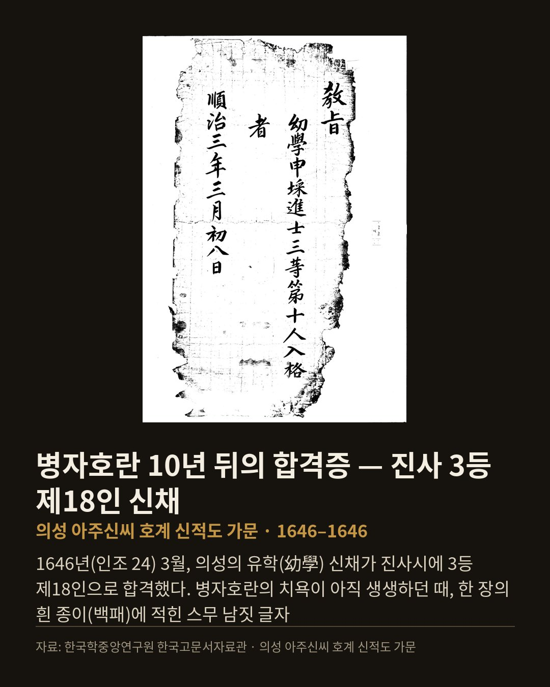
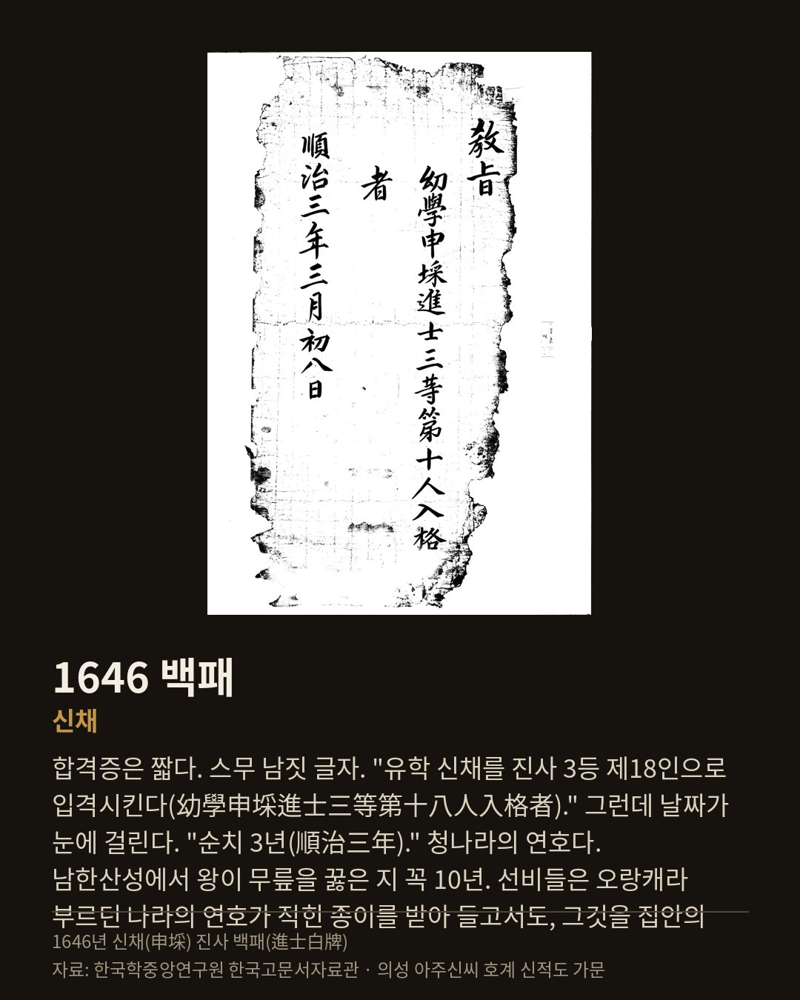
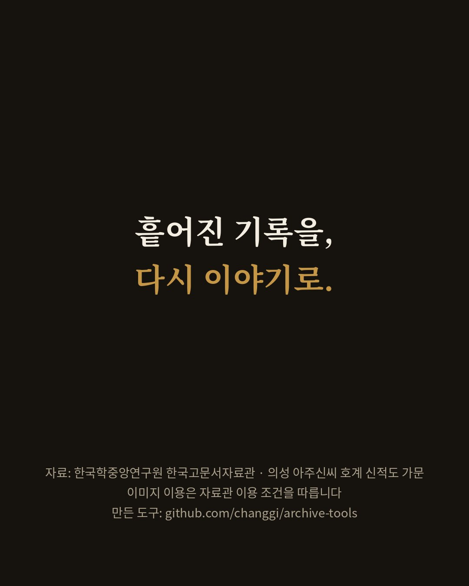

# EP.75 병자호란 10년 뒤의 합격증 — 진사 3등 제18인 신채

의성 아주신씨 호계 신적도 가문 (문중) · 1646년(인조 24) 3월, 의성의 유학(幼學) 신채가 진사시에 3등 제18인으로 합격했다. 병자호란의 치욕이 아직 생생하던 때, 한 장의 흰 종이(백패)에 적힌 스무 남짓 글자

- 🌐 [전시 웹페이지](https://changgi.github.io/archive-tools/examples/hogye/exhibit.html) (한자 위 한글 독음 · 원문 해석) · [수업 활동지](https://changgi.github.io/archive-tools/examples/hogye/handout.html)
- 🎬 영상: [릴스 9:16](https://changgi.github.io/archive-tools/examples/media/ep75-hogye_reel.mp4) · [가로 16:9](https://changgi.github.io/archive-tools/examples/media/ep75-hogye_wide.mp4) · 홍보 글: [`promo.md`](promo.md)
- 카드뉴스: [`cards/`](cards/) · SNS 글: [`sns.txt`](sns.txt) · 판독·해석 표: [`selection.csv`](selection.csv)


<!-- CURATOR -->
## 비하인드 — 큐레이터 노트

- **왜 이 문서들인가** — 스무 남짓 글자의 백패에 청나라 연호 '順治'가 적혀 있다는 점이 눈에 걸렸습니다.
- **전하고 싶은 것** — 치욕의 시대에도 사람들은 자기 삶의 성취를 소중히 간직했다는 것.
- **이렇게 보이길 바랐다** — 짧은 문서라 원문 전체를 보여 주고, '순치 3년'이라는 날짜 한 줄에 힘을 실었습니다.
- **이렇게 써 주세요** — 병자호란 이후의 사회, 연호 문제를 다루는 수업에 쓰세요.
- **만들며 있었던 일** — 흑백 마이크로필름 이미지라 가장자리가 검게 보입니다.
- **남겨 둔 질문** — 오랑캐라 부르던 나라의 연호를 쓰며, 선비들은 어떤 마음이었을까요?
- **제작 기록** — 문서 1건 · 1646년 · 원본 사진 1면(문서 전체) · 원문 판독 1건 · 번역 1건

전문: [`curator.md`](curator.md)
<!-- /CURATOR -->

## 이야기 — 사료가 말하는 대로

합격증 날짜에 적힌 건, 조선을 무릎 꿇린 나라의 연호였습니다.

> **1646 백패** — 합격증은 짧다. 스무 남짓 글자. "유학 신채를 진사 3등 제18인으로 입격시킨다(幼學申埰進士三等第十八人入格者)." 그런데 날짜가 눈에 걸린다. "순치 3년(順治三年)." 청나라의 연호다. 남한산성에서 왕이 무릎을 꿇은 지 꼭 10년. 선비들은 오랑캐라 부르던 나라의 연호가 적힌 종이를 받아 들고서도, 그것을 집안의 자랑으로 고이 간직했다.

| 표지 | 1번 카드 | 마무리 |
|---|---|---|
|  |  |  |

## 선별 문서 (1점)

| # | 연도 | 유형 | 문서명 | 원본 |
|---|---|---|---|---|
| 1 | 1646 | 백패 | 1646년 신채(申埰) 진사 백패(進士白牌) | [원본 보기](https://archive.aks.ac.kr/viewer/viewer.do#imgnode.do?itemId=book&gubun=booktree&depth=6&upPath=01%5E0167%5EL016742%5EL016742F02%5EL016742F0201&dataId=G002%2BAKS%2BKSM-XA.1646.1111-20101008.B052a_077_00001_XXX&itemType=) |

## 원문 판독과 해석

### 1. 1646년 신채(申埰) 진사 백패(進士白牌)

**원문 판독**

```
敎旨
幼學申埰進士三等第十八人入格
者
順治三年三月初八日
```

**원문 해석** 교지. 유학 신채를 진사 3등 제18인으로 입격시킨다. 순치 3년(1646) 3월 초8일.

**해제** 1646년(인조 24) 사마시(생원·진사시) 진사과에 합격한 의성의 신채(申埰)에게 내린 백패(白牌)입니다. 문과·무과 합격증인 홍패(紅牌)가 붉은 종이인 것과 달리, 소과(小科) 합격증은 흰 종이여서 '백패'라 부릅니다. '유학(幼學)'은 아직 벼슬이 없는 선비, '입격(入格)'은 소과 합격을 뜻하는 말입니다(대과는 '급제'). 3등 제18인은 3등 안에서 18번째라는 뜻입니다. 연호는 청 순치(順治)를 썼는데, 병자호란(1636) 이후 청의 연호를 쓰게 된 시대상을 보여 줍니다. 마이크로필름 계열 흑백 이미지라 가장자리가 검게 보입니다.

판독·해석·이야기는 이미지에 근거한 초안이며(검토 전 "초안" 표시), 정확한 판독은 원문 확인이 필요합니다. □는 읽지 못한 글자, (?)는 불확실한 글자입니다.
이미지: 한국학중앙연구원 한국고문서자료관 소장·제공. "원본" 링크를 누르면 자료관 뷰어에서 그 문서가 열립니다. 재사용은 자료관에 문의하세요(소장처 동의 필요).
