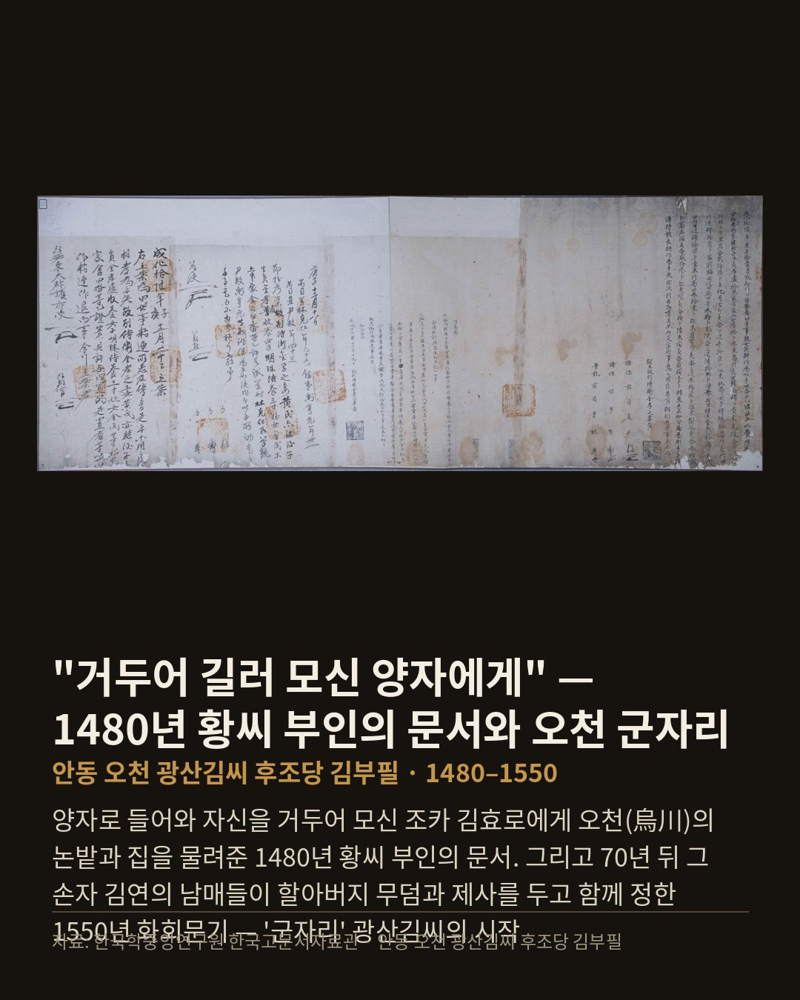
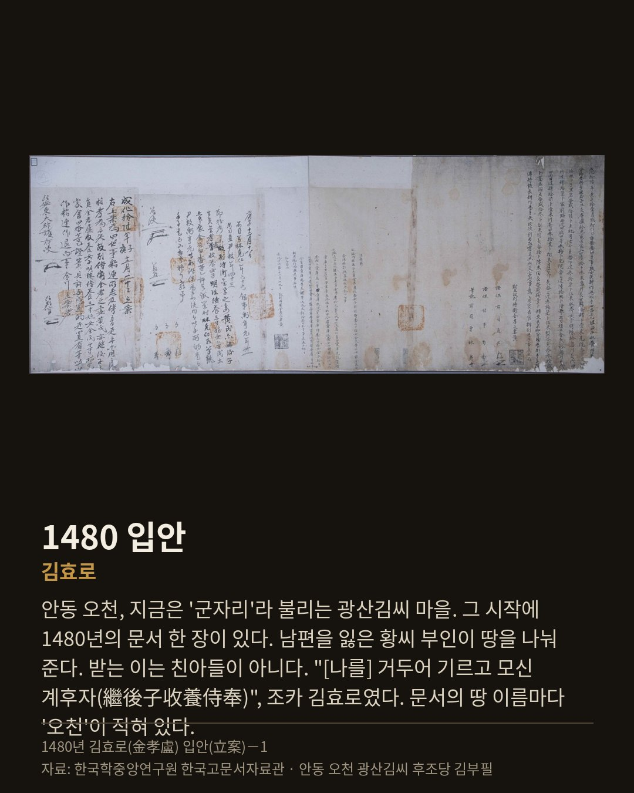
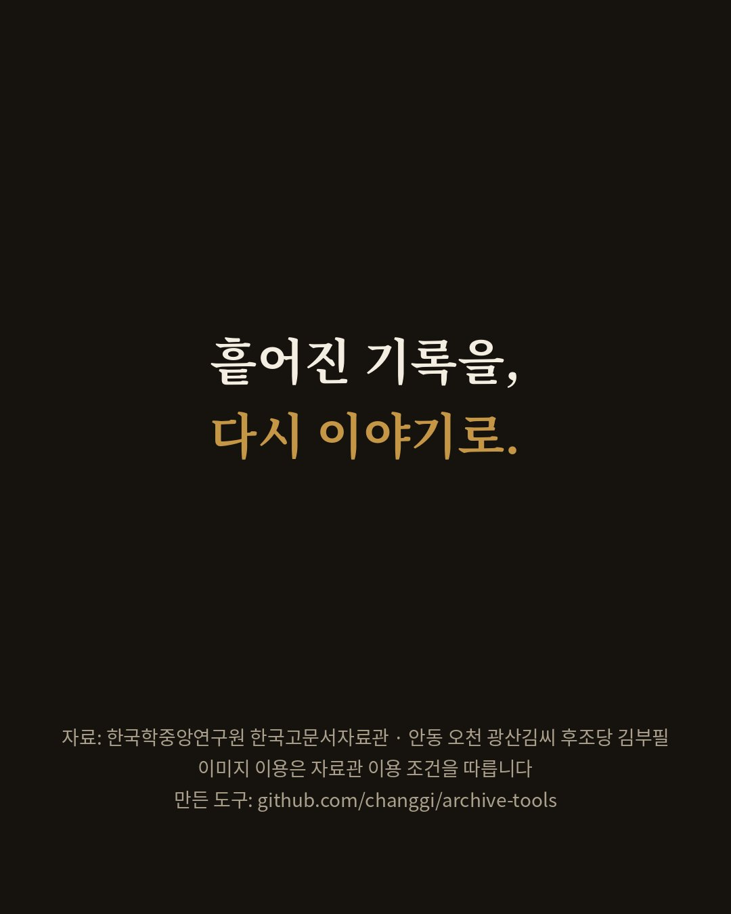

# EP.70 "거두어 길러 모신 양자에게" — 1480년 황씨 부인의 문서와 오천 군자리

안동 오천 광산김씨 후조당 김부필 (문중) · 양자로 들어와 자신을 거두어 모신 조카 김효로에게 오천(烏川)의 논밭과 집을 물려준 1480년 황씨 부인의 문서. 그리고 70년 뒤 그 손자 김연의 남매들이 할아버지 무덤과 제사를 두고 함께 정한 1550년 화회문기 — '군자리' 광산김씨의 시작

- 🌐 [전시 웹페이지](https://changgi.github.io/archive-tools/examples/hujodang/exhibit.html) (한자 위 한글 독음 · 원문 해석) · [수업 활동지](https://changgi.github.io/archive-tools/examples/hujodang/handout.html)
- 🎬 영상: [릴스 9:16](https://changgi.github.io/archive-tools-next/media/ep70-hujodang_reel.mp4) · [가로 16:9](https://changgi.github.io/archive-tools-next/media/ep70-hujodang_wide.mp4) · 홍보 글: [`promo.md`](promo.md)
- 카드뉴스: [`cards/`](cards/) · SNS 글: [`sns.txt`](sns.txt) · 판독·해석 표: [`selection.csv`](selection.csv)


<!-- DELIVERY -->
## 전달 에디팅 — 이 기록을 이렇게 전합니다

- **핵심 정서** — 돌봄
- **한 문장** — 가족은 피만이 아니라 돌봄으로도 이어졌다는 것.
- **열기** — 이 마을의 시작은 한 장의 문서였습니다. 땅을 받은 사람은 친아들이 아니었습니다.
- **펼치기** — 김효로 입안－1 → 김연 남매 화회문기－1 (1480–1550년) — '거두어 기르고 모신 아들에게'라는 구절을 중심에 두고, 70년 뒤 남매들의 화회문기로 이어 갔습니다.
- **절정** — "[나를] 거두어 기르고 모신 계후자(繼後子收養侍奉)" — 화면·공간에서 이 한 줄만 크게, 소리를 줄여 집중
- **여운** — 황씨 부인에게 '거두어 모셨다'는 말은 어떤 의미였을까요? — 질문으로 끝내고 답은 보는 사람에게
- **감각과 물질** — "거두어 기르고 모신 아들에게" 한 줄을 두 손 모양 받침 위에
- **통로와 매개** — 온라인: 릴스(열기) → 카드뉴스(펼치기) → 전시 웹페이지(절정·원문) → 비하인드 카드(여운) / 오프라인: 원본 크기 복제·낭독·참여 벽 / 남기기: 활동지·질문 카드
- **여운 장치** — "나를 거두어 준 사람"에게 한 줄
- **전달 에디팅 전** — 2건의 문서를 1480–1550년 연대순으로 놓고 문서명 · 유형 · 해설을 붙인다 — 정확하지만, 지나가면 잊힌다.
- **전달 에디팅 후** — 핵심 정서는 「돌봄」. 「이 마을의 시작은 한 장의 문서였습니다. 땅을 받은 사람은 친아들이 아니었습니다.」로 열고, 문서를 대비와 순서로 펼친 뒤, "[나를] 거두어 기르고 모신 계후자(繼後子收養侍奉)"에서 멈춘다. "거두어 기르고 모신 아들에게" 한 줄을 두 손 모양 받침 위에. 마지막엔 「"나를 거두어 준 사람"에게 한 줄」로 보는 사람이 자기 이야기를 남기고 떠나게 한다.

전문: [`delivery.md`](delivery.md)
<!-- /DELIVERY -->

<!-- CURATOR -->
## 비하인드 — 큐레이터 노트

- **왜 이 문서들인가** — 1480년 황씨 부인이 자신을 거두어 모신 양자에게 재산을 준 문서가, 한 마을(군자리) 가문의 시작이었습니다.
- **전하고 싶은 것** — 가족은 피만이 아니라 돌봄으로도 이어졌다는 것.
- **이렇게 보이길 바랐다** — '거두어 기르고 모신 아들에게'라는 구절을 중심에 두고, 70년 뒤 남매들의 화회문기로 이어 갔습니다.
- **이렇게 써 주세요** — 입양과 가족, 여성의 재산권을 다루는 수업에 쓰세요.
- **남겨 둔 질문** — 황씨 부인에게 '거두어 모셨다'는 말은 어떤 의미였을까요?
- **제작 기록** — 문서 2건 · 1480–1550년 · 원본 사진 5면(문서 전체) · 원문 판독 2건 · 번역 2건 · 못 읽은 글자 □ 0 · 불확실 (?) 21 · 해제에 "확인 필요"를 단 문서 1건

전문: [`curator.md`](curator.md)
<!-- /CURATOR -->

## 이야기 — 사료가 말하는 대로

이 마을의 시작은 한 장의 문서였습니다. 땅을 받은 사람은 친아들이 아니었습니다.

> **1480 입안** — 안동 오천, 지금은 '군자리'라 불리는 광산김씨 마을. 그 시작에 1480년의 문서 한 장이 있다. 남편을 잃은 황씨 부인이 땅을 나눠 준다. 받는 이는 친아들이 아니다. "[나를] 거두어 기르고 모신 계후자(繼後子收養侍奉)", 조카 김효로였다. 문서의 땅 이름마다 '오천'이 적혀 있다.
> **1550 화회문기** — 70년 뒤 1550년, 그 양자의 손자들이 모여 문서를 쓴다. 형제자매가 서로 합의해 재산을 나누는 화회문기다. 첫 줄은 할아버지 할머니 이야기다. "조부모 무덤의 네 명절 성묘와 기일 제사(祖父母墳墓 四名日拜掃及忌日)." 그 몫은 나누지 않고 떼어 두었다. 땅을 받은 양자의 집이, 이제 제사를 잇는 집이 되었다.

| 표지 | 1번 카드 | 마무리 |
|---|---|---|
|  |  |  |

## 선별 문서 (2점)

| # | 연도 | 유형 | 문서명 | 원본 |
|---|---|---|---|---|
| 1 | 1480 | 입안 | 1480년 김효로(金孝盧) 입안(立案)－1 | [원본 보기](https://archive.aks.ac.kr/viewer/viewer.do#imgnode.do?itemId=book&gubun=booktree&depth=6&upPath=01%5E0167%5EL016715%5EL016715F02%5EL016715F0204&dataId=G002%2BAKS%2BKSM-XD.1480.4717-20101008.B001a_001_00310_004&itemType=) |
| 2 | 1550 | 화회문기 | 1550년 김연(金緣) 남매 화회문기(和會文記)－1 | [원본 보기](https://archive.aks.ac.kr/viewer/viewer.do#imgnode.do?itemId=book&gubun=booktree&depth=6&upPath=01%5E0167%5EL016715%5EL016715F02%5EL016715F0205&dataId=G002%2BAKS%2BKSM-XE.1550.4717-20101008.B001a_001_00295_XXX&itemType=) |

## 원문 판독과 해석

### 1. 1480년 김효로(金孝盧) 입안(立案)－1

**원문 판독**

```
成化拾陸年庚子拾壹月貳拾捌日 (…) 許與爲臥乎事段 女矣耕作爲如乎田畓等乙 繼後子收養侍奉(…)
分給爲臥乎乎(?) 繼後子生 侄 孝盧亦中 元家及家入田陸拾卜參束 烏川 先田肆拾肆卜壹束 先院畓下 過(…)
拾玖卜 于里岩畓貳拾陸卜 主祀月古介 畓下 過 參拾柒卜伍束 收養女子 明珠亦中 烏川 代(?)田
川過 肆拾柒卜 家前路西過田 麻田并 參拾卜 先院畓上過 陸拾玖卜 侍養 三寸侄女 金氏亦中 烏川 代
田內 過 肆拾柒卜壹束 川南田 參拾壹卜 於(?)東月古介 畓上過 參拾柒卜伍束 梨谷 畓 參拾貳
卜 高丘洞 畓 貳拾參卜 於東 同 畓 拾卜陸束 同 畓 貳拾壹卜 肆束 爲去乎 如 分給爲臥乎乎(?) 子孫
傳持 鎭長 耕作爲乎矣 後次 別爲 所有 去等 此文字 內事意乙 用良 告官 辨別 爲乎事 是亦在
財主 故別侍衛金孝之妻黃氏 (도장)
證保 前司直 尹 (수결)
證保 前(?)… (수결)
筆執 前司勇 林壽 (수결)
(왼쪽 — 이어 붙인 관의 입안, 관인)
```

**원문 해석** 성화 16년 경자(1480) 11월 28일 … 허락하여 주는 일은, 제가 경작하던 논밭들을 [저를] 거두어 기르고 모신(收養侍奉) 계후자 … 에게 나누어 줍니다. 계후자인 조카 효로(孝盧)에게: 본가와 집에 딸린 밭 60부 3속, 오천의 선대 밭 44부 1속, 선원 논 아래 … 19부, 우리암 논 26부, 제사 몫 월고개 논 아래 37부 5속. 거두어 기른 딸 명주(明珠)에게: 오천 … 밭 냇가 47부, 집 앞 길 서쪽 밭과 삼밭 아울러 30부, 선원 논 위 69부. 모시고 기른 삼촌 조카딸 김씨에게: 오천 … 밭 안 47부 1속, 냇물 남쪽 밭 31부, 월고개 논 위 37부 5속, 배골 논 32부, 고구동 논 23부 … 이렇게 나누어 주니, 자손에게 전하여 길이 경작하되, 뒷날 딴말이 있거든 이 문서의 뜻으로 관에 고하여 가릴 일. 재주 돌아간 별시위 김효지의 아내 황씨(도장). 증인 전 사직 윤○(수결). 증인 … 필집 전 사용 임수(수결).

**해제** 1480년(성종 11) 11월, 별시위 김효지(金孝之)의 아내 황씨(黃氏)가 남편 사후 양자(繼後子)로 들인 조카 김효로(金孝盧, 1454~1534)와 거두어 기른 딸들에게 논밭을 나눠 준 문서입니다. 땅의 위치가 모두 '烏川(오천)'으로 적혀 있어, 안동 오천(지금의 군자리) 광산김씨 집안이 이곳에 터를 잡은 내력을 보여 줍니다. 논밭 넓이는 결부법의 부(卜)·속(束)으로 적었고, '爲臥乎事段(하는 일은)', '亦中(에게)' 같은 이두가 쓰였습니다. 같은 해 예조의 계후 입안도 함께 전합니다. 줄 위쪽 일부가 잘려 판독이 불완전합니다.

### 2. 1550년 김연(金緣) 남매 화회문기(和會文記)－1

**원문 판독**

```
嘉靖二十九年庚戌四月十五日 同[腹]和[會成文]
祖父母墳墓 四名日 拜掃及忌日 祭祀(?)
雜(?)乙仍于 同府(?)伏順(?)家(?)祭祀 奈(?)心(?)當(?)
仍(?)應除出 不分爲去乎 同 祭 未(?)…
用(?)而 汝(?)矣 婢(?)… 爲如 可代(?)耕(?)(…)
(이하 왼쪽 — 남매들의 이름과 서명: 年(?)親寡女 緣妻 … / 成均生員 … / 前訓導 … / 筆執 幼學 …, 흘림 · 판독 필요)
```

**원문 해석** 가정 29년 경술(1550) 4월 15일, 동복 남매가 화합하여 만드는 문서. 할아버지·할머니 무덤의 네 명절 성묘와 기일 제사는 … 그러므로 … 집에서 제사를 받들 몫은 따로 떼어 나누지 않으니 … (흘림이 심하고 훼손되어 이하 판독 필요)

**해제** 1550년(명종 5), 김효로의 손자 세대인 김연(金緣)의 남매들이 부모 재산을 나누며 함께 정한 화회문기(和會文記)의 첫 장입니다. '조부모 무덤의 네 명절 성묘와 기일 제사'를 위한 몫은 나누지 않고 떼어 둔다(除出不分)는 내용으로 시작해, 70년 전 황씨가 남긴 오천의 땅과 제사가 손자 세대에 어떻게 이어졌는지 보여 줍니다. 흘림이 심하고 위쪽이 해져 첫 몇 줄만 읽었습니다. 후조당 김부필은 김연의 아들입니다(문서 밖 사실 — 확인 필요).

판독·해석·이야기는 이미지에 근거한 초안이며(검토 전 "초안" 표시), 정확한 판독은 원문 확인이 필요합니다. □는 읽지 못한 글자, (?)는 불확실한 글자입니다.
이미지: 한국학중앙연구원 한국고문서자료관 소장·제공. "원본" 링크를 누르면 자료관 뷰어에서 그 문서가 열립니다. 재사용은 자료관에 문의하세요(소장처 동의 필요).
