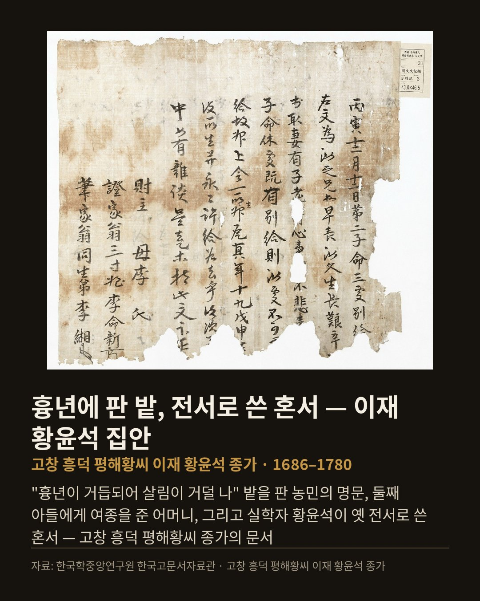
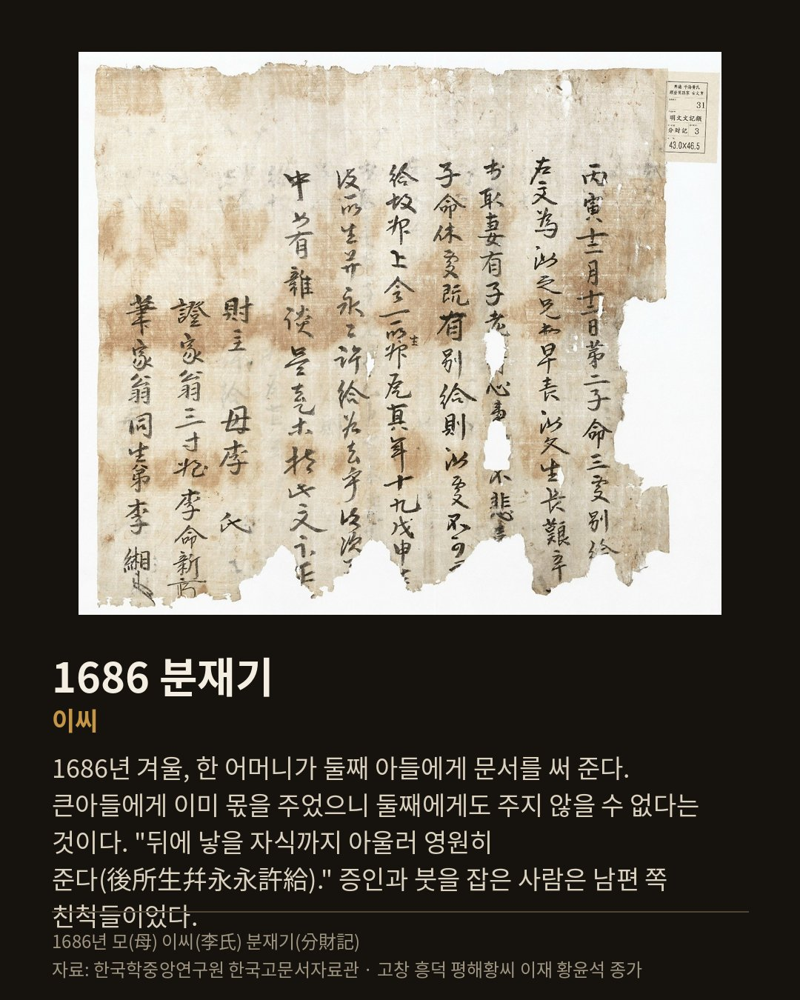
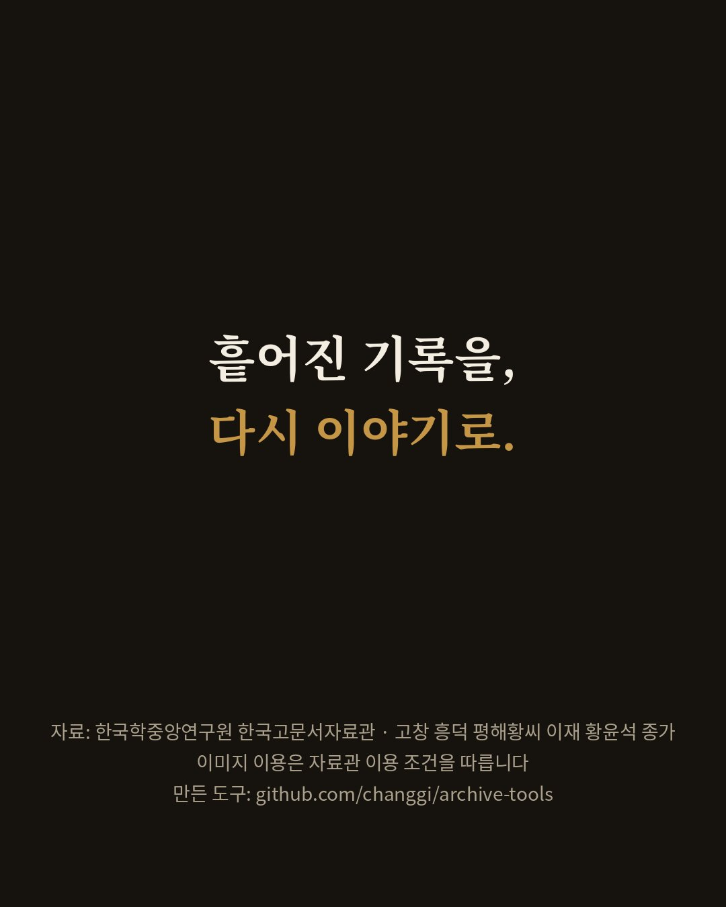

# EP.24 흉년에 판 밭, 전서로 쓴 혼서 — 이재 황윤석 집안

고창 흥덕 평해황씨 이재 황윤석 종가 (문중) · "흉년이 거듭되어 살림이 거덜 나" 밭을 판 농민의 명문, 둘째 아들에게 여종을 준 어머니, 그리고 실학자 황윤석이 옛 전서로 쓴 혼서 — 고창 흥덕 평해황씨 종가의 문서

- 🌐 [전시 웹페이지](https://changgi.github.io/archive-tools/examples/hwangyunseok/exhibit.html) (한자 위 한글 독음 · 원문 해석) · [수업 활동지](https://changgi.github.io/archive-tools/examples/hwangyunseok/handout.html)
- 🎬 영상: [릴스 9:16](https://changgi.github.io/archive-tools/examples/media/ep24-hwangyunseok_reel.mp4) · [가로 16:9](https://changgi.github.io/archive-tools/examples/media/ep24-hwangyunseok_wide.mp4) · 홍보 글: [`promo.md`](promo.md)
- 카드뉴스: [`cards/`](cards/) · SNS 글: [`sns.txt`](sns.txt) · 판독·해석 표: [`selection.csv`](selection.csv)


<!-- CURATOR -->
## 비하인드 — 큐레이터 노트

- **왜 이 문서들인가** — '흉년이 거듭되어 살 길이 없다'로 시작하는 밭 매매 문서와, 전서로 쓴 혼서가 한 집안에 있었습니다.
- **전하고 싶은 것** — 같은 집안 문서함에 굶주림의 기록과 학문의 자부심이 함께 들어 있다는 것.
- **이렇게 보이길 바랐다** — 글을 몰라 손마디를 그린 매도인의 문서로 시작해, 학자 황윤석의 정성 어린 혼서로 마무리했습니다.
- **이렇게 써 주세요** — 기근과 토지 매매, 조선 후기 학자의 삶 수업에 쓰세요.
- **만들며 있었던 일** — 세로 영상 글자 맞춤 문제로 다시 만들었습니다(v0.5.0).
- **남겨 둔 질문** — 밭을 판 김나그내의 가족은 그해 겨울을 넘겼을까요?
- **제작 기록** — 문서 4건 · 1686–1780년 · 원본 사진 5면(문서 전체) · 원문 판독 4건 · 번역 4건 · 못 읽은 글자 □ 10 · 불확실 (?) 53 · 해제에 "확인 필요"를 단 문서 2건

전문: [`curator.md`](curator.md)
<!-- /CURATOR -->

## 이야기 — 사료가 말하는 대로

300년 전 흉년에 밭을 판 사람은, 계약서에 뭐라고 적었을까요?

> **1686 분재기** — 1686년 겨울, 한 어머니가 둘째 아들에게 문서를 써 준다. 큰아들에게 이미 몫을 주었으니 둘째에게도 주지 않을 수 없다는 것이다. "뒤에 낳을 자식까지 아울러 영원히 준다(後所生幷永永許給)." 증인과 붓을 잡은 사람은 남편 쪽 친척들이었다.
> **1698 명문** — 1698년 5월, 김나그내라는 사람이 밭을 판다. 계약서 첫머리에 그 까닭이 적혀 있다. "흉년이 거듭되어 집안 살림이 거덜 나고, 돌림병까지 겹쳐 백방으로 살 길이 없다(連値凶歉 家計板蕩)." 글을 몰랐던 그는 손마디를 그려 서명했다. 조선을 휩쓴 대기근의 한복판이었다.
> **1712 소지** — 1712년 2월, 떠돌아 사는 백성 황재중이 아버지를 묻으려다 막힌다. 마을 사람이 그 자리에 자기 표식이 묻혀 있다는 것이다. 그는 관에 호소한다. "효자의 집에서 장례보다 큰일이 어디 있겠습니까(孝子人家大事 豈有是於送葬乎)." "온 식구가 머리를 맞대고 하늘에 부르짖는다(闔家聚首呼天)."
> **1780 혼서** — 그리고 1780년, 이 집안의 학자 황윤석이 혼서를 쓴다. 그런데 글씨가 이상하다. 일상의 해서가 아니라, 2000년 전의 서체인 전서(篆書)다. 평생 일기 『이재난고』를 쓰며 온갖 학문을 파고든 실학자는, 집안의 혼사에도 학자의 손을 남겼다.

| 표지 | 1번 카드 | 마무리 |
|---|---|---|
|  |  |  |

## 선별 문서 (4점)

| # | 연도 | 유형 | 문서명 | 원본 |
|---|---|---|---|---|
| 1 | 1686 | 분재기 | 1686년 모(母) 이씨(李氏) 분재기(分財記) | [원본 보기](https://archive.aks.ac.kr/viewer/viewer.do#imgnode.do?itemId=book&gubun=booktree&depth=6&upPath=01%5E0147%5EL014724%5EL014724F02%5EL014724F0205&dataId=G002%2BKHD%2BKSM-XE.1686.0000-20170529.C0402_002_00031_XXX&itemType=) |
| 2 | 1698 | 명문 | 1698년 김나그내(金羅斤乃) 명문(明文) | [원본 보기](https://archive.aks.ac.kr/viewer/viewer.do#imgnode.do?itemId=book&gubun=booktree&depth=6&upPath=01%5E0147%5EL014724%5EL014724F02%5EL014724F0205&dataId=G002%2BKHD%2BKSM-XE.1698.0000-20170529.C0402_002_00045_XXX&itemType=) |
| 3 | 1712 | 소지 | 1712년 황재중(黃載重) 소지(所志) | [원본 보기](https://archive.aks.ac.kr/viewer/viewer.do#imgnode.do?itemId=book&gubun=booktree&depth=6&upPath=01%5E0147%5EL014724%5EL014724F02%5EL014724F0202&dataId=G002%2BKHD%2BKSM-XB.1712.0000-20170529.C0402_002_00002_XXX&itemType=) |
| 4 | 1780 | 혼서 | 1780년 황윤석(黃胤錫) 혼서(婚書) | [원본 보기](https://archive.aks.ac.kr/viewer/viewer.do#imgnode.do?itemId=book&gubun=booktree&depth=6&upPath=01%5E0147%5EL014724%5EL014724F02%5EL014724F0206&dataId=G002%2BKHD%2BKSM-XF.1780.0000-20170529.C0402_002_00076_XXX&itemType=) |

## 원문 판독과 해석

### 1. 1686년 모(母) 이씨(李氏) 분재기(分財記)

**원문 판독**

```
丙寅十二月十三日第二子命三處別給
右文爲汝之兄(?)弟早喪(?)汝父生長艱辛(?)
而(?)娶妻有子老(?)□心事(?) … 不悲(?)事(?)
子命休處旣有別給則汝亦不可(?)無(?)□□
給故婢上今(?)一所生婢□□年十九戊申生
後所生幷永永許給爲去乎後次(?)□□
中若有雜談是去等持此文告官(?)卞正(?)
財主 母李 氏
證 家翁三寸姪 李命新 (수결)
筆 家翁同生弟 李緗(?) (수결)
(종이 가운데가 찢겨 일부 글자 없음 — 판독 불확실 다수)
```

**원문 해석** 병인년(1686) 12월 13일, 둘째 아들 명삼(命三)에게 따로 주는 문서. 이 문서를 만드는 까닭은, … (너의 형제가 일찍 죽고) 너도 어렵게 자라 장가들어 자식을 두었는데 … 첫째 아들 명휴(命休)에게 이미 따로 준 것이 있으니 너에게도 주지 않을 수 없다. 그러므로 여종 상금(?)의 첫째 소생인 여종 ○○(19세, 무신생)과 뒤에 낳을 자식까지 아울러 영원히 준다. 뒷날 (자손) 가운데 말썽이 있으면 이 문서를 가지고 관에 고하여 바로잡을 일이다. 재산 주인 어머니 이씨. 증인 남편의 삼촌 조카 이명신. 쓴 사람 남편의 동생 이상(?).

**해제** 병인년(1686, 숙종 12) 12월 13일, 어머니 이씨가 둘째 아들 명삼에게 여종을 따로 준 분재기(별급문기)입니다. 문서명은 '모(母) 이씨 분재기'이며, 증인과 쓴 사람이 남편(家翁) 쪽 친척입니다. 종이 가운데가 찢기고 얼룩이 있어 여러 글자는 판독이 불확실합니다. 평해황씨 집안에 전하는 문서이지만 등장인물의 성은 이씨로 보여, 이 집안에 들어오게 된 경위는 확인이 필요합니다.

### 2. 1698년 김나그내(金羅斤乃) 명문(明文)

**원문 판독**

```
康熙三十七年戊寅五月卄日李生員奴金元處明文
右明文事段連値凶歉家計板蕩之中且値癘(?)疫
□活百計無策是乎乃以勢不得已朴莫金(?)處
買得耕食是如乎與德(?)二西仙云(?)浦東邊小路下伏
在是在唯(?)字田三斗五升落只所耕柒負平(?)末庫乙
價折錢文拾兩依數捧上爲遣右人處本文幷以
永永放賣爲去乎日後某人是乃雜談是去等持此
文記告官卞正事
田主 金羅斤乃 (수촌: 左寸)
證人 寺奴 朴元鶴 (수촌)
證保 私奴 道(?)□ (수촌)
筆執 南士先 (수결)
```

**원문 해석** 강희 37년 무인(1698) 5월 20일, 이 생원 댁 종 김원(金元) 앞으로 써 주는 매매 문서. 이 문서를 만드는 까닭은, 흉년이 거듭되어 집안 살림이 거덜 난 데다 돌림병까지 겹쳐 살아갈 온갖 방도가 없으므로, 형편상 어쩔 수 없이, 박막금에게서 사서 갈아먹던 덕(德)○ 서쪽 선운포 동쪽 작은 길 아래에 있는 '유(唯)'자 밭 3두 5승락(씨앗 서 말 닷 되를 뿌리는 넓이), 경작 면적 7부짜리를 돈 10냥으로 값을 쳐 그 수대로 받고, 위 사람에게 본래의 문서까지 함께 영원히 판다. 뒷날 누구라도 말썽을 부리면 이 문서를 가지고 관에 고하여 바로잡을 일이다. 밭 주인 김나그내(왼손 손마디 그림), 증인 절의 종 박원학, 보증인 사노 도○, 쓴 사람 남사선.

**해제** 1698년(숙종 24, 康熙 37) 5월 20일, 김나그내(金羅斤乃)가 밭을 판 매매 명문입니다. 1690년대 후반은 '을병대기근'(1695~1699)으로 수많은 사람이 굶어 죽은 시기여서, '連値凶歉 家計板蕩(흉년이 거듭되어 살림이 거덜 남)'이라는 말이 실감 나게 읽힙니다. '○○處明文'의 ○○(이 생원 댁 종 김원)은 산 사람이고, 글을 몰라 서명하지 못한 사람들은 손가락 마디를 그린 수촌(手寸)으로 서명했습니다. '是乎乃(이오나)', '是如乎(이다온)', '爲去乎(하거온)'는 이두입니다.

### 3. 1712년 황재중(黃載重) 소지(所志)

**원문 판독**

```
泰仁寓民黃載重
右所志矣段矣亡父昨年寓居古縣內之地是如乎不幸身死之後矣身占得葬地於山外面龍頭山庚坐之地是如乎其
近處絶無他人山所是遣所占之地則牛馬踐踏無人家禁護之地是乎亦矣身今日窆穴卄年明(?)入葬之計是乎乃不意洞居(?)民
人忽生禁斷之意昨日矣妙(?)稱以其矣理(?)表在其間是如使不得入葬是乎今世所謂理表云者衆土爲墳於是遣詳言所得年月
及生而埋置其中是遣且以緣由呈訴官(?)此後乃當已物而(?)禁他人是乎乃今此聞(?)表人(?)稱理表是乃矣身占得一麓則果無一
杯之形此則衆人所目見矣身雖巧言(?)安敢掩人耳目是乎于(?)閑(?)表人又無一字呈訴則其所執者何狀而(?)戴(?)人莫重之事是□矣
身占得此山已過十許日之久則閑表人居在一洞矣身占得之日彼果洞(?)知(?)絶無一言乃至昨日偶發禁止之心者誠
未知其何事状是乎(?)孝子人家大事豈有是於送葬乎(?)矣身以流寓單弱之人盡在經營艱備葬需方以本(?)明入葬而無端
被人所禁此間悲痛罔措之状行路聞之尙且稱寃而悲歎矣矣身闔家聚首呼天之餘不勝痛刻之情敢此鳴乎於
仁明執法之下伏乞 惟(?)然矣身冏(?)悶(?)之状卽爲 親自摘奸(?)洞燭彼此事状後使矣身及(?)期明(?)安葬之地則天地仁恩當此(?)報哉
更乞 援例參商千萬望良(?)爲
行下向敎是事
兼城主 處分
壬辰二月 日
(왼쪽 아래 큰 글씨 — 관의 처분 題辭, 판독 불확실) 彼(?)處 … 埋(?)標 … 示(?) …
```

**원문 해석** 태인에 떠돌아 사는 백성 황재중. 이 소지의 사연은 이렇습니다. 저의 돌아가신 아버지가 지난해 고현 안 땅에 붙어살다가 불행히 돌아가신 뒤, 제가 산외면 용두산의 경좌(庚坐) 자리를 장지로 잡았습니다. 그 근처에는 다른 사람의 무덤이 전혀 없고, 잡은 땅은 소와 말이 밟고 다니며 아무 집도 금하거나 지키지 않던 곳입니다. 제가 오늘 무덤 구덩이를 파고 내일(?) 장사를 지내려 했는데, 뜻밖에 마을 사람이 갑자기 막으려는 마음을 먹고, 어제 그 사이에 자기 '이표(理表)'가 묻혀 있다며 장사를 못 지내게 합니다. 이른바 이표라는 것은 흙을 모아 무덤 모양을 만들고 땅을 얻은 해와 달을 자세히 적어 그 속에 묻어 두고, 그 사연을 관에 신고한 뒤에야 자기 땅으로 삼아 남을 막을 수 있는 것입니다. 그런데 지금 이 사람이 이표라 하는 것은, 제가 잡은 산자락에 과연 흙 한 줌의 모양도 없으니 이는 여러 사람이 눈으로 본 바입니다. … 제가 이 산을 잡은 지 이미 열흘이 넘었고 그 사람은 같은 마을에 사는데, 제가 잡던 날에는 아무 말이 없다가 어제야 갑자기 막으려 하니 참으로 무슨 까닭인지 모르겠습니다. 효자의 집에서 장례보다 큰일이 어디 있겠습니까. 저는 떠돌아 사는 외롭고 약한 사람으로 장례 비용을 어렵게 마련해 바야흐로 장사를 지내려는데 까닭 없이 남에게 막히니, 이 비통하고 어찌할 바 모르는 모습은 지나가는 사람이 들어도 원통하다 할 것입니다. 온 식구가 머리를 맞대고 하늘에 부르짖다가 원통함을 이기지 못해 감히 어질고 밝게 법을 집행하시는 분께 호소합니다. 엎드려 비오니 직접 살펴 사정을 밝게 아신 뒤 제가 기한 안에 편안히 장사 지내게 해 주시면 하늘과 땅 같은 은혜를 어찌 갚겠습니까. … 겸성주께서 처분하소서. 임진년(1712) 2월 일.

**해제** 1712년(숙종 38, 壬辰) 2월, 태인에 떠돌아 살던 황재중이 아버지의 장지 문제로 관에 올린 소지입니다. 묏자리를 두고 벌어진 다툼(산송, 山訟)은 조선 후기 가장 흔한 소송이었습니다. '理表'는 미리 묏자리를 차지했다는 표시로 묻어 두는 물건(흔히 '암장 표지')을 말하는 것으로 보이며, 황재중은 그런 표시가 실제로는 없다고 반박합니다. '兼城主'는 다른 고을 수령이 겸임한 수령을 뜻합니다. 본문은 비교적 또렷한 해서지만 일부 글자는 판독 확인이 필요하고, 왼쪽 아래 큰 글씨(관의 처분)는 판독이 어렵습니다.

### 4. 1780년 황윤석(黃胤錫) 혼서(婚書)

**원문 판독**

```
(옛 서체 전서(篆書)로 쓴 혼서 — 첫 줄과 끝 줄만 일부 판독, 나머지는 전서 판독 필요)
平海黃胤錫白 (?)
(2~9줄: 납폐서의 정해진 문구로 보임 — 判讀 필요)
… 再拜 (?)
```

**원문 해석** (판독한 부분) 평해 황윤석이 아룁니다. … 두 번 절합니다. (납폐서의 정해진 서식대로라면, '좋은 뜻을 받들어 귀댁 따님을 저의 아들에게 허락해 주시니, 선인의 예에 따라 삼가 사람을 보내 납폐의 예를 행합니다'라는 내용이 이어질 것입니다. 실제 문장은 전서 판독으로 확인해야 합니다.)

**해제** 1780년(정조 4) 실학자 이재 황윤석(1729~1791)이 보낸 혼서(납폐서)입니다. 『이재난고』라는 방대한 일기를 남긴 그는 천문·수학·언어·서체에 두루 밝았는데, 이 혼서를 일상 글씨가 아닌 고대 서체인 전서(篆書)로 썼습니다. 전서는 판독이 매우 어려워 첫 줄과 끝 줄 일부만 읽었으며, 본문은 전문가의 판독이 필요합니다.

판독·해석·이야기는 이미지에 근거한 초안이며(검토 전 "초안" 표시), 정확한 판독은 원문 확인이 필요합니다. □는 읽지 못한 글자, (?)는 불확실한 글자입니다.
이미지: 한국학중앙연구원 한국고문서자료관 소장·제공. "원본" 링크를 누르면 자료관 뷰어에서 그 문서가 열립니다. 재사용은 자료관에 문의하세요(소장처 동의 필요).
