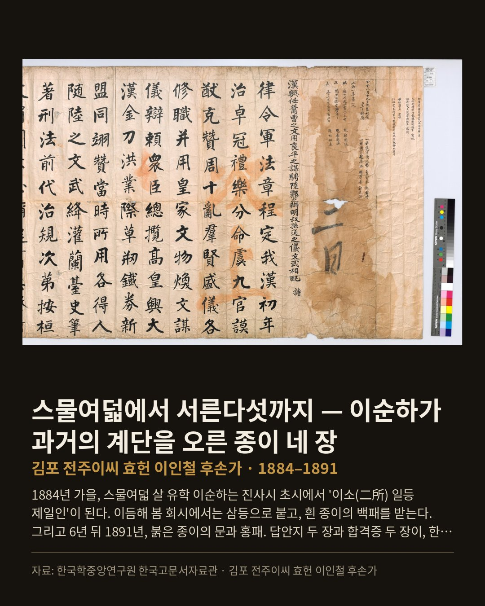
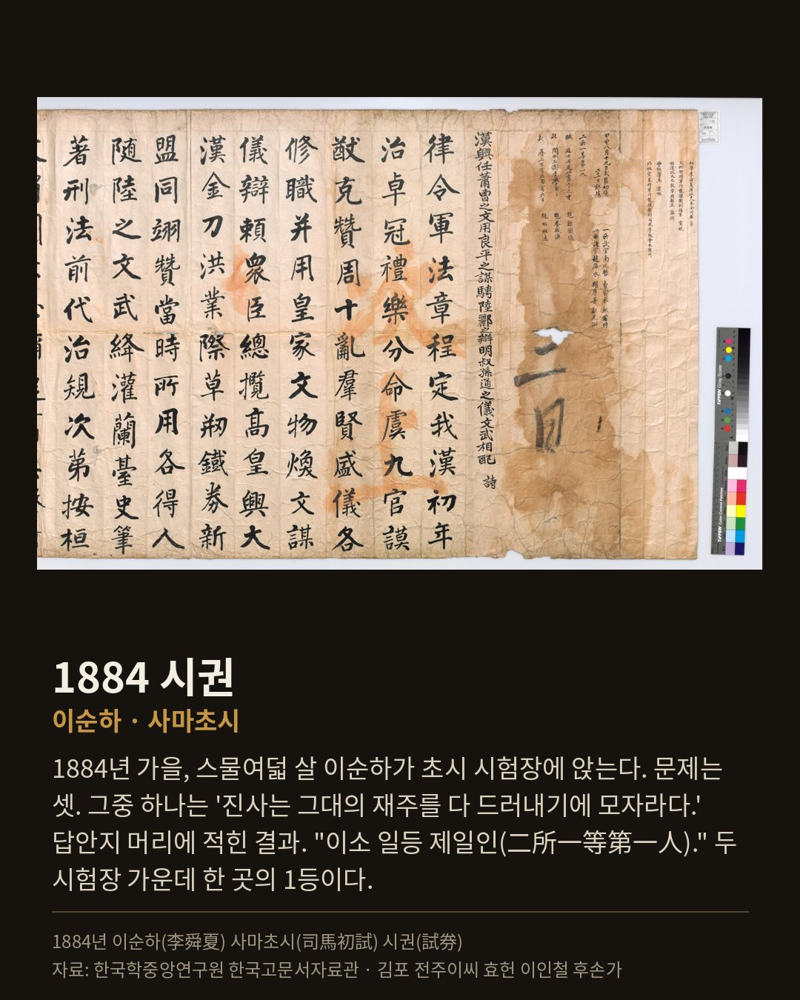
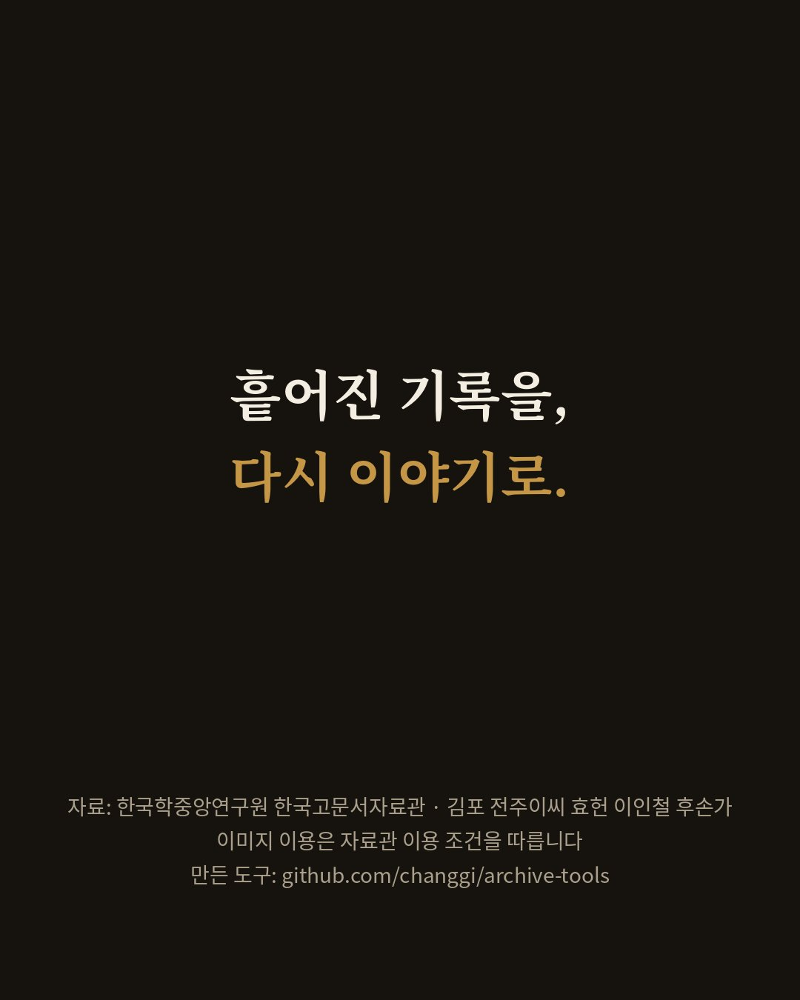

# EP.165 스물여덟에서 서른다섯까지 — 이순하가 과거의 계단을 오른 종이 네 장

김포 전주이씨 효헌 이인철 후손가 (문중) · 1884년 가을, 스물여덟 살 유학 이순하는 진사시 초시에서 '이소(二所) 일등 제일인'이 된다. 이듬해 봄 회시에서는 삼등으로 붙고, 흰 종이의 백패를 받는다. 그리고 6년 뒤 1891년, 붉은 종이의 문과 홍패. 답안지 두 장과 합격증 두 장이, 한 사람이 조선 마지막 무렵의 과거를 오른 계단을 그대로 남겼다

- 🌐 [전시 웹페이지](https://changgi.github.io/archive-tools/examples/hyoheon-gwageo/exhibit.html) (한자 위 한글 독음 · 원문 해석) · [수업 활동지](https://changgi.github.io/archive-tools/examples/hyoheon-gwageo/handout.html)
- 🎬 영상: [릴스 9:16](https://changgi.github.io/archive-tools-next/media/ep165-hyoheon-gwageo_reel.mp4) · [가로 16:9](https://changgi.github.io/archive-tools-next/media/ep165-hyoheon-gwageo_wide.mp4) · 홍보 글: [`promo.md`](promo.md)
- 카드뉴스: [`cards/`](cards/) · SNS 글: [`sns.txt`](sns.txt) · 판독·해석 표: [`selection.csv`](selection.csv)

<!-- DELIVERY -->
## 전달 에디팅 — 이 기록을 이렇게 전합니다

- **핵심 정서** — 뿌듯함
- **한 문장** — 과거 합격증만 보면 결과만 남지만, 답안지(시권)에는 날짜 · 시험장 · 시험관 · 문제 · 등수가 함께 적혀 있다 — 한 사람의 시험이 '과정'으로 보인다.
- **열기** — 초시 1등, 회시 3등, 그리고 6년 뒤의 붉은 종이 한 장.
- **펼치기** — 이순하 사마초시 시권 → 이순하 사마회시 시권 → 이순하 진사 백패 → 이순하 문과 홍패 (1884–1891년) — 1884 초시 시권(이소 일등 제일인) → 1885 회시 시권(삼등 입격) → 1885 진사 백패(흰 종이) → 1891 문과 홍패(붉은 종이)로, 시권 → 합격증, 흰 종이 → 붉은 종이의 순서로 놓았습니다.
- **절정** — "이소 일등 제일인(二所一等第一人)" — 화면·공간에서 이 한 줄만 크게, 소리를 줄여 집중
- **여운** — 1등으로 붙은 초시와 34등으로 받은 백패 사이, 그는 무엇을 더 준비했을까요? — 질문으로 끝내고 답은 보는 사람에게
- **감각과 물질** — 같은 '幼學李舜夏'와 사조 네 줄 — 그 옆의 날짜와 등수가 바뀌고, 마지막엔 종이 색이 바뀐다 · 시험장 책상과 답안지 체험 · 흰 종이 한 장에 조명 하나 · 붉은 종이를 실물 크기로 복제해 벽에 거는 연출
- **통로와 매개** — 온라인: 릴스(열기) → 카드뉴스(펼치기) → 전시 웹페이지(절정·원문) → 비하인드 카드(여운) / 오프라인: 원본 크기 복제·낭독·참여 벽 / 남기기: 활동지·질문 카드
- **여운 장치** — 내 '합격의 계단'을 연도와 함께 네 칸으로 적어 보기
- **전달 에디팅 전** — 4건의 문서를 1884–1891년 연대순으로 놓고 문서명 · 유형 · 해설을 붙인다 — 정확하지만, 지나가면 잊힌다.
- **전달 에디팅 후** — 핵심 정서는 「뿌듯함」. 「초시 1등, 회시 3등, 그리고 6년 뒤의 붉은 종이 한 장.」로 열고, 문서를 대비와 순서로 펼친 뒤, "이소 일등 제일인(二所一等第一人)"에서 멈춘다. 같은 '幼學李舜夏'와 사조 네 줄 — 그 옆의 날짜와 등수가 바뀌고, 마지막엔 종이 색이 바뀐다. 마지막엔 「내 '합격의 계단'을 연도와 함께 네 칸으로 적어 보기」로 보는 사람이 자기 이야기를 남기고 떠나게 한다.

전문: [`delivery.md`](delivery.md)
<!-- /DELIVERY -->

<!-- CURATOR -->
## 비하인드 — 큐레이터 노트

- **왜 이 문서들인가** — EP.121에서 이 집안의 대한제국 칙명(임명장)을 읽었습니다. 그 가운데 규장각 부제학이 된 이순하가 어떻게 관직에 들어섰는지를, 같은 집안의 답안지와 합격증으로 거슬러 올라가 보았습니다.
- **전하고 싶은 것** — 과거 합격증만 보면 결과만 남지만, 답안지(시권)에는 날짜 · 시험장 · 시험관 · 문제 · 등수가 함께 적혀 있다 — 한 사람의 시험이 '과정'으로 보인다.
- **이렇게 보이길 바랐다** — 1884 초시 시권(이소 일등 제일인) → 1885 회시 시권(삼등 입격) → 1885 진사 백패(흰 종이) → 1891 문과 홍패(붉은 종이)로, 시권 → 합격증, 흰 종이 → 붉은 종이의 순서로 놓았습니다.
- **이렇게 써 주세요** — 조선의 과거 제도(소과 초시 · 회시와 대과), 시권의 구성(피봉 · 시제 · 시험관 · 등수), 백패와 홍패의 차이, 19세기 말 과거의 모습 수업에 쓰세요.
- **만들며 있었던 일** — 시권은 매우 큰 두루마리라 앞머리(응시자 · 사조 · 날짜 · 시험관 · 문제 · 등수)만 옮겼고 답안 본문은 옮기지 않았습니다. 1885년 회시 시권의 등수는 '三等第四十人'으로 읽히나 백패에는 '第三十四人'으로 적혀 있어, 판독 또는 기재 차이로 보고 원문 확인이 필요하다고 적었습니다. 시권 위의 큰 붓글씨(채점 표시로 보임)는 판독하지 않았습니다.
- **남겨 둔 질문** — 1등으로 붙은 초시와 34등으로 받은 백패 사이, 그는 무엇을 더 준비했을까요?
- **제작 기록** — 문서 4건 · 1884–1891년 · 원본 사진 15면(문서 전체) · 원문 판독 4건 · 번역 4건 · 해제에 "확인 필요"를 단 문서 1건

전문: [`curator.md`](curator.md) · 비하인드 카드: [`behind/`](behind/) · 채널별 홍보안: [`channels.md`](channels.md)
<!-- /CURATOR -->

## 이야기 — 사료가 말하는 대로

초시 1등, 회시 3등, 그리고 6년 뒤의 붉은 종이 한 장.

> **1884 시권** — 1884년 가을, 스물여덟 살 이순하가 초시 시험장에 앉는다. 문제는 셋. 그중 하나는 '진사는 그대의 재주를 다 드러내기에 모자라다.' 답안지 머리에 적힌 결과. "이소 일등 제일인(二所一等第一人)." 두 시험장 가운데 한 곳의 1등이다.
> **1885 시권** — 반년 뒤 봄, 서울의 회시장. 같은 사조 네 줄, 나이만 하나 늘었다. 이번 결과는 이렇다. "감시 회시, 삼등으로 입격(監試會試 三等 … 入格)." 초시의 1등이 회시에서는 삼등이 되었다. 그래도 붙었다. 이제 그는 진사다.
> **1885 백패** — 한 달 뒤, 흰 종이 한 장이 온다. "유학 이순하를 진사 삼등 제삼십사인으로 입격시킨다(幼學李舜夏進士三等第三十四人入格者)." 답안지에 적힌 등수와 숫자가 조금 다르다. 하지만 이름 앞의 두 글자는 이제 '유학'이 아니라 '진사'가 된다.
> **1891 홍패** — 그리고 6년 뒤, 서른다섯. 이번에는 종이가 붉다. "진사 이순하를 문과 병과 제십육인으로 급제 출신시킨다(進士李舜夏文科丙科第十六人及第出身者)." 스물여덟의 초시 1등에서 서른다섯의 홍패까지. 네 장의 종이가 한 사람의 계단이 되었다.

| 표지 | 1번 카드 | 마무리 |
|---|---|---|
|  |  |  |

## 선별 문서 (4점)

| # | 연도 | 유형 | 문서명 | 원본 |
|---|---|---|---|---|
| 1 | 1884 | 시권 | 1884년 이순하(李舜夏) 사마초시(司馬初試) 시권(試券) | [원본 보기](https://archive.aks.ac.kr/viewer/viewer.do#imgnode.do?itemId=book&gubun=booktree&depth=6&upPath=01%5E0141%5EL014156%5EL014156F02%5EL014156F0204&dataId=G002%2BAKS%2BKSM-XD.1884.4157-20240822.F14101-01-W000145&itemType=) |
| 2 | 1885 | 시권 | 1885년 이순하(李舜夏) 사마회시(司馬會試) 시권(試券) | [원본 보기](https://archive.aks.ac.kr/viewer/viewer.do#imgnode.do?itemId=book&gubun=booktree&depth=6&upPath=01%5E0141%5EL014156%5EL014156F02%5EL014156F0204&dataId=G002%2BAKS%2BKSM-XD.1885.4157-20240822.F14101-01-W000146&itemType=) |
| 3 | 1885 | 백패 | 1885년 이순하(李舜夏) 진사 백패(進士白牌) | [원본 보기](https://archive.aks.ac.kr/viewer/viewer.do#imgnode.do?itemId=book&gubun=booktree&depth=6&upPath=01%5E0141%5EL014156%5EL014156F02%5EL014156F0201&dataId=G002%2BAKS%2BKSM-XA.1885.4157-20240822.F14101-01-W000002&itemType=) |
| 4 | 1891 | 홍패 | 1891년 이순하(李舜夏) 문과 홍패(文科紅牌) | [원본 보기](https://archive.aks.ac.kr/viewer/viewer.do#imgnode.do?itemId=book&gubun=booktree&depth=6&upPath=01%5E0141%5EL014156%5EL014156F02%5EL014156F0201&dataId=G002%2BAKS%2BKSM-XA.1891.4157-20240822.F14101-01-W000003&itemType=) |

## 원문 판독과 해석

### 1. 1884년 이순하(李舜夏) 사마초시(司馬初試) 시권(試券)

**원문 판독**

```
幼學李舜夏年二十八本全州居京
父折衝將軍行龍驤衛副護軍 寅晩
祖通政大夫敦寧府都正 容淵
曾祖學生 雲根
外祖宣畧將軍行龍驤衛副司果李勉會本廣州
甲申八月十九日 … 初場 二十日終場
一所試官 南廷哲 曺寅承 鄭憲時
二所試官 趙準永 權膺善 鄭光淵
二所一等第一人
賦 進士不足以盡子之才 魁 鄭國煥
疑 問十五志于學云云 魁 秦成濂
義 朞三百有六旬有六日 魁 朴經遠
(답안 본문 줄임)
```

**원문 해석** 유학 이순하, 스물여덟 살, 본관 전주, 서울 거주. 아버지 절충장군 행 용양위 부호군 인만, 할아버지 통정대부 돈녕부 도정 용연, 증조 학생 운근, 외조 선략장군 행 용양위 부사과 이면회(본관 광주). 갑신년(1884) 8월 19일 … 초장, 20일 종장. 일소 시험관 남정철 · 조인승 · 정헌시. 이소 시험관 조준영 · 권응선 · 정광연. 이소 일등 제일인. (문제) 부(賦): '진사는 그대의 재주를 다 드러내기에 모자라다' — 장원 정국환. 의(疑): '열다섯에 학문에 뜻을 두었다는 것을 묻는다' — 장원 진성렴. 의(義): '한 해는 삼백육십육 일' — 장원 박경원. (답안 본문 줄임)

**해제** 1884년(고종 21) 8월, 스물여덟 살 이순하(李舜夏)가 소과(생원 · 진사시) 초시에 낸 시권(試券, 답안지)입니다. 시권 머리에는 응시자의 이름 · 나이 · 본관 · 거주지와 사조(아버지 · 할아버지 · 증조 · 외조)를 적고, 이 장에는 시험 날짜, 일소 · 이소의 시험관 이름, 과목별 문제(賦 · 疑 · 義)와 각 과목 장원의 이름까지 덧붙여 적혀 있습니다. 가장 눈에 띄는 것은 '二所一等第一人', 곧 시험장을 둘로 나눈 가운데 이소에서 일등 첫째로 뽑혔다는 기록입니다. 답안 본문은 매우 길어 옮기지 않았습니다. 큰 붓으로 쓴 채점 표시로 보이는 글씨는 판독하지 않았습니다.

### 2. 1885년 이순하(李舜夏) 사마회시(司馬會試) 시권(試券)

**원문 판독**

```
幼學李舜夏年二十九本全州居京
父折衝將軍行龍驤衛副護軍 寅晩
祖通政大夫敦寧府都正 容淵
曾祖學生 雲根
外祖宣畧將軍行龍驤衛副司果李勉會本廣州
乙酉二月二十六日 監試會試 三等第四十人入格
二所 上試 閔種默 副 俞晩源 三 趙翼永 四 金鶴善 五 尹尙學
(붙인 쪽지) 進士試三等第四十人
(답안 본문 줄임)
```

**원문 해석** 유학 이순하, 스물아홉 살, 본관 전주, 서울 거주. (사조 같음.) 을유년(1885) 2월 26일 감시 회시, 삼등 제사십인으로 입격. 이소 시험관: 상시 민종묵, 부시 유만원, 삼시 조익영, 사시 김학선, 오시 윤상학. (붙인 쪽지) 진사시 삼등 제사십인. (답안 본문 줄임)

**해제** 이듬해 1885년(고종 22) 2월 26일, 소과 회시(복시)에 낸 시권입니다. 초시에 붙은 사람만 서울에서 치르는 회시에서 '삼등 … 입격'하여 진사가 되었습니다. 머리에 붙인 노란 쪽지에도 '進士試三等第…人'이라 적었습니다. 사조 네 줄은 지난해 시권과 똑같고, 나이만 스물여덟에서 스물아홉으로 바뀌었습니다. 이소의 시험관 다섯 사람(상시 · 부시 · 삼시 · 사시 · 오시)의 이름이 적혔습니다. 등수는 '第四十人'으로 읽히나 한 달 뒤 받은 백패에는 '第三十四人'으로 되어 있어, 판독 또는 기재의 차이로 보고 원문 확인이 필요합니다. 큰 붓글씨는 판독하지 않았습니다.

### 3. 1885년 이순하(李舜夏) 진사 백패(進士白牌)

**원문 판독**

```
敎旨
幼學李舜夏進士三等
第三十四人入格者
光緖十一年三月 日
```

**원문 해석** 교지. 유학 이순하를 진사 삼등 제삼십사인으로 입격시킨다. 광서 11년(1885) 3월 일.

**해제** 1885년 3월, 회시에 입격한 이순하에게 내린 진사 백패(白牌)입니다. 소과(생원 · 진사) 합격증은 흰 종이에 써서 백패라 부릅니다. '幼學李舜夏 進士三等第三十四人入格者'로, 시권의 '第四十人'(판독)과 등수가 다르게 적혔습니다. 큰 종이에 큼직한 해서로 쓰고 연호 위에 어보를 찍는 형식입니다. 백패를 받으면 '유학'에서 '진사'가 되어 성균관에 들어가거나 대과(문과)에 응시할 자격을 얻습니다.

### 4. 1891년 이순하(李舜夏) 문과 홍패(文科紅牌)

**원문 판독**

```
敎旨
進士李舜夏文科丙科
第十六人及第出身者
光緖十七年七月 日
```

**원문 해석** 교지. 진사 이순하를 문과 병과 제십육인으로 급제 출신시킨다. 광서 17년(1891) 7월 일.

**해제** 6년 뒤 1891년(고종 28) 7월, 서른다섯 살 이순하가 문과(대과)에 병과 제16인으로 급제하여 받은 홍패(紅牌)입니다. 대과 합격증은 붉은 종이에 써서 홍패라 부르며, '進士李舜夏'로 시작해 이제 '진사'가 그의 직함이 되었음을 보여 줍니다. 이 급제로 관직에 나아간 이순하는 대한제국기에 규장각 부제학 등을 지냈습니다(EP.121). 같은 집안에는 1891년 문과 시권 두 장도 함께 남아 있습니다.

판독·해석·이야기는 이미지에 근거한 초안이며(검토 전 "초안" 표시), 정확한 판독은 원문 확인이 필요합니다. □는 읽지 못한 글자, (?)는 불확실한 글자입니다.
이미지: 한국학중앙연구원 한국고문서자료관 소장·제공. "원본" 링크를 누르면 자료관 뷰어에서 그 문서가 열립니다. 재사용은 자료관에 문의하세요(소장처 동의 필요).
