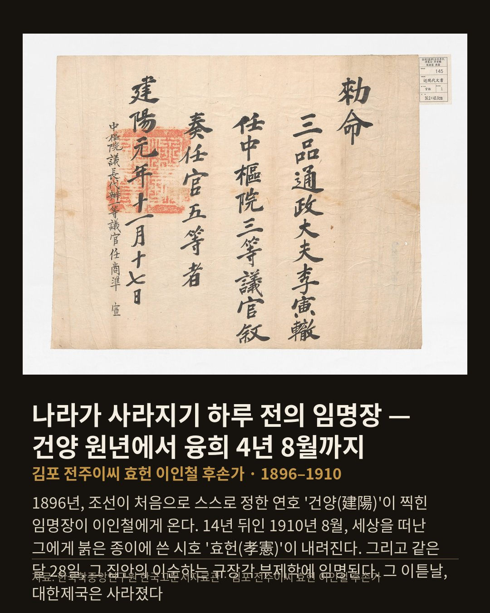
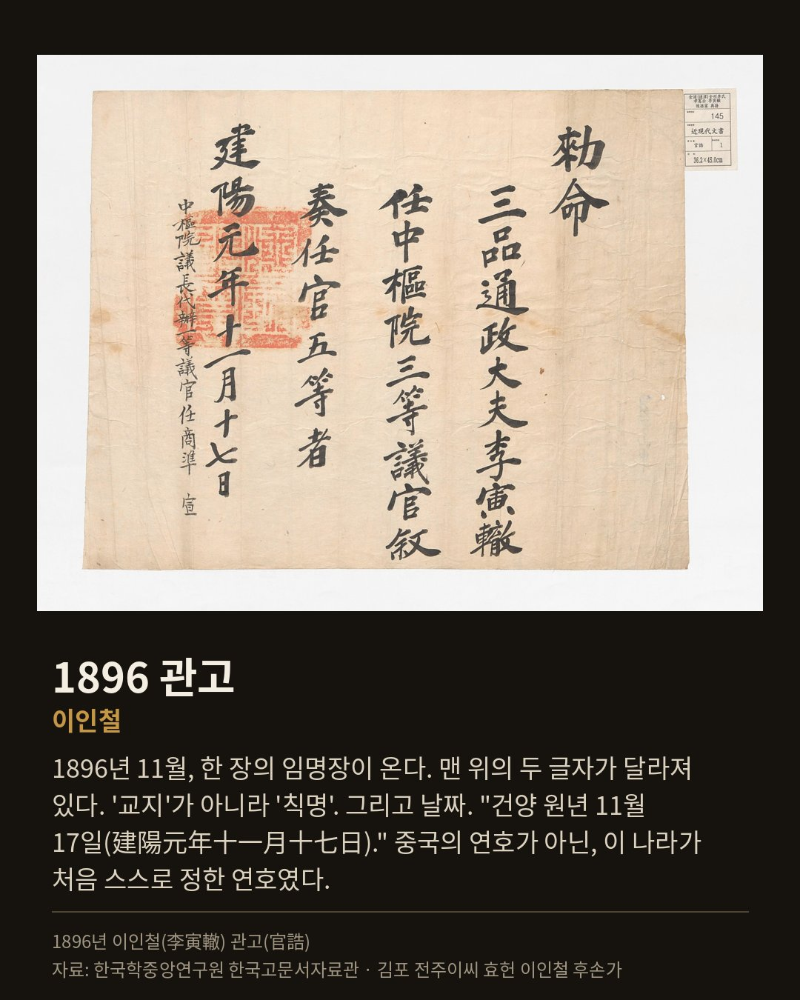
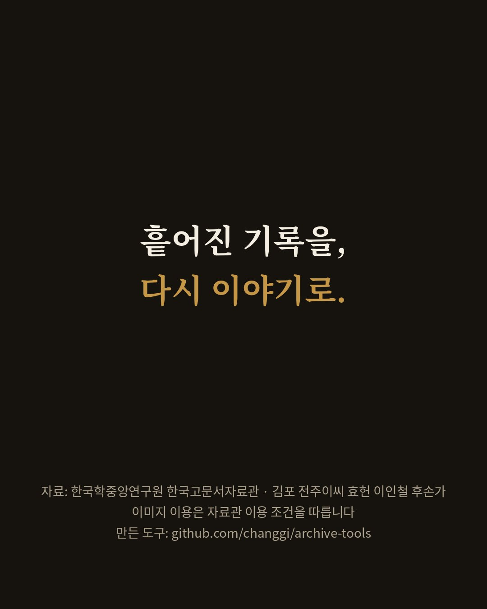

# EP.121 나라가 사라지기 하루 전의 임명장 — 건양 원년에서 융희 4년 8월까지

김포 전주이씨 효헌 이인철 후손가 (문중) · 1896년, 조선이 처음으로 스스로 정한 연호 '건양(建陽)'이 찍힌 임명장이 이인철에게 온다. 14년 뒤인 1910년 8월, 세상을 떠난 그에게 붉은 종이에 쓴 시호 '효헌(孝憲)'이 내려진다. 그리고 같은 달 28일, 그 집안의 이순하는 규장각 부제학에 임명된다. 그 이튿날, 대한제국은 사라졌다

- 🌐 [전시 웹페이지](https://changgi.github.io/archive-tools/examples/hyoheon/exhibit.html) (한자 위 한글 독음 · 원문 해석) · [수업 활동지](https://changgi.github.io/archive-tools/examples/hyoheon/handout.html)
- 🎬 영상: [릴스 9:16](https://changgi.github.io/archive-tools/examples/media/ep121-hyoheon_reel.mp4) · [가로 16:9](https://changgi.github.io/archive-tools/examples/media/ep121-hyoheon_wide.mp4) · 홍보 글: [`promo.md`](promo.md)
- 카드뉴스: [`cards/`](cards/) · SNS 글: [`sns.txt`](sns.txt) · 판독·해석 표: [`selection.csv`](selection.csv)

<!-- DELIVERY -->
## 전달 에디팅 — 이 기록을 이렇게 전합니다

- **핵심 정서** — 먹먹함
- **한 문장** — 문서는 시대의 끝을 모른 채 만들어진다 — 건양 원년의 새 연호에서 융희 4년 8월의 마지막 임명까지.
- **열기** — 이 임명장을 받은 다음 날, 나라가 사라졌습니다.
- **펼치기** — 이인철 관고 → 이인철 시호 관고 → 이순하 관고 (1896–1910년) — 1896년 건양 원년 칙명(새 연호의 시작) → 1910년 8월 시호 관고(붉은 종이의 마지막 이름) → 8월 28일 규장각 부제학 임명(하루 전) 순으로, 대한제국 14년을 세 장으로 지나가게 구성했습니다.
- **절정** — "융희 4년 8월 28일(隆熙四年八月二十八日)" — 화면·공간에서 이 한 줄만 크게, 소리를 줄여 집중
- **여운** — 8월 29일 아침, 이순하는 그 임명장을 어떻게 바라보았을까요? — 질문으로 끝내고 답은 보는 사람에게
- **감각과 물질** — '교지'에서 '칙명'으로 바뀐 첫 글자, 붉은 시호 관고, 궁내부의 큰 인장 · 어보·관인 탁본 스탬프를 찍어 보는 체험
- **통로와 매개** — 온라인: 릴스(열기) → 카드뉴스(펼치기) → 전시 웹페이지(절정·원문) → 비하인드 카드(여운) / 오프라인: 원본 크기 복제·낭독·참여 벽 / 남기기: 활동지·질문 카드
- **여운 장치** — 어떤 날의 '마지막'을 기억하는 물건을 떠올리기
- **전달 에디팅 전** — 3건의 문서를 1896–1910년 연대순으로 놓고 문서명 · 유형 · 해설을 붙인다 — 정확하지만, 지나가면 잊힌다.
- **전달 에디팅 후** — 핵심 정서는 「먹먹함」. 「이 임명장을 받은 다음 날, 나라가 사라졌습니다.」로 열고, 문서를 대비와 순서로 펼친 뒤, "융희 4년 8월 28일(隆熙四年八月二十八日)"에서 멈춘다. '교지'에서 '칙명'으로 바뀐 첫 글자, 붉은 시호 관고, 궁내부의 큰 인장. 마지막엔 「어떤 날의 '마지막'을 기억하는 물건을 떠올리기」로 보는 사람이 자기 이야기를 남기고 떠나게 한다.

전문: [`delivery.md`](delivery.md)
<!-- /DELIVERY -->

<!-- CURATOR -->
## 비하인드 — 큐레이터 노트

- **왜 이 문서들인가** — 관고 수십 장의 날짜를 훑다가 '융희 4년 8월 28일'에서 멈췄습니다. 병합 조약이 공포되기 바로 전날이었습니다.
- **전하고 싶은 것** — 문서는 시대의 끝을 모른 채 만들어진다 — 건양 원년의 새 연호에서 융희 4년 8월의 마지막 임명까지.
- **이렇게 보이길 바랐다** — 1896년 건양 원년 칙명(새 연호의 시작) → 1910년 8월 시호 관고(붉은 종이의 마지막 이름) → 8월 28일 규장각 부제학 임명(하루 전) 순으로, 대한제국 14년을 세 장으로 지나가게 구성했습니다.
- **이렇게 써 주세요** — 갑오개혁 이후의 관제와 문서 형식 변화(교지→칙명), 대한제국의 연호(건양 · 광무 · 융희), 경술국치에 쓰세요.
- **만들며 있었던 일** — 세 장 모두 정서라 판독이 확실한 편입니다. 이인철과 이순하의 관계, 이순하가 실제로 부임했는지는 확인하지 않았습니다. 시호 관고는 날짜(일)가 비어 있습니다.
- **남겨 둔 질문** — 8월 29일 아침, 이순하는 그 임명장을 어떻게 바라보았을까요?
- **제작 기록** — 문서 3건 · 1896–1910년 · 원본 사진 4면(문서 전체) · 원문 판독 3건 · 번역 3건 · 해제에 "확인 필요"를 단 문서 1건

전문: [`curator.md`](curator.md) · 비하인드 카드: [`behind/`](behind/) · 채널별 홍보안: [`channels.md`](channels.md)
<!-- /CURATOR -->

## 이야기 — 사료가 말하는 대로

이 임명장을 받은 다음 날, 나라가 사라졌습니다.

> **1896 관고** — 1896년 11월, 한 장의 임명장이 온다. 맨 위의 두 글자가 달라져 있다. '교지'가 아니라 '칙명'. 그리고 날짜. "건양 원년 11월 17일(建陽元年十一月十七日)." 중국의 연호가 아닌, 이 나라가 처음 스스로 정한 연호였다.
> **1910 관고** — 14년 뒤, 그는 세상을 떠났다. 1910년 8월, 붉은 종이에 그의 이름이 다시 적힌다. "자애롭고 어버이를 사랑함을 효라 하고, 행실이 착해 기록할 만함을 헌이라 한다(慈惠愛親曰孝 行善可紀曰憲)." 효헌. 대한제국이 그에게 준 마지막 이름이었다.
> **1910 관고** — 같은 달, 같은 집안에 또 한 장이 온다. "이순하를 규장각 부제학에 임명한다(任奎章閣副提學)." 날짜를 본다. "융희 4년 8월 28일(隆熙四年八月二十八日)." 이튿날, 병합 조약이 공포되었다. 대한제국이 마지막으로 내린 임명장 가운데 하나였을 것이다.

| 표지 | 1번 카드 | 마무리 |
|---|---|---|
|  |  |  |

## 선별 문서 (3점)

| # | 연도 | 유형 | 문서명 | 원본 |
|---|---|---|---|---|
| 1 | 1896 | 관고 | 1896년 이인철(李寅轍) 관고(官誥) | [원본 보기](https://archive.aks.ac.kr/viewer/viewer.do#imgnode.do?itemId=book&gubun=booktree&depth=6&upPath=01%5E0141%5EL014156%5EL014156F02%5EL014156F0201&dataId=G002%2BAKS%2BKSM-XA.1896.4157-20240822.F14101-01-W000114&itemType=) |
| 2 | 1910 | 관고 | 1910년 이인철(李寅轍) 시호 관고(諡號官誥) | [원본 보기](https://archive.aks.ac.kr/viewer/viewer.do#imgnode.do?itemId=book&gubun=booktree&depth=6&upPath=01%5E0141%5EL014156%5EL014156F02%5EL014156F0201&dataId=G002%2BAKS%2BKSM-XA.1909.4157-20240822.F14101-01-W000136&itemType=) |
| 3 | 1910 | 관고 | 1910년 이순하(李舜夏) 관고(官誥) | [원본 보기](https://archive.aks.ac.kr/viewer/viewer.do#imgnode.do?itemId=book&gubun=booktree&depth=6&upPath=01%5E0141%5EL014156%5EL014156F02%5EL014156F0201&dataId=G002%2BAKS%2BKSM-XA.1909.4157-20240822.F14101-01-W000132&itemType=) |

## 원문 판독과 해석

### 1. 1896년 이인철(李寅轍) 관고(官誥)

**원문 판독**

```
勅命
三品通政大夫李寅轍
任中樞院三等議官敍
奏任官五等者
建陽元年十一月十七日
中樞院議長代辦一等議官任商準 宣
```

**원문 해석** 칙명. 3품 통정대부 이인철을 중추원 3등 의관에 임명하고 주임관 5등에 서임한다. 건양 원년(1896) 11월 17일. 중추원 의장 대판 1등 의관 임상준이 선포함.

**해제** 1896년(고종 33) 이인철(李寅轍)을 중추원(中樞院) 3등 의관에 임명한 관고(官誥, 임명장)입니다. 갑오개혁 이후 관제가 바뀌면서 임명장의 형식도 '교지(敎旨)'에서 '칙명(勅命)'으로, 품계 체계도 칙임관 · 주임관 · 판임관으로 달라졌습니다. 날짜의 '건양(建陽)'은 1896년부터 쓰기 시작한 조선의 첫 독자 연호입니다. 왼쪽 작은 글씨는 중추원 의장을 대신해 1등 의관 임상준(任商準)이 이 칙명을 전한다는 뜻입니다.

### 2. 1910년 이인철(李寅轍) 시호 관고(諡號官誥)

**원문 판독**

```
勅命
資憲大夫宮內府特進
官李寅轍贈諡孝憲公
者
慈惠愛親曰孝
行善可紀曰憲
隆熙四年八月 日
贈諡事奉
勅
```

**원문 해석** 칙명. 자헌대부 궁내부 특진관 이인철에게 시호 효헌공(孝憲公)을 내린다. 자애롭고 은혜로우며 어버이를 사랑함을 효(孝)라 하고, 행실이 착해 기록할 만함을 헌(憲)이라 한다. 융희 4년(1910) 8월 일. 시호를 내리는 일로 칙명을 받듦.

**해제** 1910년(융희 4) 8월, 세상을 떠난 이인철에게 '효헌(孝憲)'이라는 시호를 내린 시호 관고입니다. 붉게 물들인 종이에 썼으며, 시호의 두 글자가 어떤 뜻인지(시법)를 함께 적었습니다. 이 후손가의 이름 '효헌'이 이 시호에서 왔습니다. 융희(隆熙)는 순종의 연호로, 융희 4년은 대한제국의 마지막 해입니다. 같은 달 같은 집안에 이순하의 관고가 전합니다.

### 3. 1910년 이순하(李舜夏) 관고(官誥)

**원문 판독**

```
從二品嘉善大夫李舜夏
任奎章閣副提學敍勅任官三等
隆熙四年八月二十八日
大勳宮內府大臣閔丙奭 奉
```

**원문 해석** 종2품 가선대부 이순하를 규장각 부제학에 임명하고 칙임관 3등에 서임한다. 융희 4년(1910) 8월 28일. 대훈 궁내부대신 민병석이 받듦.

**해제** 1910년 8월 28일 이순하(李舜夏)를 규장각 부제학(副提學)에 임명한 관고입니다. 궁내부대신 민병석(閔丙奭)이 받들어 전했으며, 가운데에 궁내부의 큰 인장이 찍혀 있습니다. 이 날짜는 한일 병합 조약이 공포되어 대한제국이 국권을 잃은 8월 29일의 바로 전날입니다. 이순하는 1884년 사마초시부터 1891년 문과까지의 시권이 같은 집안에 전하는 인물로, 이인철과의 가계상 관계는 이번에 확인하지 않았습니다.

판독·해석·이야기는 이미지에 근거한 초안이며(검토 전 "초안" 표시), 정확한 판독은 원문 확인이 필요합니다. □는 읽지 못한 글자, (?)는 불확실한 글자입니다.
이미지: 한국학중앙연구원 한국고문서자료관 소장·제공. "원본" 링크를 누르면 자료관 뷰어에서 그 문서가 열립니다. 재사용은 자료관에 문의하세요(소장처 동의 필요).
