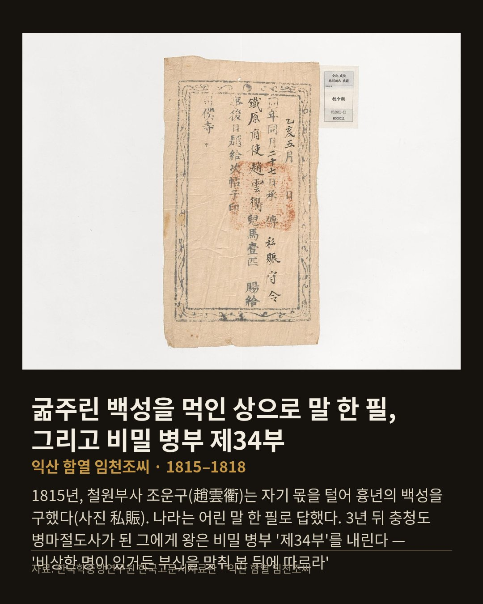
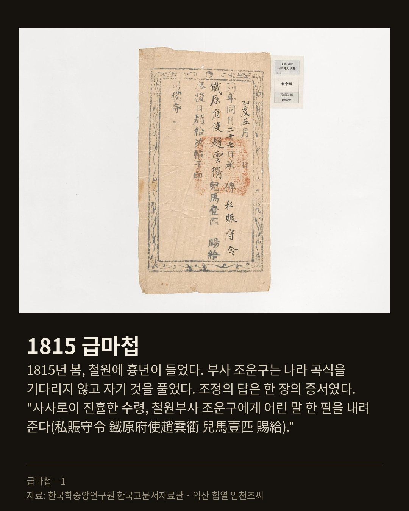
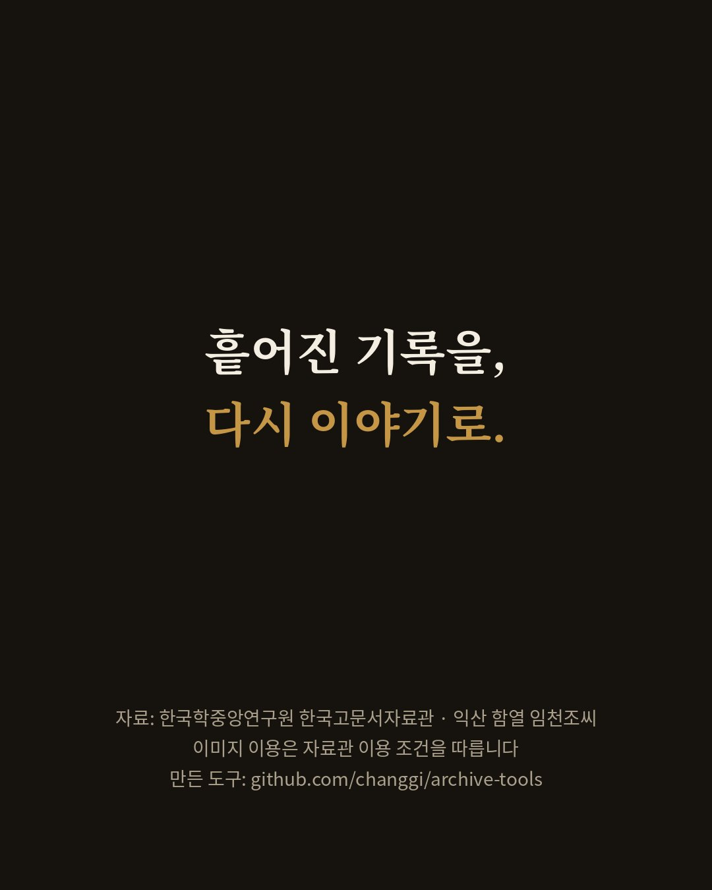

# EP.80 굶주린 백성을 먹인 상으로 말 한 필, 그리고 비밀 병부 제34부

익산 함열 임천조씨 (문중) · 1815년, 철원부사 조운구(趙雲衢)는 자기 몫을 털어 흉년의 백성을 구했다(사진 私賑). 나라는 어린 말 한 필로 답했다. 3년 뒤 충청도 병마절도사가 된 그에게 왕은 비밀 병부 '제34부'를 내린다 — '비상한 명이 있거든 부신을 맞춰 본 뒤에 따르라'

- 🌐 [전시 웹페이지](https://changgi.github.io/archive-tools/examples/imcheon-jo/exhibit.html) (한자 위 한글 독음 · 원문 해석) · [수업 활동지](https://changgi.github.io/archive-tools/examples/imcheon-jo/handout.html)
- 🎬 영상: [릴스 9:16](https://changgi.github.io/archive-tools-next/media/ep80-imcheon-jo_reel.mp4) · [가로 16:9](https://changgi.github.io/archive-tools-next/media/ep80-imcheon-jo_wide.mp4) · 홍보 글: [`promo.md`](promo.md)
- 카드뉴스: [`cards/`](cards/) · SNS 글: [`sns.txt`](sns.txt) · 판독·해석 표: [`selection.csv`](selection.csv)


<!-- DELIVERY -->
## 전달 에디팅 — 이 기록을 이렇게 전합니다

- **핵심 정서** — 신뢰
- **한 문장** — 흉년에 곳간을 연 사람에게, 나라는 가장 은밀한 열쇠를 맡겼다는 것.
- **열기** — 굶주린 백성을 먹인 상은, 말 한 필이었습니다.
- **펼치기** — 급마첩－1 → 유서－1 (1815–1818년) — 작은 상(말 한 필)에서 큰 신뢰(밀부)로 이야기가 커지게 두 문서를 배치했습니다.
- **절정** — "만약 비상한 명령이 있거든, 부신을 맞추어 의심이 없게 된 뒤에 명을 따르라(如有非常之命 合符無疑 然後當就命)" — 화면·공간에서 이 한 줄만 크게, 소리를 줄여 집중
- **여운** — 오늘의 '사진(私賑)'은 어떤 모습일까요? — 질문으로 끝내고 답은 보는 사람에게
- **감각과 물질** — 반쪽 병부 퍼즐 — 다른 관람객과 맞추기 · 책장을 넘기는 소리, 확대 열람대 · 역마 방울·말발굽 소리와 함께 펼치는 두루마리
- **통로와 매개** — 온라인: 릴스(열기) → 카드뉴스(펼치기) → 전시 웹페이지(절정·원문) → 비하인드 카드(여운) / 오프라인: 원본 크기 복제·낭독·참여 벽 / 남기기: 활동지·질문 카드
- **여운 장치** — "내가 맡은 열쇠"
- **전달 에디팅 전** — 2건의 문서를 1815–1818년 연대순으로 놓고 문서명 · 유형 · 해설을 붙인다 — 정확하지만, 지나가면 잊힌다.
- **전달 에디팅 후** — 핵심 정서는 「신뢰」. 「굶주린 백성을 먹인 상은, 말 한 필이었습니다.」로 열고, 문서를 대비와 순서로 펼친 뒤, "만약 비상한 명령이 있거든, 부신을 맞추어 의심이 없게 된 뒤에 명을 따르라(如有非常之命 合符無疑 然後當就命)"에서 멈춘다. 반쪽 병부 퍼즐 — 다른 관람객과 맞추기. 마지막엔 「"내가 맡은 열쇠"」로 보는 사람이 자기 이야기를 남기고 떠나게 한다.

전문: [`delivery.md`](delivery.md)
<!-- /DELIVERY -->

<!-- CURATOR -->
## 비하인드 — 큐레이터 노트

- **왜 이 문서들인가** — 사재로 백성을 구휼한 수령에게 말 한 필을 내린 급마첩과, 3년 뒤 비밀 병부 '제34부'를 내린 유서가 이어져 있었습니다.
- **전하고 싶은 것** — 흉년에 곳간을 연 사람에게, 나라는 가장 은밀한 열쇠를 맡겼다는 것.
- **이렇게 보이길 바랐다** — 작은 상(말 한 필)에서 큰 신뢰(밀부)로 이야기가 커지게 두 문서를 배치했습니다.
- **이렇게 써 주세요** — 구휼 제도, 병부(밀부) 제도, 공직 윤리를 다루는 수업에 쓰세요.
- **만들며 있었던 일** — 을해년을 1815년으로 본 것은 유서 연대와 맞춘 추정입니다. 이름 끝 글자는 초서가 겹쳐 확인이 필요합니다.
- **남겨 둔 질문** — 오늘의 '사진(私賑)'은 어떤 모습일까요?
- **제작 기록** — 문서 2건 · 1815–1818년 · 원본 사진 6면(문서 전체) · 원문 판독 2건 · 번역 2건 · 해제에 "확인 필요"를 단 문서 2건

전문: [`curator.md`](curator.md)
<!-- /CURATOR -->

## 이야기 — 사료가 말하는 대로

굶주린 백성을 먹인 상은, 말 한 필이었습니다.

> **1815 급마첩** — 1815년 봄, 철원에 흉년이 들었다. 부사 조운구는 나라 곡식을 기다리지 않고 자기 것을 풀었다. 조정의 답은 한 장의 증서였다. "사사로이 진휼한 수령, 철원부사 조운구에게 어린 말 한 필을 내려 준다(私賑守令 鐵原府使趙雲衢 兒馬壹匹 賜給)."
> **1818 유서** — 세 해 뒤, 그는 충청도의 군대를 맡는다. 왕은 반으로 쪼갠 병부와 함께 글을 보냈다. "만약 비상한 명령이 있거든, 부신을 맞추어 의심이 없게 된 뒤에 명을 따르라(如有非常之命 合符無疑 然後當就命)." 굶주린 백성 앞에서 곳간을 연 사람에게, 왕은 가장 은밀한 열쇠를 맡겼다.

| 표지 | 1번 카드 | 마무리 |
|---|---|---|
|  |  |  |

## 선별 문서 (2점)

| # | 연도 | 유형 | 문서명 | 원본 |
|---|---|---|---|---|
| 1 | 1815 | 급마첩 | 급마첩－1 | [원본 보기](https://archive.aks.ac.kr/viewer/viewer.do#imgnode.do?itemId=book&gubun=booktree&depth=6&upPath=01%5E0147%5EL014735%5EL014735F02%5EL014735F0203&dataId=G002%2BAKS%2BKSM-XC.1815.4514-20231031.F16601-01-W000011&itemType=) |
| 2 | 1818 | 유서 | 유서－1 | [원본 보기](https://archive.aks.ac.kr/viewer/viewer.do#imgnode.do?itemId=book&gubun=booktree&depth=6&upPath=01%5E0147%5EL014735%5EL014735F02%5EL014735F0201&dataId=G002%2BAKS%2BKSM-XA.1818.4514-20231031.F16601-01-W000009&itemType=) |

## 원문 판독과 해석

### 1. 급마첩－1

**원문 판독**

```
(테두리 인쇄 서식)
乙亥五月　日
同年同月二十七日承
傳 私賑守令
鐵原府使趙雲衢 兒馬壹匹 賜給
事 後日題給次 帖子 印
司僕寺 [수결]
(사복시 인 1과)
```

**원문 해석** 을해년(1815) 5월 일. 같은 해 같은 달 27일 왕의 전교를 받들어, 사사로이 진휼한 수령 철원부사 조운구에게 아마(어린 말) 한 필을 내려 준다. 뒷날 지급하기 위한 첩자(帖子). [관인] 사복시.

**해제** 궁중의 말과 수레를 관장한 사복시(司僕寺)가 발급한 급마첩(給馬帖)입니다. '사진(私賑)'은 수령이 나라 곡식이 아닌 자기 재물이나 따로 마련한 곡식으로 굶주린 백성을 구휼하는 것으로, 조정은 이를 포상했습니다. 철원부사 조운구에게 상으로 어린 말(兒馬) 한 필을 내리되, 실제 말은 뒷날 이 첩을 제시하면 지급하는 방식이었습니다. 을해년은 같은 인물의 1818년 유서와 맞추어 1815년(순조 15)으로 보았습니다. 이름 '衢' 자는 초서 획이 겹쳐 확인이 필요합니다.

### 2. 유서－1

**원문 판독**

```
諭折衝將軍守公淸道
兵馬節度使趙雲衢
卿受委一方 體任非輕
凡發兵應機 安民制敵
一應常事 自有舊章
慮或有予與卿獨斷
處置事 非密符莫可
施爲 且意外奸謀 不可
不預防 如有非常之命
合符無疑 然後當就
命 故賜押第三十四符
卿其受之 故諭
嘉慶二十三年四月十六日
(유서지보 3과)
```

**원문 해석** 절충장군 수 공청도(충청도) 병마절도사 조운구에게 내리는 유서. 경은 한 지방을 맡았으니 직임이 가볍지 않다. 무릇 군사를 일으켜 기회에 응하고, 백성을 편안히 하고 적을 제압하는 모든 일상적인 일에는 원래 정해진 규정이 있다. 다만 혹 나와 경만이 단독으로 처리해야 할 일이 있을까 염려되는데, 그것은 밀부가 아니면 시행할 수 없다. 또 뜻밖의 간사한 꾀를 미리 막지 않을 수 없으니, 만약 비상한 명령이 있거든 부신(符信)을 맞추어 의심이 없게 된 뒤에 명을 따르라. 그러므로 압(押) 제34부를 내리니 경은 받으라. 그러므로 이르노라. 가경 23년(1818) 4월 16일.

**해제** 왕이 지방 군사 지휘관에게 밀부(密符)를 내리며 함께 보내는 유서(諭書)입니다. 밀부는 둘로 쪼갠 병부로, 한쪽은 왕이, 한쪽은 지휘관이 가졌다가 비상시 왕명을 전하는 사람이 가져온 반쪽과 맞추어 진위를 확인했습니다. '공청도(公淸道)'는 충청도의 다른 이름으로, 공주와 청주에서 따온 것입니다. 3년 전 사진으로 상을 받은 철원부사가 충청도의 군사 최고 지휘관이 된 것입니다. 유서의 문장은 정형화된 서식이어서 판독이 비교적 확실합니다.

판독·해석·이야기는 이미지에 근거한 초안이며(검토 전 "초안" 표시), 정확한 판독은 원문 확인이 필요합니다. □는 읽지 못한 글자, (?)는 불확실한 글자입니다.
이미지: 한국학중앙연구원 한국고문서자료관 소장·제공. "원본" 링크를 누르면 자료관 뷰어에서 그 문서가 열립니다. 재사용은 자료관에 문의하세요(소장처 동의 필요).
