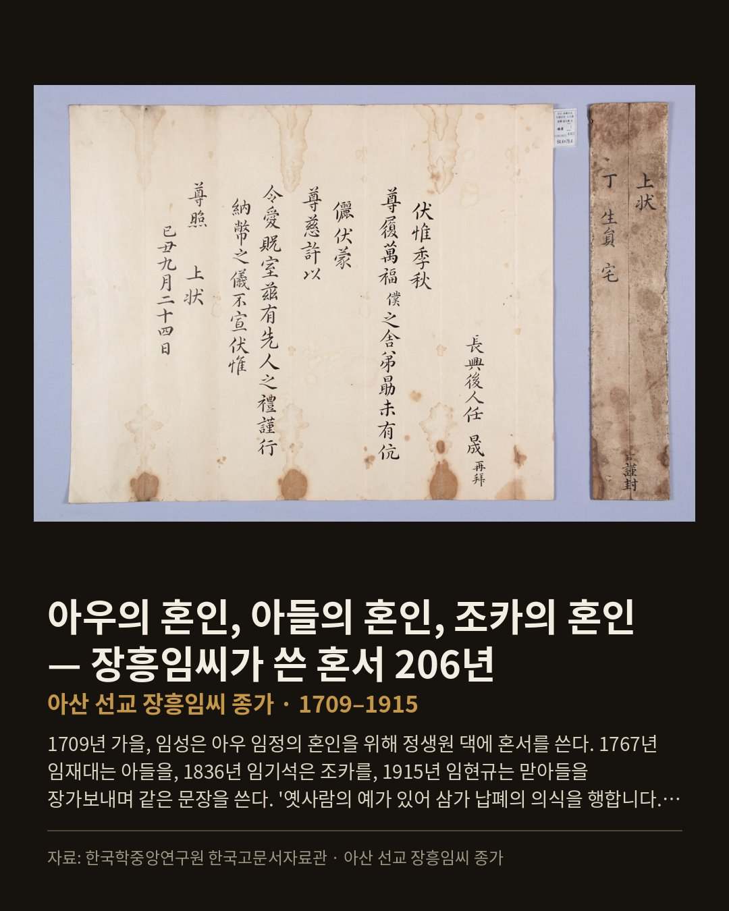
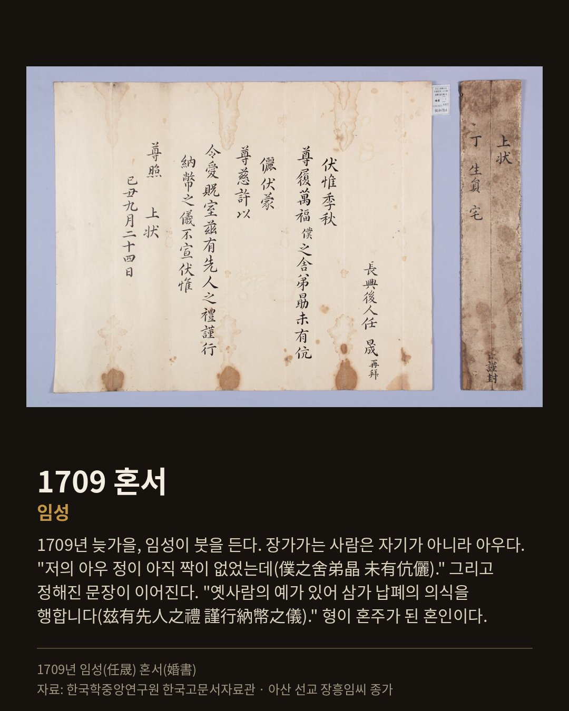
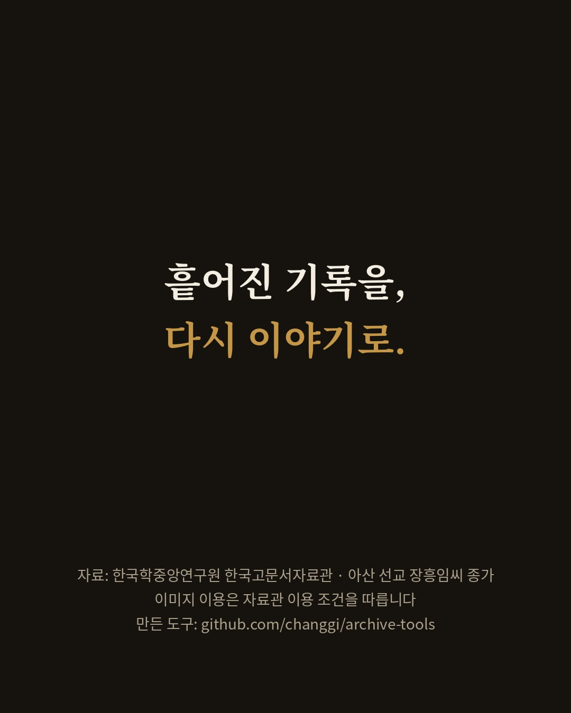

# EP.171 아우의 혼인, 아들의 혼인, 조카의 혼인 — 장흥임씨가 쓴 혼서 206년

아산 선교 장흥임씨 종가 (문중) · 1709년 가을, 임성은 아우 임정의 혼인을 위해 정생원 댁에 혼서를 쓴다. 1767년 임재대는 아들을, 1836년 임기석은 조카를, 1915년 임현규는 맏아들을 장가보내며 같은 문장을 쓴다. '옛사람의 예가 있어 삼가 납폐의 의식을 행합니다.' 붓을 든 사람이 형이었다가, 아버지였다가, 큰아버지였다. 그리고 편지를 받아야 할 신부 집이 아니라 보낸 신랑 집에, 이 종이들이 남아 있다

- 🌐 [전시 웹페이지](https://changgi.github.io/archive-tools/examples/jangheung-im-honseo/exhibit.html) (한자 위 한글 독음 · 원문 해석) · [수업 활동지](https://changgi.github.io/archive-tools/examples/jangheung-im-honseo/handout.html)
- 🎬 영상: [릴스 9:16](https://changgi.github.io/archive-tools-next/media/ep171-jangheung-im-honseo_reel.mp4) · [가로 16:9](https://changgi.github.io/archive-tools-next/media/ep171-jangheung-im-honseo_wide.mp4) · 홍보 글: [`promo.md`](promo.md)
- 카드뉴스: [`cards/`](cards/) · SNS 글: [`sns.txt`](sns.txt) · 판독·해석 표: [`selection.csv`](selection.csv)

<!-- DELIVERY -->
## 전달 에디팅 — 이 기록을 이렇게 전합니다

- **핵심 정서** — 다정함
- **한 문장** — 혼서의 문장은 200년 동안 거의 바뀌지 않았지만, 보내는 사람 칸은 바뀌었다 — 형(아우의 혼인), 아버지(아들의 혼인), 큰아버지(조카의 혼인). 혼주는 그 집안에서 혼인을 책임지는 어른이었다.
- **열기** — 206년 동안 같은 문장 — 바뀐 건 붓을 든 사람이었습니다.
- **펼치기** — 임성 혼서 → 임재대 혼서 → 임기석 혼서 → 임현규 혼서 (1709–1915년) — 1709 임성(아우 정의 혼인) → 1767 임재대(아들 서의 혼인) → 1836 임기석(조카 호덕의 혼인, 상대는 '종손 따님') → 1915 임현규(맏아들 종하의 혼인)로, 혼주와 신랑의 관계가 달라지는 순서로 놓았습니다.
- **절정** — "옛사람의 예가 있어 삼가 납폐의 의식을 행합니다(玆有先人之禮 謹行納幣之儀)" — 화면·공간에서 이 한 줄만 크게, 소리를 줄여 집중
- **여운** — 형이, 아버지가, 큰아버지가 같은 문장을 썼을 때, 각자 마음에 담긴 것은 달랐을까요? — 질문으로 끝내고 답은 보는 사람에게
- **감각과 물질** — 네 통의 오른쪽 첫 줄 — 長興後人 · 冠山後人 · 長興後人 · 長興后人, 그리고 다른 이름
- **통로와 매개** — 온라인: 릴스(열기) → 카드뉴스(펼치기) → 전시 웹페이지(절정·원문) → 비하인드 카드(여운) / 오프라인: 원본 크기 복제·낭독·참여 벽 / 남기기: 활동지·질문 카드
- **여운 장치** — 우리 집안 결혼식 청첩장의 '혼주' 이름 거슬러 적어 보기
- **전달 에디팅 전** — 4건의 문서를 1709–1915년 연대순으로 놓고 문서명 · 유형 · 해설을 붙인다 — 정확하지만, 지나가면 잊힌다.
- **전달 에디팅 후** — 핵심 정서는 「다정함」. 「206년 동안 같은 문장 — 바뀐 건 붓을 든 사람이었습니다.」로 열고, 문서를 대비와 순서로 펼친 뒤, "옛사람의 예가 있어 삼가 납폐의 의식을 행합니다(玆有先人之禮 謹行納幣之儀)"에서 멈춘다. 네 통의 오른쪽 첫 줄 — 長興後人 · 冠山後人 · 長興後人 · 長興后人, 그리고 다른 이름. 마지막엔 「우리 집안 결혼식 청첩장의 '혼주' 이름 거슬러 적어 보기」로 보는 사람이 자기 이야기를 남기고 떠나게 한다.

전문: [`delivery.md`](delivery.md)
<!-- /DELIVERY -->

<!-- CURATOR -->
## 비하인드 — 큐레이터 노트

- **왜 이 문서들인가** — EP.141에서 제주 강씨 집안의 혼서 136년을 읽었습니다. 아산 장흥임씨 종가에는 1709년부터 1915년까지 혼서가 남아 있어, 이번에는 '누가 혼주가 되어 붓을 들었는가'에 눈을 두었습니다.
- **전하고 싶은 것** — 혼서의 문장은 200년 동안 거의 바뀌지 않았지만, 보내는 사람 칸은 바뀌었다 — 형(아우의 혼인), 아버지(아들의 혼인), 큰아버지(조카의 혼인). 혼주는 그 집안에서 혼인을 책임지는 어른이었다.
- **이렇게 보이길 바랐다** — 1709 임성(아우 정의 혼인) → 1767 임재대(아들 서의 혼인) → 1836 임기석(조카 호덕의 혼인, 상대는 '종손 따님') → 1915 임현규(맏아들 종하의 혼인)로, 혼주와 신랑의 관계가 달라지는 순서로 놓았습니다.
- **이렇게 써 주세요** — 조선 후기~근대 혼례(납폐 · 혼서), 혼주의 개념과 친족 질서, 본관 표기(장흥 · 관산), 혼서의 보존 관행 수업에 쓰세요.
- **만들며 있었던 일** — 네 통 모두 해서로 또렷합니다. 연도는 간지(기축 · 정해 · 병신 · 을묘)와 자료관 목록을 맞추었습니다. 보낸 혼서가 왜 신랑 집에 남았는지(사본 · 초본 · 되돌려 받은 것 등)는 판단하지 않았습니다. 1767년의 '冠山後人'은 장흥의 옛 이름 관산(冠山)으로 보았습니다. 1709년 신랑의 이름 '晶'은 글자 모양에 따랐습니다.
- **남겨 둔 질문** — 형이, 아버지가, 큰아버지가 같은 문장을 썼을 때, 각자 마음에 담긴 것은 달랐을까요?
- **제작 기록** — 문서 4건 · 1709–1915년 · 원본 사진 4면(문서 전체) · 원문 판독 4건 · 번역 4건 · 해제에 "확인 필요"를 단 문서 1건

전문: [`curator.md`](curator.md) · 비하인드 카드: [`behind/`](behind/) · 채널별 홍보안: [`channels.md`](channels.md)
<!-- /CURATOR -->

## 이야기 — 사료가 말하는 대로

206년 동안 같은 문장 — 바뀐 건 붓을 든 사람이었습니다.

> **1709 혼서** — 1709년 늦가을, 임성이 붓을 든다. 장가가는 사람은 자기가 아니라 아우다. "저의 아우 정이 아직 짝이 없었는데(僕之舍弟晶 未有伉儷)." 그리고 정해진 문장이 이어진다. "옛사람의 예가 있어 삼가 납폐의 의식을 행합니다(玆有先人之禮 謹行納幣之儀)." 형이 혼주가 된 혼인이다.
> **1767 혼서** — 58년 뒤, 1767년 여름. 이번에는 아버지가 쓴다. "제 아들 서(僕之子瑞)." 본관도 옛 이름으로 적었다. 관산, 장흥의 옛 이름이다. 그러나 가운데 문장은 그대로다. 옛사람의 예가 있어.
> **1836 혼서** — 69년 뒤, 1836년 봄. 붓을 든 사람은 큰아버지다. "저의 조카 호덕(僕之姪浩德)." 신부는 윤씨 집안 종손의 딸. 형이, 아버지가, 이제 큰아버지가. 혼인을 책임지는 사람이 바뀌어도 문장은 바뀌지 않는다.
> **1915 혼서** — 그리고 1915년 겨울. 나라는 이미 없다. 그래도 연호 대신 간지를 쓰고, 같은 문장을 쓴다. 이번에는 아버지가 맏아들을 위해. "저의 맏아들 종하가 이미 다 자랐으나(僕之長子鍾夏 年旣長成)." 형, 아버지, 큰아버지, 다시 아버지. 206년 동안 붓은 넷이었고, 문장은 하나였다.

| 표지 | 1번 카드 | 마무리 |
|---|---|---|
|  |  |  |

## 선별 문서 (4점)

| # | 연도 | 유형 | 문서명 | 원본 |
|---|---|---|---|---|
| 1 | 1709 | 혼서 | 1709년 임성(任晟) 혼서(婚書) | [원본 보기](https://archive.aks.ac.kr/viewer/viewer.do#imgnode.do?itemId=book&gubun=booktree&depth=6&upPath=01%5E0144%5EL014430%5EL014430F02%5EL014430F0206&dataId=G002%2BAKS%2BKSM-XF.1709.0000-20101008.B062a_089_00384_XXX&itemType=) |
| 2 | 1767 | 혼서 | 1767년 임재대(任載大) 혼서(婚書) | [원본 보기](https://archive.aks.ac.kr/viewer/viewer.do#imgnode.do?itemId=book&gubun=booktree&depth=6&upPath=01%5E0144%5EL014430%5EL014430F02%5EL014430F0206&dataId=G002%2BAKS%2BKSM-XF.1767.0000-20101008.B062a_089_00386_XXX&itemType=) |
| 3 | 1836 | 혼서 | 1836년 임기석(任箕錫) 혼서(婚書) | [원본 보기](https://archive.aks.ac.kr/viewer/viewer.do#imgnode.do?itemId=book&gubun=booktree&depth=6&upPath=01%5E0144%5EL014430%5EL014430F02%5EL014430F0206&dataId=G002%2BAKS%2BKSM-XF.1836.0000-20101008.B062a_089_00387_XXX&itemType=) |
| 4 | 1915 | 혼서 | 1915년 임현규(任賢奎) 혼서(婚書) | [원본 보기](https://archive.aks.ac.kr/viewer/viewer.do#imgnode.do?itemId=book&gubun=booktree&depth=6&upPath=01%5E0144%5EL014430%5EL014430F02%5EL014430F0206&dataId=G002%2BAKS%2BKSM-XF.1915.0000-20101008.B062a_089_00389_XXX&itemType=) |

## 원문 판독과 해석

### 1. 1709년 임성(任晟) 혼서(婚書)

**원문 판독**

```
長興後人任晟 再拜
伏惟季秋
尊履萬福 僕之舍弟晶 未有伉
儷 伏蒙
尊慈許以
令愛貺室 玆有先人之禮 謹行
納幣之儀 不宣 伏惟
尊照 上狀
己丑九月二十四日
(겉봉) 上狀 丁生員宅 … 謹封
```

**원문 해석** 장흥 후인 임성이 두 번 절합니다. 엎드려 생각건대 늦가을에 존체 만복하신지요. 저의 아우 정이 아직 짝이 없었는데, 엎드려 너그러이 따님을 아내로 허락해 주심을 입었습니다. 이에 옛사람의 예가 있어 삼가 납폐의 의식을 행합니다. 다 적지 못합니다. 엎드려 바라건대 살펴 주십시오. 편지를 올립니다. 기축년(1709) 9월 24일. (겉봉) 정생원 댁에 편지를 올립니다. 삼가 봉함.

**해제** 기축년(자료관 목록 1709, 숙종 35) 9월 24일, 장흥임씨 임성(任晟)이 아우 정(晶)의 혼인을 위해 정생원(丁生員) 댁에 보낸 혼서(婚書)입니다. 혼서는 납폐 때 신랑 집 혼주가 신부 집에 보내는 편지로, 이 혼서의 혼주는 신랑의 아버지가 아니라 형입니다. 아버지가 세상을 떠났거나 형이 집안을 대표하는 처지였던 것으로 보이나 문서에는 사정이 없습니다. '伏惟季秋 尊履萬福'(계절 인사) → '未有伉儷'(짝이 없음) → '尊慈許以令愛貺室'(허락에 감사) → '玆有先人之禮 謹行納幣之儀'로 이어지는 문장은 EP.141의 제주 혼서와 같은 틀입니다. 겉봉이 함께 남았습니다.

### 2. 1767년 임재대(任載大) 혼서(婚書)

**원문 판독**

```
冠山後人任載大 再拜
伏蒙
尊慈許以
令愛貺室 僕之子瑞 玆有先人之禮 謹
行納幣之儀 伏惟
尊慈俯賜
鑑念 不宣
丁亥五月二十一日
(겉봉) 上狀 朴生員 下執事 … 謹封
```

**원문 해석** 관산 후인 임재대가 두 번 절합니다. 엎드려 너그러이 따님을 제 아들 서의 아내로 허락해 주심을 입었습니다. 이에 옛사람의 예가 있어 삼가 납폐의 의식을 행합니다. 엎드려 바라건대 너그러이 굽어살펴 주십시오. 다 적지 못합니다. 정해년(1767) 5월 21일. (겉봉) 박생원 하집사께 편지를 올립니다. 삼가 봉함.

**해제** 정해년(자료관 목록 1767, 영조 43) 5월 21일, 임재대(任載大)가 아들 서(瑞)의 혼인을 위해 박생원(朴生員) 댁에 보낸 혼서입니다. 이번 혼주는 아버지입니다. 본관을 '장흥' 대신 '관산(冠山)'으로 적었는데, 관산은 장흥의 옛 이름입니다. 계절 인사 없이 곧바로 '伏蒙 尊慈許以'로 시작해 1709년보다 짧습니다. 겉봉의 '下執事'는 상대를 높여 그 아랫사람에게 전한다는 겸양 표현입니다.

### 3. 1836년 임기석(任箕錫) 혼서(婚書)

**원문 판독**

```
長興後人任箕錫 再拜
伏承
嘉命 許以
令宗孫令愛貺室 僕之姪浩德
玆有先人之禮 謹行納幣之
儀 不宣 伏惟
尊照 上狀
丙申三月十三日
(겉봉) 上狀 尹生員宅 謹封
```

**원문 해석** 장흥 후인 임기석이 두 번 절합니다. 엎드려 아름다운 명을 받드니, 종손의 따님을 저의 조카 호덕의 아내로 허락하셨습니다. 이에 옛사람의 예가 있어 삼가 납폐의 의식을 행합니다. 다 적지 못합니다. 엎드려 바라건대 살펴 주십시오. 편지를 올립니다. 병신년(1836) 3월 13일. (겉봉) 윤생원 댁에 편지를 올립니다. 삼가 봉함.

**해제** 병신년(자료관 목록 1836, 헌종 2) 3월 13일, 임기석(任箕錫)이 조카 호덕(浩德)의 혼인을 위해 윤생원(尹生員) 댁에 보낸 혼서입니다. 혼주가 큰아버지(또는 작은아버지)이고, 신부는 상대 집안 '종손의 따님(令宗孫令愛)'입니다. 조카의 아버지가 세상을 떠났거나, 임기석이 종손으로서 집안 혼사를 맡은 것으로 보이나 문서로 확인되지 않습니다. 첫 구절 '伏承嘉命'은 EP.141의 1791년 제주 혼서와 같습니다.

### 4. 1915년 임현규(任賢奎) 혼서(婚書)

**원문 판독**

```
長興后人任賢奎 再拜
時維仲冬
尊體百福 僕之長子鍾夏 年旣
長成 未有伉儷 伏蒙
尊慈許以
令愛貺室 玆有先人之禮 謹行
納幣之儀 不備 伏惟
尊照 謹拜上狀
乙卯十一月十九日
(겉봉) 上狀 李生員 尊親 執事
```

**원문 해석** 장흥 후인 임현규가 두 번 절합니다. 때는 한겨울, 존체 두루 평안하신지요. 저의 맏아들 종하가 이미 다 자랐으나 아직 짝이 없었는데, 엎드려 너그러이 따님을 아내로 허락해 주심을 입었습니다. 이에 옛사람의 예가 있어 삼가 납폐의 의식을 행합니다. 다 갖추지 못합니다. 엎드려 바라건대 살펴 주십시오. 삼가 절하며 편지를 올립니다. 을묘년(1915) 11월 19일. (겉봉) 이생원 사돈 집사께 편지를 올립니다.

**해제** 을묘년(1915) 11월 19일, 임현규(任賢奎)가 맏아들 종하(鍾夏)의 혼인을 위해 이생원 댁에 보낸 혼서입니다. 일제강점 5년째이지만 연호 없이 간지만 썼고, 문장은 206년 전 1709년 혼서와 거의 같습니다. 근대 혼서의 서식인 '時維仲冬 尊體百福'과 '年旣長成 未有伉儷'가 들어가, EP.141의 1927년 제주 혼서와 같은 틀입니다. 겉봉에 '尊親(사돈)'이라는 말이 들어간 것이 눈에 띕니다. 같은 해 이 집안에는 차용금증서 · 계약서 같은 근대 문서도 함께 남았습니다.

판독·해석·이야기는 이미지에 근거한 초안이며(검토 전 "초안" 표시), 정확한 판독은 원문 확인이 필요합니다. □는 읽지 못한 글자, (?)는 불확실한 글자입니다.
이미지: 한국학중앙연구원 한국고문서자료관 소장·제공. "원본" 링크를 누르면 자료관 뷰어에서 그 문서가 열립니다. 재사용은 자료관에 문의하세요(소장처 동의 필요).
