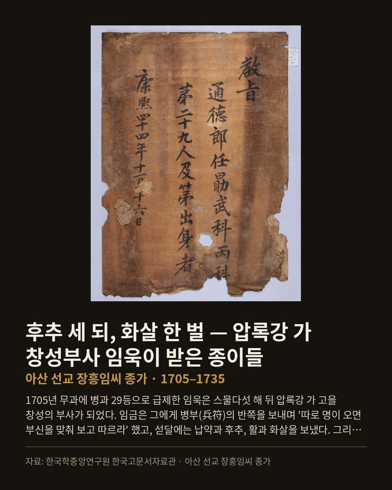
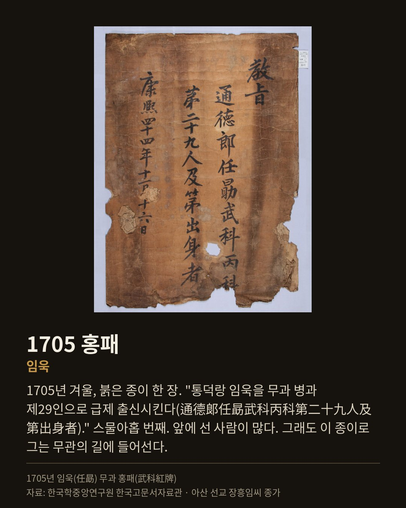
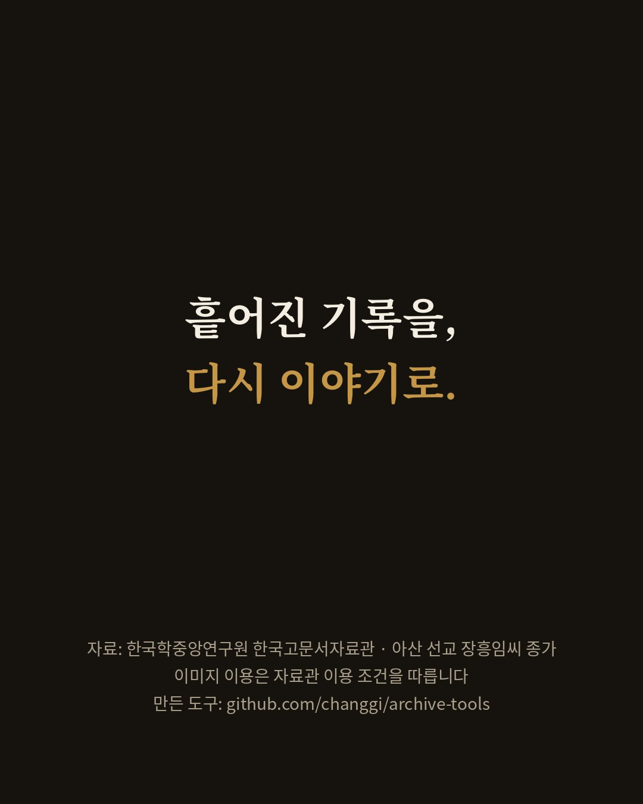

# EP.172 후추 세 되, 화살 한 벌 — 압록강 가 창성부사 임욱이 받은 종이들

아산 선교 장흥임씨 종가 (문중) · 1705년 무과에 병과 29등으로 급제한 임욱은 스물다섯 해 뒤 압록강 가 고을 창성의 부사가 되었다. 임금은 그에게 병부(兵符)의 반쪽을 보내며 '따로 명이 오면 부신을 맞춰 보고 따르라' 했고, 섣달에는 납약과 후추, 활과 화살을 보냈다. 그리고 1735년, 종2품 가선대부가 된 그의 녹패에는 녹봉을 받을 자리로 종9품 군직 '충무위 부사용'이 적혀 있다

- 🌐 [전시 웹페이지](https://changgi.github.io/archive-tools/examples/jangheung-im-imuk/exhibit.html) (한자 위 한글 독음 · 원문 해석) · [수업 활동지](https://changgi.github.io/archive-tools/examples/jangheung-im-imuk/handout.html)
- 🎬 영상: [릴스 9:16](https://changgi.github.io/archive-tools-next/media/ep172-jangheung-im-imuk_reel.mp4) · [가로 16:9](https://changgi.github.io/archive-tools-next/media/ep172-jangheung-im-imuk_wide.mp4) · 홍보 글: [`promo.md`](promo.md)
- 카드뉴스: [`cards/`](cards/) · SNS 글: [`sns.txt`](sns.txt) · 판독·해석 표: [`selection.csv`](selection.csv)

<!-- DELIVERY -->
## 전달 에디팅 — 이 기록을 이렇게 전합니다

- **핵심 정서** — 뿌듯함과 긴장
- **한 문장** — 한 무관의 일생은 임명장만으로 그려지지 않는다 — 급제 증서, 국경을 맡기며 내린 병부와 유서, 섣달의 선물 목록, 녹봉 증서가 함께 있어야 '나라가 한 사람을 어떻게 쓰고 대접했는지'가 보인다.
- **열기** — 국경 고을 사또에게 임금이 보낸 것은 병부의 반쪽, 그리고 후추 세 되였습니다.
- **펼치기** — 임욱 무과 홍패 → 임욱 유서 → 임욱 하선장 → 임욱 녹패 (1705–1735년) — 1705 무과 홍패(출발) → 1730 평안도 좌방어사 겸 창성부사에게 내린 밀부 유서(맡김) → 창성부사 앞 하선장(대접) → 1735 녹패(봉급)로, 한 사람이 받은 서로 다른 종류의 종이를 차례로 놓았습니다.
- **절정** — "후추 세 되(胡椒三升)" — 화면·공간에서 이 한 줄만 크게, 소리를 줄여 집중
- **여운** — 후추 세 되와 활 한 장을 받은 국경의 사또는, 그 선물에서 무엇을 읽었을까요? — 질문으로 끝내고 답은 보는 사람에게
- **감각과 물질** — 유서 끝 '押第三十九符' 그리고 하선장의 '胡椒三升 · 弓子一張' · 붉은 종이를 실물 크기로 복제해 벽에 거는 연출 · 역마 방울·말발굽 소리와 함께 펼치는 두루마리
- **통로와 매개** — 온라인: 릴스(열기) → 카드뉴스(펼치기) → 전시 웹페이지(절정·원문) → 비하인드 카드(여운) / 오프라인: 원본 크기 복제·낭독·참여 벽 / 남기기: 활동지·질문 카드
- **여운 장치** — 멀리 근무하는 사람에게 보낸 선물 · 위문품 목록 떠올리기
- **전달 에디팅 전** — 4건의 문서를 1705–1735년 연대순으로 놓고 문서명 · 유형 · 해설을 붙인다 — 정확하지만, 지나가면 잊힌다.
- **전달 에디팅 후** — 핵심 정서는 「뿌듯함과 긴장」. 「국경 고을 사또에게 임금이 보낸 것은 병부의 반쪽, 그리고 후추 세 되였습니다.」로 열고, 문서를 대비와 순서로 펼친 뒤, "후추 세 되(胡椒三升)"에서 멈춘다. 유서 끝 '押第三十九符' 그리고 하선장의 '胡椒三升 · 弓子一張'. 마지막엔 「멀리 근무하는 사람에게 보낸 선물 · 위문품 목록 떠올리기」로 보는 사람이 자기 이야기를 남기고 떠나게 한다.

전문: [`delivery.md`](delivery.md)
<!-- /DELIVERY -->

<!-- CURATOR -->
## 비하인드 — 큐레이터 노트

- **왜 이 문서들인가** — EP.63 · EP.171에서 이 집안의 혼서를 읽었습니다. 같은 종가에 1705년부터 1730년대까지 임욱 한 사람 앞으로 온 교령 문서가 수십 장 남아 있어, 그 가운데 성격이 다른 네 장을 골랐습니다.
- **전하고 싶은 것** — 한 무관의 일생은 임명장만으로 그려지지 않는다 — 급제 증서, 국경을 맡기며 내린 병부와 유서, 섣달의 선물 목록, 녹봉 증서가 함께 있어야 '나라가 한 사람을 어떻게 쓰고 대접했는지'가 보인다.
- **이렇게 보이길 바랐다** — 1705 무과 홍패(출발) → 1730 평안도 좌방어사 겸 창성부사에게 내린 밀부 유서(맡김) → 창성부사 앞 하선장(대접) → 1735 녹패(봉급)로, 한 사람이 받은 서로 다른 종류의 종이를 차례로 놓았습니다.
- **이렇게 써 주세요** — 조선 후기 무과와 무관의 경력, 밀부(병부) 제도와 국경 방어, 임금이 내리는 납약 · 물품 하사, 품계와 실직이 다른 '행(行)'과 녹패 · 체아직 수업에 쓰세요.
- **만들며 있었던 일** — 유서는 왼쪽 끝이 떨어져 날짜가 남지 않았고, 하선장에는 날짜가 없어 두 장의 연도는 자료관 목록(1730, 1730–1731)을 따랐습니다. 홍패의 달은 종이가 상해 '十□月'로 두었고, 녹패의 '第 科'는 숫자 칸이 비어 있습니다. 녹패 아래쪽의 흘림 글씨(녹을 받을 때 적은 기록으로 보임)는 판독하지 않았습니다. 같은 집안 1729년 추증교지에 임욱이 '奮武原從一等功臣'으로 적혀 있으나, 그 공로의 내용은 이 네 장으로 확인하지 않았습니다.
- **남겨 둔 질문** — 후추 세 되와 활 한 장을 받은 국경의 사또는, 그 선물에서 무엇을 읽었을까요?
- **제작 기록** — 문서 4건 · 1705–1735년 · 원본 사진 6면(문서 전체) · 원문 판독 4건 · 번역 4건 · 못 읽은 글자 □ 1 · 불확실 (?) 0

전문: [`curator.md`](curator.md) · 비하인드 카드: [`behind/`](behind/) · 채널별 홍보안: [`channels.md`](channels.md)
<!-- /CURATOR -->

## 이야기 — 사료가 말하는 대로

국경 고을 사또에게 임금이 보낸 것은 병부의 반쪽, 그리고 후추 세 되였습니다.

> **1705 홍패** — 1705년 겨울, 붉은 종이 한 장. "통덕랑 임욱을 무과 병과 제29인으로 급제 출신시킨다(通德郞任勗武科丙科第二十九人及第出身者)." 스물아홉 번째. 앞에 선 사람이 많다. 그래도 이 종이로 그는 무관의 길에 들어선다.
> **1730 유서** — 스물다섯 해 뒤, 압록강 가 창성. 임금의 글이 온다. "경은 한 지방을 맡았으니 그 책임이 가볍지 않다(卿受委一方體任非輕)." 그리고 반쪽짜리 나무패 하나. "평상시와 다른 명령이 있거든 부신을 맞춰 보아 의심이 없은 뒤에 명을 따르라(如有非常之命合符無疑然後當就命)." 번호는 제39부. 이제 국경의 군사가 이 반쪽에 달렸다.
> **1730 하선장** — 그리고 섣달, 또 한 장. "창성부사 임욱 처(昌城府使任勗處)." 약 한 봉, "후추 세 되(胡椒三升)", "활 한 장(弓子一張)". 긴 화살, 짧은 화살, 짧은 화살을 날리는 대롱까지. 추운 국경에서 겨울을 나는 무관에게, 임금은 약과 향신료와 무기를 함께 보냈다.
> **1735 녹패** — 마지막은 봉급 증서다. 1735년 섣달, 병조가 쓴다. "가선대부 행 충무위 부사용 임욱(嘉善大夫行忠武衛副司勇任勗)." 품계는 종2품. 그런데 녹을 받는 자리는 종9품 부사용이다. 그 사이에 '행(行)' 한 글자. 국경을 맡겼던 사람에게도, 녹봉은 빈자리에 이름을 붙여서 주었다.

| 표지 | 1번 카드 | 마무리 |
|---|---|---|
|  |  |  |

## 선별 문서 (4점)

| # | 연도 | 유형 | 문서명 | 원본 |
|---|---|---|---|---|
| 1 | 1705 | 홍패 | 1705년 임욱(任勗) 무과 홍패(武科紅牌) | [원본 보기](https://archive.aks.ac.kr/viewer/viewer.do#imgnode.do?itemId=book&gubun=booktree&depth=6&upPath=01%5E0144%5EL014430%5EL014430F02%5EL014430F0201&dataId=G002%2BAKS%2BKSM-XA.1705.1111-20101008.B062a_089_00058_XXX&itemType=) |
| 2 | 1730 | 유서 | 1730년 임욱(任勗) 유서(諭書) | [원본 보기](https://archive.aks.ac.kr/viewer/viewer.do#imgnode.do?itemId=book&gubun=booktree&depth=6&upPath=01%5E0144%5EL014430%5EL014430F02%5EL014430F0201&dataId=G002%2BAKS%2BKSM-XA.1730.1111-20101008.B062a_089_00002_XXX&itemType=) |
| 3 | 1730 | 하선장 | 1730〜1731년 임욱(任勗) 하선장(下膳狀) | [원본 보기](https://archive.aks.ac.kr/viewer/viewer.do#imgnode.do?itemId=book&gubun=booktree&depth=6&upPath=01%5E0144%5EL014430%5EL014430F02%5EL014430F0201&dataId=G002%2BAKS%2BKSM-XA.1730.1111-20101008.B062a_089_00071_XXX&itemType=) |
| 4 | 1735 | 녹패 | 1735년 임욱(任勗) 녹패(祿牌) | [원본 보기](https://archive.aks.ac.kr/viewer/viewer.do#imgnode.do?itemId=book&gubun=booktree&depth=6&upPath=01%5E0144%5EL014430%5EL014430F02%5EL014430F0201&dataId=G002%2BAKS%2BKSM-XA.1735.1111-20101008.B062a_089_00068_XXX&itemType=) |

## 원문 판독과 해석

### 1. 1705년 임욱(任勗) 무과 홍패(武科紅牌)

**원문 판독**

```
敎旨
通德郞任勗武科丙科
第二十九人及第出身者
康熙四十四年十□月十六日
(뒷면) 通德郞任勗武科丙科第二十九人
```

**원문 해석** 교지. 통덕랑 임욱을 무과 병과 제29인으로 급제 출신시킨다. 강희 44년(1705) 10□월 16일. (뒷면) 통덕랑 임욱, 무과 병과 제29인.

**해제** 1705년(숙종 31) 임욱(任勗)이 받은 무과 급제 증서, 곧 홍패(紅牌)입니다. 붉은 종이에 쓰는 홍패답게 지금도 갈색이 짙습니다. 무과 합격자는 갑과 · 을과 · 병과로 등급을 나누는데, 임욱은 병과 제29인이었습니다. 이름 앞의 '통덕랑(通德郞, 정5품)'은 급제 전에 이미 가지고 있던 품계입니다. 달은 종이가 상해 '十' 다음 글자를 읽지 못했습니다. 뒷면에는 같은 내용을 짧게 적은 쪽지가 붙어 있어, 접어 보관할 때 겉에서 누구의 홍패인지 알아보게 했습니다. 25년 뒤 그는 압록강 가 창성의 부사가 됩니다.

### 2. 1730년 임욱(任勗) 유서(諭書)

**원문 판독**

```
諭平安道左防
禦使昌城府使
任勗
卿受委一方體
任非輕凡發兵
應機安民制敵
一應常事自有
舊章慮或有予
與卿獨斷處置
事非密符莫可
施爲且意外奸
謀不可不預防如
有非常之命合
符無疑然後當就
命故賜押第三十九
符卿其受之故諭
```

**원문 해석** 평안도 좌방어사 창성부사 임욱에게 이른다. 경은 한 지방을 맡았으니 그 책임이 가볍지 않다. 무릇 군사를 내어 기회에 대응하고 백성을 편안히 하며 적을 제압하는 일상의 일은 예로부터 정한 규정이 있다. 다만 혹 나와 경만이 홀로 결단하여 처리할 일이 있을까 염려되니, 밀부가 아니면 시행할 수 없다. 또 뜻밖의 간사한 꾀는 미리 막지 않을 수 없다. 만약 평상시와 다른 명령이 있거든 부신을 맞춰 보아 의심이 없은 뒤에 명을 따르라. 그러므로 제39부를 압(押)하여 내리니, 경은 이를 받으라. 그러므로 이른다.

**해제** 임욱을 평안도 좌방어사(左防禦使) 겸 창성부사(昌城府使)로 보내며 임금이 내린 밀부 유서(密符諭書)입니다. 창성은 압록강에 닿은 평안도 북쪽 국경 고을로, 부사가 방어사를 겸했습니다. 밀부는 군사를 움직이는 명령이 진짜인지 맞춰 보는 병부(兵符)로, 반쪽은 임금이 두고 반쪽을 지방관에게 내립니다. 유서는 그 밀부를 내린다는 문서로, '평소와 다른 명이 오면 부신을 맞춰 본 뒤에 따르라'는 뜻을 적고 '제39부'라는 번호를 밝혔습니다. 붉은 '유서지보(諭書之寶)'가 여러 군데 찍혔습니다. 왼쪽 끝이 떨어져 날짜가 남지 않았고, 연도는 자료관 목록을 따랐습니다. EP.163에서 본 박경후의 밀부 유서와 같은 문장 틀입니다.

### 3. 1730〜1731년 임욱(任勗) 하선장(下膳狀)

**원문 판독**

```
昌城府使任勗處
給
臘藥一封
胡椒三升
弓子一張
長箭一部
片箭一部
筒兒一箇
```

**원문 해석** 창성부사 임욱 처(處)에 준다. 납약 한 봉, 후추 세 되, 활 한 장, 장전 한 벌, 편전 한 벌, 통아 하나.

**해제** 임금이 창성부사 임욱에게 물품을 내리며 함께 보낸 목록, 하선장(下膳狀)입니다. 맨 앞의 납약(臘藥)은 섣달 납일(臘日)에 내의원이 지어 임금이 신하들에게 나누어 준 상비약으로, 이 목록이 연말에 온 것임을 알려 줍니다. 후추(胡椒)는 수입품이라 귀했습니다. 나머지는 모두 무기입니다. 활(弓子), 긴 화살 장전(長箭), 짧은 화살 편전(片箭), 그리고 편전을 쏠 때 화살을 끼워 날리는 대롱 통아(筒兒)까지 한 벌로 갖췄습니다. 국경을 지키는 무관 수령에게 맞춘 선물입니다. 문서에 날짜가 없어 연도는 자료관 목록(1730–1731년)을 따랐습니다.

### 4. 1735년 임욱(任勗) 녹패(祿牌)

**원문 판독**

```
兵曹奉
敎賜嘉善大夫行忠武衛副司勇任勗來丙辰年第 科祿者
雍正十三年十二月 日
判書 參判 參議
參知臣李(서명)
正郞 佐郞
(아래쪽 흘림 기록 판독 안 함)
```

**원문 해석** 병조가 왕명을 받들어, 가선대부 행 충무위 부사용 임욱에게 다가오는 병진년(1736) 제□과의 녹을 내린다. 옹정 13년(1735) 12월 일. 판서 · 참판 · 참의 · 참지 신 이(서명) · 정랑 · 좌랑.

**해제** 1735년(영조 11) 12월, 병조(兵曹)가 임욱에게 다음 해인 병진년(1736) 녹봉을 내린다고 발급한 녹패(祿牌)입니다. 녹패는 녹봉을 받을 자격을 증명하는 문서로, 무관은 병조가 냈습니다. 임욱의 품계는 가선대부(嘉善大夫, 종2품)인데, 녹을 받을 자리로 적힌 것은 충무위 부사용(忠武衛副司勇, 종9품)입니다. 품계보다 낮은 직을 받을 때 쓰는 '행(行)'이 그 사이에 들어갔습니다. 오위의 부사용 같은 군직은 실무 없이 녹을 주려고 돌려 가며 붙이는 체아직(遞兒職)으로 자주 쓰였습니다. 녹의 등급을 적는 '第 科'의 숫자 칸은 비어 있습니다. 아래쪽에는 녹을 받을 때 적은 것으로 보이는 흘림 글씨와 도장이 있으나 판독하지 않았습니다.

판독·해석·이야기는 이미지에 근거한 초안이며(검토 전 "초안" 표시), 정확한 판독은 원문 확인이 필요합니다. □는 읽지 못한 글자, (?)는 불확실한 글자입니다.
이미지: 한국학중앙연구원 한국고문서자료관 소장·제공. "원본" 링크를 누르면 자료관 뷰어에서 그 문서가 열립니다. 재사용은 자료관에 문의하세요(소장처 동의 필요).
