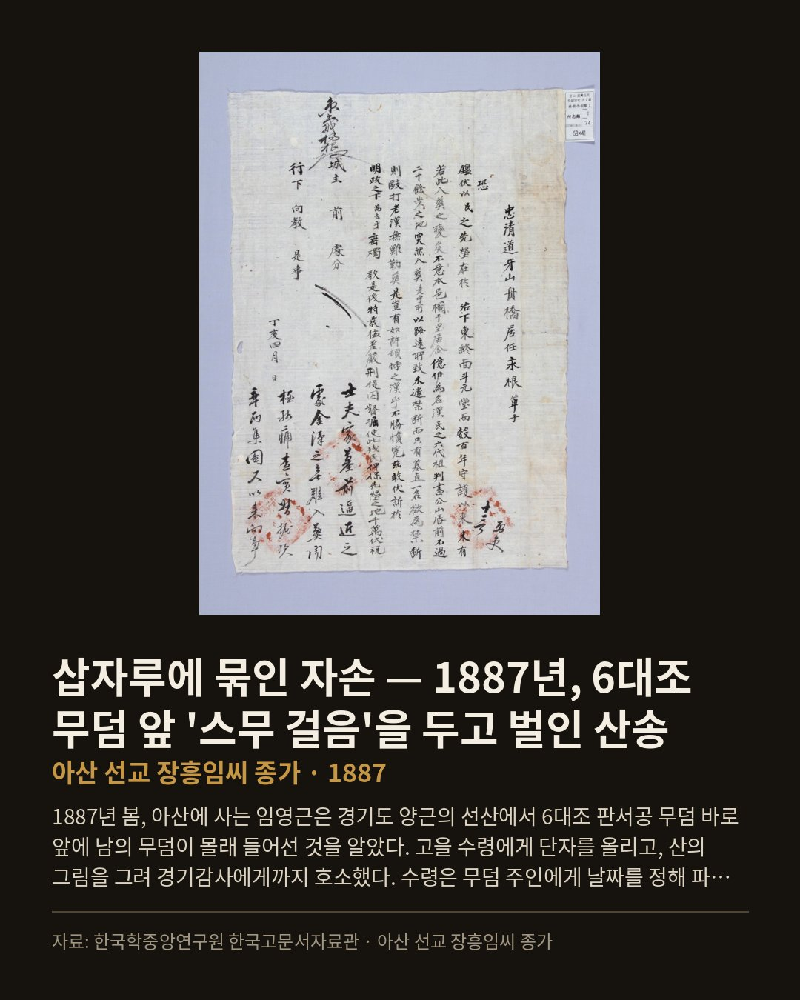
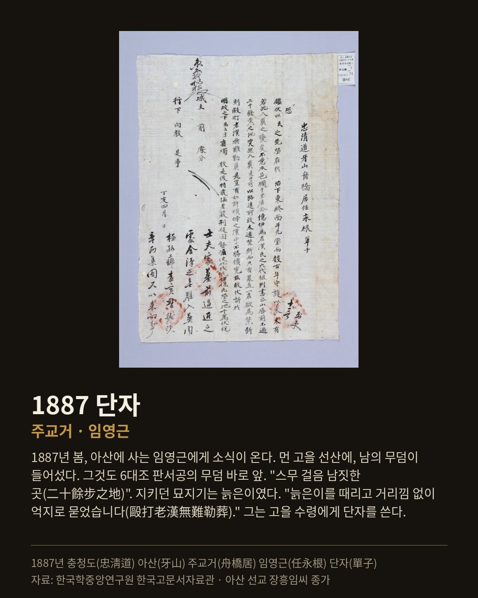
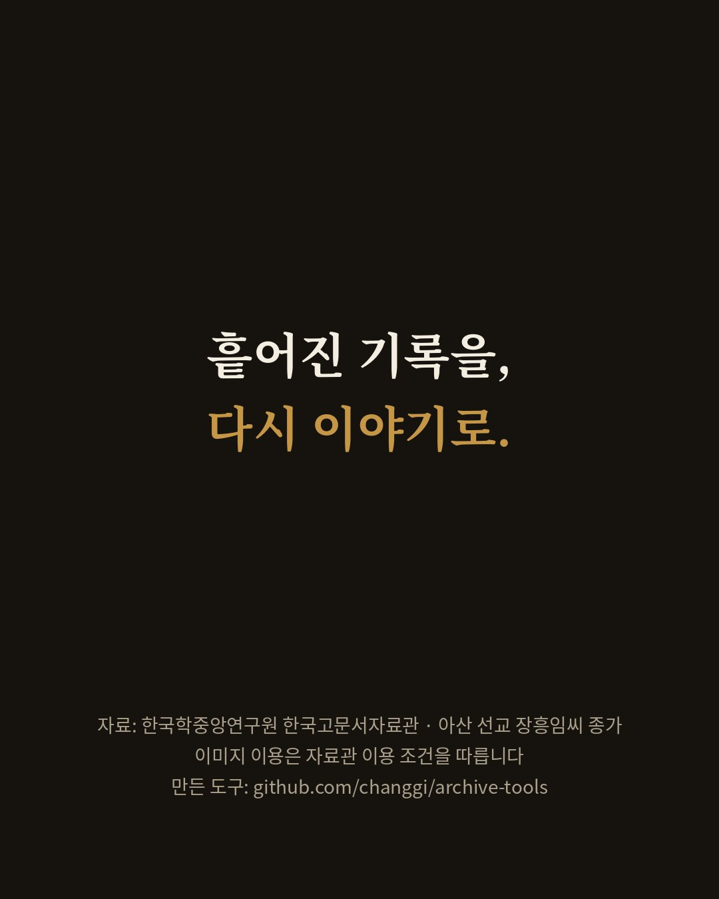

# EP.173 삽자루에 묶인 자손 — 1887년, 6대조 무덤 앞 '스무 걸음'을 두고 벌인 산송

아산 선교 장흥임씨 종가 (문중) · 1887년 봄, 아산에 사는 임영근은 경기도 양근의 선산에서 6대조 판서공 무덤 바로 앞에 남의 무덤이 몰래 들어선 것을 알았다. 고을 수령에게 단자를 올리고, 산의 그림을 그려 경기감사에게까지 호소했다. 수령은 무덤 주인에게 날짜를 정해 파 가겠다는 다짐을 받았다. 그런데 그 전날 밤, 칼과 몽둥이를 든 백여 명이 묘지기 집에 들이닥쳤다

- 🌐 [전시 웹페이지](https://changgi.github.io/archive-tools/examples/jangheung-im-sansong/exhibit.html) (한자 위 한글 독음 · 원문 해석) · [수업 활동지](https://changgi.github.io/archive-tools/examples/jangheung-im-sansong/handout.html)
- 🎬 영상: [릴스 9:16](https://changgi.github.io/archive-tools-next/media/ep173-jangheung-im-sansong_reel.mp4) · [가로 16:9](https://changgi.github.io/archive-tools-next/media/ep173-jangheung-im-sansong_wide.mp4) · 홍보 글: [`promo.md`](promo.md)
- 카드뉴스: [`cards/`](cards/) · SNS 글: [`sns.txt`](sns.txt) · 판독·해석 표: [`selection.csv`](selection.csv)

<!-- DELIVERY -->
## 전달 에디팅 — 이 기록을 이렇게 전합니다

- **핵심 정서** — 분노와 서늘함
- **한 문장** — 조선 후기 산송은 '땅 문서'가 아니라 '보이는 거리'를 다투는 싸움이었다 — 남의 무덤이 내 조상 무덤에서 몇 걸음인지, 앉아서도 보이는지가 승패를 갈랐고, 그래서 사람들은 산의 그림을 그려 관에 냈다.
- **열기** — 조상 무덤을 지키러 간 자손이, 삽자루에 묶여 돌아왔습니다.
- **펼치기** — 충청도 아산 주교거 임영근 단자 → 임영근 산도 → 충청도 아산거 임영근 단자 → 아산거 임희태 단자 (1887년) — 1887년 4월 고을 수령에게 올린 단자(시작) → 무덤 사이 거리를 그린 산도(증거) → 같은 달 경기감사에게 올린 단자(상소) → 윤4월, 파 가기로 한 전날 밤의 집단 폭행을 알린 친척의 단자(반격)로 이어 놓았습니다.
- **절정** — "스무 걸음 남짓한 곳(二十餘步之地)" — 화면·공간에서 이 한 줄만 크게, 소리를 줄여 집중
- **여운** — 스무 걸음, 수십 걸음, 서른 걸음 — 같은 거리를 사람마다 다르게 적은 이유는 무엇이었을까요? — 질문으로 끝내고 답은 보는 사람에게
- **감각과 물질** — 산도 한가운데 두 개의 동그라미와 '相距三十步' — 그리고 단자의 '縛民之三從叔於鍤柄'
- **통로와 매개** — 온라인: 릴스(열기) → 카드뉴스(펼치기) → 전시 웹페이지(절정·원문) → 비하인드 카드(여운) / 오프라인: 원본 크기 복제·낭독·참여 벽 / 남기기: 활동지·질문 카드
- **여운 장치** — 가족 묘 · 선산을 둘러싼 집안 이야기 물어보기
- **전달 에디팅 전** — 4건의 문서를 1887년 연대순으로 놓고 문서명 · 유형 · 해설을 붙인다 — 정확하지만, 지나가면 잊힌다.
- **전달 에디팅 후** — 핵심 정서는 「분노와 서늘함」. 「조상 무덤을 지키러 간 자손이, 삽자루에 묶여 돌아왔습니다.」로 열고, 문서를 대비와 순서로 펼친 뒤, "스무 걸음 남짓한 곳(二十餘步之地)"에서 멈춘다. 산도 한가운데 두 개의 동그라미와 '相距三十步' — 그리고 단자의 '縛民之三從叔於鍤柄'. 마지막엔 「가족 묘 · 선산을 둘러싼 집안 이야기 물어보기」로 보는 사람이 자기 이야기를 남기고 떠나게 한다.

전문: [`delivery.md`](delivery.md)
<!-- /DELIVERY -->

<!-- CURATOR -->
## 비하인드 — 큐레이터 노트

- **왜 이 문서들인가** — EP.172에서 이 집안 임욱의 홍패 · 유서 · 녹패를 읽었습니다. 같은 종가에 160년 뒤 후손 임영근이 벌인 산송(山訟) 문서가 한 묶음 남아 있어, 그 가운데 네 장을 일어난 순서대로 놓았습니다.
- **전하고 싶은 것** — 조선 후기 산송은 '땅 문서'가 아니라 '보이는 거리'를 다투는 싸움이었다 — 남의 무덤이 내 조상 무덤에서 몇 걸음인지, 앉아서도 보이는지가 승패를 갈랐고, 그래서 사람들은 산의 그림을 그려 관에 냈다.
- **이렇게 보이길 바랐다** — 1887년 4월 고을 수령에게 올린 단자(시작) → 무덤 사이 거리를 그린 산도(증거) → 같은 달 경기감사에게 올린 단자(상소) → 윤4월, 파 가기로 한 전날 밤의 집단 폭행을 알린 친척의 단자(반격)로 이어 놓았습니다.
- **이렇게 써 주세요** — 조선 후기 산송과 투장(偸葬), 단자 · 소지와 제사(題辭)의 형식, 수령 → 감사로 이어지는 소송 단계, 산도(山圖)라는 시각 증거, 다짐(侤音)과 수표(手標) 수업에 쓰세요.
- **만들며 있었던 일** — 자료관 이미지에서 '임영근 단자' 두 건과 '산도'는 같은 세 장의 사진을 함께 쓰고 있어, 머리글(舟橋居 · 牙山居)과 그림을 보고 각 문서에 한 장씩 맞추었습니다. 연도 丁亥는 자료관 목록(1887)을 따랐습니다. 첫 단자에는 상대가 '金億伊', 나머지에는 '金億孫'으로 적혔습니다. 큰 흘림 글씨로 쓴 관의 제사(題辭)는 일부만 읽고 나머지는 …로 두었습니다. 단자 속 '6대조 판서공'이 누구인지는 이 문서들로 확인하지 않았습니다.
- **남겨 둔 질문** — 스무 걸음, 수십 걸음, 서른 걸음 — 같은 거리를 사람마다 다르게 적은 이유는 무엇이었을까요?
- **제작 기록** — 문서 4건 · 1887년 · 원본 사진 10면(문서 전체) · 원문 판독 4건 · 번역 4건 · 못 읽은 글자 □ 0 · 불확실 (?) 1

전문: [`curator.md`](curator.md) · 비하인드 카드: [`behind/`](behind/) · 채널별 홍보안: [`channels.md`](channels.md)
<!-- /CURATOR -->

## 이야기 — 사료가 말하는 대로

조상 무덤을 지키러 간 자손이, 삽자루에 묶여 돌아왔습니다.

> **1887 단자** — 1887년 봄, 아산에 사는 임영근에게 소식이 온다. 먼 고을 선산에, 남의 무덤이 들어섰다. 그것도 6대조 판서공의 무덤 바로 앞. "스무 걸음 남짓한 곳(二十餘步之地)". 지키던 묘지기는 늙은이였다. "늙은이를 때리고 거리낌 없이 억지로 묻었습니다(毆打老漢無難勒葬)." 그는 고을 수령에게 단자를 쓴다.
> **1887 산도** — 말로는 부족했다. 그래서 산을 그렸다. 굵은 붓으로 산줄기를 긋고, 무덤마다 동그라미를 찍는다. 한가운데 "판서공 산소(判書公山)". 그리고 몰래 들어선 무덤 사이에 적는다. "서로 떨어진 거리 서른 걸음(相距三十步)". 아래에는 원고와 피고. "소송을 일으킨 사람 임영근(起訟任永根)".
> **1887 단자** — 수령은 엄하게 판결했다. 기한도 정했다. 그런데도 무덤은 그대로였다. 임영근은 한 단계 위, 감사에게 간다. "상놈이 양반 집안의 산에 몰래 묻은 것(以其常漢偸埋於班家之山)". 이번에는 그림을 붙였다. 감사가 쓴다. "이 그림을 보니(觀此圖)"... 날을 넘기지 말고 파 가게 하라.
> **1887 단자** — 파 가기로 한 날은 초이틀이었다. 그 전날 밤, 백여 명이 묘지기 집을 덮친다. 칼과 몽둥이. 임영근은 묶였다. "저의 삼종숙을 삽자루에 묶어(縛民之三從叔於鍤柄)", 도리어 자기 조상의 무덤을 파게 했다. 살려면 써 줘야 했다. 무덤을 파 가게 하지 않겠다는 수표 한 장. 조카가 붓을 든다. "대낮 큰길에서 칼을 뽑아 빼앗는 강도보다도 더 심합니다(此尤甚於白晝大道之上拔釰劫奪之强盜矣)."

| 표지 | 1번 카드 | 마무리 |
|---|---|---|
|  |  |  |

## 선별 문서 (4점)

| # | 연도 | 유형 | 문서명 | 원본 |
|---|---|---|---|---|
| 1 | 1887 | 단자 | 1887년 충청도(忠淸道) 아산(牙山) 주교거(舟橋居) 임영근(任永根) 단자(單子) | [원본 보기](https://archive.aks.ac.kr/viewer/viewer.do#imgnode.do?itemId=book&gubun=booktree&depth=6&upPath=01%5E0144%5EL014430%5EL014430F02%5EL014430F0202&dataId=G002%2BAKS%2BKSM-XB.1887.4420-20101008.B062a_089_00073_001&itemType=) |
| 2 | 1887 | 산도 | 1887년 임영근(任永根) 산도(山圖) | [원본 보기](https://archive.aks.ac.kr/viewer/viewer.do#imgnode.do?itemId=book&gubun=booktree&depth=6&upPath=01%5E0144%5EL014430%5EL014430F02%5EL014430F0202&dataId=G002%2BAKS%2BKSM-XB.1887.4420-20101008.B062a_089_00073_002&itemType=) |
| 3 | 1887 | 단자 | 1887년 충청도(忠淸道) 아산거(牙山居) 임영근(任永根) 단자(單子) | [원본 보기](https://archive.aks.ac.kr/viewer/viewer.do#imgnode.do?itemId=book&gubun=booktree&depth=6&upPath=01%5E0144%5EL014430%5EL014430F02%5EL014430F0202&dataId=G002%2BAKS%2BKSM-XB.1887.4420-20101008.B062a_089_00073_003&itemType=) |
| 4 | 1887 | 단자 | 1887년 아산거(牙山居) 임희태(任熙台) 단자(單子) | [원본 보기](https://archive.aks.ac.kr/viewer/viewer.do#imgnode.do?itemId=book&gubun=booktree&depth=6&upPath=01%5E0144%5EL014430%5EL014430F02%5EL014430F0202&dataId=G002%2BAKS%2BKSM-XB.1887.4420-20101008.B062a_089_00074_XXX&itemType=) |

## 원문 판독과 해석

### 1. 1887년 충청도(忠淸道) 아산(牙山) 주교거(舟橋居) 임영근(任永根) 단자(單子)

**원문 판독**

```
忠淸道牙山舟橋居任永根單子
恐
鑑伏以民之先塋在於 治下東終面斗元堂而數百年守護以來未有
若此入葬之變矣不意本邑欄干里居金億伊爲名漢民之六代祖判書公山居前不過
二十餘步之地突然入葬是乎所以路遠所致未遑禁斷而只有墓直一名欲爲禁斷
則毆打老漢無難勒葬是豈有如許頑悖之漢乎不勝憤冤玆敢仰訴於
明政之下爲去乎垂燭
敎是後特爲猛差嚴刑提囚督掘使此殘民俾保先塋之地千萬伏祝
行下向敎是事
城主 前 處分
丁亥四月 日
(제사) 士夫家墓前逼近之處 金漢之冢 雖入葬 … (十二日)
```

**원문 해석** 충청도 아산 주교에 사는 임영근의 단자. 삼가 살펴 주시기 바랍니다. 저의 선영은 사또께서 다스리시는 동종면 두원당에 있어 수백 년을 지켜 왔는데 이처럼 남이 묘를 쓴 변고는 없었습니다. 뜻밖에 이 고을 난간리에 사는 김억이라는 놈이 저의 6대조 판서공 산소 앞 스무 걸음 남짓한 곳에 갑자기 묘를 썼습니다. 길이 멀어 미처 막지 못했고, 묘지기 한 사람만 있어 막으려 했더니 늙은이를 때리고 거리낌 없이 억지로 묻었습니다. 어찌 이렇게 완악하고 패악한 놈이 있겠습니까. 분하고 원통함을 이기지 못해 감히 밝은 정사 아래 우러러 호소하오니, 살피신 뒤 특별히 사나운 사령을 보내 엄히 형벌하고 잡아 가두어 무덤을 파 가게 하여, 이 쇠잔한 백성이 선영을 지킬 수 있게 해 주시기를 천만 바랍니다. 처분을 내려 주십시오. 사또 앞. 정해년(1887) 4월 일. (제사) 사대부 집안 묘 앞 바싹 가까운 곳에 김가 놈의 무덤이 묻혔으니 … (12일)

**해제** 1887년(고종 24) 4월, 충청도 아산 주교(舟橋)에 사는 임영근(任永根)이 선산이 있는 고을의 수령(城主)에게 올린 단자(單子)입니다. 선산은 그 고을 동종면 두원당에 있었고, 같은 고을 난간리의 김억이(金億伊)가 6대조 판서공 무덤 앞 '스무 걸음 남짓한 곳'에 몰래 무덤을 썼다고 했습니다. 남의 묘역에 몰래 묻는 것을 투장(偸葬)이라 하고, 이를 둘러싼 소송을 산송(山訟)이라 합니다. 길이 멀어 막지 못했고 묘지기가 막다가 맞았다는 사정, '사령을 보내 잡아 가두고 무덤을 파 가게 해 달라'는 요구가 산송 단자의 전형입니다. 왼쪽 아래에 큰 흘림 글씨로 수령의 제사(題辭)가 쓰이고 관인이 찍혔으나, 일부만 읽었습니다. 이 고을은 다음 단자에서 경기도 양근(楊根)임이 드러납니다.

### 2. 1887년 임영근(任永根) 산도(山圖)

**원문 판독**

```
北 · 南 · 西 · 東
(산줄기 그림) 李班十代祖山 · 李班五代祖山 · 崔哥塚 · 判書公山 · 任班高祖山
相距三十步 … 俱見
金哥偸塚(?) · 李班叔母山 · 崔哥塚
起訟任永根
被隻金億孫
(제사) 任班先墓與金塚相距 … 俱見處 爲任安得不與爭 … 金塚置之 … 向事 (二十八日)
```

**원문 해석** 북 · 남 · 서 · 동. (산줄기 그림) 이 양반 10대조 산소 · 이 양반 5대조 산소 · 최가 무덤 · 판서공 산소 · 임 양반 고조 산소. 서로 떨어진 거리 서른 걸음, … 모두 보인다. 김가가 몰래 쓴 무덤(?) · 이 양반 숙모 산소 · 최가 무덤. 소송을 일으킨 사람 임영근, 상대(피척) 김억손. (제사) 임 양반의 선산 묘와 김가 무덤 사이가 … 다 보이는 곳이니, 임가가 어찌 다투지 않겠는가. … 김가 무덤을 … 할 일. (28일)

**해제** 산송에서 증거로 낸 산도(山圖)입니다. 굵은 붓으로 산줄기(용맥)를 그리고, 그 위에 동그라미로 무덤 자리를 찍어 누구의 무덤인지 적었습니다. 이씨 집안 10대조 · 5대조 산소, 최가 무덤, 그리고 줄기 한가운데 '판서공 산소'와 '임 양반 고조 산소'가 붙어 있고, 그 옆으로 '서로 떨어진 거리 서른 걸음(相距三十步)'이라는 글과 함께 몰래 쓴 무덤이 표시됐습니다. 오른쪽 아래에는 소송을 일으킨 사람(起訟) 임영근과 상대(被隻) 김억손을 적었습니다. 산송의 핵심은 거리와 '보이는지'였기에 이런 그림이 판결의 근거가 됐습니다. 관의 제사가 그림 아래 큰 흘림 글씨로 쓰였고 관인이 찍혔으나, 일부만 읽었습니다. 첫 단자에서는 '스무 걸음 남짓', 이 그림에서는 '서른 걸음'입니다.

### 3. 1887년 충청도(忠淸道) 아산거(牙山居) 임영근(任永根) 단자(單子)

**원문 판독**

```
忠淸道牙山居任永根單子
恐
鑑伏以生之屢世先塋在於道內楊根東終面斗元堂而守護禁養數百年曾未有他人入葬之弊矣不意本邑欄干里居金億伊
爲名漢謂以生之在遠無難偸葬於生之六代祖判書公墓居前至近必爭之地寧有如許人心乎以其常漢偸埋於班家之山
已極無嚴況其重臣山單居數十步乎具由呈訴於本官城主則題音若是截嚴侤限又其丁寧而金漢頓無掘意故玆敢
累足上來前狀貼聯仰籲於
旬宣之下伏乞
洞燭敎是後特爲
嚴題所謂金漢先治偸葬之律其偸塚卽爲掘移使此他道殘班獲保先壠之地千
萬泣血祈懇之至
行下向敎是事
巡相閣下 處分
丁亥四月 日
(제사) 觀此圖 … 金漢 … 不日督掘 … 向事 (二十六日)
```

**원문 해석** 충청도 아산에 사는 임영근의 단자. 삼가 살펴 주시기 바랍니다. 저의 여러 대 선영은 이 도(道) 안 양근 동종면 두원당에 있어 수백 년을 지키고 나무를 길러 왔으나 남이 묘를 쓰는 폐단은 없었습니다. 뜻밖에 그 고을 난간리에 사는 김억이라는 놈이 제가 멀리 산다는 것을 믿고 거리낌 없이 저의 6대조 판서공 무덤 앞, 바싹 가까워 반드시 다툴 자리에 몰래 묻었습니다. 어찌 이런 인심이 있겠습니까. 상놈이 양반 집안의 산에 몰래 묻은 것만으로도 이미 지극히 무엄한데, 하물며 중신(重臣)의 산소에서 겨우 수십 걸음이겠습니까. 사유를 갖추어 본관 사또께 호소하니 제사가 이처럼 엄하고 기한을 정한 다짐도 분명했으나, 김가 놈은 도무지 파 갈 뜻이 없습니다. 그래서 감히 발이 부르트도록 올라와 앞서 낸 소장을 붙여 감사 앞에 우러러 호소합니다. 엎드려 바라오니, 살피신 뒤 특별히 엄한 제사를 내려 김가 놈을 먼저 투장의 율로 다스리고 몰래 쓴 무덤은 곧 파 옮기게 하여, 다른 도의 쇠잔한 양반이 선영을 지킬 수 있게 해 주시기를 천만 피눈물로 빕니다. 처분을 내려 주십시오. 순상(감사) 합하 앞. 정해년(1887) 4월 일. (제사) 이 그림을 보니 … 김가 놈 … 날을 넘기지 말고 파 가게 할 일. (26일)

**해제** 같은 4월, 임영근이 경기감사(巡相)에게 올린 단자입니다. 선산이 '도내 양근(楊根) 동종면 두원당'에 있다고 밝혀, 아산(충청도)에 사는 그가 경기도 양근의 선산 문제로 다른 도의 감사에게 호소했음을 알 수 있습니다. 그래서 스스로를 '다른 도의 쇠잔한 양반(他道殘班)'이라 했습니다. 고을 수령이 엄한 제사를 내리고 기한을 정한 다짐(侤限)까지 받았는데도 상대가 파 가지 않자, 앞의 소장을 붙여(前狀貼聯) 한 단계 위로 올라간 것입니다. 상대를 '상놈(常漢)', 자기 쪽을 '양반 집안(班家)', 6대조 산소를 '중신(重臣)의 산'이라 부르며 신분의 차이를 앞세웠고, 거리는 '수십 걸음'이라 했습니다. 감사의 제사는 '이 그림을 보니(觀此圖)'로 시작해, 앞의 산도가 이 단자에 함께 냈던 것임을 보여 줍니다.

### 4. 1887년 아산거(牙山居) 임희태(任熙台) 단자(單子)

**원문 판독**

```
牙山居任熙台單子
恐
鑑伏以民之三從叔永根以金億孫偸葬事已有仰訴而 題敎截嚴以今初二日掘去之意捧侤音矣億孫敢生不
側 … 符同鳳里居李景天李景洪輩初一日夜聚黨百餘人各持釖杖突入墓直家結縛三從叔與四從兄
無 … 打幾至死境而縛民之三從叔於鍤柄反使掘三從叔之六代祖判書公墓是乎則三從叔不耐苦楚百般哀乞
而金李輩以不掘億孫塚之意欲勒捧手標是乎所三從叔至於此境若不捧手標則禍及於先塋且性命難保
故 … 已姑不督掘之意成手標以給而身被重傷載而歸家至今治療死生未判是乎尼有法天地豈有如許無嚴
之變乎此尤甚於白晝大道之上拔釰劫奪之强盜矣不勝驚憤玆敢仰訴爲去乎伏乞 … 敎是後金李
作黨之輩一一捉致嚴杖枷囚論報巡營期於定配是白遣金億孫塚卽爲掘移一以懲金李輩之獰習
一以雪殘民窮極之辱千萬泣血懇祝之至
行下向敎是事
城主 前 處分
丁亥閏四月 日
(제사) 金漢自知理屈 … 李班之群聚 … (二十六日)
```

**원문 해석** 아산에 사는 임희태의 단자. 삼가 살펴 주시기 바랍니다. 저의 삼종숙 영근이 김억손의 투장 일로 이미 호소하여 제사가 엄하였고, 이달 초이틀에 파 가겠다는 다짐을 받았습니다. 그런데 억손이 감히 헤아릴 수 없는 마음을 내어 … 봉리에 사는 이경천 · 이경홍 무리와 짜고, 초하루 밤 백여 명을 모아 저마다 칼과 몽둥이를 들고 묘지기 집에 들이닥쳐 삼종숙과 사종형을 묶고 … 때려 거의 죽게 하였습니다. 그리고 저의 삼종숙을 삽자루에 묶어 도리어 삼종숙의 6대조 판서공 묘를 파게 하니, 삼종숙이 고초를 견디지 못해 온갖 말로 애걸하였습니다. 그러자 김 · 이 무리가 억손의 무덤을 파지 않겠다는 뜻으로 수표(手標)를 억지로 받으려 하였습니다. 삼종숙은 이 지경에 이르러 수표를 써 주지 않으면 화가 선영에 미치고 목숨도 보전하기 어려워, … 파 가게 하지 않겠다는 수표를 써 주었습니다. 몸에 크게 다쳐 실려 집으로 돌아와 지금까지 치료하는데 살지 죽을지 알 수 없습니다. 법이 있는 세상에 어찌 이렇게 무엄한 변고가 있겠습니까. 이는 대낮 큰길에서 칼을 뽑아 빼앗는 강도보다도 더 심합니다. 놀라고 분함을 이기지 못해 감히 호소하오니, 엎드려 바라건대 … 살피신 뒤 김 · 이가 무리를 지은 자들을 하나하나 잡아 엄히 곤장 치고 칼을 씌워 가두고, 감영에 보고하여 반드시 귀양 보내게 하시며, 김억손의 무덤은 곧 파 옮기게 하여, 한편으로는 김 · 이 무리의 사나운 버릇을 징계하고 한편으로는 쇠잔한 백성의 극한 치욕을 씻어 주시기를 천만 피눈물로 빕니다. 처분을 내려 주십시오. 사또 앞. (제사) 김가 놈이 스스로 이치가 굽은 줄 알면서 … 이 양반 무리가 모여 … (26일)

**해제** 산송이 폭력으로 번진 뒤, 임영근의 삼종질(9촌 조카) 임희태(任熙台)가 고을 수령에게 올린 단자입니다. 날짜는 '丁亥閏四月'로, 1887년 윤4월입니다. 수령의 판결로 김억손은 '이달 초이틀에 파 가겠다'는 다짐(侤音)을 냈는데, 그 전날인 초하루 밤 봉리의 이경천 · 이경홍 무리와 함께 백여 명이 칼과 몽둥이를 들고 묘지기 집에 들이닥쳤다고 했습니다. 임영근을 삽자루(鍤柄)에 묶고 도리어 자기 6대조 묘를 파게 하며 위협해, '무덤을 파 가게 하지 않겠다'는 수표(手標)를 억지로 받아 갔다는 것입니다. 산도에 '이 양반 5대조 · 10대조 산소'가 함께 그려져 있어, 같은 산에 무덤을 둔 이씨 집안이 김억손 편에 선 것으로 보입니다. 관의 제사는 큰 흘림 글씨라 일부만 읽었습니다. 이 다툼이 끝내 어떻게 끝났는지는 이 문서들로 알 수 없습니다.

판독·해석·이야기는 이미지에 근거한 초안이며(검토 전 "초안" 표시), 정확한 판독은 원문 확인이 필요합니다. □는 읽지 못한 글자, (?)는 불확실한 글자입니다.
이미지: 한국학중앙연구원 한국고문서자료관 소장·제공. "원본" 링크를 누르면 자료관 뷰어에서 그 문서가 열립니다. 재사용은 자료관에 문의하세요(소장처 동의 필요).
