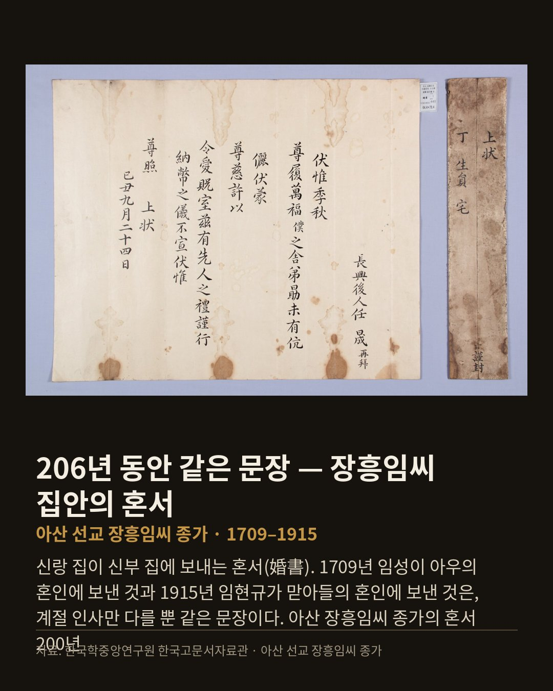
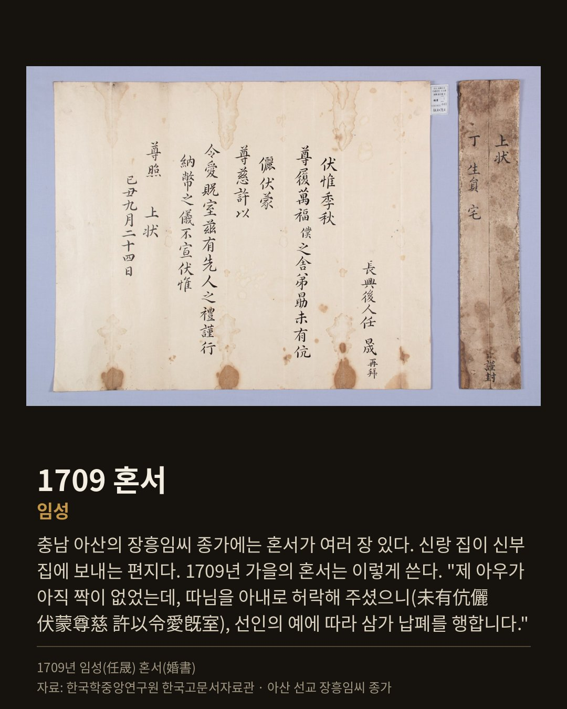
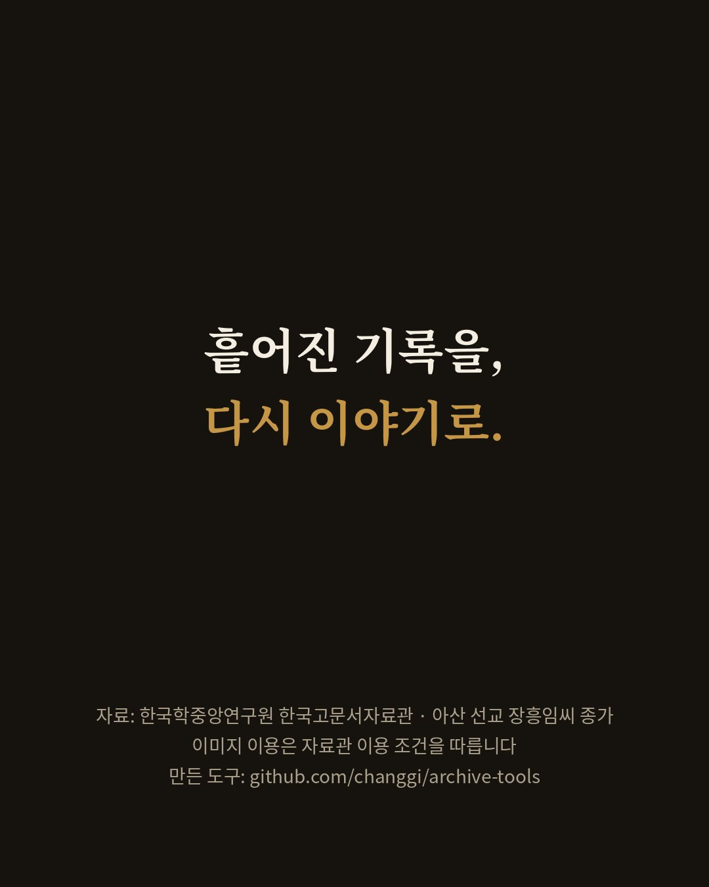

# EP.63 206년 동안 같은 문장 — 장흥임씨 집안의 혼서

아산 선교 장흥임씨 종가 (문중) · 신랑 집이 신부 집에 보내는 혼서(婚書). 1709년 임성이 아우의 혼인에 보낸 것과 1915년 임현규가 맏아들의 혼인에 보낸 것은, 계절 인사만 다를 뿐 같은 문장이다. 아산 장흥임씨 종가의 혼서 200년

- 🌐 [전시 웹페이지](https://changgi.github.io/archive-tools/examples/jangheung-im/exhibit.html) (한자 위 한글 독음 · 원문 해석) · [수업 활동지](https://changgi.github.io/archive-tools/examples/jangheung-im/handout.html)
- 🎬 영상: [릴스 9:16](https://changgi.github.io/archive-tools/examples/media/ep63-jangheung-im_reel.mp4) · [가로 16:9](https://changgi.github.io/archive-tools/examples/media/ep63-jangheung-im_wide.mp4) · 홍보 글: [`promo.md`](promo.md)
- 카드뉴스: [`cards/`](cards/) · SNS 글: [`sns.txt`](sns.txt) · 판독·해석 표: [`selection.csv`](selection.csv)

## 이야기 — 사료가 말하는 대로

206년을 사이에 둔 두 장의 혼서. 거의 같은 문장입니다.

> **1709 혼서** — 충남 아산의 장흥임씨 종가에는 혼서가 여러 장 있다. 신랑 집이 신부 집에 보내는 편지다. 1709년 가을의 혼서는 이렇게 쓴다. "제 아우가 아직 짝이 없었는데, 따님을 아내로 허락해 주셨으니(未有伉儷 伏蒙尊慈 許以令愛旣室), 선인의 예에 따라 삼가 납폐를 행합니다."
> **1915 혼서** — 206년 뒤인 1915년 겨울, 같은 집안에서 또 혼서를 쓴다. 나라는 사라졌고 세상은 바뀌었다. 그런데 문장은 그대로다. "따님을 아내로 허락해 주셨으니, 선인의 예에 따라 삼가 납폐를 행합니다(玆有先人之禮 謹行納幣之儀)." 바뀐 것은 계절 인사와, '맏아들이 이미 장성하였다'는 한 구절뿐이었다.

| 표지 | 1번 카드 | 마무리 |
|---|---|---|
|  |  |  |

## 선별 문서 (2점)

| # | 연도 | 유형 | 문서명 | 원본 |
|---|---|---|---|---|
| 1 | 1709 | 혼서 | 1709년 임성(任晟) 혼서(婚書) | [원본 보기](https://archive.aks.ac.kr/viewer/viewer.do#imgnode.do?itemId=book&gubun=booktree&depth=6&upPath=01%5E0144%5EL014430%5EL014430F02%5EL014430F0206&dataId=G002%2BAKS%2BKSM-XF.1709.0000-20101008.B062a_089_00384_XXX&itemType=) |
| 2 | 1915 | 혼서 | 1915년 임현규(任賢奎) 혼서(婚書) | [원본 보기](https://archive.aks.ac.kr/viewer/viewer.do#imgnode.do?itemId=book&gubun=booktree&depth=6&upPath=01%5E0144%5EL014430%5EL014430F02%5EL014430F0206&dataId=G002%2BAKS%2BKSM-XF.1915.0000-20101008.B062a_089_00389_XXX&itemType=) |

## 원문 판독과 해석

### 1. 1709년 임성(任晟) 혼서(婚書)

**원문 판독**

```
長興後人任 晟 再拜
伏惟季秋
尊履萬福 僕之舍弟勗未有伉
儷 伏蒙
尊慈許以
令愛旣室 玆有先人之禮 謹行
納幣之儀 不宣 伏惟
尊照 上狀
己丑九月二十四日
(봉투) 上狀 / 丁生員宅 / 謹封
```

**원문 해석** 장흥 후손 임성이 두 번 절합니다. 엎드려 생각건대 늦가을에 존체 만복하십니까. 저의 아우 욱(勗)이 아직 배필이 없었는데, 엎드려 존귀한 자애를 입어 따님을 아내로 허락해 주셨습니다. 이에 선인의 예가 있으므로 삼가 납폐의 예를 행합니다. 다 갖추지 못합니다. 엎드려 살펴 주시기 바랍니다. 글을 올립니다. 기축년(1709) 9월 24일. (봉투) 글을 올림. 정생원 댁. 삼가 봉함.

**해제** 1709년(숙종 35, 己丑) 9월, 장흥임씨 임성(任晟)이 아우 임욱(任勗)의 혼인을 위해 신부 집 정생원 댁에 보낸 혼서(婚書)입니다. 혼서는 신랑 집 혼주가 납폐(예물을 보냄) 때 신부 집에 보내는 편지로, 신부 집은 이를 평생 간직했다가 신부가 죽으면 관에 넣기도 했다고 합니다. '아직 배필이 없는데 따님을 허락해 주셨으니 선인의 예에 따라 납폐한다'는 정해진 문장으로 씁니다. 봉투(上狀 … 謹封)가 함께 남았습니다.

### 2. 1915년 임현규(任賢奎) 혼서(婚書)

**원문 판독**

```
長興后人任賢奎再拜
時維仲冬
尊體百福 僕之長子鍾夏年旣
長成 未有伉儷 伏蒙
尊慈許以
令愛旣室 玆有先人之禮 謹行
納幣之儀 不備 伏惟
尊照 謹拜上狀
乙卯十一月十九日
(봉투) 上狀 / 李生員 尊親 / 執事
```

**원문 해석** 장흥 후손 임현규가 두 번 절합니다. 때는 한겨울, 존체 백복하십니까. 저의 맏아들 종하(鍾夏)가 나이가 이미 장성하였으나 아직 배필이 없었는데, 엎드려 존귀한 자애를 입어 따님을 아내로 허락해 주셨습니다. 이에 선인의 예가 있으므로 삼가 납폐의 예를 행합니다. 다 갖추지 못합니다. 엎드려 살펴 주시기 바랍니다. 삼가 절하고 글을 올립니다. 을묘년(1915) 11월 19일. (봉투) 글을 올림. 이생원 사돈 집사께.

**해제** 1915년(乙卯) 11월, 임현규(任賢奎)가 맏아들 임종하(任鍾夏)의 혼인을 위해 신부 집 이생원 댁에 보낸 혼서입니다. 일제강점기이지만 서식은 206년 전 혼서와 거의 같습니다. 계절 인사(季秋 → 仲冬), 신랑과의 관계(舍弟 → 長子), '年旣長成' 한 구절만 더해졌을 뿐, '未有伉儷 伏蒙尊慈 許以令愛旣室 玆有先人之禮 謹行納幣之儀'는 그대로입니다. 봉투에는 사돈을 높이는 '尊親'을 썼습니다.

판독·해석·이야기는 이미지에 근거한 초안이며(검토 전 "초안" 표시), 정확한 판독은 원문 확인이 필요합니다. □는 읽지 못한 글자, (?)는 불확실한 글자입니다.
이미지: 한국학중앙연구원 한국고문서자료관 소장·제공. "원본" 링크를 누르면 자료관 뷰어에서 그 문서가 열립니다. 재사용은 자료관에 문의하세요(소장처 동의 필요).
