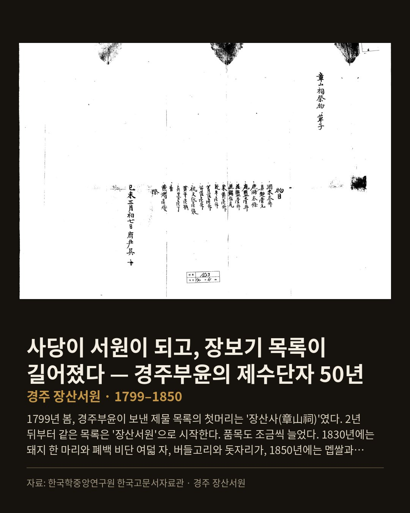
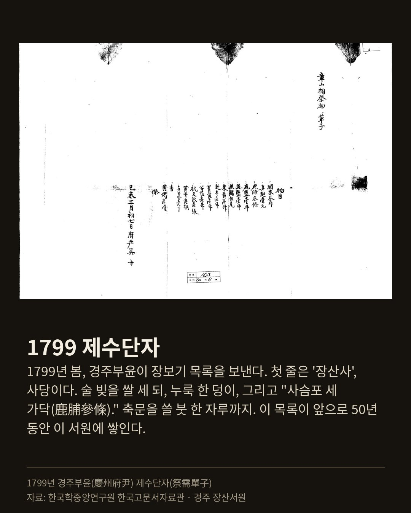
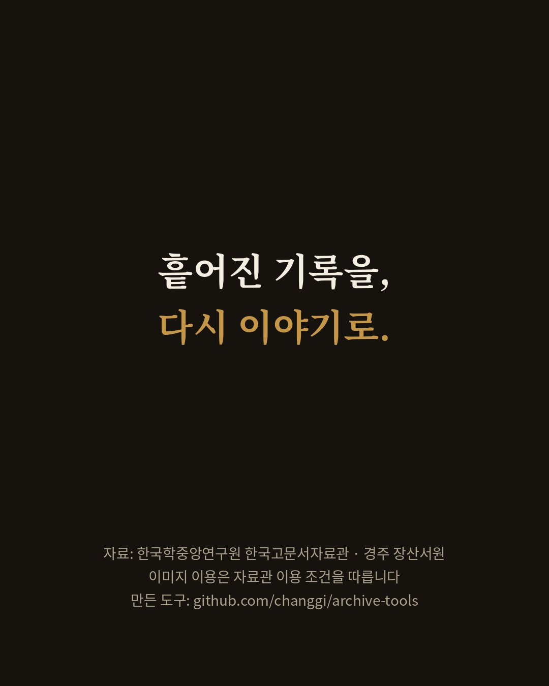

# EP.169 사당이 서원이 되고, 장보기 목록이 길어졌다 — 경주부윤의 제수단자 50년

경주 장산서원 (서원) · 1799년 봄, 경주부윤이 보낸 제물 목록의 첫머리는 '장산사(章山祠)'였다. 2년 뒤부터 같은 목록은 '장산서원'으로 시작한다. 품목도 조금씩 늘었다. 1830년에는 돼지 한 마리와 폐백 비단 여덟 자, 버들고리와 돗자리가, 1850년에는 멥쌀과 기장쌀이 더해진다. 원님은 다섯 번 넘게 바뀌었지만 사슴포 세 가닥과 붓 한 자루는 50년 동안 그대로였다

- 🌐 [전시 웹페이지](https://changgi.github.io/archive-tools/examples/jangsan-jesu/exhibit.html) (한자 위 한글 독음 · 원문 해석) · [수업 활동지](https://changgi.github.io/archive-tools/examples/jangsan-jesu/handout.html)
- 🎬 영상: [릴스 9:16](https://changgi.github.io/archive-tools-next/media/ep169-jangsan-jesu_reel.mp4) · [가로 16:9](https://changgi.github.io/archive-tools-next/media/ep169-jangsan-jesu_wide.mp4) · 홍보 글: [`promo.md`](promo.md)
- 카드뉴스: [`cards/`](cards/) · SNS 글: [`sns.txt`](sns.txt) · 판독·해석 표: [`selection.csv`](selection.csv)

<!-- DELIVERY -->
## 전달 에디팅 — 이 기록을 이렇게 전합니다

- **핵심 정서** — 잔잔함
- **한 문장** — 같은 목록을 반세기 동안 나란히 놓으면 변화가 보인다 — '사당(祠)'이 '서원'이 되고, 돼지 · 비단 · 쌀이 늘었다. 그러나 사슴포 세 가닥 · 붓 한 자루 · 누룩 한 덩이는 바뀌지 않았다.
- **열기** — 원님은 바뀌어도, 사슴포 세 가닥은 50년 동안 그대로였습니다.
- **펼치기** — 경주부윤 제수단자 (1799–1850년) — 1799(장산사, 기본 목록) → 1817(장산서원, 같은 목록) → 1830(돼지 · 폐백 · 버들고리 · 돗자리가 더해짐) → 1850(멥쌀 · 기장쌀까지)으로, 목록이 길어지는 순서대로 놓았습니다. 1799년 장은 EP.86과 같은 문서입니다.
- **절정** — "사슴포 세 가닥(鹿脯參條)" — 화면·공간에서 이 한 줄만 크게, 소리를 줄여 집중
- **여운** — 50년 동안 바뀌지 않은 사슴포 세 가닥은, 무엇을 지키고 있었을까요? — 질문으로 끝내고 답은 보는 사람에게
- **감각과 물질** — 목록 첫 줄 '酒米參升 眞麴壹元 鹿脯參條'는 그대로, 아래로 줄이 늘어난다
- **통로와 매개** — 온라인: 릴스(열기) → 카드뉴스(펼치기) → 전시 웹페이지(절정·원문) → 비하인드 카드(여운) / 오프라인: 원본 크기 복제·낭독·참여 벽 / 남기기: 활동지·질문 카드
- **여운 장치** — 우리 집 명절 장보기 목록을 10년 전과 견주어 보기
- **전달 에디팅 전** — 4건의 문서를 1799–1850년 연대순으로 놓고 문서명 · 유형 · 해설을 붙인다 — 정확하지만, 지나가면 잊힌다.
- **전달 에디팅 후** — 핵심 정서는 「잔잔함」. 「원님은 바뀌어도, 사슴포 세 가닥은 50년 동안 그대로였습니다.」로 열고, 문서를 대비와 순서로 펼친 뒤, "사슴포 세 가닥(鹿脯參條)"에서 멈춘다. 목록 첫 줄 '酒米參升 眞麴壹元 鹿脯參條'는 그대로, 아래로 줄이 늘어난다. 마지막엔 「우리 집 명절 장보기 목록을 10년 전과 견주어 보기」로 보는 사람이 자기 이야기를 남기고 떠나게 한다.

전문: [`delivery.md`](delivery.md)
<!-- /DELIVERY -->

<!-- CURATOR -->
## 비하인드 — 큐레이터 노트

- **왜 이 문서들인가** — EP.86에서 1799년 제수단자 한 장을 '제사 장보기 목록'으로 읽었습니다. 같은 서원에 1850년까지 열일곱 장이 남아 있어, 50년 동안 무엇이 바뀌고 무엇이 그대로였는지 견주어 보았습니다.
- **전하고 싶은 것** — 같은 목록을 반세기 동안 나란히 놓으면 변화가 보인다 — '사당(祠)'이 '서원'이 되고, 돼지 · 비단 · 쌀이 늘었다. 그러나 사슴포 세 가닥 · 붓 한 자루 · 누룩 한 덩이는 바뀌지 않았다.
- **이렇게 보이길 바랐다** — 1799(장산사, 기본 목록) → 1817(장산서원, 같은 목록) → 1830(돼지 · 폐백 · 버들고리 · 돗자리가 더해짐) → 1850(멥쌀 · 기장쌀까지)으로, 목록이 길어지는 순서대로 놓았습니다. 1799년 장은 EP.86과 같은 문서입니다.
- **이렇게 써 주세요** — 서원 제향과 지방관의 지원(제수 지급), 사우(祠宇)의 서원 승격, 제사 음식의 구성(포 · 해 · 저 · 율 · 조), 물목(목록) 문서 읽기 수업에 쓰세요.
- **만들며 있었던 일** — 자료관 이미지가 흑백 복사본이라 1830년 장의 위쪽이 검게 번져 날짜와 아래 품목 일부를 읽지 못했습니다. 1850년 장의 '條床壹艮衣' 등 몇 품목과 수량 글자는 확정하지 못해 원문 모양대로 두었습니다. 장산사가 언제 서원으로 승격했는지는 이 문서들의 첫머리 변화(1799 → 1801)만 근거로 적었습니다.
- **남겨 둔 질문** — 50년 동안 바뀌지 않은 사슴포 세 가닥은, 무엇을 지키고 있었을까요?
- **제작 기록** — 문서 4건 · 1799–1850년 · 원본 사진 4면(문서 전체) · 원문 판독 4건 · 번역 4건

전문: [`curator.md`](curator.md) · 비하인드 카드: [`behind/`](behind/) · 채널별 홍보안: [`channels.md`](channels.md)
<!-- /CURATOR -->

## 이야기 — 사료가 말하는 대로

원님은 바뀌어도, 사슴포 세 가닥은 50년 동안 그대로였습니다.

> **1799 제수단자** — 1799년 봄, 경주부윤이 장보기 목록을 보낸다. 첫 줄은 '장산사', 사당이다. 술 빚을 쌀 세 되, 누룩 한 덩이, 그리고 "사슴포 세 가닥(鹿脯參條)." 축문을 쓸 붓 한 자루까지. 이 목록이 앞으로 50년 동안 이 서원에 쌓인다.
> **1817 제수단자** — 18년 뒤, 1817년 가을. 첫 줄이 달라졌다. "장산서원 제수 단자(章山書院祭需單子)." 사당이 서원이 되었다. 원님의 성도 바뀌었다. 그런데 목록은 거의 그대로다. 사슴포 세 가닥, 붓 한 자루.
> **1830 제수단자** — 다시 13년 뒤. 종이 위쪽은 검게 번졌지만 목록은 읽힌다. 익숙한 열 가지 뒤로 새 줄이 붙는다. "날돼지 한 마리, 폐백 비단 여덟 자(豕腥壹口 幣帛捌尺)." 제사상이 커졌다.
> **1850 제수단자** — 그리고 1850년 봄. 목록 맨 앞에 쌀이 생겼다. 멥쌀 두 되 두 홉 닷 작, 기장쌀 두 되 두 홉 닷 작. 품목은 열다섯에서 스물다섯이 되었다. 그런데 그 한가운데에 50년 전과 똑같은 줄이 있다. "사슴포 세 가닥(鹿脯參條)." 원님이 몇 번을 바뀌어도, 제사상의 중심은 그대로였다.

| 표지 | 1번 카드 | 마무리 |
|---|---|---|
|  |  |  |

## 선별 문서 (4점)

| # | 연도 | 유형 | 문서명 | 원본 |
|---|---|---|---|---|
| 1 | 1799 | 제수단자 | 1799년 경주부윤(慶州府尹) 제수단자(祭需單子) | [원본 보기](https://archive.aks.ac.kr/viewer/viewer.do#imgnode.do?itemId=book&gubun=booktree&depth=6&upPath=02%5E0247%5EL024711%5EL024711F02%5EL024711F0202&dataId=G002%2BAKS%2BKSM-XB.1799.4723-20101008.B043c_066_00342_XXX&itemType=) |
| 2 | 1817 | 제수단자 | 1817년 경주부윤(慶州府尹) 제수단자(祭需單子) | [원본 보기](https://archive.aks.ac.kr/viewer/viewer.do#imgnode.do?itemId=book&gubun=booktree&depth=6&upPath=02%5E0247%5EL024711%5EL024711F02%5EL024711F0202&dataId=G002%2BAKS%2BKSM-XB.1817.4723-20101008.B043c_066_00348_XXX&itemType=) |
| 3 | 1830 | 제수단자 | 1830년 경주부윤(慶州府尹) 제수단자(祭需單子) | [원본 보기](https://archive.aks.ac.kr/viewer/viewer.do#imgnode.do?itemId=book&gubun=booktree&depth=6&upPath=02%5E0247%5EL024711%5EL024711F02%5EL024711F0202&dataId=G002%2BAKS%2BKSM-XB.1830.4723-20101008.B043c_066_00352_XXX&itemType=) |
| 4 | 1850 | 제수단자 | 1850년 경주부윤(慶州府尹) 제수단자(祭需單子) | [원본 보기](https://archive.aks.ac.kr/viewer/viewer.do#imgnode.do?itemId=book&gubun=booktree&depth=6&upPath=02%5E0247%5EL024711%5EL024711F02%5EL024711F0202&dataId=G002%2BAKS%2BKSM-XB.1850.4723-20101008.B043c_066_00358_XXX&itemType=) |

## 원문 판독과 해석

### 1. 1799년 경주부윤(慶州府尹) 제수단자(祭需單子)

**원문 판독**

```
章山祠祭物單子
物目
酒米參升 眞麴壹元 鹿脯參條 鹿醢壹升 魚醢壹升 魚鱐伍尾
栗黃壹升 乾棗壹升 菁菹壹升 芹菹壹升
祝文紙壹張 黃筆壹柄 眞墨壹丁 香 黃燭壹雙
除
己未三月初七日 府尹吳 (수결)
```

**원문 해석** 장산사 제물 단자. 물목: 술 빚을 쌀 세 되, 누룩 한 덩이, 사슴포 세 가닥, 사슴 젓갈 한 되, 생선 젓갈 한 되, 말린 생선 다섯 마리, 밤 한 되, 대추 한 되, 무김치 한 되, 미나리김치 한 되, 축문 종이 한 장, 붓 한 자루, 먹 한 정, 향, 누런 초 한 쌍. (나머지는) 덜어냄. 기미년(1799) 3월 7일. 부윤 오 (수결).

**해제** 1799년(정조 23) 3월 7일 경주부윤 오(吳)가 장산사(章山祠)의 봄 제사에 쓸 물건을 적어 보낸 제수단자(祭需單子)입니다(EP.86에서 자세히 읽음). 첫머리가 '장산사', 곧 '사당'으로 적혔습니다. 사슴포(鹿脯) · 사슴 젓갈(鹿醢) · 생선 젓갈 · 말린 생선 · 밤 · 대추 · 무김치 · 미나리김치로 차리는 전형적인 서원 제사상이며, 축문을 쓸 종이 · 붓 · 먹과 향 · 초까지 관에서 내주었습니다. 끝의 '除'는 나머지를 덜어 냈다는 표시로 보입니다.

### 2. 1817년 경주부윤(慶州府尹) 제수단자(祭需單子)

**원문 판독**

```
章山書院祭需單子
酒米參升 眞麴壹圓 鹿脯參條 鹿醢壹升 魚醢壹升 魚鱐伍尾
栗黃壹升 乾棗壹升 菁菹壹升 芹菹壹升
祝文紙壹張 黃筆壹柄 眞墨壹丁
香 紙帒參部 黃燭壹雙
除
丁丑九月初三日 府尹李 (수결)
```

**원문 해석** 장산서원 제수 단자. 술 빚을 쌀 세 되, 누룩 한 덩이, 사슴포 세 가닥, 사슴 젓갈 한 되, 생선 젓갈 한 되, 말린 생선 다섯 마리, 밤 한 되, 대추 한 되, 무김치 한 되, 미나리김치 한 되, 축문 종이 한 장, 붓 한 자루, 먹 한 정, 향, 종이 주머니 세 개, 누런 초 한 쌍. (나머지는) 덜어냄. 정축년(1817) 9월 3일. 부윤 이 (수결).

**해제** 18년 뒤 1817년(순조 17) 9월 3일, 가을 제사를 위해 경주부윤 이(李)가 보낸 제수단자입니다. 첫머리가 '장산서원(章山書院)'으로 바뀌었습니다. 같은 서원의 1801년 단자부터 이미 '서원'으로 적혀, 1799–1801년 사이에 사당(祠)에서 서원으로 이름이 바뀐 것으로 보입니다. 품목은 1799년과 거의 같고, 종이 주머니(紙帒) 세 개가 더해졌습니다. 부윤의 성은 오(吳)에서 이(李)로 바뀌었습니다.

### 3. 1830년 경주부윤(慶州府尹) 제수단자(祭需單子)

**원문 판독**

```
章山書院祭 祭需單子
酒米參升 眞麴壹元 鹿脯參條 鹿醢壹升 魚醢壹升 魚鱐伍尾
栗黃壹升 乾棗壹升 菁菹壹升 芹菹壹升
柳笥壹部 草席壹立 豕腥壹口 幣帛捌尺 …
```

**원문 해석** 장산서원 제사 제수 단자. 술 빚을 쌀 세 되, 누룩 한 덩이, 사슴포 세 가닥, 사슴 젓갈 한 되, 생선 젓갈 한 되, 말린 생선 다섯 마리, 밤 한 되, 대추 한 되, 무김치 한 되, 미나리김치 한 되, 버들고리 하나, 돗자리 한 닢, 날돼지 한 마리, 폐백 비단 여덟 자 ….

**해제** 자료관 목록 1830년(순조 30)의 제수단자입니다. 복사본 위쪽이 검게 번져 날짜와 부윤의 서명, 목록 끝부분은 읽지 못했습니다. 앞의 열 가지 음식은 1799 · 1817년과 같으나, 새로 버들고리(柳笥) · 돗자리(草席) · 날돼지 한 마리(豕腥壹口) · 폐백 비단 여덟 자(幣帛捌尺)가 더해졌습니다. 날돼지와 폐백은 제향의 격을 높이는 제물로, 서원이 된 뒤 제사 규모가 커졌음을 보여 줍니다.

### 4. 1850년 경주부윤(慶州府尹) 제수단자(祭需單子)

**원문 판독**

```
章山書院 祭需單子
稻米貳升貳合伍夕 黍米貳升貳合伍夕
酒米參升 眞曲壹元 鹿脯參條 鹿醢壹升 魚醢壹升 魚鱐伍尾
黃栗壹升 乾棗壹升 菁菹壹升 芹菹壹升 豕腥壹口
祝文紙壹張 黃筆壹柄 眞墨壹丁 柳笥壹部 草席壹立
幣篚壹部 條床壹艮衣 皮紙伍張 香 紙帒參部 幣帛捌尺 黃燭壹雙
庚戌三月十二日 府尹李 (수결)
```

**원문 해석** 장산서원 제수 단자. 멥쌀 두 되 두 홉 닷 작, 기장쌀 두 되 두 홉 닷 작, 술 빚을 쌀 세 되, 누룩 한 덩이, 사슴포 세 가닥, 사슴 젓갈 한 되, 생선 젓갈 한 되, 말린 생선 다섯 마리, 밤 한 되, 대추 한 되, 무김치 한 되, 미나리김치 한 되, 날돼지 한 마리, 축문 종이 한 장, 붓 한 자루, 먹 한 정, 버들고리 하나, 돗자리 한 닢, 폐백 광주리 하나, 조상(條床) …, 두꺼운 종이 다섯 장, 향, 종이 주머니 세 개, 폐백 비단 여덟 자, 누런 초 한 쌍. 경술년(1850) 3월 12일. 부윤 이 (수결).

**해제** 1850년(철종 1) 3월 12일 경주부윤 이(李)가 보낸 봄 제사 제수단자로, 이 서원에 남은 열일곱 장 가운데 마지막입니다. 맨 앞에 멥쌀(稻米)과 기장쌀(黍米)이 '두 되 두 홉 닷 작'까지 정밀하게 적혀 새로 더해졌고, 폐백 광주리(幣篚) · 두꺼운 종이(皮紙) 등도 늘어 품목이 스물다섯 가지가 되었습니다. 1799년의 열다섯 가지에서 50년 사이 열 가지가 늘었습니다. 그러나 술 빚을 쌀 세 되, 누룩 한 덩이, 사슴포 세 가닥, 사슴 젓갈 한 되, 붓 한 자루는 처음 그대로입니다. '條床壹艮衣'의 뜻은 확정하지 못했습니다.

판독·해석·이야기는 이미지에 근거한 초안이며(검토 전 "초안" 표시), 정확한 판독은 원문 확인이 필요합니다. □는 읽지 못한 글자, (?)는 불확실한 글자입니다.
이미지: 한국학중앙연구원 한국고문서자료관 소장·제공. "원본" 링크를 누르면 자료관 뷰어에서 그 문서가 열립니다. 재사용은 자료관에 문의하세요(소장처 동의 필요).
