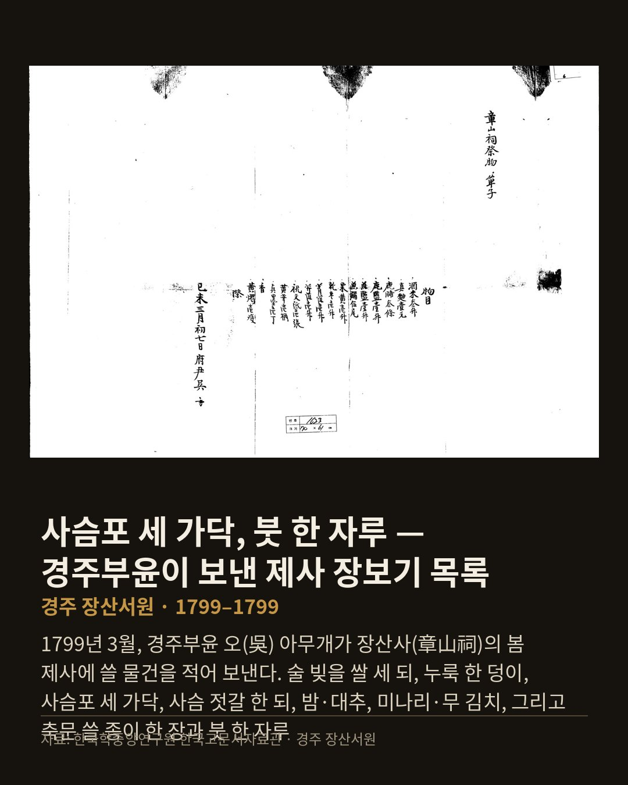
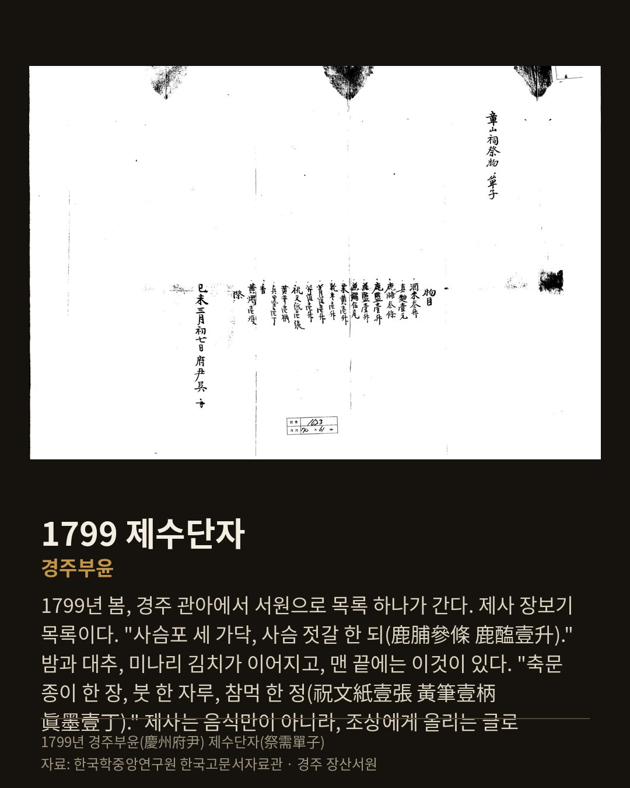
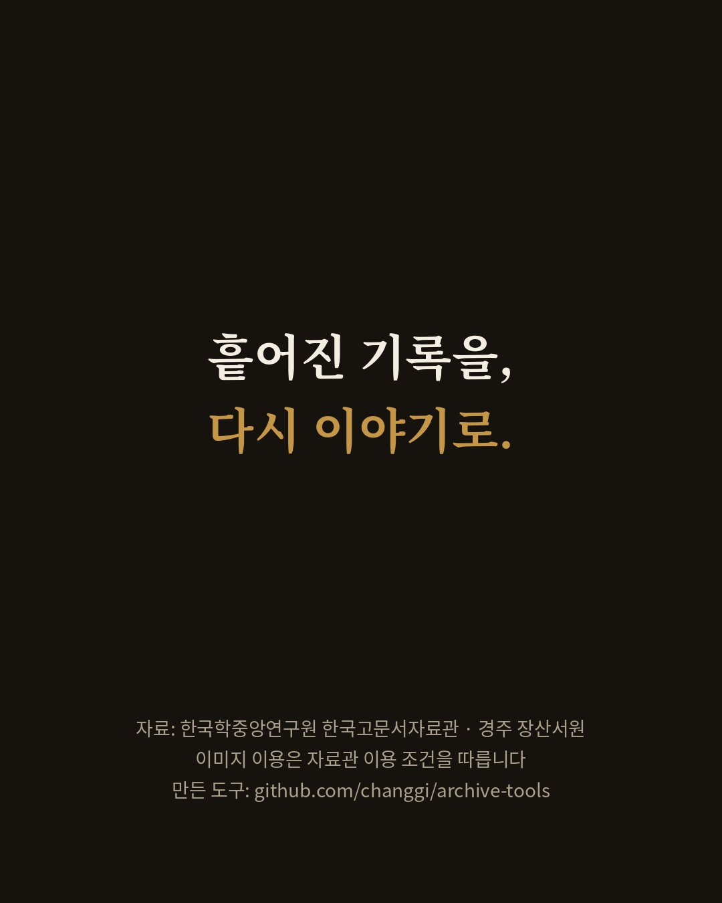

# EP.86 사슴포 세 가닥, 붓 한 자루 — 경주부윤이 보낸 제사 장보기 목록

경주 장산서원 (서원) · 1799년 3월, 경주부윤 오(吳) 아무개가 장산사(章山祠)의 봄 제사에 쓸 물건을 적어 보낸다. 술 빚을 쌀 세 되, 누룩 한 덩이, 사슴포 세 가닥, 사슴 젓갈 한 되, 밤·대추, 미나리·무 김치, 그리고 축문 쓸 종이 한 장과 붓 한 자루

- 🌐 [전시 웹페이지](https://changgi.github.io/archive-tools/examples/jangsan/exhibit.html) (한자 위 한글 독음 · 원문 해석) · [수업 활동지](https://changgi.github.io/archive-tools/examples/jangsan/handout.html)
- 🎬 영상: [릴스 9:16](https://changgi.github.io/archive-tools-next/media/ep86-jangsan_reel.mp4) · [가로 16:9](https://changgi.github.io/archive-tools-next/media/ep86-jangsan_wide.mp4) · 홍보 글: [`promo.md`](promo.md)
- 카드뉴스: [`cards/`](cards/) · SNS 글: [`sns.txt`](sns.txt) · 판독·해석 표: [`selection.csv`](selection.csv)


<!-- DELIVERY -->
## 전달 에디팅 — 이 기록을 이렇게 전합니다

- **핵심 정서** — 정성
- **한 문장** — 제사는 음식과 함께 글(축문)로 완성되었다는 것 — 그리고 관과 서원이 함께 제사를 꾸렸다는 것.
- **열기** — 1799년, 관청이 보낸 제사 장보기 목록입니다.
- **펼치기** — 경주부윤 제수단자 (1799년) — 품목을 하나씩 나열하는 문서의 리듬을 살리고, 마지막 '붓·먹·종이'에 힘을 주었습니다.
- **절정** — "사슴포 세 가닥, 사슴 젓갈 한 되(鹿脯參條 鹿醢壹升)" — 화면·공간에서 이 한 줄만 크게, 소리를 줄여 집중
- **여운** — 오늘 우리 집 제사 목록에는 무엇이 빠지고 무엇이 더해졌을까요? — 질문으로 끝내고 답은 보는 사람에게
- **감각과 물질** — 사슴포·밤·대추·미나리 실물과 붓·먹·종이를 제사상처럼
- **통로와 매개** — 온라인: 릴스(열기) → 카드뉴스(펼치기) → 전시 웹페이지(절정·원문) → 비하인드 카드(여운) / 오프라인: 원본 크기 복제·낭독·참여 벽 / 남기기: 활동지·질문 카드
- **여운 장치** — "우리 집 제사상에 빠진 것"
- **전달 에디팅 전** — 1건의 문서를 1799년 연대순으로 놓고 문서명 · 유형 · 해설을 붙인다 — 정확하지만, 지나가면 잊힌다.
- **전달 에디팅 후** — 핵심 정서는 「정성」. 「1799년, 관청이 보낸 제사 장보기 목록입니다.」로 열고, 문서를 한 장의 집중로 펼친 뒤, "사슴포 세 가닥, 사슴 젓갈 한 되(鹿脯參條 鹿醢壹升)"에서 멈춘다. 사슴포·밤·대추·미나리 실물과 붓·먹·종이를 제사상처럼. 마지막엔 「"우리 집 제사상에 빠진 것"」로 보는 사람이 자기 이야기를 남기고 떠나게 한다.

전문: [`delivery.md`](delivery.md)
<!-- /DELIVERY -->

<!-- CURATOR -->
## 비하인드 — 큐레이터 노트

- **왜 이 문서들인가** — 관청이 서원 제사에 보낸 '장보기 목록'에 사슴포와 붓 한 자루가 함께 적혀 있었습니다.
- **전하고 싶은 것** — 제사는 음식과 함께 글(축문)로 완성되었다는 것 — 그리고 관과 서원이 함께 제사를 꾸렸다는 것.
- **이렇게 보이길 바랐다** — 품목을 하나씩 나열하는 문서의 리듬을 살리고, 마지막 '붓·먹·종이'에 힘을 주었습니다.
- **이렇게 써 주세요** — 제례 문화, 관과 서원의 관계, 옛 단위(되·정·쌍) 학습에 쓰세요.
- **만들며 있었던 일** — 마지막 품목 옆 '除'는 이번에 뺀다는 표시로 읽었습니다. 마이크로필름 흑백 이미지입니다.
- **남겨 둔 질문** — 오늘 우리 집 제사 목록에는 무엇이 빠지고 무엇이 더해졌을까요?
- **제작 기록** — 문서 1건 · 1799년 · 원본 사진 1면(문서 전체) · 원문 판독 1건 · 번역 1건

전문: [`curator.md`](curator.md)
<!-- /CURATOR -->

## 이야기 — 사료가 말하는 대로

1799년, 관청이 보낸 제사 장보기 목록입니다.

> **1799 제수단자** — 1799년 봄, 경주 관아에서 서원으로 목록 하나가 간다. 제사 장보기 목록이다. "사슴포 세 가닥, 사슴 젓갈 한 되(鹿脯參條 鹿醢壹升)." 밤과 대추, 미나리 김치가 이어지고, 맨 끝에는 이것이 있다. "축문 종이 한 장, 붓 한 자루, 참먹 한 정(祝文紙壹張 黃筆壹柄 眞墨壹丁)." 제사는 음식만이 아니라, 조상에게 올리는 글로 완성되었다.

| 표지 | 1번 카드 | 마무리 |
|---|---|---|
|  |  |  |

## 선별 문서 (1점)

| # | 연도 | 유형 | 문서명 | 원본 |
|---|---|---|---|---|
| 1 | 1799 | 제수단자 | 1799년 경주부윤(慶州府尹) 제수단자(祭需單子) | [원본 보기](https://archive.aks.ac.kr/viewer/viewer.do#imgnode.do?itemId=book&gubun=booktree&depth=6&upPath=02%5E0247%5EL024711%5EL024711F02%5EL024711F0202&dataId=G002%2BAKS%2BKSM-XB.1799.4723-20101008.B043c_066_00342_XXX&itemType=) |

## 원문 판독과 해석

### 1. 1799년 경주부윤(慶州府尹) 제수단자(祭需單子)

**원문 판독**

```
章山祠祭物單子
物目
酒米參升
眞麴壹元
鹿脯參條
鹿醢壹升
魚醢壹升
魚鱐伍尾
栗黃壹升
乾棗壹升
菁菹壹升
芹菹壹升
祝文紙壹張
黃筆壹柄
眞墨壹丁
香
黃燭壹雙　除
己未三月初七日 府尹吳 [수결]
```

**원문 해석** 장산사 제물 단자. 물목: 술 빚을 쌀 3되, 밀누룩 1덩이, 사슴포 3가닥, 사슴 젓갈 1되, 물고기 젓갈 1되, 말린 물고기 5마리, 밤 1되, 말린 대추 1되, 무 김치(청저) 1되, 미나리 김치(근저) 1되, 축문 종이 1장, 황모붓 1자루, 참먹 1정, 향, 황촛대 초 1쌍 — 제외. 기미년(1799) 3월 초7일 부윤 오 [서명].

**해제** 경주부윤이 관할 서원인 장산서원(장산사)의 봄 제향에 쓸 제물을 관에서 지급하며 적어 보낸 제수단자(祭需單子)입니다. 서원 제향은 관청이 제물 일부를 대어 주는 것이 관례였습니다. 『국조오례의』 계열 제례에서 쓰는 녹포(鹿脯)·녹해(鹿醢)·청저·근저 같은 제물이 보여, 지방 서원 제사의 실제 차림을 알 수 있습니다. 마지막 '黃燭壹雙' 옆의 '除'는 그 품목을 이번에는 빼고 보낸다는 표시로 읽힙니다. 같은 서원에 1799년부터 1850년대까지 같은 형식의 단자가 여러 장 남아 있습니다. 마이크로필름 흑백 이미지입니다.

판독·해석·이야기는 이미지에 근거한 초안이며(검토 전 "초안" 표시), 정확한 판독은 원문 확인이 필요합니다. □는 읽지 못한 글자, (?)는 불확실한 글자입니다.
이미지: 한국학중앙연구원 한국고문서자료관 소장·제공. "원본" 링크를 누르면 자료관 뷰어에서 그 문서가 열립니다. 재사용은 자료관에 문의하세요(소장처 동의 필요).
