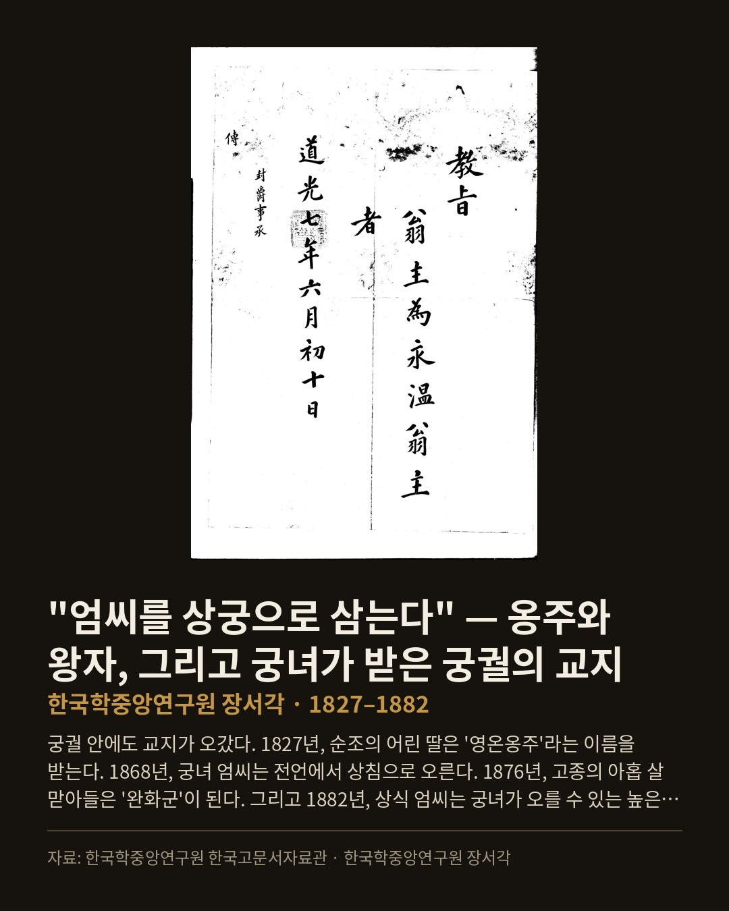
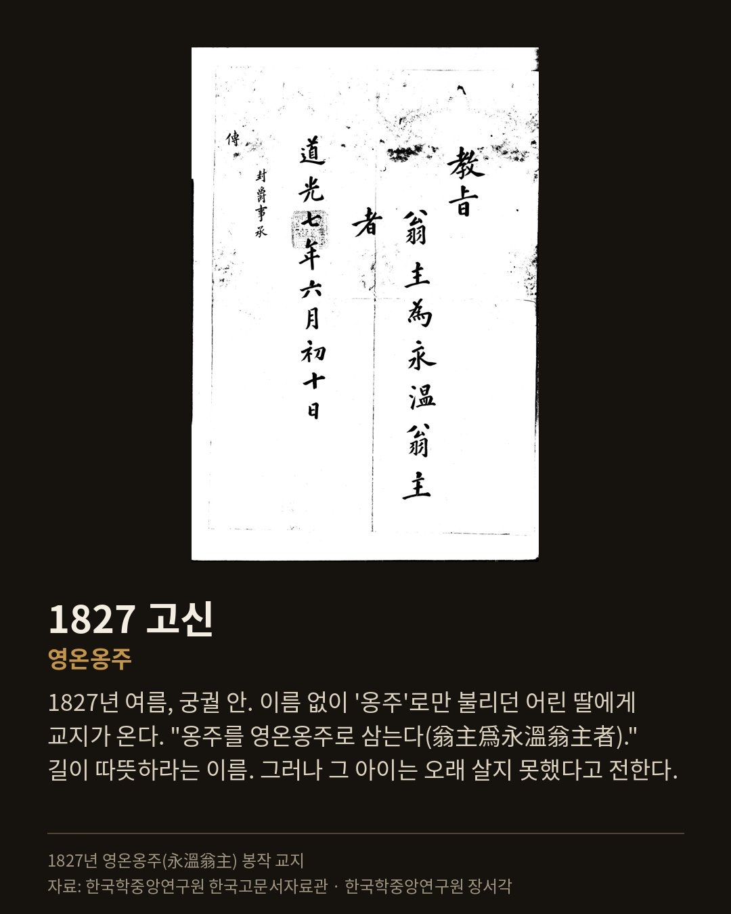
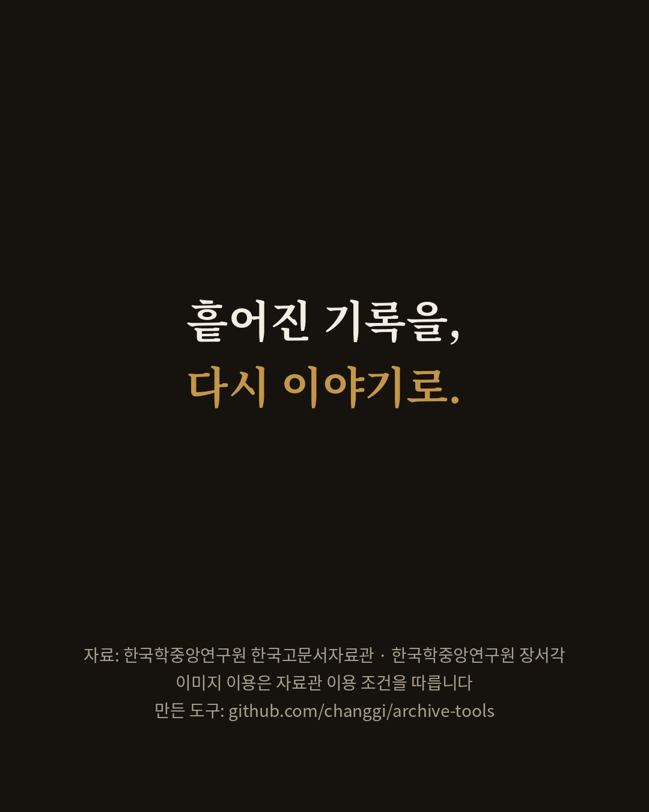

# EP.137 "엄씨를 상궁으로 삼는다" — 옹주와 왕자, 그리고 궁녀가 받은 궁궐의 교지

한국학중앙연구원 장서각 (박물관) · 궁궐 안에도 교지가 오갔다. 1827년, 순조의 어린 딸은 '영온옹주'라는 이름을 받는다. 1868년, 궁녀 엄씨는 전언에서 상침으로 오른다. 1876년, 고종의 아홉 살 맏아들은 '완화군'이 된다. 그리고 1882년, 상식 엄씨는 궁녀가 오를 수 있는 높은 자리, 상궁이 된다. 옹주와 왕자는 어려서 세상을 떠났고, 궁녀의 이름은 성 한 글자로만 남았다

- 🌐 [전시 웹페이지](https://changgi.github.io/archive-tools/examples/jangseogak-gung/exhibit.html) (한자 위 한글 독음 · 원문 해석) · [수업 활동지](https://changgi.github.io/archive-tools/examples/jangseogak-gung/handout.html)
- 🎬 영상: [릴스 9:16](https://changgi.github.io/archive-tools/examples/media/ep137-jangseogak-gung_reel.mp4) · [가로 16:9](https://changgi.github.io/archive-tools/examples/media/ep137-jangseogak-gung_wide.mp4) · 홍보 글: [`promo.md`](promo.md)
- 카드뉴스: [`cards/`](cards/) · SNS 글: [`sns.txt`](sns.txt) · 판독·해석 표: [`selection.csv`](selection.csv)

<!-- DELIVERY -->
## 전달 에디팅 — 이 기록을 이렇게 전합니다

- **핵심 정서** — 애잔함
- **한 문장** — 궁궐에서 교지는 이름을 주기도 하고, 성 한 글자만 남기기도 했다 — 이름을 받은 아이들은 일찍 떠났고, 이름 없는 궁녀는 한 계단씩 올랐다.
- **열기** — 궁녀가 받은 임명장에는 이름이 없었습니다. 성 한 글자뿐.
- **펼치기** — 영온옹주 봉작 교지 → 전언 엄씨 상침 고신 → 완화군 이선 봉작 교지 → 상식 엄씨 상궁 고신 (1827–1882년) — 1827년 영온옹주 → 1868년 엄씨 상침 → 1876년 완화군 → 1882년 엄씨 상궁 순으로, '이름을 받는 사람'과 '성만 적히는 사람'이 번갈아 나오게 구성했습니다.
- **절정** — "상식 엄씨를 상궁으로 삼는다(尙食嚴氏爲尙宮者)" — 화면·공간에서 이 한 줄만 크게, 소리를 줄여 집중
- **여운** — 궁녀 엄씨의 이름은 무엇이었을까요? 누가 그 이름을 불렀을까요? — 질문으로 끝내고 답은 보는 사람에게
- **감각과 물질** — 같은 크기의 교지 네 장 — 이름 '永溫' '墡' 옆에 비어 있는 '嚴氏'의 이름 자리 · 어보·관인 탁본 스탬프를 찍어 보는 체험
- **통로와 매개** — 온라인: 릴스(열기) → 카드뉴스(펼치기) → 전시 웹페이지(절정·원문) → 비하인드 카드(여운) / 오프라인: 원본 크기 복제·낭독·참여 벽 / 남기기: 활동지·질문 카드
- **여운 장치** — 이름 없이 직함으로만 불리던 사람 떠올리기
- **전달 에디팅 전** — 4건의 문서를 1827–1882년 연대순으로 놓고 문서명 · 유형 · 해설을 붙인다 — 정확하지만, 지나가면 잊힌다.
- **전달 에디팅 후** — 핵심 정서는 「애잔함」. 「궁녀가 받은 임명장에는 이름이 없었습니다. 성 한 글자뿐.」로 열고, 문서를 대비와 순서로 펼친 뒤, "상식 엄씨를 상궁으로 삼는다(尙食嚴氏爲尙宮者)"에서 멈춘다. 같은 크기의 교지 네 장 — 이름 '永溫' '墡' 옆에 비어 있는 '嚴氏'의 이름 자리. 마지막엔 「이름 없이 직함으로만 불리던 사람 떠올리기」로 보는 사람이 자기 이야기를 남기고 떠나게 한다.

전문: [`delivery.md`](delivery.md)
<!-- /DELIVERY -->

<!-- CURATOR -->
## 비하인드 — 큐레이터 노트

- **왜 이 문서들인가** — 장서각 교지 가운데 궁녀의 품계를 올린 교지가 두 장 있었습니다. 둘 다 '엄씨'로만 적혀 있어, 같은 궁궐 안에서 이름을 받은 옹주 · 왕자의 교지와 나란히 놓아 보았습니다.
- **전하고 싶은 것** — 궁궐에서 교지는 이름을 주기도 하고, 성 한 글자만 남기기도 했다 — 이름을 받은 아이들은 일찍 떠났고, 이름 없는 궁녀는 한 계단씩 올랐다.
- **이렇게 보이길 바랐다** — 1827년 영온옹주 → 1868년 엄씨 상침 → 1876년 완화군 → 1882년 엄씨 상궁 순으로, '이름을 받는 사람'과 '성만 적히는 사람'이 번갈아 나오게 구성했습니다.
- **이렇게 써 주세요** — 조선의 내명부와 궁녀 제도, 왕자 · 옹주 봉작, 고종 대 왕실, 기록에 이름이 남는 방식 수업에 쓰세요.
- **만들며 있었던 일** — 네 장 모두 해서라 판독은 확실합니다. 두 엄씨가 같은 사람인지, 순헌황귀비 엄씨와의 관계, 영온옹주의 생몰년은 확인하지 않았습니다. 완화군의 생몰과 나이는 널리 알려진 사실을 따랐습니다.
- **남겨 둔 질문** — 궁녀 엄씨의 이름은 무엇이었을까요? 누가 그 이름을 불렀을까요?
- **제작 기록** — 문서 4건 · 1827–1882년 · 원본 사진 4면(문서 전체) · 원문 판독 4건 · 번역 4건 · 해제에 "확인 필요"를 단 문서 3건

전문: [`curator.md`](curator.md) · 비하인드 카드: [`behind/`](behind/) · 채널별 홍보안: [`channels.md`](channels.md)
<!-- /CURATOR -->

## 이야기 — 사료가 말하는 대로

궁녀가 받은 임명장에는 이름이 없었습니다. 성 한 글자뿐.

> **1827 고신** — 1827년 여름, 궁궐 안. 이름 없이 '옹주'로만 불리던 어린 딸에게 교지가 온다. "옹주를 영온옹주로 삼는다(翁主爲永溫翁主者)." 길이 따뜻하라는 이름. 그러나 그 아이는 오래 살지 못했다고 전한다.
> **1868 고신** — 궁궐에는 이름 대신 성만 적히는 사람들이 있었다. 궁녀다. 1868년 겨울, 교지 한 장. "전언 엄씨를 상침으로 삼는다(典言嚴氏爲尙寢者)." 일곱째 품에서 여섯째 품으로, 한 계단.
> **1876 고신** — 1876년 봄, 아홉 살 왕자에게 교지가 온다. 고종의 첫아들이다. "선을 완화군으로 삼는다(墡爲完和君)." 이름 한 글자, 그리고 긴 직함. 그 아이는 4년 뒤 열세 살로 세상을 떠났다.
> **1882 고신** — 그리고 14년 뒤, 1882년 정월. 또 엄씨의 교지다. "상식 엄씨를 상궁으로 삼는다(尙食嚴氏爲尙宮者)." 궁녀가 오를 수 있는 가장 높은 자리. 그러나 종이에는 여전히, 이름 없이 성 한 글자뿐이다.

| 표지 | 1번 카드 | 마무리 |
|---|---|---|
|  |  |  |

## 선별 문서 (4점)

| # | 연도 | 유형 | 문서명 | 원본 |
|---|---|---|---|---|
| 1 | 1827 | 고신 | 1827년 영온옹주(永溫翁主) 봉작 교지 | [원본 보기](https://archive.aks.ac.kr/viewer/viewer.do#imgnode.do?itemId=book&gubun=booktree&depth=6&upPath=04%5E0401%5EL040101%5EL040101F02%5EL040101F0201&dataId=G002%2BAKS%2BKSM-XA.1827.1111-20101008.B009a_010_00086_XXX&itemType=) |
| 2 | 1868 | 고신 | 1868년 전언(典言) 엄씨(嚴氏) 상침 고신(告身) | [원본 보기](https://archive.aks.ac.kr/viewer/viewer.do#imgnode.do?itemId=book&gubun=booktree&depth=6&upPath=04%5E0401%5EL040101%5EL040101F02%5EL040101F0201&dataId=G002%2BAKS%2BKSM-XC.1868.1111-20101008.B009a_010_00082_XXX&itemType=) |
| 3 | 1876 | 고신 | 1876년 완화군(完和君) 이선(李墡) 봉작 교지 | [원본 보기](https://archive.aks.ac.kr/viewer/viewer.do#imgnode.do?itemId=book&gubun=booktree&depth=6&upPath=04%5E0401%5EL040101%5EL040101F02%5EL040101F0201&dataId=G002%2BAKS%2BKSM-XA.1876.1111-20101008.B009a_010_00078_XXX&itemType=) |
| 4 | 1882 | 고신 | 1882년 상식(尙食) 엄씨(嚴氏) 상궁 고신(告身) | [원본 보기](https://archive.aks.ac.kr/viewer/viewer.do#imgnode.do?itemId=book&gubun=booktree&depth=6&upPath=04%5E0401%5EL040101%5EL040101F02%5EL040101F0201&dataId=G002%2BAKS%2BKSM-XA.1882.1111-20101008.B009a_010_00083_XXX&itemType=) |

## 원문 판독과 해석

### 1. 1827년 영온옹주(永溫翁主) 봉작 교지

**원문 판독**

```
敎旨
翁主爲永溫翁主
者
道光七年六月初十日
封爵事承
傳
```

**원문 해석** 교지. 옹주를 영온옹주로 삼는다. 도광 7년(1827) 6월 10일. (작은 글씨) 봉작하는 일로 전교를 받듦.

**해제** 1827년(순조 27, 道光 7) 옹주에게 '영온(永溫)'이라는 이름을 내려 봉작한 교지입니다. 영온옹주는 순조와 숙의 박씨 사이의 딸로 알려져 있으며, 어려서 세상을 떠났다고 전합니다(생몰년은 이번에 확인하지 않음). 교지에는 이름 없이 '옹주(翁主)'라고만 적었다가 새 이름을 붙여, 봉작 전에는 그저 '옹주'로 불렸음을 보여 줍니다. 왼쪽 작은 글씨 '封爵事承傳'은 봉작의 일로 임금의 전교를 받들었다는 뜻입니다.

### 2. 1868년 전언(典言) 엄씨(嚴氏) 상침 고신(告身)

**원문 판독**

```
敎旨
典言嚴氏
爲尙寢者
同治七年十二月　日
```

**원문 해석** 교지. 전언 엄씨를 상침으로 삼는다. 동치 7년(1868) 12월 일.

**해제** 1868년(고종 5, 同治 7) 궁녀 엄씨(嚴氏)를 전언(典言)에서 상침(尙寢)으로 올린 교지입니다. 궁녀에게도 내명부(內命婦)의 품계가 있어, 전언은 정7품, 상침은 정6품에 해당했습니다. 상침은 임금이 거처하는 곳의 잠자리와 침소 일을 맡는 자리였습니다. 궁녀는 이름 대신 성(姓)과 직함으로만 적혔습니다. 이 엄씨가 1882년 교지의 상식 엄씨와 같은 사람인지, 훗날 고종의 후궁이 된 엄씨(순헌황귀비)와 같은 사람인지는 이번에 확인하지 않았습니다.

### 3. 1876년 완화군(完和君) 이선(李墡) 봉작 교지

**원문 판독**

```
敎旨
墡爲完和君
兼領宗正卿
府事者
光緖二年四月初十日
封爵事
傳敎
```

**원문 해석** 교지. 선(墡)을 완화군 겸 영종정경부사로 삼는다. 광서 2년(1876) 4월 10일. (작은 글씨) 봉작하는 일. 전교.

**해제** 1876년(고종 13, 光緖 2) 고종의 맏아들 이선(李墡)을 완화군(完和君)으로 봉하고, 왕실 종친의 일을 맡는 종정경부(宗正卿府)의 우두머리 자리(영종정경부사)를 겸하게 한 교지입니다. 이선은 1868년 귀인 이씨에게서 태어난 고종의 첫아들로, 이때 아홉 살이었고, 1880년 열세 살로 세상을 떠났습니다. 앞의 연잉군 교지(EP.132)처럼 성 없이 이름 한 글자 '墡'만 적었습니다.

### 4. 1882년 상식(尙食) 엄씨(嚴氏) 상궁 고신(告身)

**원문 판독**

```
敎旨
尙食嚴氏
爲尙宮者
光緖八年正月　日
```

**원문 해석** 교지. 상식 엄씨를 상궁으로 삼는다. 광서 8년(1882) 정월 일.

**해제** 1882년(고종 19, 光緖 8) 궁녀 엄씨를 상식(尙食)에서 상궁(尙宮)으로 올린 교지입니다. 상식은 음식과 반찬을 맡는 종5품, 상궁은 궁녀 가운데 가장 높은 품계인 정5품의 자리였습니다. 1868년 교지에서 상침(정6품)이던 엄씨와 같은 사람이라면, 14년 사이에 상식을 거쳐 상궁에 오른 셈이 되지만 같은 사람인지는 확인하지 않았습니다. 훗날 고종의 후궁이 되는 엄씨(순헌황귀비, 영친왕의 어머니)도 상궁 출신으로 알려져 있으나, 이 교지의 주인과 같은 사람인지는 판단하지 않았습니다.

판독·해석·이야기는 이미지에 근거한 초안이며(검토 전 "초안" 표시), 정확한 판독은 원문 확인이 필요합니다. □는 읽지 못한 글자, (?)는 불확실한 글자입니다.
이미지: 한국학중앙연구원 한국고문서자료관 소장·제공. "원본" 링크를 누르면 자료관 뷰어에서 그 문서가 열립니다. 재사용은 자료관에 문의하세요(소장처 동의 필요).
