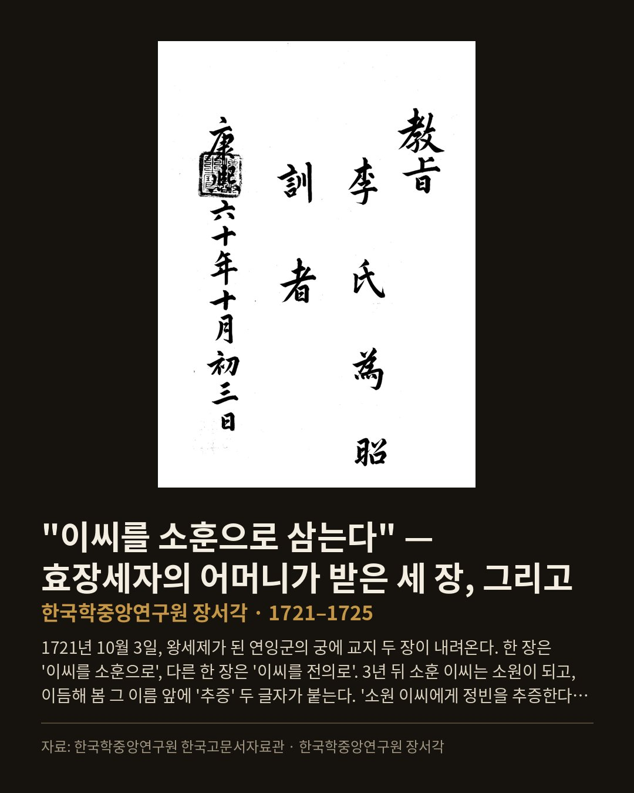
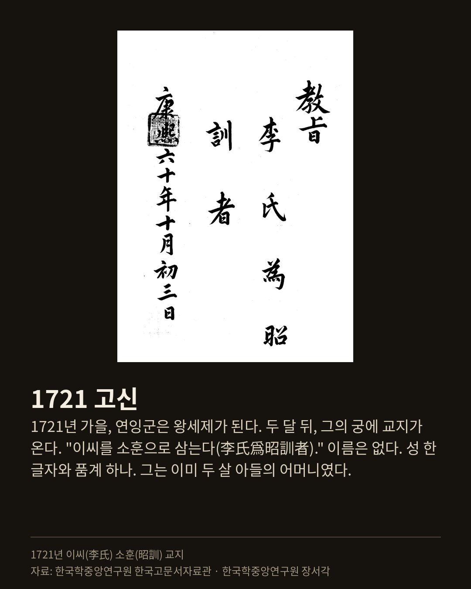
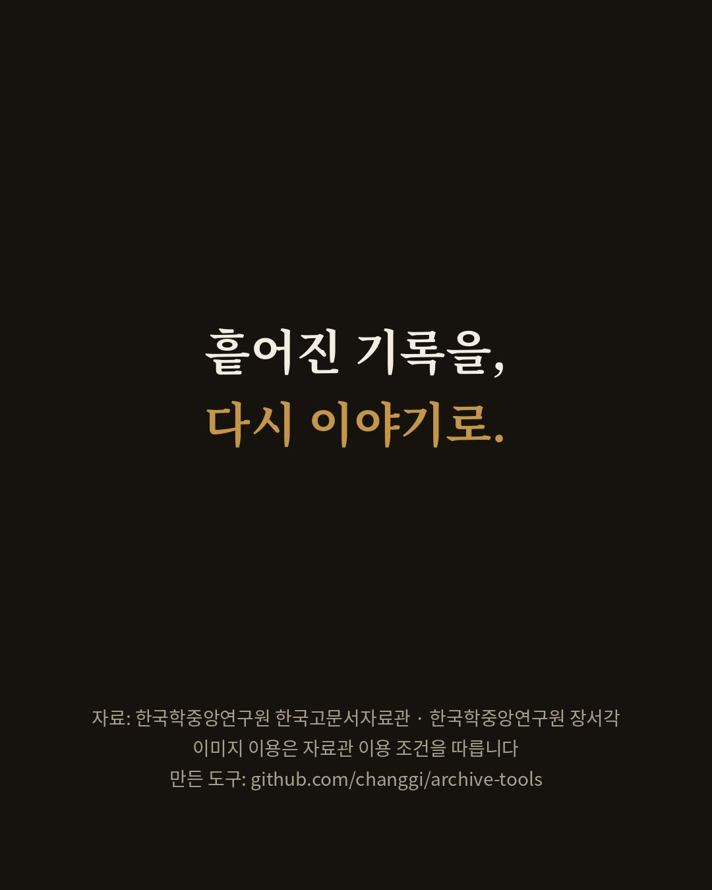

# EP.139 "이씨를 소훈으로 삼는다" — 효장세자의 어머니가 받은 세 장, 그리고 같은 날의 또 한 장

한국학중앙연구원 장서각 (박물관) · 1721년 10월 3일, 왕세제가 된 연잉군의 궁에 교지 두 장이 내려온다. 한 장은 '이씨를 소훈으로', 다른 한 장은 '이씨를 전의로'. 3년 뒤 소훈 이씨는 소원이 되고, 이듬해 봄 그 이름 앞에 '추증' 두 글자가 붙는다. '소원 이씨에게 정빈을 추증한다.' 그의 아들은 두 해 뒤 아홉 살에 성인식을 치른 효장세자다

- 🌐 [전시 웹페이지](https://changgi.github.io/archive-tools/examples/jangseogak-jeongbin/exhibit.html) (한자 위 한글 독음 · 원문 해석) · [수업 활동지](https://changgi.github.io/archive-tools/examples/jangseogak-jeongbin/handout.html)
- 🎬 영상: [릴스 9:16](https://changgi.github.io/archive-tools-next/media/ep139-jangseogak-jeongbin_reel.mp4) · [가로 16:9](https://changgi.github.io/archive-tools-next/media/ep139-jangseogak-jeongbin_wide.mp4) · 홍보 글: [`promo.md`](promo.md)
- 카드뉴스: [`cards/`](cards/) · SNS 글: [`sns.txt`](sns.txt) · 판독·해석 표: [`selection.csv`](selection.csv)

<!-- DELIVERY -->
## 전달 에디팅 — 이 기록을 이렇게 전합니다

- **핵심 정서** — 애틋함
- **한 문장** — 세자의 어머니도 교지에는 성 한 글자로 적혔다 — 품계가 오르는 동안 그는 세상을 떠났고, 마지막 교지는 '추증'이었다.
- **열기** — 세자의 어머니는, 성 한 글자 '이씨'로만 교지를 받았습니다.
- **펼치기** — 이씨 소훈 교지 → 이씨 전의 교지 → 이씨 소원 교지 → 소원 이씨 정빈 추증 교지 (1721–1725년) — 1721년 소훈 → 같은 날 전의(또 다른 이씨) → 1724년 소원 → 1725년 정빈 추증 순으로, 품계가 오르는 길 가운데 '같은 날의 또 다른 이씨'를 끼워 이름 없는 여인들을 함께 보이게 구성했습니다.
- **절정** — "소원 이씨에게 정빈을 추증한다(昭媛李氏贈靖嬪者)" — 화면·공간에서 이 한 줄만 크게, 소리를 줄여 집중
- **여운** — 아들이 세자가 되던 해, 그 어머니의 이름은 누가 기억하고 있었을까요? — 질문으로 끝내고 답은 보는 사람에게
- **감각과 물질** — 같은 크기의 교지 네 장 — 마지막 장에만 붙은 '贈' 한 글자 · 어보·관인 탁본 스탬프를 찍어 보는 체험
- **통로와 매개** — 온라인: 릴스(열기) → 카드뉴스(펼치기) → 전시 웹페이지(절정·원문) → 비하인드 카드(여운) / 오프라인: 원본 크기 복제·낭독·참여 벽 / 남기기: 활동지·질문 카드
- **여운 장치** — 이름 없이 남은 가족 한 사람 떠올리기
- **전달 에디팅 전** — 4건의 문서를 1721–1725년 연대순으로 놓고 문서명 · 유형 · 해설을 붙인다 — 정확하지만, 지나가면 잊힌다.
- **전달 에디팅 후** — 핵심 정서는 「애틋함」. 「효장세자의 어머니는, 성 한 글자 '이씨'로만 교지를 받았습니다.」로 열고, 문서를 대비와 순서로 펼친 뒤, "소원 이씨에게 정빈을 추증한다(昭媛李氏贈靖嬪者)"에서 멈춘다. 같은 크기의 교지 네 장 — 마지막 장에만 붙은 '贈' 한 글자. 마지막엔 「이름 없이 남은 가족 한 사람 떠올리기」로 보는 사람이 자기 이야기를 남기고 떠나게 한다.

전문: [`delivery.md`](delivery.md)
<!-- /DELIVERY -->

<!-- CURATOR -->
## 비하인드 — 큐레이터 노트

- **왜 이 문서들인가** — EP.132의 관례교서(효장세자)를 만든 뒤, 같은 장서각 자료에서 그 세자의 어머니가 받은 교지를 찾았습니다. 네 장 모두 이름 없이 '이씨'로만 적혀 있었습니다.
- **전하고 싶은 것** — 세자의 어머니도 교지에는 성 한 글자로 적혔다 — 품계가 오르는 동안 그는 세상을 떠났고, 마지막 교지는 '추증'이었다.
- **이렇게 보이길 바랐다** — 1721년 소훈 → 같은 날 전의(또 다른 이씨) → 1724년 소원 → 1725년 정빈 추증 순으로, 품계가 오르는 길 가운데 '같은 날의 또 다른 이씨'를 끼워 이름 없는 여인들을 함께 보이게 구성했습니다.
- **이렇게 써 주세요** — 조선의 내명부와 세자궁 품계, 영조와 효장세자, 기록 속 여성의 이름, 추증 제도 수업에 쓰세요.
- **만들며 있었던 일** — 네 장 모두 해서라 판독은 확실합니다. 전의 이씨가 누구인지, 1724년 교지가 살아 있는 사람에게 내린 것인지(정빈 이씨의 사망 연도는 기록마다 다름)는 판단하지 않았습니다. 효장세자의 생몰과 세자 책봉, 수길원 · 연호궁은 알려진 사실을 따랐습니다.
- **남겨 둔 질문** — 아들이 세자가 되던 해, 그 어머니의 이름은 누가 기억하고 있었을까요?
- **제작 기록** — 문서 4건 · 1721–1725년 · 원본 사진 4면(문서 전체) · 원문 판독 4건 · 번역 4건 · 해제에 "확인 필요"를 단 문서 1건

전문: [`curator.md`](curator.md) · 비하인드 카드: [`behind/`](behind/) · 채널별 홍보안: [`channels.md`](channels.md)
<!-- /CURATOR -->

## 이야기 — 사료가 말하는 대로

효장세자의 어머니는, 성 한 글자 '이씨'로만 교지를 받았습니다.

> **1721 고신** — 1721년 가을, 연잉군은 왕세제가 된다. 두 달 뒤, 그의 궁에 교지가 온다. "이씨를 소훈으로 삼는다(李氏爲昭訓者)." 이름은 없다. 성 한 글자와 품계 하나. 그는 이미 두 살 아들의 어머니였다.
> **1721 고신** — 같은 날, 같은 궁에 또 한 장이 온다. "이씨를 전의로 삼는다(李氏爲典衣者)." 또 이씨다. 같은 사람일까, 다른 사람일까. 종이는 말해 주지 않는다. 궁궐의 여인들은 이렇게, 성 하나로만 남았다.
> **1724 고신** — 3년 뒤, 남편이 임금이 된다. 교지가 다시 온다. "이씨를 소원으로 삼는다(李氏爲昭媛者)." 세자궁의 품계에서, 대궐의 품계로.
> **1725 고신** — 그리고 이듬해 봄. 같은 이름 앞에 두 글자가 붙는다. "소원 이씨에게 정빈을 추증한다(昭媛李氏贈靖嬪者)." 추증, 떠난 사람에게 주는 이름. 그해 그의 아들은 세자가 되었다. 어머니는, 그것을 보지 못했다.

| 표지 | 1번 카드 | 마무리 |
|---|---|---|
|  |  |  |

## 선별 문서 (4점)

| # | 연도 | 유형 | 문서명 | 원본 |
|---|---|---|---|---|
| 1 | 1721 | 고신 | 1721년 이씨(李氏) 소훈(昭訓) 교지 | [원본 보기](https://archive.aks.ac.kr/viewer/viewer.do#imgnode.do?itemId=book&gubun=booktree&depth=6&upPath=04%5E0401%5EL040101%5EL040101F02%5EL040101F0201&dataId=G002%2BAKS%2BKSM-XA.1721.1111-20101008.B009a_010_00072_XXX&itemType=) |
| 2 | 1721 | 고신 | 1721년 이씨(李氏) 전의(典衣) 교지 | [원본 보기](https://archive.aks.ac.kr/viewer/viewer.do#imgnode.do?itemId=book&gubun=booktree&depth=6&upPath=04%5E0401%5EL040101%5EL040101F02%5EL040101F0201&dataId=G002%2BAKS%2BKSM-XA.1721.1111-20101008.B009a_010_00073_XXX&itemType=) |
| 3 | 1724 | 고신 | 1724년 이씨(李氏) 소원(昭媛) 교지 | [원본 보기](https://archive.aks.ac.kr/viewer/viewer.do#imgnode.do?itemId=book&gubun=booktree&depth=6&upPath=04%5E0401%5EL040101%5EL040101F02%5EL040101F0201&dataId=G002%2BAKS%2BKSM-XA.1724.1111-20101008.B009a_010_00074_XXX&itemType=) |
| 4 | 1725 | 고신 | 1725년 소원 이씨(李氏) 정빈(靖嬪) 추증 교지 | [원본 보기](https://archive.aks.ac.kr/viewer/viewer.do#imgnode.do?itemId=book&gubun=booktree&depth=6&upPath=04%5E0401%5EL040101%5EL040101F02%5EL040101F0201&dataId=G002%2BAKS%2BKSM-XA.1725.1111-20101008.B009a_010_00075_XXX&itemType=) |

## 원문 판독과 해석

### 1. 1721년 이씨(李氏) 소훈(昭訓) 교지

**원문 판독**

```
敎旨
李氏爲昭
訓者
康熙六十年十月初三日
```

**원문 해석** 교지. 이씨를 소훈으로 삼는다. 강희 60년(1721) 10월 3일.

**해제** 1721년(경종 1, 康熙 60) 10월 3일 이씨(李氏)를 소훈(昭訓)으로 삼은 교지입니다. 소훈은 세자궁에 딸린 내명부의 품계(종5품)입니다. 이해 8월 연잉군(훗날의 영조)이 왕세제로 책봉되었으므로, 이 교지는 왕세제궁의 여인에게 내린 것으로 보입니다. 장서각에는 이 이씨가 1724년 소원, 1725년 정빈으로 이어지는 교지가 함께 전하여, 효장세자(1719–1728)를 낳은 정빈 이씨의 것으로 정리되어 있습니다. 여인의 이름 대신 성 '李氏'만 적었습니다. 연호 위에 어보가 찍혔습니다.

### 2. 1721년 이씨(李氏) 전의(典衣) 교지

**원문 판독**

```
敎旨
李氏爲典
衣者
康熙六十年十月初三日
```

**원문 해석** 교지. 이씨를 전의로 삼는다. 강희 60년(1721) 10월 3일.

**해제** 같은 날짜(1721년 10월 3일)에 또 다른 이씨를 전의(典衣)로 삼은 교지입니다. 전의는 세자궁 궁인의 직임 가운데 하나로, 옷과 관련된 일을 맡는 자리로 보입니다. 앞의 '소훈 이씨'와 같은 사람인지 다른 사람인지는 문서에 적혀 있지 않습니다. 같은 날 두 품계를 한 사람에게 함께 줄 까닭은 찾기 어려워 다른 사람일 가능성이 높아 보이나, 누구인지는 확인하지 않았습니다. 연호 위 어보 자리가 흐립니다.

### 3. 1724년 이씨(李氏) 소원(昭媛) 교지

**원문 판독**

```
敎旨
李氏爲
昭媛者
雍正二年十月十六日
```

**원문 해석** 교지. 이씨를 소원으로 삼는다. 옹정 2년(1724) 10월 16일.

**해제** 1724년(영조 즉위년, 雍正 2) 10월 16일 이씨를 소원(昭媛, 정4품)으로 삼은 교지입니다. 이해 8월 영조가 즉위하여, 세자궁의 품계였던 소훈이 대궐의 내명부 품계인 소원으로 옮겨졌습니다. 교지에는 '추증(贈)'이 아니라 '삼는다(爲)'로 적혔는데, 이듬해 교지는 '추증'입니다. 정빈 이씨가 1721년에 세상을 떠났다는 기록도 있어, 이 교지가 살아 있는 사람에게 내린 것인지 떠난 사람의 품계를 옮겨 준 것인지는 이번에 판단하지 않았습니다.

### 4. 1725년 소원 이씨(李氏) 정빈(靖嬪) 추증 교지

**원문 판독**

```
敎旨
昭媛李氏
贈靖嬪者
雍正三年二月二十七日
```

**원문 해석** 교지. 소원 이씨에게 정빈을 추증한다. 옹정 3년(1725) 2월 27일.

**해제** 1725년(영조 1, 雍正 3) 2월 27일 소원 이씨에게 정빈(靖嬪, 정1품 빈)을 추증한 교지입니다. '贈'은 세상을 떠난 사람에게 품계를 높여 주는 추증을 뜻합니다. 이해 정빈 이씨의 아들 경의군(敬義君)이 왕세자로 책봉되었는데(효장세자), 세자의 어머니를 높이는 뜻으로 보입니다. 효장세자는 1727년 관례를 치르고(EP.132의 관례교서) 이듬해 열 살로 세상을 떠났습니다. 정빈 이씨의 무덤은 훗날 수길원(綏吉園)으로 높여졌고, 신위는 육상궁 안 연호궁(延祜宮)에 모셔졌다고 전합니다.

판독·해석·이야기는 이미지에 근거한 초안이며(검토 전 "초안" 표시), 정확한 판독은 원문 확인이 필요합니다. □는 읽지 못한 글자, (?)는 불확실한 글자입니다.
이미지: 한국학중앙연구원 한국고문서자료관 소장·제공. "원본" 링크를 누르면 자료관 뷰어에서 그 문서가 열립니다. 재사용은 자료관에 문의하세요(소장처 동의 필요).
