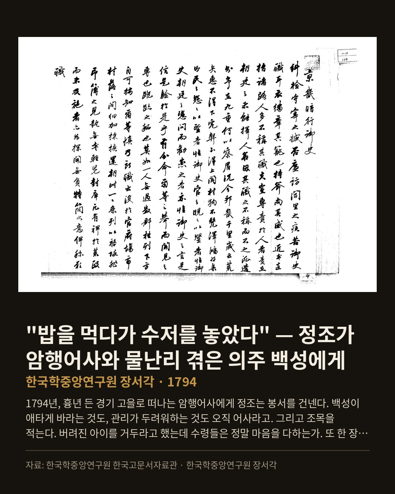
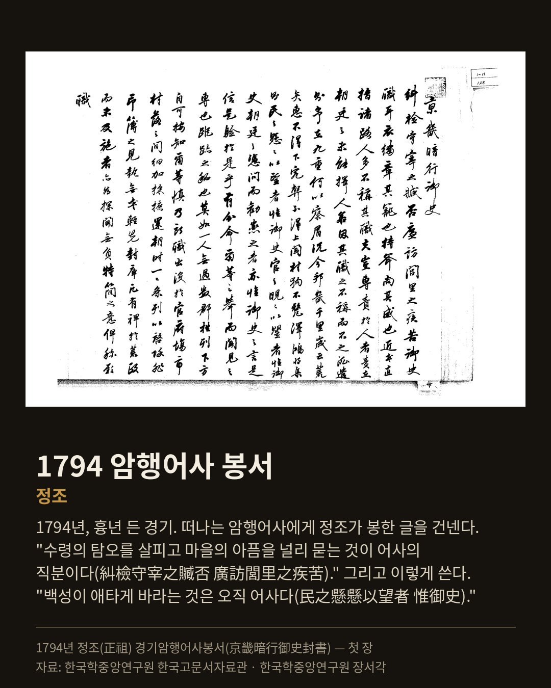
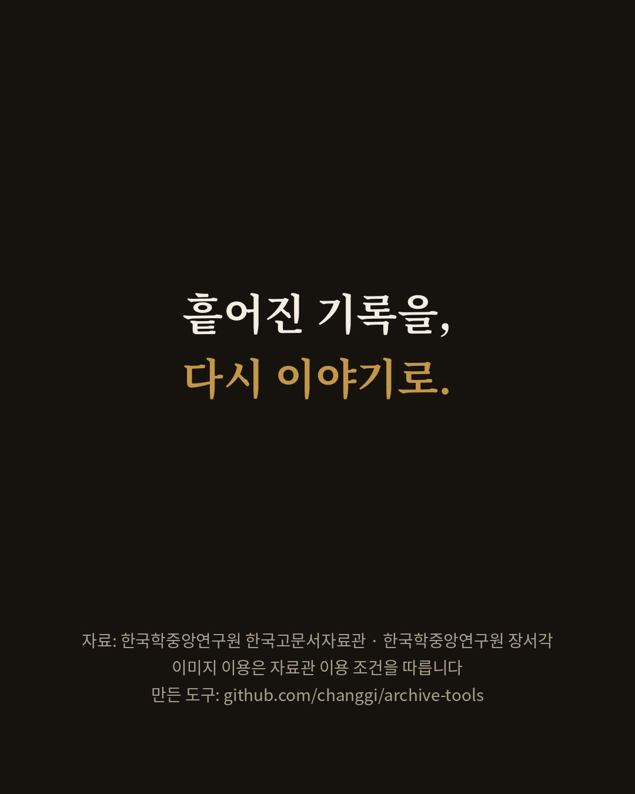

# EP.135 "밥을 먹다가 수저를 놓았다" — 정조가 암행어사와 물난리 겪은 의주 백성에게 쓴 글

한국학중앙연구원 장서각 (박물관) · 1794년, 흉년 든 경기 고을로 떠나는 암행어사에게 정조는 봉서를 건넨다. 백성이 애타게 바라는 것도, 관리가 두려워하는 것도 오직 어사라고. 그리고 조목을 적는다. 버려진 아이를 거두라고 했는데 수령들은 정말 마음을 다하는가. 또 한 장, 압록강 하구의 의주에 큰물이 져 천여 호가 떠내려가고 수백 명이 빠져 죽었다는 보고를 받은 임금은 쓴다. 한 번 보고 놀라고, 두 번 보고 슬퍼, 밥을 먹다가 수저를 놓았다고

- 🌐 [전시 웹페이지](https://changgi.github.io/archive-tools/examples/jangseogak-jeongjo/exhibit.html) (한자 위 한글 독음 · 원문 해석) · [수업 활동지](https://changgi.github.io/archive-tools/examples/jangseogak-jeongjo/handout.html)
- 🎬 영상: [릴스 9:16](https://changgi.github.io/archive-tools-next/media/ep135-jangseogak-jeongjo_reel.mp4) · [가로 16:9](https://changgi.github.io/archive-tools-next/media/ep135-jangseogak-jeongjo_wide.mp4) · 홍보 글: [`promo.md`](promo.md)
- 카드뉴스: [`cards/`](cards/) · SNS 글: [`sns.txt`](sns.txt) · 판독·해석 표: [`selection.csv`](selection.csv)

<!-- DELIVERY -->
## 전달 에디팅 — 이 기록을 이렇게 전합니다

- **핵심 정서** — 먹먹함
- **한 문장** — 구중궁궐의 임금은 백성을 직접 볼 수 없었다 — 그래서 어사를 보내 골목을 묻게 했고, 보고를 받으면 밥을 먹다 수저를 놓았다.
- **열기** — 물난리 소식을 들은 임금이 썼습니다. "밥을 먹다가 수저를 멈추었다."
- **펼치기** — 정조 경기암행어사봉서 — 첫 장 → 정조 경기암행어사봉서 — 살필 조 → 정조 평안도 의주 육도 수재민 효 (1794년) — 봉서 첫 장(어사의 직분) → 둘째 장(버려진 아이 등 살필 조목) → 효유문 첫 장(온 나라의 풍년과 의주의 물난리) → 둘째 장(수저를 멈춘 임금) 순으로, 제도의 문장에서 마음의 문장으로 옮겨 가게 구성했습니다.
- **절정** — "한 번 보고 놀라고, 두 번 보고 참담하여, 밥을 먹다가 수저를 멈추었다(一看驚愕 再看慘惻 却令當食停箸)" — 화면·공간에서 이 한 줄만 크게, 소리를 줄여 집중
- **여운** — 수저를 놓은 임금의 글을, 의주의 섬사람들은 누가 어디서 읽어 주었을까요? — 질문으로 끝내고 답은 보는 사람에게
- **감각과 물질** — 큰 행서로 또렷한 '一看驚愕 再看慘惻'과, 내려놓은 수저 한 벌 · 역마 방울·말발굽 소리와 함께 펼치는 두루마리
- **통로와 매개** — 온라인: 릴스(열기) → 카드뉴스(펼치기) → 전시 웹페이지(절정·원문) → 비하인드 카드(여운) / 오프라인: 원본 크기 복제·낭독·참여 벽 / 남기기: 활동지·질문 카드
- **여운 장치** — 멀리 있는 사람에게 위로 한 줄 써 보기
- **전달 에디팅 전** — 4건의 문서를 1794년 연대순으로 놓고 문서명 · 유형 · 해설을 붙인다 — 정확하지만, 지나가면 잊힌다.
- **전달 에디팅 후** — 핵심 정서는 「먹먹함」. 「물난리 소식을 들은 임금이 썼습니다. "밥을 먹다가 수저를 멈추었다."」로 열고, 문서를 대비와 순서로 펼친 뒤, "한 번 보고 놀라고, 두 번 보고 참담하여, 밥을 먹다가 수저를 멈추었다(一看驚愕 再看慘惻 却令當食停箸)"에서 멈춘다. 큰 행서로 또렷한 '一看驚愕 再看慘惻'과, 내려놓은 수저 한 벌. 마지막엔 「멀리 있는 사람에게 위로 한 줄 써 보기」로 보는 사람이 자기 이야기를 남기고 떠나게 한다.

전문: [`delivery.md`](delivery.md)
<!-- /DELIVERY -->

<!-- CURATOR -->
## 비하인드 — 큐레이터 노트

- **왜 이 문서들인가** — 장서각의 정조 문서 가운데, 임금이 '자기 마음'을 적은 대목이 유난히 또렷한 두 문서를 골랐습니다. 암행어사에게 준 봉서와, 물난리 겪은 의주 백성에게 보낸 글입니다.
- **전하고 싶은 것** — 구중궁궐의 임금은 백성을 직접 볼 수 없었다 — 그래서 어사를 보내 골목을 묻게 했고, 보고를 받으면 밥을 먹다 수저를 놓았다.
- **이렇게 보이길 바랐다** — 봉서 첫 장(어사의 직분) → 둘째 장(버려진 아이 등 살필 조목) → 효유문 첫 장(온 나라의 풍년과 의주의 물난리) → 둘째 장(수저를 멈춘 임금) 순으로, 제도의 문장에서 마음의 문장으로 옮겨 가게 구성했습니다.
- **이렇게 써 주세요** — 정조의 민본 정치, 암행어사 제도와 봉서, 유기아 구휼(자휼전칙), 재난과 국가의 위로, 조선의 국경 의주 수업에 쓰세요.
- **만들며 있었던 일** — 두 문서 모두 행서지만 대체로 읽히며, 몇 글자는 (?)로 두고 읽지 못한 끝부분은 '…'로 줄였습니다. 봉서와 효유문은 각각 앞 두 장만 받아 나머지 조목과 효유문의 날짜 · 구휼 내용은 보지 못했습니다. 효유문의 연도, 육도의 정확한 범위, 봉서를 받은 어사의 이름은 확인하지 않았습니다. 효유문은 자료관 목록의 '훈유유서'를 첫 줄 제목에 따라 고쳐 적었습니다.
- **남겨 둔 질문** — 수저를 놓은 임금의 글을, 의주의 섬사람들은 누가 어디서 읽어 주었을까요?
- **제작 기록** — 문서 4건 · 1794년 · 원본 사진 8면(문서 전체) · 원문 판독 4건 · 번역 4건 · 못 읽은 글자 □ 0 · 불확실 (?) 6 · 해제에 "확인 필요"를 단 문서 1건

전문: [`curator.md`](curator.md) · 비하인드 카드: [`behind/`](behind/) · 채널별 홍보안: [`channels.md`](channels.md)
<!-- /CURATOR -->

## 이야기 — 사료가 말하는 대로

물난리 소식을 들은 임금이 썼습니다. "밥을 먹다가 수저를 멈추었다."

> **1794 암행어사 봉서** — 1794년, 흉년 든 경기. 떠나는 암행어사에게 정조가 봉한 글을 건넨다. "수령의 탐오를 살피고 마을의 아픔을 널리 묻는 것이 어사의 직분이다(糾檢守宰之贓否 廣訪閭里之疾苦)." 그리고 이렇게 쓴다. "백성이 애타게 바라는 것은 오직 어사다(民之懸懸以望者 惟御史)."
> **1794 암행어사 봉서** — 둘째 장에는 살필 일이 한 줄씩 적혔다. 그 셋째 줄. 버려진 아이를 거두라고 명했는데, "수령 된 자들이 과연 마음을 다해 받드는가(爲守令者 果然盡心對揚否)." 임금은 어사에게, 골목을 몰래 다니며 직접 물어보라고 했다.
> ** 효유서** — 어느 해 가을, 온 나라에 풍년 보고가 올라온다. "올해는 비와 볕이 가장 알맞았다(今年雨暘最稱適可)." 그런데 한 곳에서만 다른 소식이 온다. 압록강 하구, 의주의 섬들이다.
> ** 효유서** — "의주의 천여 호가 떠내려가고 수백 사람이 빠져 죽었다니, 이 무슨 일인가." 임금은 자기 마음을 숨기지 않는다. "한 번 보고 놀라고, 두 번 보고 참담하여, 밥을 먹다가 수저를 멈추었다(一看驚愕 再看慘惻 却令當食停箸)."

| 표지 | 1번 카드 | 마무리 |
|---|---|---|
|  |  |  |

## 선별 문서 (4점)

| # | 연도 | 유형 | 문서명 | 원본 |
|---|---|---|---|---|
| 1 | 1794 | 암행어사 봉서 | 1794년 정조(正祖) 경기암행어사봉서(京畿暗行御史封書) — 첫 장 | [원본 보기](https://archive.aks.ac.kr/viewer/viewer.do#imgnode.do?itemId=book&gubun=booktree&depth=6&upPath=04%5E0401%5EL040101%5EL040101F02%5EL040101F0201&dataId=G002%2BAKS%2BKSM-XA.1794.1111-20101008.B009a_010_00050_XXX&itemType=) |
| 2 | 1794 | 암행어사 봉서 | 1794년 정조(正祖) 경기암행어사봉서(京畿暗行御史封書) — 살필 조목 | [원본 보기](https://archive.aks.ac.kr/viewer/viewer.do#imgnode.do?itemId=book&gubun=booktree&depth=6&upPath=04%5E0401%5EL040101%5EL040101F02%5EL040101F0201&dataId=G002%2BAKS%2BKSM-XA.1794.1111-20101008.B009a_010_00050_XXX&itemType=) |
| 3 | — | 효유서 | 정조(正祖) 평안도 의주 육도 수재민 효유서(曉諭書) — 첫 장 | [원본 보기](https://archive.aks.ac.kr/viewer/viewer.do#imgnode.do?itemId=book&gubun=booktree&depth=6&upPath=04%5E0401%5EL040101%5EL040101F02%5EL040101F0201&dataId=G002%2BAKS%2BKSM-XA.0000.1111-20101008.B009a_010_00017_XXX&itemType=) |
| 4 | — | 효유서 | 정조(正祖) 평안도 의주 육도 수재민 효유서(曉諭書) — 둘째 장 | [원본 보기](https://archive.aks.ac.kr/viewer/viewer.do#imgnode.do?itemId=book&gubun=booktree&depth=6&upPath=04%5E0401%5EL040101%5EL040101F02%5EL040101F0201&dataId=G002%2BAKS%2BKSM-XA.0000.1111-20101008.B009a_010_00017_XXX&itemType=) |

## 원문 판독과 해석

### 1. 1794년 정조(正祖) 경기암행어사봉서(京畿暗行御史封書) — 첫 장

**원문 판독**

```
京畿暗行御史
糾檢守宰之贓否廣訪閭里之疾苦卽御史
職耳衣繡章其寵也持斧尙其威也近者直
指諸路人多不稱其職失豈專責於人者責在
朝廷之未能擇人(?)因其職之不稱而不之派遣
乎予在九重何以察眉況今郊畿千里歲云荒
矣惠不得下究弊不得上聞村狗不驚澤鴻相集(?)
民之懸懸以望者惟御史官之睍睍以畏者惟御
史朝廷之憑聞而勸懲之者亦惟御史之言是
信是驗於是乎有命爾等之耳目而聞見之
專也跳踏之勤也莫如一人無過數郡枚列下方
自可揣知爾等愼乃職出沒於官府場市
村落之間細加採摭還朝時一一條列以啓 …
而未及施者亦爲採聞無負特簡之意俾稱厥
職
```

**원문 해석** 경기 암행어사. 수령의 탐오 여부를 살펴 바로잡고, 마을의 아픔을 널리 찾아 묻는 것이 곧 어사의 직분이다. 수놓은 옷은 그 총애이고, 도끼를 쥔 것은 그 위엄이다. 근래 여러 도에 어사를 보냈으나 그 직분에 걸맞은 사람이 많지 않았다. 그 잘못을 어찌 사람에게만 돌리겠는가, 조정이 사람을 가려 뽑지 못한 탓이다. 그렇다고 직분에 걸맞지 않다 하여 보내지 않겠는가. 나는 구중궁궐에 있으니 무엇으로 눈썹 끝을 살피겠는가. 하물며 지금 서울 둘레 천 리에 흉년이 들었다. 은혜는 아래로 다 미치지 못하고, 폐단은 위로 들리지 않는다. … 백성이 애타게 바라보는 것은 오직 어사이고, 관리가 두려워 곁눈질하는 것도 오직 어사이며, 조정이 듣고서 권하고 징계하는 것도 오직 어사의 말을 믿고 따른다. 이에 명하노니, 너희가 귀와 눈을 오로지하고 부지런히 발로 다니는 것은 한 사람이 몇 고을을 넘지 않게 하는 것만 한 것이 없다. 아래에 조목을 적으니 스스로 헤아려 알 것이다. 너희는 그 직분을 삼가, 관청 · 장터 · 마을 사이를 드나들며 자세히 캐어 모아, 조정에 돌아오는 날 하나하나 조목으로 아뢰라. … 아직 시행되지 못한 것도 캐어 들어, 특별히 뽑은 뜻을 저버리지 말고 그 직분에 걸맞게 하라.

**해제** 1794년(정조 18, 甲寅) 정조가 경기 암행어사에게 내린 봉서(封書)의 첫 장입니다. 봉서는 임금이 직접 쓰거나 쓰게 해 봉하여 내리는 비밀 명령서로, 암행어사는 도성 밖에 나가서야 이를 열어 보았습니다. 이 해 경기에 흉년이 들었다는 말('歲云荒矣')이 보입니다. 정조는 어사의 직분을 '수령의 탐오를 살피고 마을의 아픔을 널리 묻는 것(糾檢守宰之贓否 廣訪閭里之疾苦)'이라 정의하고, 앞서 보낸 어사들이 제 직분을 다하지 못한 책임이 사람을 잘 뽑지 못한 조정에 있다고 스스로 말합니다. 이어 '백성이 애타게 바라는 것도 오직 어사(民之懸懸以望者 惟御史)'라 하여 어사의 무게를 일깨웁니다. 행서라 몇 글자는 (?)로 두었고, 끝부분 한 줄은 읽지 못해 '…'로 줄였습니다. 연도는 자료관 목록(1794)을 따랐고, 받은 어사의 이름은 이 장에 없습니다.

### 2. 1794년 정조(正祖) 경기암행어사봉서(京畿暗行御史封書) — 살필 조목

**원문 판독**

```
一荒歲俵灾實難必數及民守令之私用吏鄕
之偸竊另加採察
一山火田濫稅之弊無處不然向因完伯狀本嚴
飭諸道果有實效與否各別廣採犯者隨現
論啓
一向於賑恤廳草記以遺棄兒收養事有嚴飭
京外之命矣爲守令者果然盡心對揚否
家(?)飼饋之穀亦不至於中間消瀜乎此亦各別
廣問
一今番停代一從抄戶而爲之若或當入而不入
不當入而入貧富相混虛實相蒙則是豈抄
戶停代之本意哉潛行坊曲先問某戶之入於
尤甚之次間何等而其停其代之爲此何較(?) …
於錮(?)恤條件以爲考察論啓之地
```

**원문 해석** 하나. 흉년에 재해를 나누어 덜어 주는 일은 반드시 셈하기 어렵거니와, 백성에게 돌아갈 것을 수령이 사사로이 쓰거나 향리가 몰래 빼돌리는 일을 따로 더 살피라. 하나. 산의 화전에 세금을 지나치게 매기는 폐단은 없는 곳이 없다. 앞서 전라 감사의 보고에 따라 여러 도에 엄히 단속했는데, 과연 효과가 있는지 각별히 널리 캐고, 어긴 자는 드러나는 대로 아뢰라. 하나. 지난번 진휼청의 보고에 따라 버려진 아이를 거두어 기르는 일로 서울과 지방에 엄히 명한 바 있다. 수령 된 자들이 과연 마음을 다해 받들고 있는가. 집집마다 아이를 먹일 곡식이 중간에서 녹아 없어지지는 않는가. 이것도 각별히 널리 물으라. 하나. 이번에 세금을 멈추고 대신하는 일은 오로지 가려 뽑은 집에 따라 하게 했다. 들어가야 할 집이 빠지고 들어가지 않아야 할 집이 들어가, 가난한 집과 부잣집이 뒤섞이고 참과 거짓이 서로 가려진다면, 어찌 가려 뽑아 덜어 준 본뜻이겠는가. 골목을 몰래 다니며 어느 집이 가장 어려운 등급에 들었는지 먼저 묻고 … 살펴 아뢸 바탕으로 삼으라.

**해제** 같은 봉서의 둘째 장으로, 어사가 살필 조목(條目)을 '一'자로 하나씩 적었습니다. 흉년의 재해 감면에서 수령 · 향리가 가로채는 일, 화전에 매기는 지나친 세금, 버려진 아이를 거두어 기르는 일(遺棄兒收養), 가장 어려운 집을 골라 세금을 덜어 주는 일이 바르게 되는지를 '각별히 널리 물으라(各別廣問)'고 했습니다. 버려진 아이를 거두는 일은 1783년(정조 7)에 「자휼전칙(字恤典則)」으로 규정을 만든 정조의 관심사였는데, 여기서도 '수령들이 과연 마음을 다하는가(爲守令者 果然盡心對揚否)'라고 물었습니다. 행서라 몇 글자는 (?)로 두었고, 넷째 조목의 끝부분은 읽지 못한 글자가 있어 '…'로 줄였습니다. 봉서의 나머지 장(조목이 더 있었을 가능성)은 이번에 받지 않았습니다.

### 3. 정조(正祖) 평안도 의주 육도 수재민 효유서(曉諭書) — 첫 장

**원문 판독**

```
諭平安道義州府六
島漂溺民人等書
王若曰今年雨暘最稱
適可雖在沮洳汚下之地
未嘗有昏墊沉沒之患
室家安堵禾黍盈疇每
接諸道之啓實有降康
之喜不料獨於關西以水
災告向來安博(?)之沿江漂
戶爲之驚心而幸無人物
```

**원문 해석** 평안도 의주부 여섯 섬의 물에 떠내려가고 빠진 백성들에게 이르는 글. 왕은 이르노라. 올해는 비와 볕이 가장 알맞았다고 일컬을 만하여, 질퍽하고 낮은 땅에서도 물에 잠기는 근심이 없었고, 집집마다 편안하고 벼와 기장이 들에 가득하였다. 여러 도의 보고를 받을 때마다 참으로 하늘이 내린 편안함의 기쁨이 있었다. 뜻밖에도 오직 관서(평안도)에서만 물난리를 알려 왔다. 지난번 안박(?)의 강가에서 집이 떠내려갔을 때도 놀랐으나, 다행히 사람은 상하지 않았는데,

**해제** 정조가 평안도 의주부의 여섯 섬(六島)에서 홍수로 집을 잃고 물에 빠진 백성들에게 내린 효유문(曉諭文)의 첫 장입니다. 자료관 목록에는 '훈유유서'로 되어 있으나, 첫 줄의 제목 '諭平安道義州府六島漂溺民人等書'를 따라 이름을 고쳐 적었습니다. 의주는 압록강 하구의 국경 고을이고, '육도'는 그 강 하구의 섬들을 가리키는 것으로 보입니다. 글은 '올해는 비와 볕이 가장 알맞았다(今年雨暘最稱適可)'는 나라 전체의 풍년 이야기로 시작해, '뜻밖에도 오직 관서에서만 물난리를 알려 왔다(不料獨於關西 以水災告)'로 무게를 옮깁니다. 이 문서에는 연도가 없고, 어느 해의 홍수였는지는 확인하지 못했습니다. 큰 행서로 또렷이 썼으며, 한 글자는 (?)로 두었습니다.

### 4. 정조(正祖) 평안도 의주 육도 수재민 효유서(曉諭書) — 둘째 장

**원문 판독**

```
之渰溺今者灣府之千
餘戶漂失數百人渰沒是
何事也灣府卽予邊塞
重鎭也予之視之非他地
比而許多民命偏罹此
害生者蕩析離居死者
掛罥洪濤使一島之民擧
入於懷襄之中一看驚愕
再看慘惻却令當食停
箸噫其生者結搆屋子俵 …
```

**원문 해석** …빠져 죽은 이는 없었다. 그런데 이제 의주부의 천여 호가 떠내려가고 수백 사람이 물에 빠져 죽었다니 이 무슨 일인가. 의주는 곧 나의 변방을 지키는 중요한 진(鎭)이다. 내가 보기에 다른 땅에 견줄 바가 아닌데, 수많은 백성의 목숨이 홀로 이 해를 입었다. 산 자는 흩어져 집을 떠나 살고, 죽은 자는 큰 물결에 걸려 있으며, 한 섬의 백성을 모두 산을 감고 언덕을 넘는 물속에 들게 하였다. 한 번 보고 놀라고, 두 번 보고 참담하여, 밥을 먹다가 수저를 멈추었다. 아, 산 자들이 집을 얽어 짓고 … (뒤 이어짐)

**해제** 같은 효유문의 둘째 장입니다. '의주부의 천여 호가 떠내려가고 수백 사람이 물에 빠져 죽었다(灣府之千餘戶漂失 數百人渰沒)'는 피해를 적고, 의주를 '나의 변방을 지키는 중요한 진(予邊塞重鎭)'이라 부르며 각별한 마음을 드러냅니다. '회양(懷襄)'은 『서경』의 '懷山襄陵(물이 산을 감싸고 언덕을 넘는다)'에서 온 말로 큰 홍수를 뜻합니다. 그리고 임금 자신의 반응을 그대로 적었습니다. '한 번 보고 놀라고, 두 번 보고 참담하여, 밥을 먹다가 수저를 멈추었다(一看驚愕 再看慘惻 却令當食停箸).' 이번에 받은 것은 두 장뿐이어서, 이어지는 구휼의 내용(집 짓기, 곡식 나누기 등)과 날짜는 보지 못했습니다.

판독·해석·이야기는 이미지에 근거한 초안이며(검토 전 "초안" 표시), 정확한 판독은 원문 확인이 필요합니다. □는 읽지 못한 글자, (?)는 불확실한 글자입니다.
이미지: 한국학중앙연구원 한국고문서자료관 소장·제공. "원본" 링크를 누르면 자료관 뷰어에서 그 문서가 열립니다. 재사용은 자료관에 문의하세요(소장처 동의 필요).
