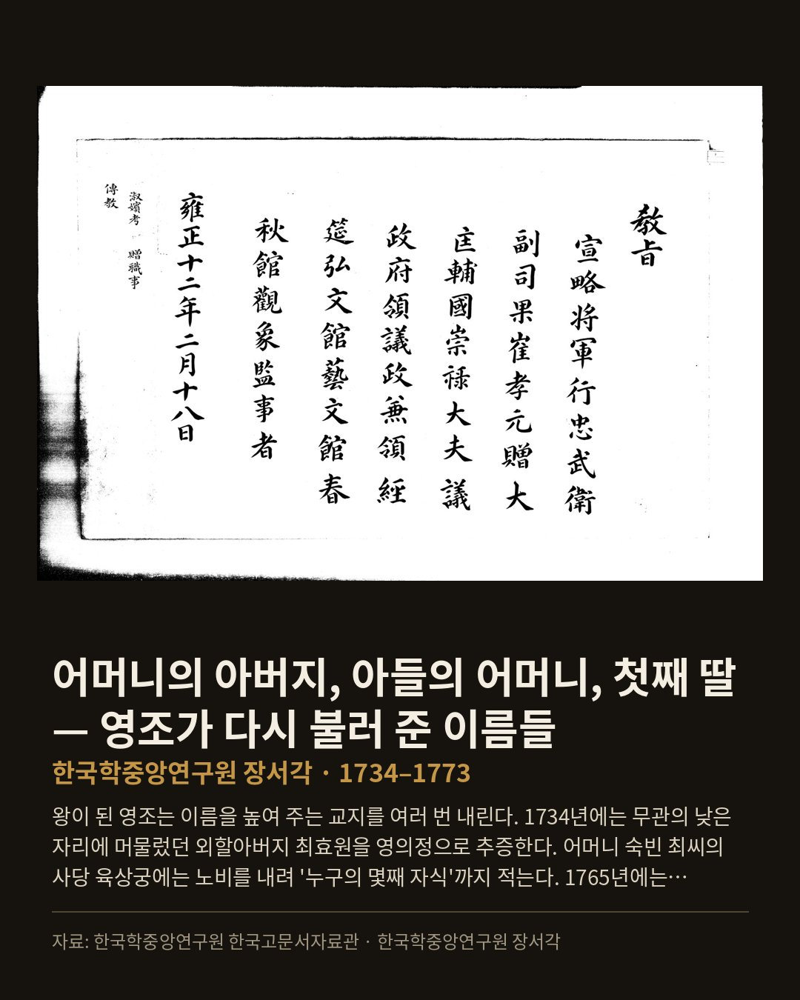
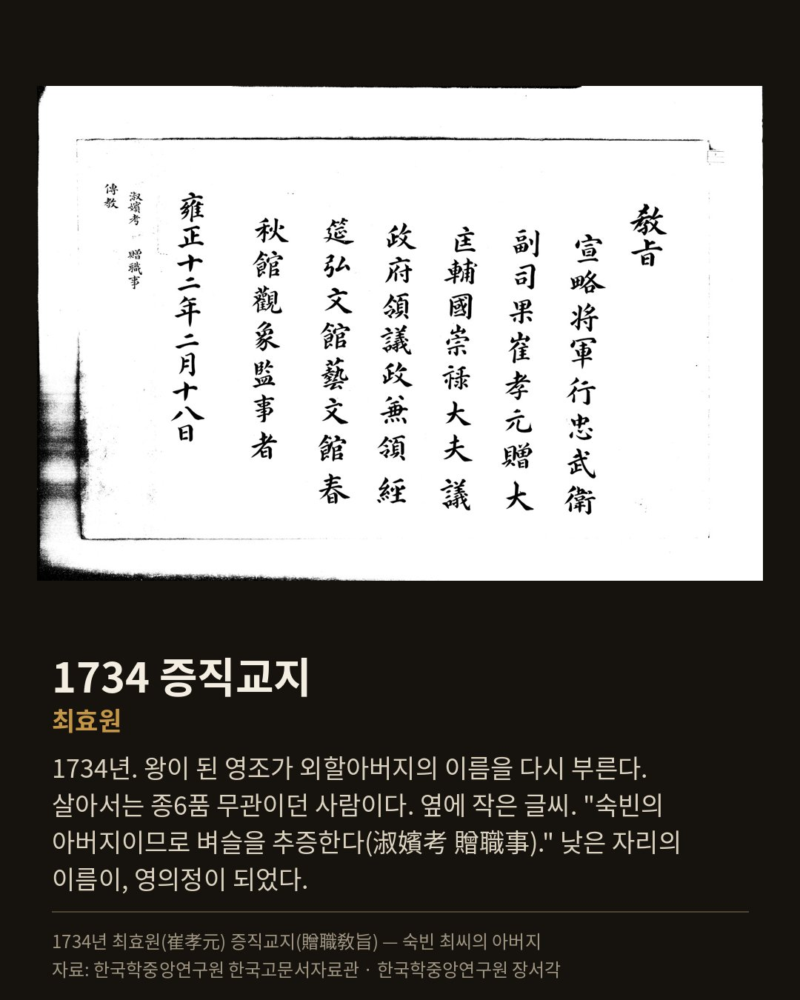
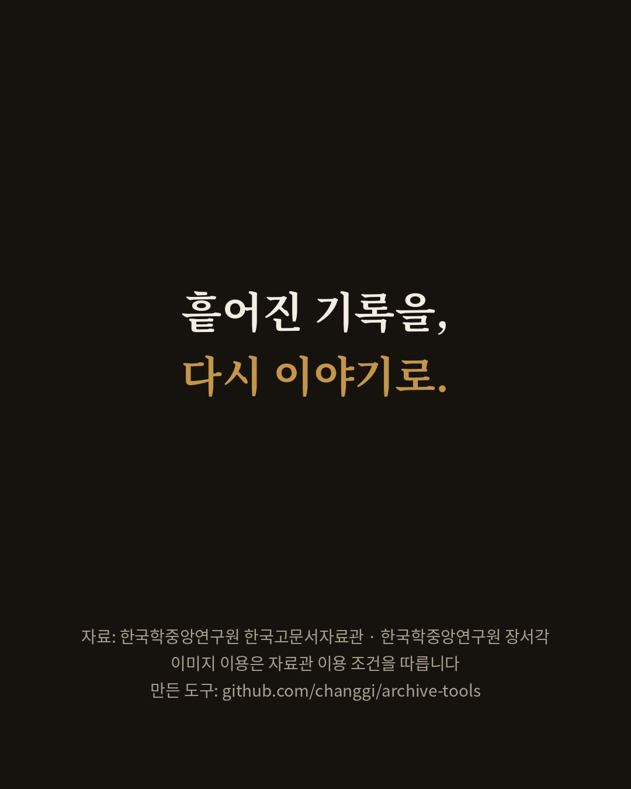

# EP.133 어머니의 아버지, 아들의 어머니, 첫째 딸 — 영조가 다시 불러 준 이름들

한국학중앙연구원 장서각 (박물관) · 왕이 된 영조는 이름을 높여 주는 교지를 여러 번 내린다. 1734년에는 무관의 낮은 자리에 머물렀던 외할아버지 최효원을 영의정으로 추증한다. 어머니 숙빈 최씨의 사당 육상궁에는 노비를 내려 '누구의 몇째 자식'까지 적는다. 1765년에는 사도세자의 어머니 영빈 이씨에게 '의열'이라는 시호를, 1773년에는 이름 없이 '첫째 옹주'로 불리던 딸에게 '화억'이라는 이름을 준다

- 🌐 [전시 웹페이지](https://changgi.github.io/archive-tools/examples/jangseogak-yeongjo/exhibit.html) (한자 위 한글 독음 · 원문 해석) · [수업 활동지](https://changgi.github.io/archive-tools/examples/jangseogak-yeongjo/handout.html)
- 🎬 영상: [릴스 9:16](https://changgi.github.io/archive-tools-next/media/ep133-jangseogak-yeongjo_reel.mp4) · [가로 16:9](https://changgi.github.io/archive-tools-next/media/ep133-jangseogak-yeongjo_wide.mp4) · 홍보 글: [`promo.md`](promo.md)
- 카드뉴스: [`cards/`](cards/) · SNS 글: [`sns.txt`](sns.txt) · 판독·해석 표: [`selection.csv`](selection.csv)

<!-- DELIVERY -->
## 전달 에디팅 — 이 기록을 이렇게 전합니다

- **핵심 정서** — 애틋함
- **한 문장** — 임금의 교지는 산 사람만이 아니라 떠난 사람의 이름을 다시 부르는 일이기도 했다 — 그리고 그 곁에는 이름만 적힌 또 다른 사람들이 있었다.
- **열기** — 이름 없이 '첫째 옹주'로만 불린 딸에게, 여든의 영조가 이름을 지어 주었습니다.
- **펼치기** — 최효원 증직교지 — 숙빈 최씨의  → 육상궁 노비사패교지 → 영빈이씨 증시교지 → 일옹주 증직교지 — 화억옹주 (1734–1773년) — 1734년 외할아버지 추증 → 육상궁 노비사패 → 1765년 영빈 이씨 시호 → 1773년 첫째 옹주의 이름 순으로, 영조의 가족을 따라가면서도 사패에 '누구의 몇째 자식'으로 적힌 노비들을 지우지 않고 가운데에 두었습니다.
- **절정** — "첫째 옹주에게 화억옹주를 추증한다(一翁主贈和憶翁主者)" — 화면·공간에서 이 한 줄만 크게, 소리를 줄여 집중
- **여운** — '첫째 옹주'에게 이름을 지어 주던 날, 여든의 영조는 그 아이의 얼굴을 기억하고 있었을까요? — 질문으로 끝내고 답은 보는 사람에게
- **감각과 물질** — 가장 마지막에, 이름 없던 '一翁主' 세 글자와 새 이름 '和憶' · 어보·관인 탁본 스탬프를 찍어 보는 체험
- **통로와 매개** — 온라인: 릴스(열기) → 카드뉴스(펼치기) → 전시 웹페이지(절정·원문) → 비하인드 카드(여운) / 오프라인: 원본 크기 복제·낭독·참여 벽 / 남기기: 활동지·질문 카드
- **여운 장치** — 늦게라도 불러 주고 싶은 이름 하나 적기
- **전달 에디팅 전** — 4건의 문서를 1734–1773년 연대순으로 놓고 문서명 · 유형 · 해설을 붙인다 — 정확하지만, 지나가면 잊힌다.
- **전달 에디팅 후** — 핵심 정서는 「애틋함」. 「이름 없이 '첫째 옹주'로만 불린 딸에게, 여든의 영조가 이름을 지어 주었습니다.」로 열고, 문서를 대비와 순서로 펼친 뒤, "첫째 옹주에게 화억옹주를 추증한다(一翁主贈和憶翁主者)"에서 멈춘다. 가장 마지막에, 이름 없던 '一翁主' 세 글자와 새 이름 '和憶'. 마지막엔 「늦게라도 불러 주고 싶은 이름 하나 적기」로 보는 사람이 자기 이야기를 남기고 떠나게 한다.

전문: [`delivery.md`](delivery.md)
<!-- /DELIVERY -->

<!-- CURATOR -->
## 비하인드 — 큐레이터 노트

- **왜 이 문서들인가** — 장서각의 영조 대 교지를 늘어놓고 보니, 대부분이 '누군가의 이름을 높여 주는' 문서였습니다. 외할아버지, 어머니의 사당, 아들의 어머니, 그리고 이름 없던 딸.
- **전하고 싶은 것** — 임금의 교지는 산 사람만이 아니라 떠난 사람의 이름을 다시 부르는 일이기도 했다 — 그리고 그 곁에는 이름만 적힌 또 다른 사람들이 있었다.
- **이렇게 보이길 바랐다** — 1734년 외할아버지 추증 → 육상궁 노비사패 → 1765년 영빈 이씨 시호 → 1773년 첫째 옹주의 이름 순으로, 영조의 가족을 따라가면서도 사패에 '누구의 몇째 자식'으로 적힌 노비들을 지우지 않고 가운데에 두었습니다.
- **이렇게 써 주세요** — 영조와 숙빈 최씨 · 사도세자 · 영빈 이씨의 이야기, 증직 · 증시 제도, 왕실 사당(칠궁)과 노비, 노비 신분의 모계 세습 수업에 쓰세요.
- **만들며 있었던 일** — 모두 해서라 판독은 확실한 편이나, 노비사패는 앞 두 장만 판독했고 몇몇 이름자는 글꼴이 특이해 불확실합니다. 육상궁 사패의 연도(목록 1751)는 '육상궁' 이름이 붙은 해(1753으로 알려짐)와 맞지 않아 확인이 필요합니다. 화억옹주의 생몰년과 영빈 시호의 까닭은 확인하지 않았습니다.
- **남겨 둔 질문** — '첫째 옹주'에게 이름을 지어 주던 날, 여든의 영조는 그 아이의 얼굴을 기억하고 있었을까요?
- **제작 기록** — 문서 4건 · 1734–1773년 · 원본 사진 5면(문서 전체) · 원문 판독 4건 · 번역 4건 · 해제에 "확인 필요"를 단 문서 2건

전문: [`curator.md`](curator.md) · 비하인드 카드: [`behind/`](behind/) · 채널별 홍보안: [`channels.md`](channels.md)
<!-- /CURATOR -->

## 이야기 — 사료가 말하는 대로

이름 없이 '첫째 옹주'로만 불린 딸에게, 여든의 영조가 이름을 지어 주었습니다.

> **1734 증직교지** — 1734년. 왕이 된 영조가 외할아버지의 이름을 다시 부른다. 살아서는 종6품 무관이던 사람이다. 옆에 작은 글씨. "숙빈의 아버지이므로 벼슬을 추증한다(淑嬪考 贈職事)." 낮은 자리의 이름이, 영의정이 되었다.
> **1751 노비사패교지** — 어머니의 사당에도 사람이 내려진다. 그런데 이번엔 이름만이 아니다. "계집종 석녀의 셋째 자식, 사내종 일부, 나이 마흔하나(婢石女三所生奴日夫年四十一)." 누구의 몇째 자식인지까지. 어머니를 기리는 문서에, 다른 어머니들의 이름이 줄지어 적혔다.
> **1765 증시교지** — 1765년. 한 해 전 세상을 떠난 후궁에게 시호가 내려진다. 사도세자의 어머니다. "영빈 이씨에게 시호 '의열'을 내린다(暎嬪李氏贈諡義烈嬪者)." 두 글자 안에 무엇이 담겼는지, 종이는 말하지 않는다.
> **1773 증직교지** — 그리고 1773년, 여든의 임금이 또 하나의 이름을 부른다. 이름조차 없이 '첫째 옹주'로 적혀 있던 딸이다. "첫째 옹주에게 화억옹주를 추증한다(一翁主贈和憶翁主者)." 늙은 아버지는 끝내, 딸에게 이름을 지어 주었다.

| 표지 | 1번 카드 | 마무리 |
|---|---|---|
|  |  |  |

## 선별 문서 (4점)

| # | 연도 | 유형 | 문서명 | 원본 |
|---|---|---|---|---|
| 1 | 1734 | 증직교지 | 1734년 최효원(崔孝元) 증직교지(贈職敎旨) — 숙빈 최씨의 아버지 | [원본 보기](https://archive.aks.ac.kr/viewer/viewer.do#imgnode.do?itemId=book&gubun=booktree&depth=6&upPath=04%5E0401%5EL040101%5EL040101F02%5EL040101F0201&dataId=G002%2BAKS%2BKSM-XA.1734.1111-20101008.B009a_010_00077_XXX&itemType=) |
| 2 | 1751 | 노비사패교지 | 육상궁(毓祥宮) 노비사패교지(奴婢賜牌敎旨) | [원본 보기](https://archive.aks.ac.kr/viewer/viewer.do#imgnode.do?itemId=book&gubun=booktree&depth=6&upPath=04%5E0401%5EL040101%5EL040101F02%5EL040101F0201&dataId=G002%2BAKS%2BKSM-XA.1751.1111-20101008.B009a_010_00064_XXX&itemType=) |
| 3 | 1765 | 증시교지 | 1765년 영빈이씨(暎嬪李氏) 증시교지(贈諡敎旨) | [원본 보기](https://archive.aks.ac.kr/viewer/viewer.do#imgnode.do?itemId=book&gubun=booktree&depth=6&upPath=04%5E0401%5EL040101%5EL040101F02%5EL040101F0201&dataId=G002%2BAKS%2BKSM-XA.1765.1111-20101008.B009a_010_00085_XXX&itemType=) |
| 4 | 1773 | 증직교지 | 1773년 일옹주(一翁主) 증직교지(贈職敎旨) — 화억옹주 | [원본 보기](https://archive.aks.ac.kr/viewer/viewer.do#imgnode.do?itemId=book&gubun=booktree&depth=6&upPath=04%5E0401%5EL040101%5EL040101F02%5EL040101F0201&dataId=G002%2BAKS%2BKSM-XA.1773.1111-20101008.B009a_010_00081_XXX&itemType=) |

## 원문 판독과 해석

### 1. 1734년 최효원(崔孝元) 증직교지(贈職敎旨) — 숙빈 최씨의 아버지

**원문 판독**

```
敎旨
宣略將軍行忠武衛
副司果崔孝元贈大
匡輔國崇祿大夫議
政府領議政兼領經
筵弘文館藝文館春
秋館觀象監事者
雍正十二年二月十八日
淑嬪考　贈職事
傳敎
```

**원문 해석** 교지. 선략장군 행 충무위 부사과 최효원에게 대광보국숭록대부 의정부 영의정 겸 영경연 · 홍문관 · 예문관 · 춘추관 · 관상감사를 추증한다. 옹정 12년(1734) 2월 18일. (작은 글씨) 숙빈의 아버지이므로 벼슬을 추증하는 일. 전교.

**해제** 1734년(영조 10, 雍正 12) 영조의 어머니 숙빈 최씨(淑嬪崔氏)의 아버지 최효원(崔孝元)에게 영의정을 추증한 교지입니다. 최효원이 살아서 지닌 직함은 '선략장군(종4품) 행 충무위 부사과(종6품)'로 무관의 낮은 자리였는데, 외손자가 임금이 되자 신하로서 가장 높은 자리인 대광보국숭록대부 영의정으로 높여졌습니다. 왼쪽 작은 글씨 '淑嬪考 贈職事'가 그 까닭 — 숙빈의 아버지(考)이기 때문 — 을 밝힙니다. 숙빈 최씨는 궁중의 낮은 신분에서 출발해 숙종의 후궁이 된 사람으로 알려져 있습니다.

### 2. 육상궁(毓祥宮) 노비사패교지(奴婢賜牌敎旨)

**원문 판독**

```
敎旨
惟
毓祥宮將義城司宰監婢石女三所生奴日夫年四十一婢
平玉二所生奴允巖田年四十二婢進大一所生婢二娘年四
十一婢厚分七所生奴占孫年五十婢正春四所生婢致良年
五十八婢一德四所生婢秋女年四十七婢㐫德五所生婢允大年
五十六婢㐫女二所生奴德伊年四十七婢太月二所生奴汗億
年四十二婢順分七所生婢亥玉年四十九婢升還一所生婢
召史年五十婢一丹三所生婢已分年五十九婢已丹三所生
奴成官年五十九婢正月六所生婢順月年四十八禮賓寺
婢一香一所生奴致方年三十二婢江牙之二所生奴二乞年四 …
```

**원문 해석** 교지. 육상궁에 사패하여, 의성 사재감의 계집종 석녀의 셋째 자식 사내종 일부(41세), 계집종 평옥의 둘째 자식 사내종 윤암전(42세), 계집종 진대의 첫째 자식 계집종 이낭(41세), 계집종 후분의 일곱째 자식 사내종 점손(50세), 계집종 정춘의 넷째 자식 계집종 치량(58세) … 예빈시 계집종 일향의 첫째 자식 사내종 치방(32세) … 계집종 이녀의 둘째 자식 이단(44세), 셋째 자식 두백(36세) … (뒤 이어짐)

**해제** 영조의 어머니 숙빈 최씨를 모신 사당 육상궁(毓祥宮)에 관노비를 내려 준 노비사패교지입니다. 사당의 제사와 살림을 맡을 사람들로, 의성의 사재감(司宰監) 소속과 예빈시(禮賓寺) 소속 노비들을 옮겨 주었습니다. 이 문서는 사람마다 '어머니 누구의 몇째 자식(某婢 幾所生)'이라고 적어, 노비의 신분이 어머니를 따라 이어졌음을 그대로 보여 줍니다. 한 어머니 이녀(以女)의 둘째와 셋째 자식이 함께 적힌 대목도 있습니다. 대부분 마흔에서 쉰아홉 살로, 젊은 사람보다 나이 든 사람이 많습니다. 연도는 자료관 목록(1751)을 따랐으나, 숙빈의 사당이 '육상궁'이라는 이름을 얻은 것은 1753년으로 알려져 있어 연도는 확인이 필요합니다. 처음 두 장만 판독했고 몇몇 이름자(㐫 등)는 글꼴이 특이해 불확실합니다.

### 3. 1765년 영빈이씨(暎嬪李氏) 증시교지(贈諡敎旨)

**원문 판독**

```
敎旨
暎嬪李氏
贈諡義烈
嬪者
乾隆三十年七月十一日
```

**원문 해석** 교지. 영빈 이씨에게 시호 '의열'을 내려 의열빈으로 삼는다. 건륭 30년(1765) 7월 11일.

**해제** 1765년(영조 41, 乾隆 30) 영조의 후궁이자 사도세자의 어머니인 영빈 이씨(暎嬪李氏)에게 '의열(義烈)'이라는 시호를 내린 교지입니다. 영빈 이씨는 1764년에 세상을 떠났습니다. 사도세자가 뒤주에 갇혀 죽은 1762년의 일과 영빈의 관계는 여러 기록에 전하지만 이 교지에는 시호만 적혀 있습니다. '의(義)'와 '열(烈)'이라는 두 글자를 고른 까닭은 이 문서만으로는 알 수 없습니다. 이미지는 바탕이 거칠게 찍힌 흑백 촬영본입니다.

### 4. 1773년 일옹주(一翁主) 증직교지(贈職敎旨) — 화억옹주

**원문 판독**

```
敎旨
一翁主
贈和憶
翁主者
乾隆三十八年十月初七日
```

**원문 해석** 교지. 첫째 옹주에게 '화억옹주'를 추증한다. 건륭 38년(1773) 10월 7일.

**해제** 1773년(영조 49, 乾隆 38) '일옹주(一翁主)', 곧 첫째 옹주에게 '화억(和憶)'이라는 옹주 이름을 추증한 교지입니다. 일찍 세상을 떠나 봉작을 받지 못한 영조의 딸로 보이며, 이름 없이 '첫째 옹주'로만 불리다가 이때 비로소 이름을 얻었습니다. 영조가 여든 살이던 해입니다. 이 옹주가 언제 태어나 언제 세상을 떠났는지는 이번에 확인하지 않았습니다.

판독·해석·이야기는 이미지에 근거한 초안이며(검토 전 "초안" 표시), 정확한 판독은 원문 확인이 필요합니다. □는 읽지 못한 글자, (?)는 불확실한 글자입니다.
이미지: 한국학중앙연구원 한국고문서자료관 소장·제공. "원본" 링크를 누르면 자료관 뷰어에서 그 문서가 열립니다. 재사용은 자료관에 문의하세요(소장처 동의 필요).
