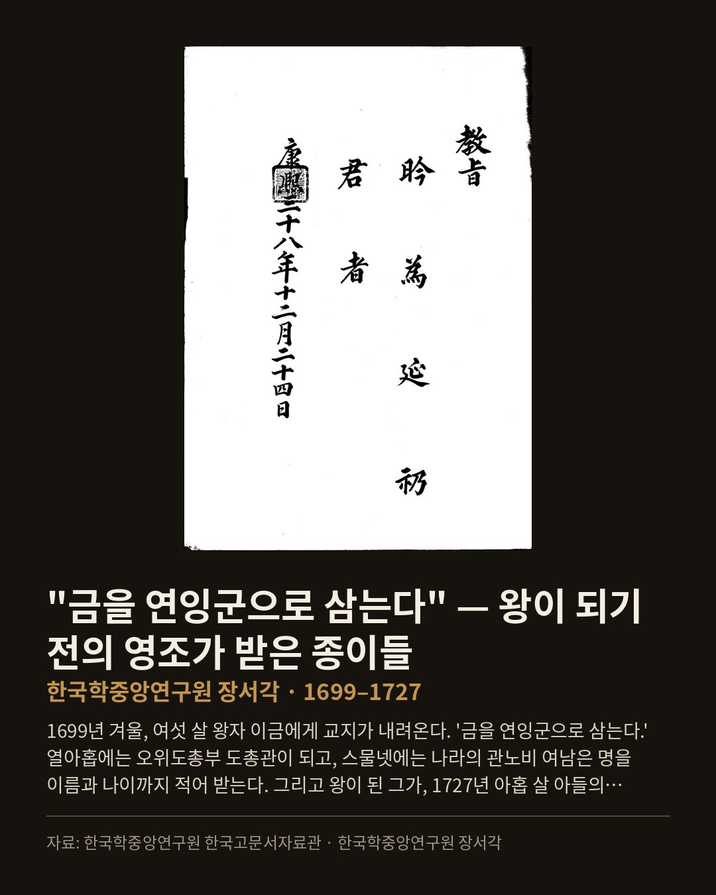
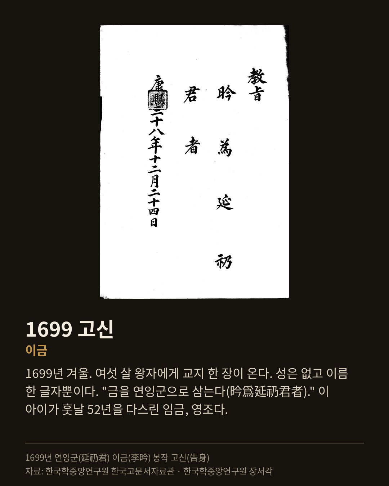
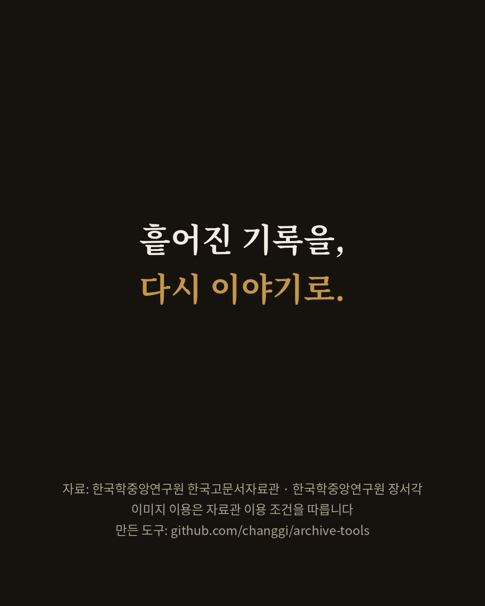

# EP.132 "금을 연잉군으로 삼는다" — 왕이 되기 전의 영조가 받은 종이들

한국학중앙연구원 장서각 (박물관) · 1699년 겨울, 여섯 살 왕자 이금에게 교지가 내려온다. '금을 연잉군으로 삼는다.' 열아홉에는 오위도총부 도총관이 되고, 스물넷에는 나라의 관노비 여남은 명을 이름과 나이까지 적어 받는다. 그리고 왕이 된 그가, 1727년 아홉 살 아들의 성인식에 교서를 내린다. '이제부터 너는 밤낮으로 삼가라'

- 🌐 [전시 웹페이지](https://changgi.github.io/archive-tools/examples/jangseogak/exhibit.html) (한자 위 한글 독음 · 원문 해석) · [수업 활동지](https://changgi.github.io/archive-tools/examples/jangseogak/handout.html)
- 🎬 영상: [릴스 9:16](https://changgi.github.io/archive-tools-next/media/ep132-jangseogak_reel.mp4) · [가로 16:9](https://changgi.github.io/archive-tools-next/media/ep132-jangseogak_wide.mp4) · 홍보 글: [`promo.md`](promo.md)
- 카드뉴스: [`cards/`](cards/) · SNS 글: [`sns.txt`](sns.txt) · 판독·해석 표: [`selection.csv`](selection.csv)

<!-- DELIVERY -->
## 전달 에디팅 — 이 기록을 이렇게 전합니다

- **핵심 정서** — 뭉클함
- **한 문장** — 임금도 처음엔 이름 한 글자로 불린 아이였다 — 받던 사람이 주는 사람이 되기까지, 종이가 그 시간을 남겼다.
- **열기** — 영조가 왕이 되기 전, 여섯 살에 받은 교지가 있습니다.
- **펼치기** — 연잉군 이금 봉작 고신 → 연잉군 이금 오위도총부 도총관 고 → 연잉군 노비사패교지 → 영조 왕세자관례교서 (1699–1727년) — 1699년 봉작 교지(6세) → 1712 · 1715년 도총관 교지(19 · 22세) → 노비사패교지(24세) → 왕이 되어 1727년 아들에게 내린 관례교서 순으로, '받는 사람'이 '주는 사람'으로 바뀌는 구조로 구성했습니다. 사패에 이름이 적힌 노비들을 지우지 않고 한 사람씩 불렀습니다.
- **절정** — "너는 부디 밤낮으로 삼가 나의 가르침을 어기지 말라(爾尙夙夜祗愼 無違予訓)" — 화면·공간에서 이 한 줄만 크게, 소리를 줄여 집중
- **여운** — 사패에 이름이 적힌 열일곱 살 용석은, 자기 이름이 왕자에게 넘겨진 것을 언제 알았을까요? — 질문으로 끝내고 답은 보는 사람에게
- **감각과 물질** — 흰 종이 위 이름 한 글자 '昑' — 그리고 마지막엔 그가 쓴 '無違予訓' · 어보·관인 탁본 스탬프를 찍어 보는 체험 · 두루마리를 실제 길이로 펼친 복제
- **통로와 매개** — 온라인: 릴스(열기) → 카드뉴스(펼치기) → 전시 웹페이지(절정·원문) → 비하인드 카드(여운) / 오프라인: 원본 크기 복제·낭독·참여 벽 / 남기기: 활동지·질문 카드
- **여운 장치** — 부모에게 들은 '이제 어른이다' 한마디 떠올리기
- **전달 에디팅 전** — 5건의 문서를 1699–1727년 연대순으로 놓고 문서명 · 유형 · 해설을 붙인다 — 정확하지만, 지나가면 잊힌다.
- **전달 에디팅 후** — 핵심 정서는 「뭉클함」. 「영조가 왕이 되기 전, 여섯 살에 받은 교지가 있습니다.」로 열고, 문서를 대비와 순서로 펼친 뒤, "너는 부디 밤낮으로 삼가 나의 가르침을 어기지 말라(爾尙夙夜祗愼 無違予訓)"에서 멈춘다. 흰 종이 위 이름 한 글자 '昑' — 그리고 마지막엔 그가 쓴 '無違予訓'. 마지막엔 「부모에게 들은 '이제 어른이다' 한마디 떠올리기」로 보는 사람이 자기 이야기를 남기고 떠나게 한다.

전문: [`delivery.md`](delivery.md)
<!-- /DELIVERY -->

<!-- CURATOR -->
## 비하인드 — 큐레이터 노트

- **왜 이 문서들인가** — 장서각 왕실 문서 가운데, 훗날의 영조가 왕자 시절에 받은 교지가 해마다 이어져 있었습니다. 그리고 왕이 된 그가 아들에게 쓴 교서가 같은 곳에 있었습니다.
- **전하고 싶은 것** — 임금도 처음엔 이름 한 글자로 불린 아이였다 — 받던 사람이 주는 사람이 되기까지, 종이가 그 시간을 남겼다.
- **이렇게 보이길 바랐다** — 1699년 봉작 교지(6세) → 1712 · 1715년 도총관 교지(19 · 22세) → 노비사패교지(24세) → 왕이 되어 1727년 아들에게 내린 관례교서 순으로, '받는 사람'이 '주는 사람'으로 바뀌는 구조로 구성했습니다. 사패에 이름이 적힌 노비들을 지우지 않고 한 사람씩 불렀습니다.
- **이렇게 써 주세요** — 영조의 생애와 숙종 대 왕실, 왕자 봉작과 종친의 관직, 노비 사패와 왕실 재정, 관례(성인식)와 교서 수업에 쓰세요.
- **만들며 있었던 일** — 모두 해서라 판독은 확실한 편이나, 1699년 교지의 연호 숫자 하나는 어보에 가려 자료관 목록을 따랐습니다. 노비사패교지와 관례교서는 앞의 두 장 · 한 장만 받아 끝부분과 날짜를 보지 못했고, 관례교서 자료의 첫 장은 1882년 문서로 보여 자료관 연결 확인이 필요합니다. 도총관 거듭 임명의 사정은 확인하지 않았습니다.
- **남겨 둔 질문** — 사패에 이름이 적힌 열일곱 살 용석은, 자기 이름이 왕자에게 넘겨진 것을 언제 알았을까요?
- **제작 기록** — 문서 5건 · 1699–1727년 · 원본 사진 7면(문서 전체) · 원문 판독 5건 · 번역 5건 · 못 읽은 글자 □ 1 · 불확실 (?) 0 · 해제에 "확인 필요"를 단 문서 3건

전문: [`curator.md`](curator.md) · 비하인드 카드: [`behind/`](behind/) · 채널별 홍보안: [`channels.md`](channels.md)
<!-- /CURATOR -->

## 이야기 — 사료가 말하는 대로

영조가 왕이 되기 전, 여섯 살에 받은 교지가 있습니다.

> **1699 고신** — 1699년 겨울. 여섯 살 왕자에게 교지 한 장이 온다. 성은 없고 이름 한 글자뿐이다. "금을 연잉군으로 삼는다(昑爲延礽君者)." 이 아이가 훗날 52년을 다스린 임금, 영조다.
> **1712 고신** — 13년 뒤, 열아홉의 왕자에게 다시 교지가 온다. "금을 겸 오위도총부 도총관으로 삼는다(昑爲兼五衛都摠府都摠管者)." 나라의 군대를 맡는 높은 자리. 왕자의 이름이 관직의 이름과 함께 적히기 시작했다.
> **1715 고신** — 그리고 해마다, 같은 문장이 되풀이된다. 1713년, 1714년, 1715년. "금을 겸 오위도총부 도총관으로 삼는다(昑爲兼五衛都摠府都摠管者)." 같은 종이가 쌓이는 동안, 왕자는 스물두 살이 되었다.
> **1717 노비사패교지** — 스물넷이 된 왕자에게, 이번엔 사람이 내려진다. 연기의 가지, 춘천의 초선, 인제의 용석. 고을마다 한 명씩, 이름과 나이가 적혔다. "인제 관노 용석, 나이 열일곱(麟蹄官奴龍錫年十七)." 왕자의 살림은, 이 사람들의 이름 위에 꾸려졌다.
> **1727 왕세자관례교서** — 그리고 1727년. 여섯 살에 교지를 받던 그 아이가 이제 임금이 되어, 아홉 살 아들의 성인식에 교서를 쓴다. "너는 부디 밤낮으로 삼가 나의 가르침을 어기지 말라(爾尙夙夜祗愼 無違予訓)." 아들은 이듬해 열 살로 세상을 떠났다.

| 표지 | 1번 카드 | 마무리 |
|---|---|---|
|  |  |  |

## 선별 문서 (5점)

| # | 연도 | 유형 | 문서명 | 원본 |
|---|---|---|---|---|
| 1 | 1699 | 고신 | 1699년 연잉군(延礽君) 이금(李昑) 봉작 고신(告身) | [원본 보기](https://archive.aks.ac.kr/viewer/viewer.do#imgnode.do?itemId=book&gubun=booktree&depth=6&upPath=04%5E0401%5EL040101%5EL040101F02%5EL040101F0201&dataId=G002%2BAKS%2BKSM-XA.1699.1111-20101008.B009a_010_00065_XXX&itemType=) |
| 2 | 1712 | 고신 | 1712년 연잉군 이금(李昑) 오위도총부 도총관 고신(告身) | [원본 보기](https://archive.aks.ac.kr/viewer/viewer.do#imgnode.do?itemId=book&gubun=booktree&depth=6&upPath=04%5E0401%5EL040101%5EL040101F02%5EL040101F0201&dataId=G002%2BAKS%2BKSM-XA.1712.1111-20101008.B009a_010_00066_XXX&itemType=) |
| 3 | 1715 | 고신 | 1715년 연잉군 이금(李昑) 오위도총부 도총관 고신(告身) | [원본 보기](https://archive.aks.ac.kr/viewer/viewer.do#imgnode.do?itemId=book&gubun=booktree&depth=6&upPath=04%5E0401%5EL040101%5EL040101F02%5EL040101F0201&dataId=G002%2BAKS%2BKSM-XA.1715.1111-20101008.B009a_010_00070_XXX&itemType=) |
| 4 | 1717 | 노비사패교지 | 1717년 연잉군(延礽君) 노비사패교지(奴婢賜牌敎旨) | [원본 보기](https://archive.aks.ac.kr/viewer/viewer.do#imgnode.do?itemId=book&gubun=booktree&depth=6&upPath=04%5E0401%5EL040101%5EL040101F02%5EL040101F0201&dataId=G002%2BAKS%2BKSM-XA.1717.1111-20101008.B009a_010_00063_XXX&itemType=) |
| 5 | 1727 | 왕세자관례교서 | 1727년 영조(英祖) 왕세자관례교서(王世子冠禮敎書) | [원본 보기](https://archive.aks.ac.kr/viewer/viewer.do#imgnode.do?itemId=book&gubun=booktree&depth=6&upPath=04%5E0401%5EL040101%5EL040101F02%5EL040101F0201&dataId=G002%2BAKS%2BKSM-XA.1727.1111-20101008.B009a_010_00004_002&itemType=) |

## 원문 판독과 해석

### 1. 1699년 연잉군(延礽君) 이금(李昑) 봉작 고신(告身)

**원문 판독**

```
敎旨
昑爲延
礽君者
康熙□十八年十二月二十四日
```

**원문 해석** 교지. 금(昑)을 연잉군으로 삼는다. 강희 38년(1699) 12월 24일.

**해제** 1699년(숙종 25, 康熙 38) 12월 숙종의 아들 이금(李昑)을 연잉군(延礽君)으로 봉한 교지입니다. 이금은 1694년에 태어났으므로 이때 여섯 살(만 다섯 살)이었고, 훗날 조선의 21대 임금 영조가 됩니다. 왕자의 교지에는 성을 쓰지 않고 이름 한 글자 '昑'만 적었습니다. 연호 '熙' 위에 어보가 찍혀 그 아래 첫 숫자의 윗부분이 가려졌는데, 보이는 '二'만으로는 1689년(28년)이 되어 이금이 태어나기 전이므로, 가려진 글자를 '三'으로 보고 자료관 목록의 1699년을 따랐습니다. 같은 문서가 두 장(－1, －2) 전합니다. 이미지는 대비가 강한 흑백 촬영본입니다.

### 2. 1712년 연잉군 이금(李昑) 오위도총부 도총관 고신(告身)

**원문 판독**

```
敎旨
昑爲兼五衛都摠府
都摠管者
康熙五十一年二月二十七日
```

**원문 해석** 교지. 금을 겸 오위도총부 도총관으로 삼는다. 강희 51년(1712) 2월 27일.

**해제** 1712년(숙종 38, 康熙 51) 열아홉 살 연잉군을 오위도총부(五衛都摠府) 도총관(都摠管, 정2품)으로 겸임하게 한 교지입니다. 오위도총부는 중앙 군대인 오위를 지휘 · 감독하던 관청이며, 도총관 자리에는 왕실의 종친이나 부마가 흔히 임명되었습니다. 이 해에 같은 날짜의 교지가 두 장(－1, －2) 전합니다.

### 3. 1715년 연잉군 이금(李昑) 오위도총부 도총관 고신(告身)

**원문 판독**

```
敎旨
昑爲兼五衛都
摠府都摠管者
康熙五十四年十二月二十六日
```

**원문 해석** 교지. 금을 겸 오위도총부 도총관으로 삼는다. 강희 54년(1715) 12월 26일.

**해제** 1715년(숙종 41, 康熙 54) 다시 연잉군을 겸 오위도총부 도총관으로 임명한 교지입니다. 장서각에는 1712년부터 1715년까지 해마다 같은 내용의 교지(1713년 8월 13일, 1714년 9월 14일 등)가 이어서 전해, 도총관에 거듭 임명되었음을 보여 줍니다. 도총관은 임기가 짧아 다시 임명되는 일이 잦았던 것으로 보이나, 각 임명의 사정은 이번에 확인하지 않았습니다.

### 4. 1717년 연잉군(延礽君) 노비사패교지(奴婢賜牌敎旨)

**원문 판독**

```
敎旨
惟延礽君昑賜牌將燕岐
官奴加之年四十五春川官
奴楚先年三十九麟蹄官奴
龍錫年十七果川官奴守奉
年三十一安岳官婢順禮年
三十五密陽官婢玉娟年三
十七靈光官婢柳枝年三十
七安東官婢適仙年三十三
長城官婢玉娘年三十五茂
朱官婢次節年三十二襄陽
官婢適暹年二十九黃州官 …
```

**원문 해석** 교지. 연잉군 금에게 사패하여, 연기 관노 가지(45세), 춘천 관노 초선(39세), 인제 관노 용석(17세), 과천 관노 수봉(31세), 안악 관비 순례(35세), 밀양 관비 옥연(37세), 영광 관비 유지(37세), 안동 관비 적선(33세), 장성 관비 옥낭(35세), 무주 관비 차절(32세), 양양 관비 적섬(29세), 황주 관… (뒤 이어짐)

**해제** 연잉군 이금에게 전국 여러 고을의 관노비를 내려 준 노비사패교지(奴婢賜牌敎旨)입니다. 사패(賜牌)는 임금이 땅이나 노비를 내려 주며 발급한 문서로, 왕자가 궁 밖에 살림을 차릴 때 이렇게 노비를 내려 주곤 했습니다. 연기 · 춘천 · 인제 · 과천 · 안악 · 밀양 · 영광 · 안동 · 장성 · 무주 · 양양 · 황주 등 고을마다 한두 사람씩, 이름과 나이를 하나하나 적었습니다. 가장 어린 사람은 열일곱 살 용석입니다. 연도는 자료관 목록(1717)을 따랐고, 문서 끝의 날짜가 있는 뒤 장은 이번에 받지 않아 전체 인원은 확인하지 못했습니다. 이 문서는 왕실의 살림을 떠받친 것이 이름과 나이를 가진 사람들이었으며, 그들이 재산처럼 주고받아졌다는 사실을 함께 보여 줍니다. 이들이 실제로 서울로 옮겨 왔는지, 제 고을에 살며 몸값(신공)을 바쳤는지는 이 문서만으로는 알 수 없습니다.

### 5. 1727년 영조(英祖) 왕세자관례교서(王世子冠禮敎書)

**원문 판독**

```
王世子冠禮敎書
王若曰敎王世子緈吉日元服率由舊章命議政
府左議政趙泰億就宮展禮予惟古者聖王重
冠冠而后服備服備而后體正三加彌尊加有
成也已冠而字成人道也成人之者責成人禮
也衆庶尙然況在君嗣主鬯承
祧其禮可不重歟咨爾世子緈資性宏遠氣宇莊
重孩提之年德器已成爰正儲位夙係民望謁
廟齒學動中乎禮則發言處事恒出於意表左右
承奉仁孝愈著朝夕講誦溫文日就肆予嘉悅
無極期望彌至爰擧嘉事載加元服載申載咸
醴焉字焉責爾成人其自今始爾尙夙夜祗愼
無違予訓夫成人之道孝悌忠順禮所云四行
是已爾常愛予敬予思盡爾心擴充此心孝與
忠不可勝用爾常愛爾同氣擴充此心悌不可
勝用 …
```

**원문 해석** 왕세자 관례 교서. 왕은 이르노라. 왕세자 행(緈)에게 가르친다. 좋은 날에 관을 씌우되 옛 법을 따라, 의정부 좌의정 조태억에게 명해 궁에 나아가 예를 펴게 하였다. 내가 생각하건대, 옛 성왕은 관례를 중히 여겼다. 관을 쓴 뒤에야 옷이 갖추어지고, 옷이 갖추어진 뒤에야 몸가짐이 바르게 되며, 세 번 관을 더할수록 더욱 높아지니 더한다는 것은 이룬다는 뜻이다. 관을 쓰고 자(字)를 짓는 것은 어른이 되는 길이니, 어른으로 대한다는 것은 어른의 예를 요구한다는 것이다. 백성도 그러한데 하물며 임금의 뒤를 이어 제사를 받들 사람이랴, 그 예를 어찌 중히 여기지 않겠는가. 아, 세자 행아. 너는 타고난 바탕이 넓고 깊으며 기상이 의젓하여, 어린 나이에 이미 덕과 그릇이 이루어졌다. 이에 세자의 자리를 바로 하니 일찍부터 백성의 바람이 너에게 매였다. 종묘에 뵙고 학교에 들어가는 데 움직임이 예에 맞았고, 말하고 일을 처리함이 늘 뜻밖으로 뛰어났다. 곁에서 받들 때 어짊과 효성이 더욱 드러나고, 아침저녁 강독하니 온화한 글이 날로 나아갔다. 그래서 나의 기쁨은 끝이 없고 바람은 더욱 크다. 이에 좋은 일을 일으켜 관을 씌우고, 거듭하고 모두 갖추어, 술을 내리고 자를 짓는다. 너에게 어른 됨을 요구하는 것은 지금부터 시작이니, 너는 부디 밤낮으로 공경하고 삼가 나의 가르침을 어기지 말라. 대저 어른의 도리는 효 · 제 · 충 · 순, 예에서 말하는 네 가지 행실이 바로 그것이다. 너는 늘 나를 사랑하고 나를 공경하니, 네 마음을 다하기를 생각하고 이 마음을 넓혀 가면 효와 충은 다 쓸 수 없을 만큼 될 것이다. 너는 늘 너의 형제를 사랑하니, 이 마음을 넓혀 가면 제(悌)도 다 쓸 수 없을 만큼 될 것이다. …

**해제** 왕이 된 영조가 세자 이행(李緈, 효장세자)의 관례(冠禮, 성인식)에 내린 교서입니다. 연도는 자료관 목록(1727년, 영조 3)을 따랐습니다. 효장세자는 1719년에 태어났으므로 이때 아홉 살이었고, 이듬해(1728) 열 살로 세상을 떠났습니다. 좌의정 조태억(趙泰億)에게 명해 예를 거행하게 했다고 적었습니다. 교서는 관례의 뜻(관을 쓰고 자를 지어 어른의 예를 요구함)을 풀고, 세자의 바탕과 행실을 칭찬한 뒤, '지금부터 어른 됨을 요구한다(責爾成人 其自今始)', '밤낮으로 삼가 나의 가르침을 어기지 말라(爾尙夙夜祗愼 無違予訓)'고 당부합니다. 이번에 받은 장은 교서의 앞부분이며, 끝부분과 날짜가 있는 장은 받지 않았습니다. 같은 자료 번호의 첫 장 이미지는 1882년 고종이 세자(순종)에게 내린 관례교서의 첫머리로 보여, 자료관의 연결을 확인할 필요가 있습니다.

판독·해석·이야기는 이미지에 근거한 초안이며(검토 전 "초안" 표시), 정확한 판독은 원문 확인이 필요합니다. □는 읽지 못한 글자, (?)는 불확실한 글자입니다.
이미지: 한국학중앙연구원 한국고문서자료관 소장·제공. "원본" 링크를 누르면 자료관 뷰어에서 그 문서가 열립니다. 재사용은 자료관에 문의하세요(소장처 동의 필요).
