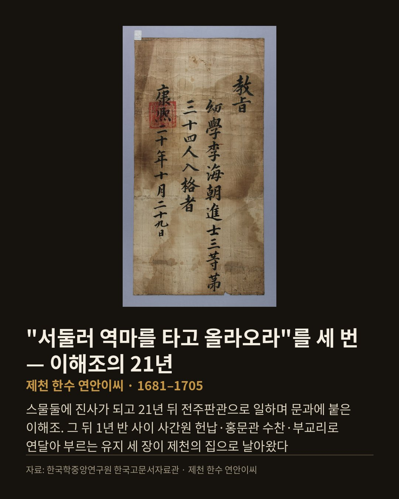
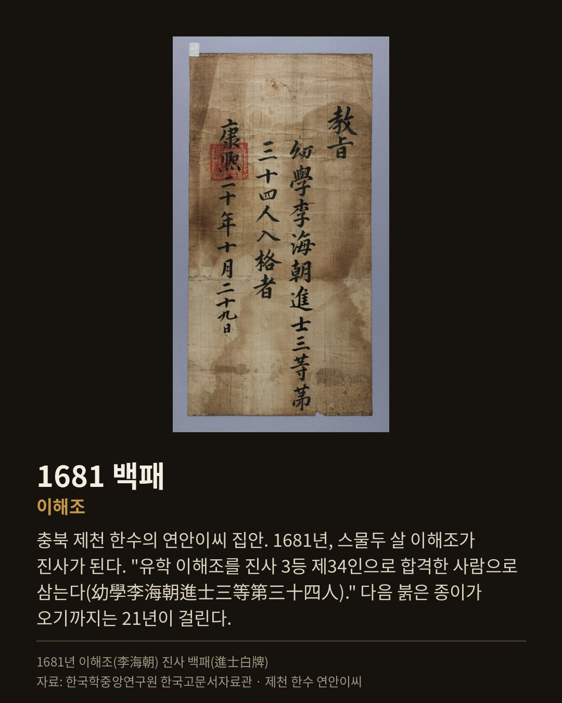
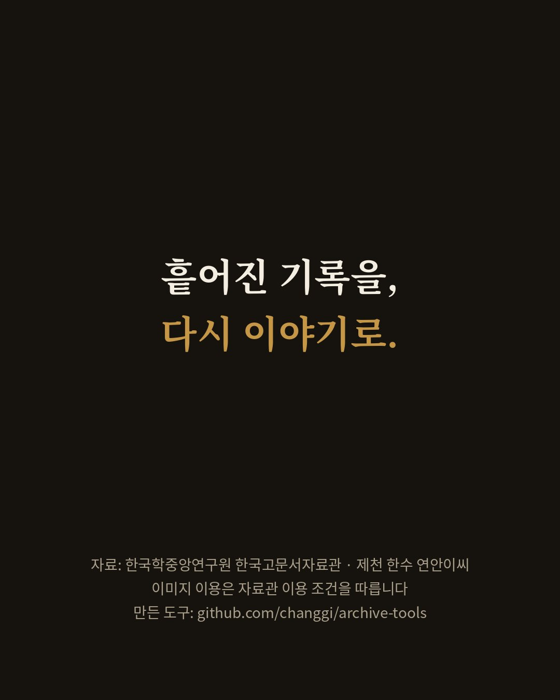

# EP.58 "서둘러 역마를 타고 올라오라"를 세 번 — 이해조의 21년

제천 한수 연안이씨 (문중) · 스물둘에 진사가 되고 21년 뒤 전주판관으로 일하며 문과에 붙은 이해조. 그 뒤 1년 반 사이 사간원 헌납·홍문관 수찬·부교리로 연달아 부르는 유지 세 장이 제천의 집으로 날아왔다

- 🌐 [전시 웹페이지](https://changgi.github.io/archive-tools/examples/jecheon-lee/exhibit.html) (한자 위 한글 독음 · 원문 해석) · [수업 활동지](https://changgi.github.io/archive-tools/examples/jecheon-lee/handout.html)
- 🎬 영상: [릴스 9:16](https://changgi.github.io/archive-tools/examples/media/ep58-jecheon-lee_reel.mp4) · [가로 16:9](https://changgi.github.io/archive-tools/examples/media/ep58-jecheon-lee_wide.mp4) · 홍보 글: [`promo.md`](promo.md)
- 카드뉴스: [`cards/`](cards/) · SNS 글: [`sns.txt`](sns.txt) · 판독·해석 표: [`selection.csv`](selection.csv)


<!-- DELIVERY -->
## 전달 에디팅 — 이 기록을 이렇게 전합니다

- **핵심 정서** — 부름
- **한 문장** — 늦게 핀 벼슬길(진사 뒤 21년)에도 나라는 서둘러 그를 불렀다는 것.
- **열기** — 서둘러 올라오라.' 같은 명령이 1년 반 사이 세 번 왔습니다.
- **펼치기** — 이해조 진사 백패 → 이해조 문과 홍패 → 이해조 유지－2 → 이해조 유지－1 (1681–1705년) — 같은 문장이 반복되는 리듬을 살려, 세 장을 빠르게 이어 보여 주었습니다.
- **절정** — "홍문관 부교리 이해조가 열어 볼 것(弘文館副校理李海朝 開拆)" — 화면·공간에서 이 한 줄만 크게, 소리를 줄여 집중
- **여운** — 스물둘에 진사가 되고 21년을 기다린 그는 그 시간을 어떻게 보냈을까요? — 질문으로 끝내고 답은 보는 사람에게
- **감각과 물질** — 같은 문장 세 번 — 세 번째 낭독이 가장 크게 · 흰 종이 한 장에 조명 하나 · 붉은 종이를 실물 크기로 복제해 벽에 거는 연출 · 역마 방울·말발굽 소리와 함께 펼치는 두루마리
- **통로와 매개** — 온라인: 릴스(열기) → 카드뉴스(펼치기) → 전시 웹페이지(절정·원문) → 비하인드 카드(여운) / 오프라인: 원본 크기 복제·낭독·참여 벽 / 남기기: 활동지·질문 카드
- **여운 장치** — "나를 부른 목소리"
- **전달 에디팅 전** — 5건의 문서를 1681–1705년 연대순으로 놓고 문서명 · 유형 · 해설을 붙인다 — 정확하지만, 지나가면 잊힌다.
- **전달 에디팅 후** — 핵심 정서는 「부름」. 「서둘러 올라오라.' 같은 명령이 1년 반 사이 세 번 왔습니다.」로 열고, 문서를 대비와 순서로 펼친 뒤, "홍문관 부교리 이해조가 열어 볼 것(弘文館副校理李海朝 開拆)"에서 멈춘다. 같은 문장 세 번 — 세 번째 낭독이 가장 크게. 마지막엔 「"나를 부른 목소리"」로 보는 사람이 자기 이야기를 남기고 떠나게 한다.

전문: [`delivery.md`](delivery.md)
<!-- /DELIVERY -->

<!-- CURATOR -->
## 비하인드 — 큐레이터 노트

- **왜 이 문서들인가** — 1년 반 사이 '서둘러 역마를 타고 올라오라'는 유지가 세 번이나 같은 집으로 날아왔습니다.
- **전하고 싶은 것** — 늦게 핀 벼슬길(진사 뒤 21년)에도 나라는 서둘러 그를 불렀다는 것.
- **이렇게 보이길 바랐다** — 같은 문장이 반복되는 리듬을 살려, 세 장을 빠르게 이어 보여 주었습니다.
- **이렇게 써 주세요** — 유지라는 문서 서식, 조선 관료의 임용 절차 학습에 쓰세요.
- **남겨 둔 질문** — 스물둘에 진사가 되고 21년을 기다린 그는 그 시간을 어떻게 보냈을까요?
- **제작 기록** — 문서 5건 · 1681–1705년 · 원본 사진 6면(문서 전체) · 원문 판독 5건 · 번역 5건 · 못 읽은 글자 □ 1 · 불확실 (?) 1 · 해제에 "확인 필요"를 단 문서 1건

전문: [`curator.md`](curator.md)
<!-- /CURATOR -->

## 이야기 — 사료가 말하는 대로

'서둘러 올라오라.' 같은 명령이 1년 반 사이 세 번 왔습니다.

> **1681 백패** — 충북 제천 한수의 연안이씨 집안. 1681년, 스물두 살 이해조가 진사가 된다. "유학 이해조를 진사 3등 제34인으로 합격한 사람으로 삼는다(幼學李海朝進士三等第三十四人)." 다음 붉은 종이가 오기까지는 21년이 걸린다.
> **1702 홍패** — 1702년 봄, 마흔셋의 이해조는 이미 전주판관이었다. 그런데도 다시 과거장에 앉았다. 붉은 홍패에 그의 현직이 그대로 적혀 있다. "행 전주부 판관 이해조를 문과 병과 제2인으로(行全州府判官 … 李海朝文科丙科第二人)."
> **1704 유지** — 2년 뒤, 그는 제천에 있었다. 1704년 3월, 첫 부름이 온다. "너를 사간원 헌납으로 삼으니, 서둘러 역마를 타고 올라오라(爾其斯速乘馹上來事)."
> **1704 유지** — 두 달 뒤, 또 한 장. 이번에는 이유까지 붙었다. "번을 서는 일이 급하니(入番事緊), 서둘러 역마를 타고 올라오라."
> **1705 유지** — 1705년, 세 번째 부름. 그런데 이 종이에는 날짜가 둘이다. 안쪽은 8월 25일, 겉봉은 9월 14일. "홍문관 부교리 이해조가 열어 볼 것(弘文館副校理李海朝 開拆)." '서둘러 오라'는 명령이 그에게 닿기까지 스무 날이 걸렸다.

| 표지 | 1번 카드 | 마무리 |
|---|---|---|
|  |  |  |

## 선별 문서 (5점)

| # | 연도 | 유형 | 문서명 | 원본 |
|---|---|---|---|---|
| 1 | 1681 | 백패 | 1681년 이해조(李海朝) 진사 백패(進士白牌) | [원본 보기](https://archive.aks.ac.kr/viewer/viewer.do#imgnode.do?itemId=book&gubun=booktree&depth=6&upPath=01%5E0143%5EL014303%5EL014303F02%5EL014303F0201&dataId=G002%2BAKS%2BKSM-XA.1681.1111-20101008.B035a_055_00023_XXX&itemType=) |
| 2 | 1702 | 홍패 | 1702년 이해조(李海朝) 문과 홍패(文科紅牌) | [원본 보기](https://archive.aks.ac.kr/viewer/viewer.do#imgnode.do?itemId=book&gubun=booktree&depth=6&upPath=01%5E0143%5EL014303%5EL014303F02%5EL014303F0201&dataId=G002%2BAKS%2BKSM-XA.1702.1111-20101008.B035a_055_00022_XXX&itemType=) |
| 3 | 1704 | 유지 | 1704년 이해조(李海朝) 유지(有旨)－2 | [원본 보기](https://archive.aks.ac.kr/viewer/viewer.do#imgnode.do?itemId=book&gubun=booktree&depth=6&upPath=01%5E0143%5EL014303%5EL014303F02%5EL014303F0201&dataId=G002%2BAKS%2BKSM-XA.1704.1111-20101008.B035a_055_00009_XXX&itemType=) |
| 4 | 1704 | 유지 | 1704년 이해조(李海朝) 유지(有旨)－1 | [원본 보기](https://archive.aks.ac.kr/viewer/viewer.do#imgnode.do?itemId=book&gubun=booktree&depth=6&upPath=01%5E0143%5EL014303%5EL014303F02%5EL014303F0201&dataId=G002%2BAKS%2BKSM-XA.1704.1111-20101008.B035a_055_00008_XXX&itemType=) |
| 5 | 1705 | 유지 | 1705년 이해조(李海朝) 유지(有旨)－1 | [원본 보기](https://archive.aks.ac.kr/viewer/viewer.do#imgnode.do?itemId=book&gubun=booktree&depth=6&upPath=01%5E0143%5EL014303%5EL014303F02%5EL014303F0201&dataId=G002%2BAKS%2BKSM-XA.1705.1111-20101008.B035a_055_00014_XXX&itemType=) |

## 원문 판독과 해석

### 1. 1681년 이해조(李海朝) 진사 백패(進士白牌)

**원문 판독**

```
敎旨
幼學李海朝進士三等第
三十四人入格者
康熙二十年十月二十九日 (도장)
```

**원문 해석** 교지. 유학 이해조를 진사시 3등 제34인으로 합격한 사람으로 삼는다. 강희 20년(1681) 10월 29일.

**해제** 1681년(숙종 7) 10월, 이해조(李海朝, 1660~1711)가 스물둘에 진사시에 합격하고 받은 백패입니다. 제천 한수 연안이씨 집안에는 그가 받은 고신·유지·녹패가 수십 점 남아 있습니다.

### 2. 1702년 이해조(李海朝) 문과 홍패(文科紅牌)

**원문 판독**

```
敎旨
通訓大夫行全州府判官全州
鎭管兵馬節制都尉李海朝
文科丙科第二人及第出身者
康熙四十一年三月二十五日 (도장)
(붙인 띠) 謁聖別試文科丙科第二人 □(?)
```

**원문 해석** 교지. 통훈대부 행 전주부 판관 전주진관 병마절제도위 이해조를 문과 병과 제2인으로 급제하여 출신한 사람으로 삼는다. 강희 41년(1702) 3월 25일. (띠) 알성별시 문과 병과 제2인.

**해제** 1702년(숙종 28) 3월, 이해조가 마흔셋에 문과에 급제하고 받은 홍패입니다. 이름 앞에 '전주부 판관'이라는 현직이 적혀 있어, 음직(蔭職)으로 관직에 있으면서 임금이 성균관에 나와 치르는 알성시(謁聖別試)에 응시해 붙었음을 알 수 있습니다. 진사 합격 21년 만입니다.

### 3. 1704년 이해조(李海朝) 유지(有旨)－2

**원문 판독**

```
右副承旨黃(押)
今以爾爲司諫院獻納
爾其斯速乘馹上來事
有
旨
康熙四十三年三月十七日 (도장)
```

**원문 해석** 우부승지 황(黃)이 씀. 이제 너를 사간원 헌납으로 삼으니, 너는 서둘러 역마를 타고 올라오라는 유지. 강희 43년(1704) 3월 17일.

**해제** 1704년(숙종 30) 3월, 이해조를 사간원 헌납(정5품)에 임명하고 서둘러 올라오라고 부른 유지입니다. 이 해에만 같은 집안에 유지가 여섯 점 남아 있어, 지방(제천)에 머무는 그를 조정이 거듭 불렀음을 알 수 있습니다.

### 4. 1704년 이해조(李海朝) 유지(有旨)－1

**원문 판독**

```
同副承旨申(押)
今以爾爲弘文館修撰經筵
入番事緊 爾其斯速乘馹
上來事 有
旨
康熙四十三年五月二十六日
```

**원문 해석** 동부승지 신(申)이 씀. 이제 너를 홍문관 수찬 겸 경연[관]으로 삼는데, 입번(번을 서는 일)이 급하니 너는 서둘러 역마를 타고 올라오라는 유지. 강희 43년(1704) 5월 26일.

**해제** 두 달 뒤인 1704년 5월, 이해조를 홍문관 수찬으로 삼으며 '입번하는 일이 급하다(入番事緊)'는 이유를 덧붙여 부른 유지입니다. 홍문관 관원은 궁궐에서 번을 서며 경연(임금의 공부)에 참여해야 했습니다. 마이크로필름 복사본입니다.

### 5. 1705년 이해조(李海朝) 유지(有旨)－1

**원문 판독**

```
(겉) 康熙四十四年九月十四日 弘文館副校理李海朝 開拆
同副承旨申(押)
今以爾爲弘文館副校
理經筵入番事緊 爾
其斯速乘馹上來事
有
旨
康熙四十四年八月二十五日
(이어 붙인 교지 조각) 敎旨 …
```

**원문 해석** (겉봉) 강희 44년 9월 14일, 홍문관 부교리 이해조가 열어 볼 것. 동부승지 신(申)이 씀. 이제 너를 홍문관 부교리로 삼는데, 경연에 입번하는 일이 급하니 너는 서둘러 역마를 타고 올라오라는 유지. 강희 44년(1705) 8월 25일.

**해제** 1705년 8월 25일에 발급되어, 겉봉에 '9월 14일'이라는 날짜가 따로 적힌 유지입니다. 겉봉의 날짜는 문서가 이해조에게 도착한(또는 열어 본) 날로 보이며, 서울에서 제천까지 약 20일이 걸렸던 것으로 읽힙니다(확인 필요). 같은 '入番事緊'의 부름이 1년 남짓 사이 세 번째입니다.

판독·해석·이야기는 이미지에 근거한 초안이며(검토 전 "초안" 표시), 정확한 판독은 원문 확인이 필요합니다. □는 읽지 못한 글자, (?)는 불확실한 글자입니다.
이미지: 한국학중앙연구원 한국고문서자료관 소장·제공. "원본" 링크를 누르면 자료관 뷰어에서 그 문서가 열립니다. 재사용은 자료관에 문의하세요(소장처 동의 필요).
