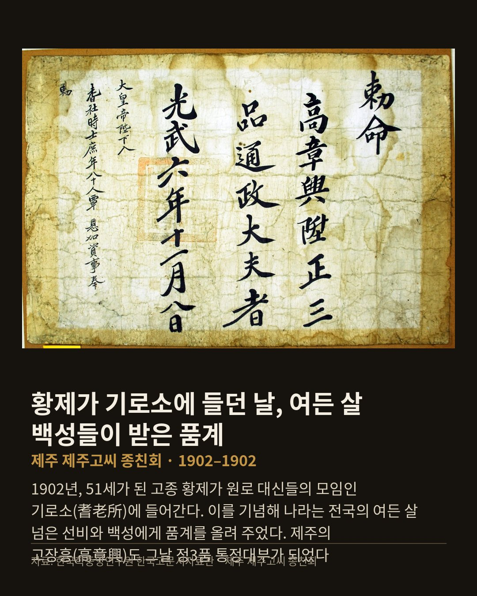
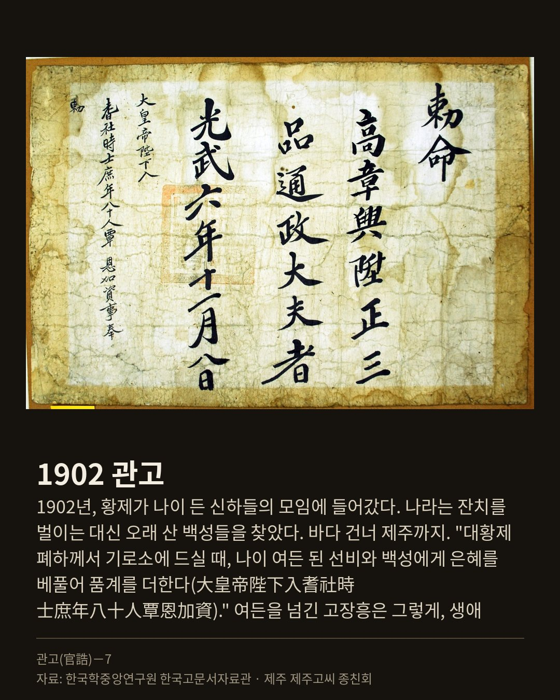
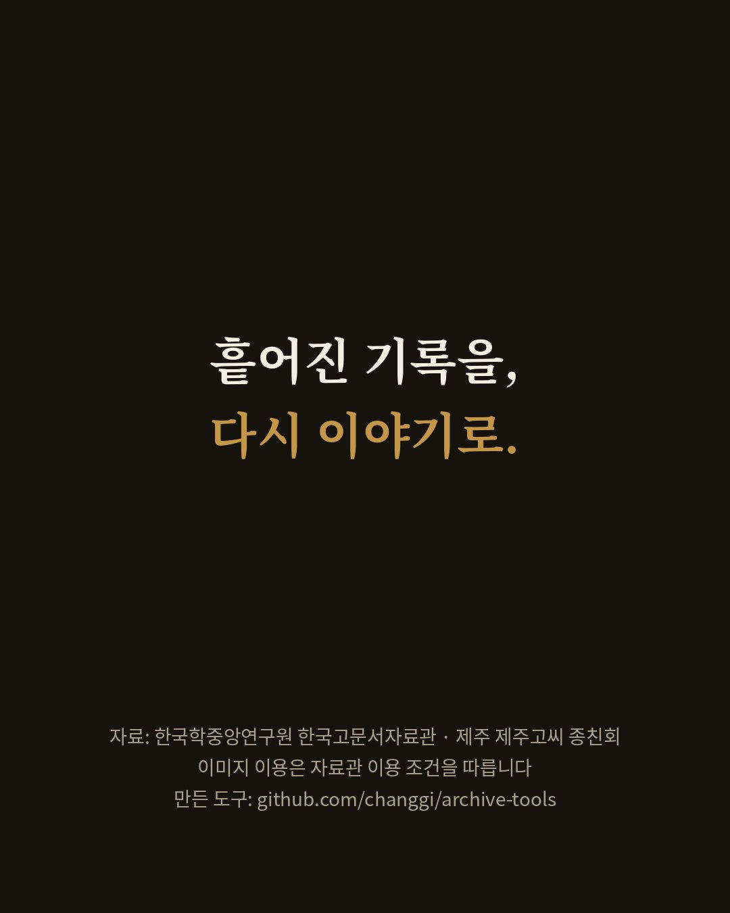

# EP.90 황제가 기로소에 들던 날, 여든 살 백성들이 받은 품계

제주 제주고씨 종친회 (문중) · 1902년, 51세가 된 고종 황제가 원로 대신들의 모임인 기로소(耆老所)에 들어간다. 이를 기념해 나라는 전국의 여든 살 넘은 선비와 백성에게 품계를 올려 주었다. 제주의 고장흥(高章興)도 그날 정3품 통정대부가 되었다

- 🌐 [전시 웹페이지](https://changgi.github.io/archive-tools/examples/jeju-go/exhibit.html) (한자 위 한글 독음 · 원문 해석) · [수업 활동지](https://changgi.github.io/archive-tools/examples/jeju-go/handout.html)
- 🎬 영상: [릴스 9:16](https://changgi.github.io/archive-tools/examples/media/ep90-jeju-go_reel.mp4) · [가로 16:9](https://changgi.github.io/archive-tools/examples/media/ep90-jeju-go_wide.mp4) · 홍보 글: [`promo.md`](promo.md)
- 카드뉴스: [`cards/`](cards/) · SNS 글: [`sns.txt`](sns.txt) · 판독·해석 표: [`selection.csv`](selection.csv)


<!-- DELIVERY -->
## 전달 에디팅 — 이 기록을 이렇게 전합니다

- **핵심 정서** — 장수의 축복
- **한 문장** — 나라는 오래 산 백성을 찾아 경축의 몫을 나누었다는 것.
- **열기** — 여든 살이 되면, 나라가 벼슬을 주던 때가 있었습니다.
- **펼치기** — 관고－7 (1902년) — '나이 여든 된 선비와 백성에게'라는 구절을 중심에 두어 은전의 범위를 보여 주었습니다.
- **절정** — "대황제 폐하께서 기로소에 드실 때, 나이 여든 된 선비와 백성에게 은혜를 베풀어 품계를 더한다(大皇帝陛下入耆社時 士庶年八十人覃恩加資)" — 화면·공간에서 이 한 줄만 크게, 소리를 줄여 집중
- **여운** — 여든을 넘긴 고장흥은 '통정대부'라는 이름을 어떻게 받아들였을까요? — 질문으로 끝내고 답은 보는 사람에게
- **감각과 물질** — 여든 개의 촛불, 칙명 한 장 · 어보·관인 탁본 스탬프를 찍어 보는 체험
- **통로와 매개** — 온라인: 릴스(열기) → 카드뉴스(펼치기) → 전시 웹페이지(절정·원문) → 비하인드 카드(여운) / 오프라인: 원본 크기 복제·낭독·참여 벽 / 남기기: 활동지·질문 카드
- **여운 장치** — 어르신께 보내는 축하 한 줄
- **전달 에디팅 전** — 1건의 문서를 1902년 연대순으로 놓고 문서명 · 유형 · 해설을 붙인다 — 정확하지만, 지나가면 잊힌다.
- **전달 에디팅 후** — 핵심 정서는 「장수의 축복」. 「여든 살이 되면, 나라가 벼슬을 주던 때가 있었습니다.」로 열고, 문서를 한 장의 집중로 펼친 뒤, "대황제 폐하께서 기로소에 드실 때, 나이 여든 된 선비와 백성에게 은혜를 베풀어 품계를 더한다(大皇帝陛下入耆社時 士庶年八十人覃恩加資)"에서 멈춘다. 여든 개의 촛불, 칙명 한 장. 마지막엔 「어르신께 보내는 축하 한 줄」로 보는 사람이 자기 이야기를 남기고 떠나게 한다.

전문: [`delivery.md`](delivery.md)
<!-- /DELIVERY -->

<!-- CURATOR -->
## 비하인드 — 큐레이터 노트

- **왜 이 문서들인가** — 고종이 기로소에 든 해, 전국의 여든 넘은 백성에게 품계를 올려 준 칙명이 제주까지 와 있었습니다.
- **전하고 싶은 것** — 나라는 오래 산 백성을 찾아 경축의 몫을 나누었다는 것.
- **이렇게 보이길 바랐다** — '나이 여든 된 선비와 백성에게'라는 구절을 중심에 두어 은전의 범위를 보여 주었습니다.
- **이렇게 써 주세요** — 대한제국의 의례, 노인 공경 정책을 오늘과 비교하는 수업에 쓰세요.
- **남겨 둔 질문** — 여든을 넘긴 고장흥은 '통정대부'라는 이름을 어떻게 받아들였을까요?
- **제작 기록** — 문서 1건 · 1902년 · 원본 사진 1면(문서 전체) · 원문 판독 1건 · 번역 1건

전문: [`curator.md`](curator.md)
<!-- /CURATOR -->

## 이야기 — 사료가 말하는 대로

여든 살이 되면, 나라가 벼슬을 주던 때가 있었습니다.

> **1902 관고** — 1902년, 황제가 나이 든 신하들의 모임에 들어갔다. 나라는 잔치를 벌이는 대신 오래 산 백성들을 찾았다. 바다 건너 제주까지. "대황제 폐하께서 기로소에 드실 때, 나이 여든 된 선비와 백성에게 은혜를 베풀어 품계를 더한다(大皇帝陛下入耆社時 士庶年八十人覃恩加資)." 여든을 넘긴 고장흥은 그렇게, 생애 처음으로 당상관이 되었다.

| 표지 | 1번 카드 | 마무리 |
|---|---|---|
|  |  |  |

## 선별 문서 (1점)

| # | 연도 | 유형 | 문서명 | 원본 |
|---|---|---|---|---|
| 1 | 1902 | 관고 | 관고(官誥)－7 | [원본 보기](https://archive.aks.ac.kr/viewer/viewer.do#imgnode.do?itemId=book&gubun=booktree&depth=6&upPath=01%5E0168%5EL016815%5EL016815F02%5EL016815F0201&dataId=G002%2BAKS%2BKSM-XA.1902.5011-20220125.B085a_114_00836_XXX&itemType=) |

## 원문 판독과 해석

### 1. 관고(官誥)－7

**원문 판독**

```
勅命
高章興陞正三
品通政大夫者
光武六年十一月八日
(소자) 大皇帝陛下入
耆社時士庶年八十人覃
恩加資事奉
勅
(칙명지보 1과)
```

**원문 해석** 칙명. 고장흥을 정3품 통정대부로 올린다. 광무 6년(1902) 11월 8일. 대황제 폐하께서 기사(기로소)에 드실 때, 나이 여든 된 선비와 백성에게 은혜를 널리 베풀어 품계를 더한 일로 칙명을 받들어.

**해제** 대한제국 시기에는 '교지' 대신 황제의 명령인 '칙명(勅命)'으로 관고(官誥)를 발급했습니다. 1902년 고종은 나이 51세로 기로소(耆老所, 70세 이상 정2품 이상 원로 문신들의 기구, 왕은 60세 무렵에 들어가는 것이 관례)에 들어갔고, 이를 경축해 80세 이상의 사서인(士庶人)에게 품계를 올려 주는 은전을 베풀었습니다. 제주의 고장흥이 받은 정3품 통정대부는 실직이 없는 노인직(老人職)입니다. 칙명지보가 찍혀 있습니다.

판독·해석·이야기는 이미지에 근거한 초안이며(검토 전 "초안" 표시), 정확한 판독은 원문 확인이 필요합니다. □는 읽지 못한 글자, (?)는 불확실한 글자입니다.
이미지: 한국학중앙연구원 한국고문서자료관 소장·제공. "원본" 링크를 누르면 자료관 뷰어에서 그 문서가 열립니다. 재사용은 자료관에 문의하세요(소장처 동의 필요).
