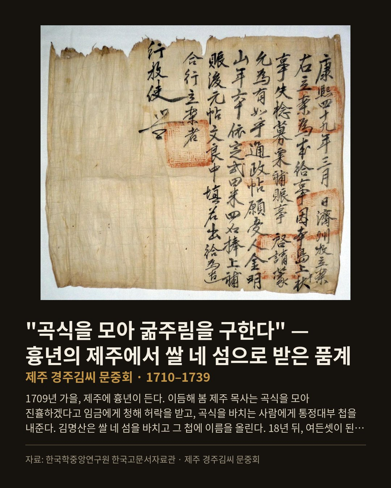
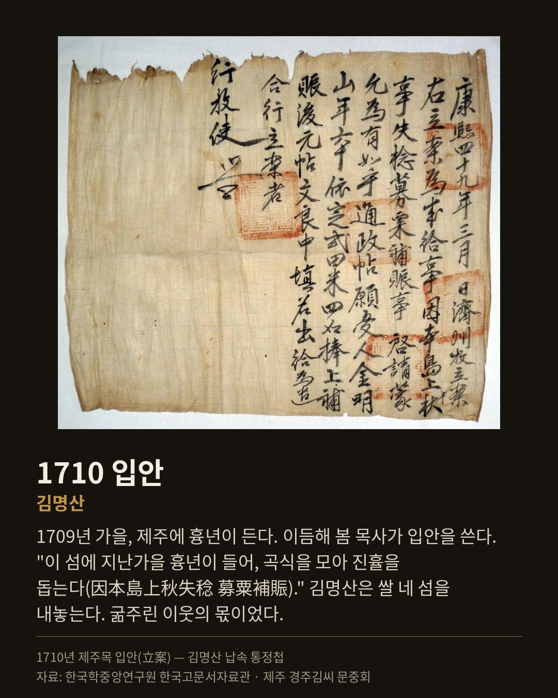
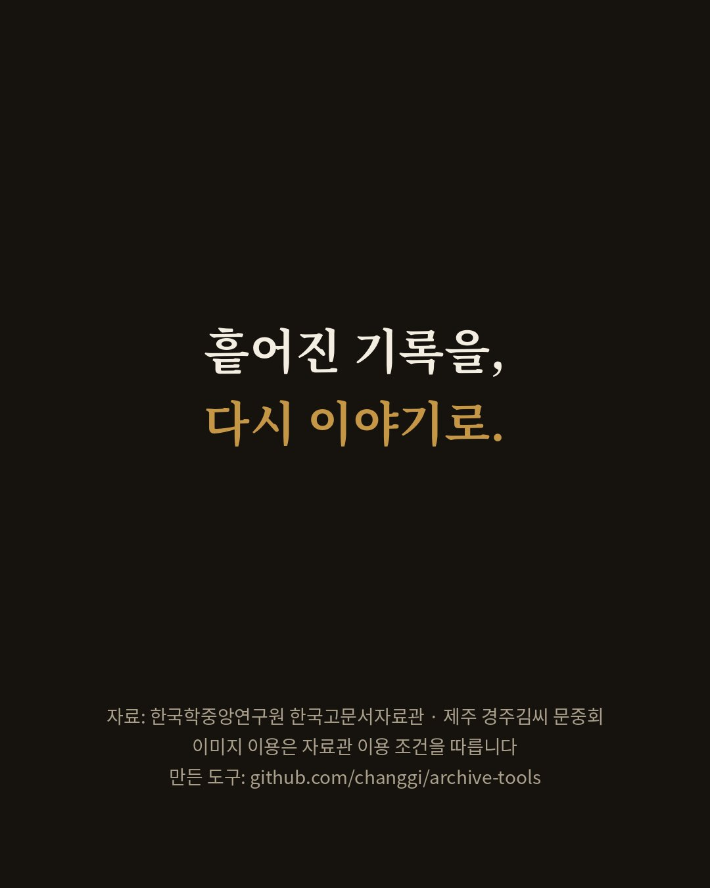

# EP.130 "곡식을 모아 굶주림을 구한다" — 흉년의 제주에서 쌀 네 섬으로 받은 품계

제주 경주김씨 문중회 (문중) · 1709년 가을, 제주에 흉년이 든다. 이듬해 봄 제주 목사는 곡식을 모아 진휼하겠다고 임금에게 청해 허락을 받고, 곡식을 바치는 사람에게 통정대부 첩을 내준다. 김명산은 쌀 네 섬을 바치고 그 첩에 이름을 올린다. 18년 뒤, 여든셋이 된 그는 어사의 보고로 가선대부에 오른다. 같은 집안의 김차복도 근력부위를 거쳐 통정대부가 된다

- 🌐 [전시 웹페이지](https://changgi.github.io/archive-tools/examples/jeju-kim-mun/exhibit.html) (한자 위 한글 독음 · 원문 해석) · [수업 활동지](https://changgi.github.io/archive-tools/examples/jeju-kim-mun/handout.html)
- 🎬 영상: [릴스 9:16](https://changgi.github.io/archive-tools-next/media/ep130-jeju-kim-mun_reel.mp4) · [가로 16:9](https://changgi.github.io/archive-tools-next/media/ep130-jeju-kim-mun_wide.mp4) · 홍보 글: [`promo.md`](promo.md)
- 카드뉴스: [`cards/`](cards/) · SNS 글: [`sns.txt`](sns.txt) · 판독·해석 표: [`selection.csv`](selection.csv)

<!-- DELIVERY -->
## 전달 에디팅 — 이 기록을 이렇게 전합니다

- **핵심 정서** — 숙연함
- **한 문장** — 흉년의 섬에서 곡식은 이웃을 살리는 것이었고, 나라는 그 곡식을 품계로 갚았다 — 그 셈법이 종이에 남았다.
- **열기** — 300년 전 제주의 흉년, 쌀 네 섬을 바치고 받은 종이가 있습니다.
- **펼치기** — 제주목 입안 — 김명산 납속 통정 → 김명산 통정대부 고신 → 김명산 가선대부 고신 → 보충대 김차복 근력부위 고신 → 김차복 통정대부 고신 (1710–1739년) — 1710년 입안(흉년과 쌀 네 섬) → 같은 해의 빈 날짜 고신 → 18년 뒤 83세의 가선대부 → 같은 집안 김차복의 1729 · 1739년 고신 순으로, 흉년의 품계가 한 사람의 노년과 다음 사람에게 이어지게 구성했습니다.
- **절정** — "이 섬에 지난가을 흉년이 들어, 곡식을 모아 진휼을 돕는다(因本島上秋失稔 募粟補賑)" — 화면·공간에서 이 한 줄만 크게, 소리를 줄여 집중
- **여운** — 쌀 네 섬을 내놓던 그해 봄, 김명산의 집 곳간에는 얼마가 남아 있었을까요? — 질문으로 끝내고 답은 보는 사람에게
- **감각과 물질** — 쌀 네 섬의 자루 옆에, 달과 날이 비어 있는 통정대부 첩 한 장 · 어보·관인 탁본 스탬프를 찍어 보는 체험
- **통로와 매개** — 온라인: 릴스(열기) → 카드뉴스(펼치기) → 전시 웹페이지(절정·원문) → 비하인드 카드(여운) / 오프라인: 원본 크기 복제·낭독·참여 벽 / 남기기: 활동지·질문 카드
- **여운 장치** — 어려울 때 내가 이웃과 나눈 것 하나 떠올리기
- **전달 에디팅 전** — 5건의 문서를 1710–1739년 연대순으로 놓고 문서명 · 유형 · 해설을 붙인다 — 정확하지만, 지나가면 잊힌다.
- **전달 에디팅 후** — 핵심 정서는 「숙연함」. 「300년 전 제주의 흉년, 쌀 네 섬을 바치고 받은 종이가 있습니다.」로 열고, 문서를 대비와 순서로 펼친 뒤, "이 섬에 지난가을 흉년이 들어, 곡식을 모아 진휼을 돕는다(因本島上秋失稔 募粟補賑)"에서 멈춘다. 쌀 네 섬의 자루 옆에, 달과 날이 비어 있는 통정대부 첩 한 장. 마지막엔 「어려울 때 내가 이웃과 나눈 것 하나 떠올리기」로 보는 사람이 자기 이야기를 남기고 떠나게 한다.

전문: [`delivery.md`](delivery.md)
<!-- /DELIVERY -->

<!-- CURATOR -->
## 비하인드 — 큐레이터 노트

- **왜 이 문서들인가** — 입안에 '이 섬에 지난가을 흉년이 들었다'는 한 줄이 있었습니다. 그 흉년에 쌀 네 섬을 내고 받은, 달과 날이 빈 통정대부 첩이 함께 남아 있었습니다.
- **전하고 싶은 것** — 흉년의 섬에서 곡식은 이웃을 살리는 것이었고, 나라는 그 곡식을 품계로 갚았다 — 그 셈법이 종이에 남았다.
- **이렇게 보이길 바랐다** — 1710년 입안(흉년과 쌀 네 섬) → 같은 해의 빈 날짜 고신 → 18년 뒤 83세의 가선대부 → 같은 집안 김차복의 1729 · 1739년 고신 순으로, 흉년의 품계가 한 사람의 노년과 다음 사람에게 이어지게 구성했습니다.
- **이렇게 써 주세요** — 조선 후기 진휼과 납속 · 공명첩, 제주의 흉년과 섬 경제, 장수 노인 우대(노인직), 신분과 품계의 관계 수업에 쓰세요.
- **만들며 있었던 일** — 고신 네 장은 정서라 확실하고 1710년 입안도 행서지만 대체로 읽히나, 입안의 나이 '六十'은 1728년 고신(83세)과 맞지 않아 확인이 필요합니다. 1729 · 1739년 입안 두 장은 판독하지 않았고, 1729년 고신의 작은 글씨, 1739년 '加設'의 판독, 김명산 · 김차복의 관계는 확인하지 않았습니다.
- **남겨 둔 질문** — 쌀 네 섬을 내놓던 그해 봄, 김명산의 집 곳간에는 얼마가 남아 있었을까요?
- **제작 기록** — 문서 5건 · 1710–1739년 · 원본 사진 5면(문서 전체) · 원문 판독 5건 · 번역 5건 · 못 읽은 글자 □ 2 · 불확실 (?) 4 · 해제에 "확인 필요"를 단 문서 2건

전문: [`curator.md`](curator.md) · 비하인드 카드: [`behind/`](behind/) · 채널별 홍보안: [`channels.md`](channels.md)
<!-- /CURATOR -->

## 이야기 — 사료가 말하는 대로

300년 전 제주의 흉년, 쌀 네 섬을 바치고 받은 종이가 있습니다.

> **1710 입안** — 1709년 가을, 제주에 흉년이 든다. 이듬해 봄 목사가 입안을 쓴다. "이 섬에 지난가을 흉년이 들어, 곡식을 모아 진휼을 돕는다(因本島上秋失稔 募粟補賑)." 김명산은 쌀 네 섬을 내놓는다. 굶주린 이웃의 몫이었다.
> **1710 고신** — 그 대가로 받은 종이 한 장. "김명산을 통정대부로 삼는다(金明山爲通政大夫者)." 달도 날도 비어 있다. 이름만 나중에 써 넣은, 흉년의 품계였다.
> **1728 고신** — 18년 뒤, 그는 여든셋이다. 바다를 건너온 어사가 그의 이름을 적어 올린다. "나이 여든셋이므로 어사의 보고에 따라 품계를 올린다(年八十三因試才御史書啓加資事)." 흉년에 쌀을 내놓던 사람이, 이제 섬의 노인으로 기록된다.
> **1729 고신** — 이듬해, 같은 집안의 김차복에게 병조의 고신이 온다. "보충대 김차복을 근력부위로 삼는다(補充隊金次福爲勤力副尉者)." 군역을 지던 이가, 처음 품계를 얻었다.
> **1739 고신** — 10년 뒤, 또 한 장. "김차복을 통정대부로 삼는다(金次福爲通政大夫者)." 29년 전 김명산이 받았던 바로 그 품계다. 흉년의 섬에서, 한 집안은 같은 이름의 종이를 두 번 받았다.

| 표지 | 1번 카드 | 마무리 |
|---|---|---|
|  |  |  |

## 선별 문서 (5점)

| # | 연도 | 유형 | 문서명 | 원본 |
|---|---|---|---|---|
| 1 | 1710 | 입안 | 1710년 제주목 입안(立案) — 김명산 납속 통정첩 | [원본 보기](https://archive.aks.ac.kr/viewer/viewer.do#imgnode.do?itemId=book&gubun=booktree&depth=6&upPath=01%5E0168%5EL016814%5EL016814F02%5EL016814F0204&dataId=G002%2BAKS%2BKSM-XD.1710.5011-20220125.B084a_114_00823_XXX&itemType=) |
| 2 | 1710 | 고신 | 1710년 김명산(金明山) 통정대부 고신(告身) | [원본 보기](https://archive.aks.ac.kr/viewer/viewer.do#imgnode.do?itemId=book&gubun=booktree&depth=6&upPath=01%5E0168%5EL016814%5EL016814F02%5EL016814F0201&dataId=G002%2BAKS%2BKSM-XA.1710.5011-20220125.B084a_114_00809_XXX&itemType=) |
| 3 | 1728 | 고신 | 1728년 김명산(金明山) 가선대부 고신(告身) | [원본 보기](https://archive.aks.ac.kr/viewer/viewer.do#imgnode.do?itemId=book&gubun=booktree&depth=6&upPath=01%5E0168%5EL016814%5EL016814F02%5EL016814F0201&dataId=G002%2BAKS%2BKSM-XA.1728.5011-20220125.B084a_114_00810_XXX&itemType=) |
| 4 | 1729 | 고신 | 1729년 보충대 김차복(金次福) 근력부위 고신(告身) | [원본 보기](https://archive.aks.ac.kr/viewer/viewer.do#imgnode.do?itemId=book&gubun=booktree&depth=6&upPath=01%5E0168%5EL016814%5EL016814F02%5EL016814F0201&dataId=G002%2BAKS%2BKSM-XA.1729.5011-20220125.B084a_114_00812_XXX&itemType=) |
| 5 | 1739 | 고신 | 1739년 김차복(金次福) 통정대부 고신(告身) | [원본 보기](https://archive.aks.ac.kr/viewer/viewer.do#imgnode.do?itemId=book&gubun=booktree&depth=6&upPath=01%5E0168%5EL016814%5EL016814F02%5EL016814F0201&dataId=G002%2BAKS%2BKSM-XA.1739.5011-20220125.B084a_114_00813_XXX&itemType=) |

## 원문 판독과 해석

### 1. 1710년 제주목 입안(立案) — 김명산 납속 통정첩

**원문 판독**

```
康熙四十九年三月　日濟州牧立案
右立案爲成給事因本島上秋
失稔募粟補賑事　啓請蒙
允爲有如乎以通政帖願受人金明
山年六十(?)依定式田米四石捧上補
賑後元帖文良中塡名出給爲遣
合行立案者
行牧使 (수결)
```

**원문 해석** 강희 49년(1710) 3월 일, 제주목 입안. 이 입안은 발급하는 일이다. 이 섬에 지난가을 흉년이 들어, 곡식을 모아 진휼을 돕겠다고 임금께 아뢰어 허락을 받았다. 이에 통정대부 첩을 받기 원하는 사람 김명산(나이 60?)에게서 정해진 규식대로 밭벼쌀(田米) 네 섬을 받아 진휼에 보탠 뒤, 본래의 첩 문서에 이름을 써 넣어 내주고, 아울러 입안을 발급한다. 행 목사(수결).

**해제** 1710년(숙종 36, 康熙 49, 庚寅) 3월 제주 목사가 발급한 입안입니다. 앞선 해 가을(1709) 제주에 흉년(失稔)이 들자, 목사는 곡식을 모아(募粟) 진휼에 보태겠다고 임금에게 청해 허락을 받았습니다. 그 방법이 곡식을 바치는 사람에게 품계를 적은 첩(帖)을 주는 납속(納粟)이었습니다. 김명산(金明山)은 정해진 규식(定式)대로 밭벼쌀 네 섬을 바치고, 미리 만들어 둔 통정대부 첩에 자기 이름을 써 넣어 받았습니다. 같은 해의 통정대부 고신과 짝을 이룹니다. 나이는 '六十'으로 읽었으나 1728년 고신의 83세로 보면 이때 65세여서, 글자를 다시 확인해야 합니다. 관인이 여섯 군데 찍혔습니다.

### 2. 1710년 김명산(金明山) 통정대부 고신(告身)

**원문 판독**

```
敎旨
金明山爲
通政大夫
者
康□□十九年　月　日
```

**원문 해석** 교지. 김명산을 통정대부로 삼는다. 강[희 4]9년(1710) 월 일.

**해제** 1710년(숙종 36, 康熙 49) 김명산을 통정대부(정3품 당상 품계)로 삼은 고신입니다. 앞의 입안에서 말한 '통정첩'이 바로 이것으로, 달과 날을 비워 둔 채 미리 만들어 두었다가 곡식을 바친 사람의 이름을 써 넣어 내주었습니다. 이런 첩을 공명첩(空名帖)이라 합니다. 연호 위의 어보 자리에 종이가 덧대어져 '康熙' 아래 두 글자가 가려졌으나 '…十九年'이 보여 입안의 연도와 맞습니다. 품계만 있고 실제 관직은 없습니다.

### 3. 1728년 김명산(金明山) 가선대부 고신(告身)

**원문 판독**

```
敎旨
金明山爲
嘉善大夫
者
雍正六年二月二十六日
年八十三因試才御史書啓加資事承
傳
```

**원문 해석** 교지. 김명산을 가선대부로 삼는다. 옹정 6년(1728) 2월 26일. (작은 글씨) 나이 여든셋이므로 시재 어사의 서계에 따라 품계를 올리라는 전교를 받듦.

**해제** 1728년(영조 4, 雍正 6, 戊申) 2월 김명산을 가선대부(종2품 품계)로 올린 고신입니다. 왼쪽 작은 글씨에 까닭이 있습니다. 나이가 83세이고, 시재 어사(試才御史)의 서계(書啓, 보고서)에 따라 품계를 올렸다는 것입니다. 시재 어사는 제주 같은 먼 곳에 보내 인재를 시험하고 백성의 사정을 살피게 한 어사로, 장수한 노인을 보고해 품계를 올려 주기도 했습니다. 18년 전 납속으로 받은 통정대부에서 한 단계 더 오른 셈입니다.

### 4. 1729년 보충대 김차복(金次福) 근력부위 고신(告身)

**원문 판독**

```
兵曹雍正七年九月
十八日奉
敎補充隊金次福
爲勤力副尉者
雍正七年十二月　日
判書
參判
參知
參議臣李(?)
正郞臣李(?)
佐郞
```

**원문 해석** 병조에서 옹정 7년(1729) 9월 18일에 교지를 받들어, 보충대 김차복을 근력부위로 삼는다. 옹정 7년 12월 일. 판서, 참판, 참지, 참의 신 이□, 정랑 신 이□, 좌랑.

**해제** 1729년(영조 5, 雍正 7, 己酉) 병조가 보충대(補充隊) 김차복(金次福)을 근력부위(勤力副尉, 정9품 무관 품계)로 삼은 고신입니다. 보충대는 신분이 낮은 이들이 주로 속한 군대였으므로, 김차복이 처음으로 무관 품계를 얻은 문서입니다. 연호 옆에 작은 행서가 있으나 읽지 못했습니다. 이 집안에는 같은 해 9월의 입안이 따로 전하는데(행서 · 초서), 이번에는 판독하지 않았습니다. 김명산과의 가계상 관계는 확인하지 않았습니다.

### 5. 1739년 김차복(金次福) 통정대부 고신(告身)

**원문 판독**

```
敎旨
金次福爲
通政大夫
者
乾隆四年二月　日
加設(?)
```

**원문 해석** 교지. 김차복을 통정대부로 삼는다. 건륭 4년(1739) 2월 일. (작은 글씨) 가설(?).

**해제** 1739년(영조 15, 乾隆 4, 己未) 김차복을 통정대부(정3품 당상 품계)로 삼은 고신입니다. 10년 전 정9품 근력부위에서 단번에 당상 품계에 올랐습니다. 연호 옆의 작은 글씨는 '加設'로 보이는데, 정원 밖에 더 둔 자리라는 뜻으로 납속 등으로 받은 품계에 흔히 붙었습니다. 이 해에도 이 집안에 입안이 한 장 전하나(1739년, 행서 · 초서) 이번에는 판독하지 않아, 이 품계가 무엇의 대가였는지는 판단하지 않았습니다. 아래쪽이 찢겼습니다.

판독·해석·이야기는 이미지에 근거한 초안이며(검토 전 "초안" 표시), 정확한 판독은 원문 확인이 필요합니다. □는 읽지 못한 글자, (?)는 불확실한 글자입니다.
이미지: 한국학중앙연구원 한국고문서자료관 소장·제공. "원본" 링크를 누르면 자료관 뷰어에서 그 문서가 열립니다. 재사용은 자료관에 문의하세요(소장처 동의 필요).
