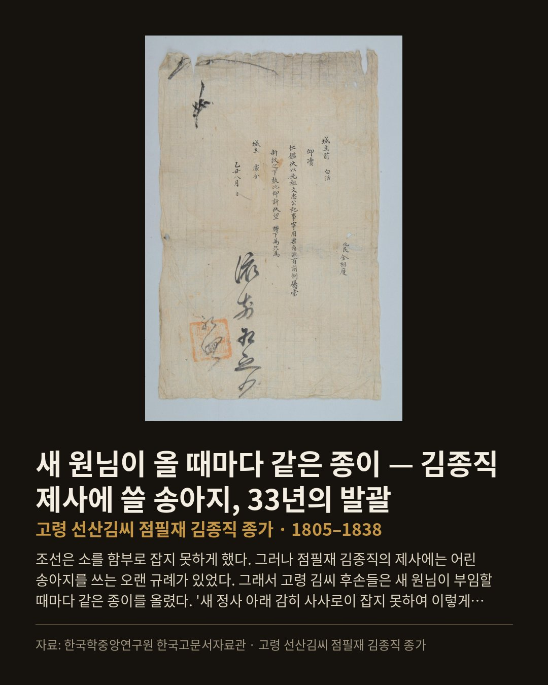
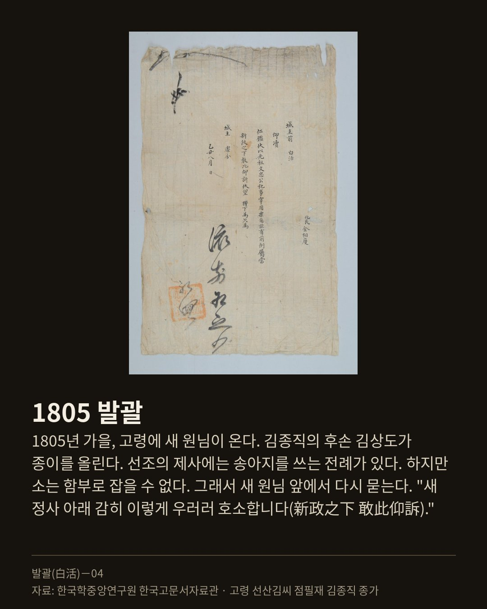
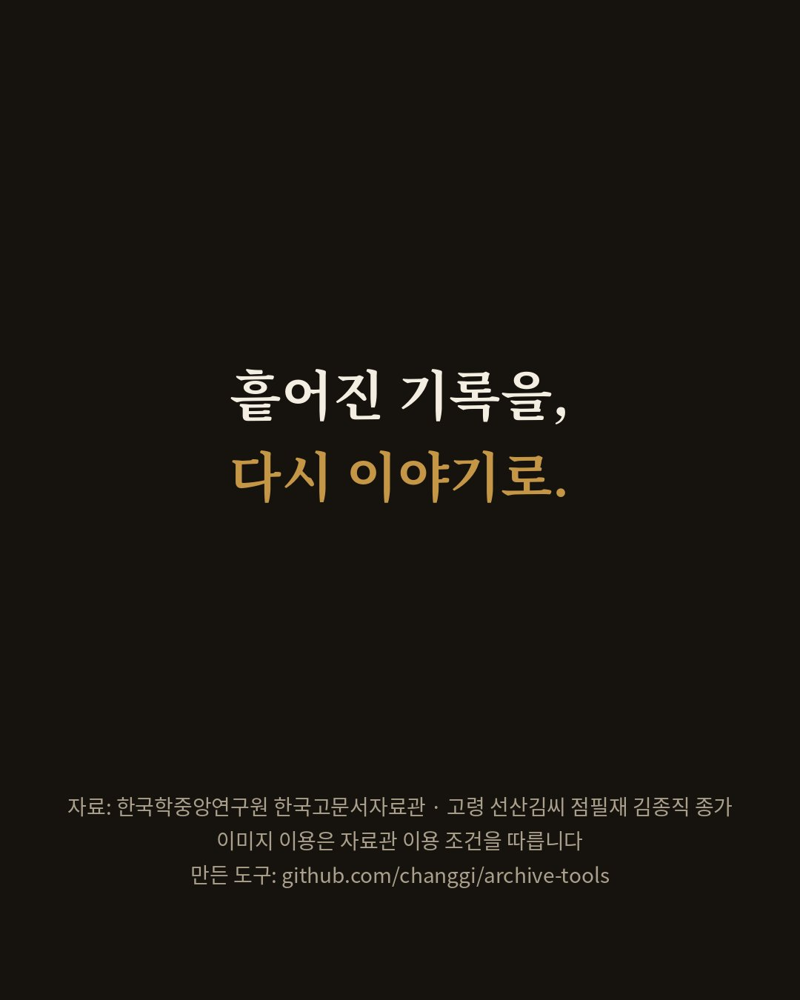

# EP.161 새 원님이 올 때마다 같은 종이 — 김종직 제사에 쓸 송아지, 33년의 발괄

고령 선산김씨 점필재 김종직 종가 (문중) · 조선은 소를 함부로 잡지 못하게 했다. 그러나 점필재 김종직의 제사에는 어린 송아지를 쓰는 오랜 규례가 있었다. 그래서 고령 김씨 후손들은 새 원님이 부임할 때마다 같은 종이를 올렸다. '새 정사 아래 감히 사사로이 잡지 못하여 이렇게 우러러 호소합니다.' 1805년, 1813년, 1826년, 1838년. 쓰는 사람도 원님도 바뀌었지만 문장은 거의 그대로였다

- 🌐 [전시 웹페이지](https://changgi.github.io/archive-tools/examples/jeompiljae-balgwal/exhibit.html) (한자 위 한글 독음 · 원문 해석) · [수업 활동지](https://changgi.github.io/archive-tools/examples/jeompiljae-balgwal/handout.html)
- 🎬 영상: [릴스 9:16](https://changgi.github.io/archive-tools-next/media/ep161-jeompiljae-balgwal_reel.mp4) · [가로 16:9](https://changgi.github.io/archive-tools-next/media/ep161-jeompiljae-balgwal_wide.mp4) · 홍보 글: [`promo.md`](promo.md)
- 카드뉴스: [`cards/`](cards/) · SNS 글: [`sns.txt`](sns.txt) · 판독·해석 표: [`selection.csv`](selection.csv)

<!-- DELIVERY -->
## 전달 에디팅 — 이 기록을 이렇게 전합니다

- **핵심 정서** — 담담함
- **한 문장** — 소를 잡지 못하게 한 나라(우금)에서, 성현의 제사에 쓸 송아지만은 '전례'로 허락받았다 — 그러나 그 전례도 원님이 바뀔 때마다 종이로 다시 확인받아야 했다.
- **열기** — 원님이 바뀔 때마다, 이 집안은 송아지 한 마리를 허락받아야 했습니다.
- **펼치기** — 발괄－04 → 발괄－06 → 발괄－08 → 발괄－14 (1805–1838년) — 1805(김상도) → 1813(김상도) → 1826(김용진) → 1838(김용진)으로, 같은 문장 · 다른 날짜 · 다른 제사(題辭)를 나란히 놓았습니다. 쓰는 후손이 한 번 바뀌는 지점을 가운데 두었습니다.
- **절정** — "감히 사사로이 잡지 못하여 이렇게 우러러 호소합니다(不敢私自宰殺 茲以仰訴)" — 화면·공간에서 이 한 줄만 크게, 소리를 줄여 집중
- **여운** — 같은 문장을 33년 동안 고쳐 쓰지 않은 것은, 무엇을 지키려 한 것이었을까요? — 질문으로 끝내고 답은 보는 사람에게
- **감각과 물질** — 네 장의 첫 줄이 똑같다 — '城主前 白活 仰瀆 仁鑑', 그리고 '先祖文忠公'
- **통로와 매개** — 온라인: 릴스(열기) → 카드뉴스(펼치기) → 전시 웹페이지(절정·원문) → 비하인드 카드(여운) / 오프라인: 원본 크기 복제·낭독·참여 벽 / 남기기: 활동지·질문 카드
- **여운 장치** — 해마다 갱신해야 하는 서류 하나를 떠올리고 그 이유 적어 보기
- **전달 에디팅 전** — 4건의 문서를 1805–1838년 연대순으로 놓고 문서명 · 유형 · 해설을 붙인다 — 정확하지만, 지나가면 잊힌다.
- **전달 에디팅 후** — 핵심 정서는 「담담함」. 「원님이 바뀔 때마다, 이 집안은 송아지 한 마리를 허락받아야 했습니다.」로 열고, 문서를 대비와 순서로 펼친 뒤, "감히 사사로이 잡지 못하여 이렇게 우러러 호소합니다(不敢私自宰殺 茲以仰訴)"에서 멈춘다. 네 장의 첫 줄이 똑같다 — '城主前 白活 仰瀆 仁鑑', 그리고 '先祖文忠公'. 마지막엔 「해마다 갱신해야 하는 서류 하나를 떠올리고 그 이유 적어 보기」로 보는 사람이 자기 이야기를 남기고 떠나게 한다.

전문: [`delivery.md`](delivery.md)
<!-- /DELIVERY -->

<!-- CURATOR -->
## 비하인드 — 큐레이터 노트

- **왜 이 문서들인가** — EP.28에서 점필재 김종직 종가의 교지와 홍패를 읽었습니다. 같은 집안 발괄 24장을 펼쳐 보니 대부분이 같은 문장으로 시작해, 그 가운데 서로 다른 해 · 다른 원님 앞의 네 장을 골랐습니다.
- **전하고 싶은 것** — 소를 잡지 못하게 한 나라(우금)에서, 성현의 제사에 쓸 송아지만은 '전례'로 허락받았다 — 그러나 그 전례도 원님이 바뀔 때마다 종이로 다시 확인받아야 했다.
- **이렇게 보이길 바랐다** — 1805(김상도) → 1813(김상도) → 1826(김용진) → 1838(김용진)으로, 같은 문장 · 다른 날짜 · 다른 제사(題辭)를 나란히 놓았습니다. 쓰는 후손이 한 번 바뀌는 지점을 가운데 두었습니다.
- **이렇게 써 주세요** — 조선의 우금(牛禁) 정책과 예외, 발괄 · 소지의 서식과 제사(題辭), 수령 교체와 행정의 연속성, 서원 · 종가 제사와 지방관의 관계 수업에 쓰세요.
- **만들며 있었던 일** — 본문은 단정한 해서라 대부분 읽었으나, 관아의 큰 초서 제사는 '依前例' 등 일부만 읽혀 나머지는 …로 두었습니다. '宰用繭栗之角'은 『예기』의 '제사에 쓰는 소는 뿔이 고치나 밤톨만 한 송아지'라는 구절에서 온 표현으로 보았습니다. 발괄을 올린 김상도 · 김용진이 김종직의 몇 대손인지는 판단하지 않았습니다.
- **남겨 둔 질문** — 같은 문장을 33년 동안 고쳐 쓰지 않은 것은, 무엇을 지키려 한 것이었을까요?
- **제작 기록** — 문서 4건 · 1805–1838년 · 원본 사진 5면(문서 전체) · 원문 판독 4건 · 번역 4건

전문: [`curator.md`](curator.md) · 비하인드 카드: [`behind/`](behind/) · 채널별 홍보안: [`channels.md`](channels.md)
<!-- /CURATOR -->

## 이야기 — 사료가 말하는 대로

원님이 바뀔 때마다, 이 집안은 송아지 한 마리를 허락받아야 했습니다.

> **1805 발괄** — 1805년 가을, 고령에 새 원님이 온다. 김종직의 후손 김상도가 종이를 올린다. 선조의 제사에는 송아지를 쓰는 전례가 있다. 하지만 소는 함부로 잡을 수 없다. 그래서 새 원님 앞에서 다시 묻는다. "새 정사 아래 감히 이렇게 우러러 호소합니다(新政之下 敢此仰訴)."
> **1813 발괄** — 8년 뒤, 또 새 원님. 김상도는 같은 종이를 다시 쓴다. 글자 하나 다르지 않다. 바뀐 건 날짜뿐, 을축에서 계유로. 원님이 바뀌는 만큼, 전례도 다시 태어나야 했다.
> **1826 발괄** — 13년 뒤, 쓰는 사람이 바뀐다. 김용진. 문장이 조금 늘었다. "감히 사사로이 잡지 못하여 이렇게 우러러 호소합니다(不敢私自宰殺 茲以仰訴)." 아래에 원님의 큰 붓이 지나간다. 전례대로, 허락한다.
> **1838 발괄** — 그리고 1838년, 같은 김용진, 같은 문장, 다른 원님. 첫 장부터 서른세 해가 흘렀다. 소를 지키려는 나라와, 선조의 제사를 지키려는 집안. 그 사이에서 같은 종이가 몇 번이고 다시 쓰였다. 이 집에 남은 발괄만 스물네 장이다.

| 표지 | 1번 카드 | 마무리 |
|---|---|---|
|  |  |  |

## 선별 문서 (4점)

| # | 연도 | 유형 | 문서명 | 원본 |
|---|---|---|---|---|
| 1 | 1805 | 발괄 | 발괄(白活)－04 | [원본 보기](https://archive.aks.ac.kr/viewer/viewer.do#imgnode.do?itemId=book&gubun=booktree&depth=6&upPath=01%5E0167%5EL016763%5EL016763F02%5EL016763F0202&dataId=G002%2BAKS%2BKSM-XB.1805.4783-20220125.B076a_109_00115_XXX&itemType=) |
| 2 | 1813 | 발괄 | 발괄(白活)－06 | [원본 보기](https://archive.aks.ac.kr/viewer/viewer.do#imgnode.do?itemId=book&gubun=booktree&depth=6&upPath=01%5E0167%5EL016763%5EL016763F02%5EL016763F0202&dataId=G002%2BAKS%2BKSM-XB.1813.4783-20220125.B076a_109_00117_XXX&itemType=) |
| 3 | 1826 | 발괄 | 발괄(白活)－08 | [원본 보기](https://archive.aks.ac.kr/viewer/viewer.do#imgnode.do?itemId=book&gubun=booktree&depth=6&upPath=01%5E0167%5EL016763%5EL016763F02%5EL016763F0202&dataId=G002%2BAKS%2BKSM-XB.1826.4783-20220125.B076a_109_00119_XXX&itemType=) |
| 4 | 1838 | 발괄 | 발괄(白活)－14 | [원본 보기](https://archive.aks.ac.kr/viewer/viewer.do#imgnode.do?itemId=book&gubun=booktree&depth=6&upPath=01%5E0167%5EL016763%5EL016763F02%5EL016763F0202&dataId=G002%2BAKS%2BKSM-XB.1838.4783-20220125.B076a_109_00125_XXX&itemType=) |

## 원문 판독과 해석

### 1. 발괄(白活)－04

**원문 판독**

```
城主前 白活
仰瀆
仁鑑 伏以先祖文忠公祀事宰用粟角 諸有前例 屬當
新政之下 敢此仰訴 伏望 行下爲只爲
城主 處分
乙丑八月 日
化民金相度
(제사) 依前 …
```

**원문 해석** 원님께 아룁니다. 어지신 살핌을 우러러 번거롭게 합니다. 엎드려 아뢰건대, 선조 문충공의 제사에 송아지를 잡아 쓰는 일은 모두 전례가 있사온데, 마침 새 정사를 맞아 감히 이렇게 우러러 호소하오니, 엎드려 바라건대 처분해 주십시오. 원님께서 처분하소서. 을축년(1805) 8월 일. 화민 김상도. (관아 제사) 전례대로 ….

**해제** 을축년(자료관 목록 1805, 순조 5) 8월, 고령의 '화민(化民)' 김상도(金相度)가 새로 부임한 고령 현감(城主)에게 올린 발괄(白活)입니다. 발괄은 백성이 관에 사정을 아뢰는 소지의 한 형식입니다. 조선은 농사에 쓰는 소를 보호하려 함부로 잡는 것을 금했는데(우금 牛禁), 선조 문충공(김종직, 시호 文忠)의 제사에 소를 잡아 쓰는 일은 전례가 있었습니다. '새 정사 아래(新政之下)'라는 말처럼 원님이 새로 올 때마다 이 전례를 다시 허락받아야 했습니다. 관아의 큰 초서 제사(題辭)는 '依前(전례대로)'로 시작하는 것으로 보이나 나머지는 확정하지 못했습니다.

### 2. 발괄(白活)－06

**원문 판독**

```
城主前 白活
仰瀆
仁鑑 伏以先祖文忠公祀事宰用粟角 諸有前例 屬當
新政之下 敢此仰訴 伏望 行下爲只爲
城主 處分
癸酉八月 日
化民金相度
(제사) …
```

**원문 해석** 원님께 아룁니다. 어지신 살핌을 우러러 번거롭게 합니다. 엎드려 아뢰건대, 선조 문충공의 제사에 송아지를 잡아 쓰는 일은 모두 전례가 있사온데, 마침 새 정사를 맞아 감히 이렇게 우러러 호소하오니, 엎드려 바라건대 처분해 주십시오. 원님께서 처분하소서. 계유년(1813) 8월 일. 화민 김상도. (관아 제사) ….

**해제** 8년 뒤 계유년(자료관 목록 1813) 8월, 같은 김상도가 또 다른 새 원님에게 올린 발괄입니다. 본문은 1805년 것과 글자 하나 다르지 않고 날짜만 바뀌었습니다. 미리 정서해 둔 서식에 날짜만 채워 넣은 듯 같은 손으로 쓰였습니다. 관아의 제사는 크고 빠른 초서여서 판독하지 못했으나, 큰 붓으로 그은 획과 관인이 처분이 내려졌음을 보여 줍니다. 원님은 바뀌어도 백성의 문장은 그대로입니다.

### 3. 발괄(白活)－08

**원문 판독**

```
城主前 白活
仰瀆
仁鑑 伏以民之先祖文忠公佔畢齋祀事宰用繭栗之角 自有前規 而當此
新莅之下 不敢私自宰殺 茲以仰訴爲去乎
特爲 題下爲只爲
行下向敎是事
城主前 處分
丙戌十二月 日
化民金鏞振
(제사) 依前例許 …
```

**원문 해석** 원님께 아룁니다. 어지신 살핌을 우러러 번거롭게 합니다. 엎드려 아뢰건대, 저의 선조 문충공 점필재의 제사에 '뿔이 고치와 밤톨만 한' 송아지를 잡아 쓰는 일은 본디 전례가 있사온데, 이제 새로 부임하신 아래에서 감히 사사로이 잡지 못하여 이렇게 우러러 호소하오니, 특별히 처분을 적어 내려 주시기를 바랍니다. 원님께서 처분하소서. 병술년(1826) 12월 일. 화민 김용진. (관아 제사) 전례대로 허락한다 ….

**해제** 병술년(자료관 목록 1826) 12월, 이번에는 김용진(金鏞振)이 올린 발괄입니다. 쓰는 사람이 바뀌면서 문장이 조금 길어졌습니다. 제물은 '繭栗之角'으로 적었는데, 『예기』에 '천지에 제사하는 소는 뿔이 고치나 밤톨만 하다'고 한 데서 온 말로 어린 송아지를 가리킵니다. 앞 두 장의 '粟角'은 이를 줄인 표현으로 보입니다. '감히 사사로이 잡지 못하여(不敢私自宰殺)'라는 구절에 우금 아래의 조심스러움이 담겨 있습니다. 관아의 제사는 '依前例許(전례대로 허락한다)'로 읽히며 뒷부분은 확정하지 못했습니다.

### 4. 발괄(白活)－14

**원문 판독**

```
城主前 白活
仰瀆
仁鑑 伏以民之先祖文忠公佔畢齋祀事宰用繭栗之角 自有前規 屬當
新莅之下 敢此仰訴爲去乎 伏乞
特爲 題下爲只爲
行下向敎事
城主 處分
戊戌八月 日
化民金鏞振
(제사) …
```

**원문 해석** 원님께 아룁니다. 어지신 살핌을 우러러 번거롭게 합니다. 엎드려 아뢰건대, 저의 선조 문충공 점필재의 제사에 어린 송아지를 잡아 쓰는 일은 본디 전례가 있사온데, 마침 새로 부임하신 아래에서 감히 이렇게 우러러 호소하오니, 엎드려 비건대 특별히 처분을 적어 내려 주십시오. 원님께서 처분하소서. 무술년(1838) 8월 일. 화민 김용진. (관아 제사) ….

**해제** 무술년(자료관 목록 1838) 8월, 같은 김용진이 12년 만에 다시 올린 발괄입니다. 첫 장(1805)부터 33년이 흘렀고 그 사이 원님은 여러 번 바뀌었으나, '城主前 白活 仰瀆 仁鑑 … 新莅之下 敢此仰訴'의 틀은 그대로입니다. 이 집안 발괄 24장(1779–1881)은 대부분 이 같은 청원으로 보입니다. 국가의 금령과 성현 제사라는 예외가 부딪치는 자리에서, 종가는 해마다 같은 종이로 그 예외를 지켜 냈습니다. 관아의 큰 초서 제사는 판독하지 못했습니다.

판독·해석·이야기는 이미지에 근거한 초안이며(검토 전 "초안" 표시), 정확한 판독은 원문 확인이 필요합니다. □는 읽지 못한 글자, (?)는 불확실한 글자입니다.
이미지: 한국학중앙연구원 한국고문서자료관 소장·제공. "원본" 링크를 누르면 자료관 뷰어에서 그 문서가 열립니다. 재사용은 자료관에 문의하세요(소장처 동의 필요).
