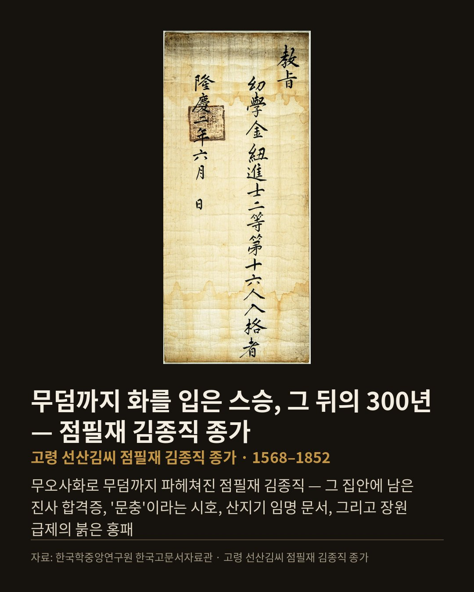
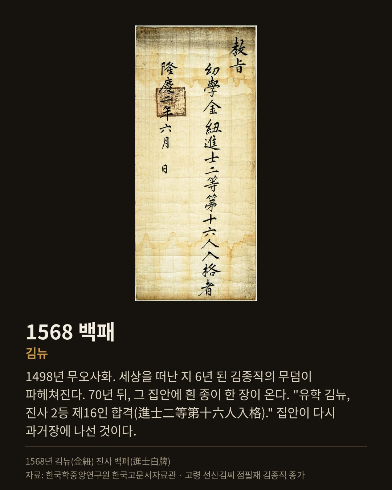
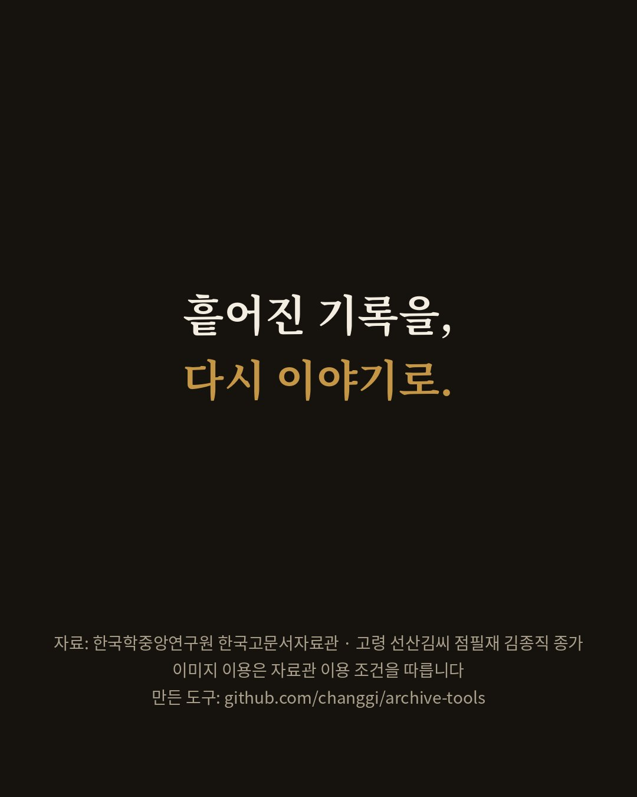

# EP.28 무덤까지 화를 입은 스승, 그 뒤의 300년 — 점필재 김종직 종가

고령 선산김씨 점필재 김종직 종가 (문중) · 무오사화로 무덤까지 파헤쳐진 점필재 김종직 — 그 집안에 남은 진사 합격증, '문충'이라는 시호, 산지기 임명 문서, 그리고 장원 급제의 붉은 홍패

- 🌐 [전시 웹페이지](https://changgi.github.io/archive-tools/examples/jeompiljae/exhibit.html) (한자 위 한글 독음 · 원문 해석) · [수업 활동지](https://changgi.github.io/archive-tools/examples/jeompiljae/handout.html)
- 🎬 영상: [릴스 9:16](https://changgi.github.io/archive-tools-next/media/ep28-jeompiljae_reel.mp4) · [가로 16:9](https://changgi.github.io/archive-tools-next/media/ep28-jeompiljae_wide.mp4) · 홍보 글: [`promo.md`](promo.md)
- 카드뉴스: [`cards/`](cards/) · SNS 글: [`sns.txt`](sns.txt) · 판독·해석 표: [`selection.csv`](selection.csv)


<!-- DELIVERY -->
## 전달 에디팅 — 이 기록을 이렇게 전합니다

- **핵심 정서** — 회복
- **한 문장** — 집안의 명예는 무너져도 기록으로 다시 세워질 수 있었다는 것.
- **열기** — 무덤까지 파헤쳐진 학자의 집안은 어떻게 다시 일어섰을까요?
- **펼치기** — 김뉴 진사 백패 → 김준 문과 홍패 → 산직차출문서 → 증시교지 (1568–1852년) — 사화의 상처 → 후손의 합격 → 나라의 복권 순으로 회복의 서사를 만들었습니다.
- **절정** — "김종직에게 영의정을 추증하고 시호를 문충공이라 한다(贈大匡輔國崇祿大夫議政府領議政 … 贈諡文忠公者)" — 화면·공간에서 이 한 줄만 크게, 소리를 줄여 집중
- **여운** — 무덤이 파헤쳐진 집안의 후손에게 과거 시험은 어떤 의미였을까요? — 질문으로 끝내고 답은 보는 사람에게
- **감각과 물질** — 파헤쳐진 흙빛 공간에서 백패의 흰빛, 시호 교지의 금빛으로 밝아지는 동선 · 흰 종이 한 장에 조명 하나 · 붉은 종이를 실물 크기로 복제해 벽에 거는 연출 · 어보·관인 탁본 스탬프를 찍어 보는 체험
- **통로와 매개** — 온라인: 릴스(열기) → 카드뉴스(펼치기) → 전시 웹페이지(절정·원문) → 비하인드 카드(여운) / 오프라인: 원본 크기 복제·낭독·참여 벽 / 남기기: 활동지·질문 카드
- **여운 장치** — "무너진 뒤 다시 세운 경험" 나누기
- **전달 에디팅 전** — 4건의 문서를 1568–1852년 연대순으로 놓고 문서명 · 유형 · 해설을 붙인다 — 정확하지만, 지나가면 잊힌다.
- **전달 에디팅 후** — 핵심 정서는 「회복」. 「무덤까지 파헤쳐진 학자의 집안은 어떻게 다시 일어섰을까요?」로 열고, 문서를 대비와 순서로 펼친 뒤, "김종직에게 영의정을 추증하고 시호를 문충공이라 한다(贈大匡輔國崇祿大夫議政府領議政 … 贈諡文忠公者)"에서 멈춘다. 파헤쳐진 흙빛 공간에서 백패의 흰빛, 시호 교지의 금빛으로 밝아지는 동선. 마지막엔 「"무너진 뒤 다시 세운 경험" 나누기」로 보는 사람이 자기 이야기를 남기고 떠나게 한다.

전문: [`delivery.md`](delivery.md)
<!-- /DELIVERY -->

<!-- CURATOR -->
## 비하인드 — 큐레이터 노트

- **왜 이 문서들인가** — 무오사화로 무덤까지 파헤쳐진 김종직의 집안이 70년 뒤 진사 백패, 200년 뒤 시호로 다시 일어선 과정이 있었습니다.
- **전하고 싶은 것** — 집안의 명예는 무너져도 기록으로 다시 세워질 수 있었다는 것.
- **이렇게 보이길 바랐다** — 사화의 상처 → 후손의 합격 → 나라의 복권 순으로 회복의 서사를 만들었습니다.
- **이렇게 써 주세요** — 사화와 사림, 복권과 추숭 수업에 쓰세요.
- **만들며 있었던 일** — 세로 영상을 다시 만들었습니다(v0.5.0 갱신 과정).
- **남겨 둔 질문** — 무덤이 파헤쳐진 집안의 후손에게 과거 시험은 어떤 의미였을까요?
- **제작 기록** — 문서 4건 · 1568–1852년 · 원본 사진 6면(문서 전체) · 원문 판독 4건 · 번역 4건 · 못 읽은 글자 □ 0 · 불확실 (?) 2 · 해제에 "확인 필요"를 단 문서 2건

전문: [`curator.md`](curator.md)
<!-- /CURATOR -->

## 이야기 — 사료가 말하는 대로

무덤까지 화를 입은 스승의 집안은, 그 뒤 어떻게 되었을까요?

> **1568 백패** — 1498년 무오사화. 세상을 떠난 지 6년 된 김종직의 무덤이 파헤쳐진다. 70년 뒤, 그 집안에 흰 종이 한 장이 온다. "유학 김뉴, 진사 2등 제16인 합격(進士二等第十六人入格)." 집안이 다시 과거장에 나선 것이다.
> **1852 홍패** — 그리고 1852년 가을, 붉은 종이 한 장. "유학 김준, 문과 갑과 제1인(文科甲科第一人)." 장원 급제다. 무덤까지 화를 입었던 스승의 집안에서, 350여 년 뒤 나라의 첫째 선비가 나왔다.
> ** 산직차출문서** — 한 번 무덤을 잃었던 집안은 무덤을 지키는 일에 정성을 다했다. 산지기를 정하는 문서가 그것을 보여 준다. "너를 우령산 산지기로 정하니 착실히 지키라(汝矣身乙牛嶺山山直差出 着實守護)."
> ** 증시교지** — 그리고 1709년, 마침내 나라가 그를 다시 부른다. "김종직에게 영의정을 추증하고 시호를 문충공이라 한다(贈大匡輔國崇祿大夫議政府領議政 … 贈諡文忠公者)." 무덤이 파헤쳐진 지 211년 만이다.

| 표지 | 1번 카드 | 마무리 |
|---|---|---|
|  |  |  |

## 선별 문서 (4점)

| # | 연도 | 유형 | 문서명 | 원본 |
|---|---|---|---|---|
| 1 | 1568 | 백패 | 1568년 김뉴(金紐) 진사 백패(進士白牌) | [원본 보기](https://archive.aks.ac.kr/viewer/viewer.do#imgnode.do?itemId=book&gubun=booktree&depth=6&upPath=01%5E0167%5EL016763%5EL016763F02%5EL016763F0201&dataId=G002%2BAKS%2BKSM-XA.1568.4783-20220125.B076a_109_00001_XXX&itemType=) |
| 2 | 1852 | 홍패 | 1852년 김준(金{土+隼}) 문과 홍패(文科紅牌) | [원본 보기](https://archive.aks.ac.kr/viewer/viewer.do#imgnode.do?itemId=book&gubun=booktree&depth=6&upPath=01%5E0167%5EL016763%5EL016763F02%5EL016763F0201&dataId=G002%2BAKS%2BKSM-XA.1852.4783-20220125.B076a_109_00005_XXX&itemType=) |
| 3 | — | 산직차출문서 | 산직차출문서(山直差出文書) | [원본 보기](https://archive.aks.ac.kr/viewer/viewer.do#imgnode.do?itemId=book&gubun=booktree&depth=6&upPath=01%5E0167%5EL016763%5EL016763F02%5EL016763F0203&dataId=G002%2BAKS%2BKSM-XC.1859.4783-20220125.B076a_109_00141_XXX&itemType=) |
| 4 | — | 증시교지 | 증시교지(贈諡敎旨) | [원본 보기](https://archive.aks.ac.kr/viewer/viewer.do#imgnode.do?itemId=book&gubun=booktree&depth=6&upPath=01%5E0167%5EL016763%5EL016763F02%5EL016763F0201&dataId=G002%2BAKS%2BKSM-XA.1707.4783-20220125.B076a_109_00058_XXX&itemType=) |

## 원문 판독과 해석

### 1. 1568년 김뉴(金紐) 진사 백패(進士白牌)

**원문 판독**

```
敎旨
幼學金紐進士二等第十六人入格者
隆慶二年六月 日 (도장)
```

**원문 해석** 교지. 유학 김뉴를 진사 2등 제16인으로 합격시킨다. 융경 2년(1568) 6월 일.

**해제** 1568년(선조 1, 隆慶 2) 6월, 김종직의 후손 김뉴가 진사시에 2등 16번째로 합격해 받은 백패(소과 합격 증서)입니다. 김종직(1431~1492)은 세상을 떠난 뒤 1498년 무오사화 때 제자 김일손이 실록에 실은 「조의제문」이 문제가 되어 무덤이 파헤쳐지는 부관참시를 당했고, 집안도 큰 화를 입었습니다. 70년 뒤의 이 합격증은 집안이 다시 과거에 나선 기록입니다.

### 2. 1852년 김준(金{土+隼}) 문과 홍패(文科紅牌)

**원문 판독**

```
敎旨
幼學金埈文科甲科第
一人及第出身者
咸豐二年十月二十二日 (도장)
```

**원문 해석** 교지. 유학 김준을 문과 갑과 제1인으로 급제시켜 출신을 준다. 함풍 2년(1852) 10월 22일.

**해제** 1852년(철종 3, 咸豐 2) 10월 22일, 김종직의 후손 김준(金埈)에게 내린 문과 홍패입니다. '甲科第一人'은 문과 전체 1등, 곧 장원 급제입니다. 붉게 물들인 종이에 써서 홍패라고 합니다.

### 3. 산직차출문서(山直差出文書)

**원문 판독**

```
白楊洞李德倫
汝矣身乙牛嶺山山直
差出着(?)實(?)守護宜
當者
己未十月 日 (붉은 도장 두 개)
(왼쪽 큰 글씨) 수결(押)
```

**원문 해석** 백양동 이덕륜. 너를 우령산(牛嶺山)의 산지기(山直)로 정하니, 착실히 지키고 보호함이 마땅하다. 기미년 10월 일. (서명)

**해제** 기미년 10월, 김종직 종가가 백양동에 사는 이덕륜을 집안 산소가 있는 우령산의 산지기로 임명한 문서입니다. '汝矣身乙'은 '너를'이라는 이두입니다. 양반가는 선산을 지키기 위해 산지기를 두고 이런 임명 문서(差帖)를 내주었으며, 산지기는 나무를 지키고 무덤을 돌보는 대신 산 아래 땅을 부치는 등의 혜택을 받았습니다. 기미년이 몇 년인지는 확인이 필요합니다.

### 4. 증시교지(贈諡敎旨)

**원문 판독**

```
敎旨
資憲大夫刑曹判書兼
知經筵春秋館事弘文
館提學同知成均館事
金宗直贈大匡輔國崇
祿大夫議政府領議政
兼領經筵弘文館藝文
館春秋館觀象監事贈
諡文忠公者
康熙四十八年二月 日 (도장)
```

**원문 해석** 교지. 자헌대부 형조판서 겸 지경연·춘추관사, 홍문관 제학, 동지성균관사로서 대광보국숭록대부 의정부 영의정 겸 영경연·홍문관·예문관·춘추관·관상감사에 추증된 김종직에게 '문충공(文忠公)'이라는 시호를 내린다. 강희 48년(1709) 2월 일.

**해제** 1709년(숙종 35, 康熙 48) 2월, 김종직에게 '문충(文忠)'이라는 시호를 내린 증시교지입니다. 앞부분은 생전의 마지막 관직(형조판서 등), 뒷부분은 추증된 관직(영의정)입니다. 무오사화로 삭탈되었던 그는 중종반정 뒤 복권되었고, 이 교지로 나라가 그의 일생을 다시 공식적으로 기렸습니다. 시호를 받은 경위(앞선 시호와의 관계)는 원문·연대기 확인이 필요합니다.

판독·해석·이야기는 이미지에 근거한 초안이며(검토 전 "초안" 표시), 정확한 판독은 원문 확인이 필요합니다. □는 읽지 못한 글자, (?)는 불확실한 글자입니다.
이미지: 한국학중앙연구원 한국고문서자료관 소장·제공. "원본" 링크를 누르면 자료관 뷰어에서 그 문서가 열립니다. 재사용은 자료관에 문의하세요(소장처 동의 필요).
