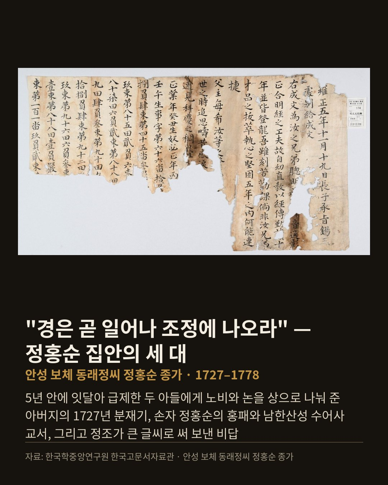
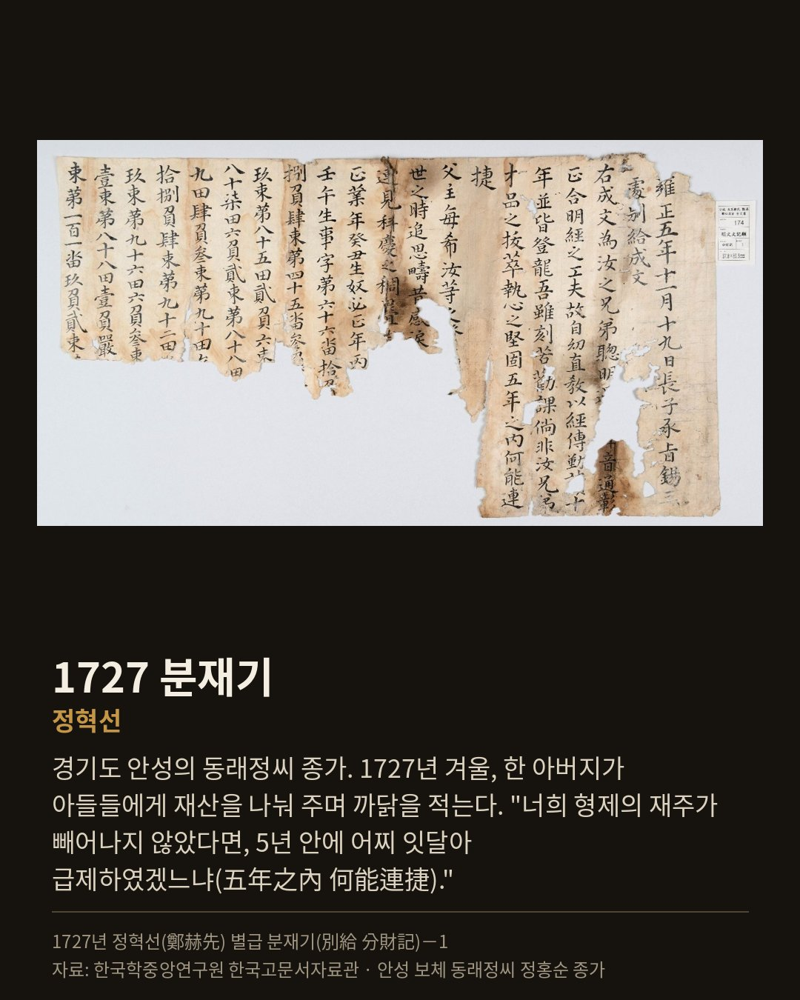
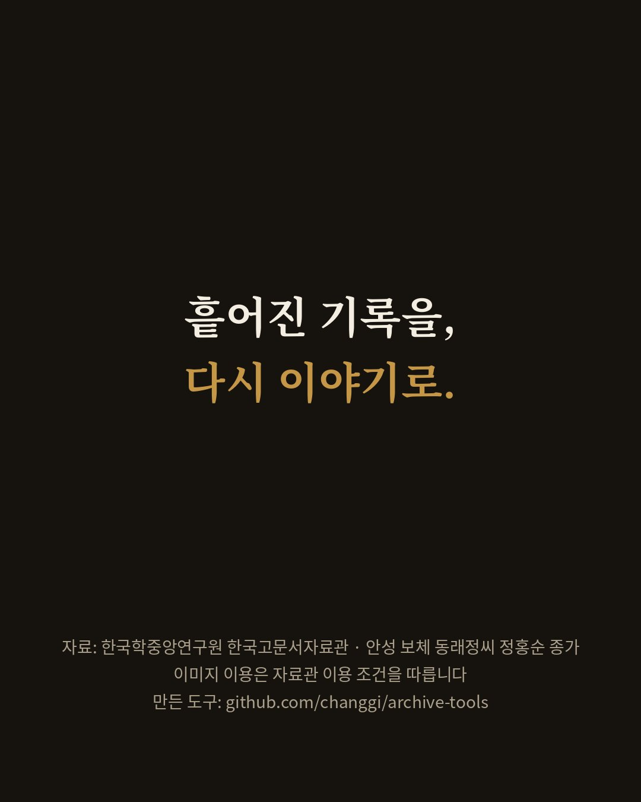

# EP.51 "경은 곧 일어나 조정에 나오라" — 정홍순 집안의 세 대

안성 보체 동래정씨 정홍순 종가 (문중) · 5년 안에 잇달아 급제한 두 아들에게 노비와 논을 상으로 나눠 준 아버지의 1727년 분재기, 손자 정홍순의 홍패와 남한산성 수어사 교서, 그리고 정조가 큰 글씨로 써 보낸 비답

- 🌐 [전시 웹페이지](https://changgi.github.io/archive-tools/examples/jeonghongsun/exhibit.html) (한자 위 한글 독음 · 원문 해석) · [수업 활동지](https://changgi.github.io/archive-tools/examples/jeonghongsun/handout.html)
- 🎬 영상: [릴스 9:16](https://changgi.github.io/archive-tools/examples/media/ep51-jeonghongsun_reel.mp4) · [가로 16:9](https://changgi.github.io/archive-tools/examples/media/ep51-jeonghongsun_wide.mp4) · 홍보 글: [`promo.md`](promo.md)
- 카드뉴스: [`cards/`](cards/) · SNS 글: [`sns.txt`](sns.txt) · 판독·해석 표: [`selection.csv`](selection.csv)


<!-- DELIVERY -->
## 전달 에디팅 — 이 기록을 이렇게 전합니다

- **핵심 정서** — 기쁨과 책임
- **한 문장** — 벼슬은 한 사람의 성취이기 전에 집안 전체의 기쁨이자 책임이었다는 것.
- **열기** — 임금이 큰 붓으로 단 열 글자를 써 보냈습니다. 무슨 말이었을까요?
- **펼치기** — 정혁선 별급 분재기－1 → 정홍순 문과 홍패 → 정홍순 교서 → 정홍순 비답 (1727–1778년) — 아버지의 기쁨(분재기) → 손자의 붉은 종이(홍패) → 임금의 큰 글씨(비답) 순으로, 문서의 목소리가 점점 커지도록 놓았습니다.
- **절정** — "경은 곧 일어나 조정에 나와, 함께 어려운 때를 건너라(卿卽起造朝 共濟時艱)" — 화면·공간에서 이 한 줄만 크게, 소리를 줄여 집중
- **여운** — 아버지가 상으로 나눠 준 노비와 논은 그 뒤 누구의 삶이 되었을까요? — 질문으로 끝내고 답은 보는 사람에게
- **감각과 물질** — 아버지의 분재기 → 홍패 → 임금의 큰 글씨, 글씨 크기가 커지는 동선 · 값(무명·냥·원)을 오늘의 물건으로 바꿔 옆에 놓기, 수결 따라 그리기 · 붉은 종이를 실물 크기로 복제해 벽에 거는 연출 · 두루마리를 실제 길이로 펼친 복제
- **통로와 매개** — 온라인: 릴스(열기) → 카드뉴스(펼치기) → 전시 웹페이지(절정·원문) → 비하인드 카드(여운) / 오프라인: 원본 크기 복제·낭독·참여 벽 / 남기기: 활동지·질문 카드
- **여운 장치** — "우리 집의 경사 문서"
- **전달 에디팅 전** — 4건의 문서를 1727–1778년 연대순으로 놓고 문서명 · 유형 · 해설을 붙인다 — 정확하지만, 지나가면 잊힌다.
- **전달 에디팅 후** — 핵심 정서는 「기쁨과 책임」. 「임금이 큰 붓으로 단 열 글자를 써 보냈습니다. 무슨 말이었을까요?」로 열고, 문서를 대비와 순서로 펼친 뒤, "경은 곧 일어나 조정에 나와, 함께 어려운 때를 건너라(卿卽起造朝 共濟時艱)"에서 멈춘다. 아버지의 분재기 → 홍패 → 임금의 큰 글씨, 글씨 크기가 커지는 동선. 마지막엔 「"우리 집의 경사 문서"」로 보는 사람이 자기 이야기를 남기고 떠나게 한다.

전문: [`delivery.md`](delivery.md)
<!-- /DELIVERY -->

<!-- CURATOR -->
## 비하인드 — 큐레이터 노트

- **왜 이 문서들인가** — 한 집안에 분재기·홍패·교서·비답이 3대에 걸쳐 남아, '급제'가 집안에 어떤 사건이었는지를 한 줄로 이을 수 있었습니다.
- **전하고 싶은 것** — 벼슬은 한 사람의 성취이기 전에 집안 전체의 기쁨이자 책임이었다는 것.
- **이렇게 보이길 바랐다** — 아버지의 기쁨(분재기) → 손자의 붉은 종이(홍패) → 임금의 큰 글씨(비답) 순으로, 문서의 목소리가 점점 커지도록 놓았습니다.
- **이렇게 써 주세요** — 과거 제도·가족사 수업에서 '합격이 집안에 가져온 변화'를 문서로 따라가는 활동에 쓰세요.
- **남겨 둔 질문** — 아버지가 상으로 나눠 준 노비와 논은 그 뒤 누구의 삶이 되었을까요?
- **제작 기록** — 문서 4건 · 1727–1778년 · 원본 사진 4면(문서 전체) · 원문 판독 4건 · 번역 4건 · 못 읽은 글자 □ 0 · 불확실 (?) 3 · 해제에 "확인 필요"를 단 문서 2건

전문: [`curator.md`](curator.md)
<!-- /CURATOR -->

## 이야기 — 사료가 말하는 대로

임금이 큰 붓으로 단 열 글자를 써 보냈습니다. 무슨 말이었을까요?

> **1727 분재기** — 경기도 안성의 동래정씨 종가. 1727년 겨울, 한 아버지가 아들들에게 재산을 나눠 주며 까닭을 적는다. "너희 형제의 재주가 빼어나지 않았다면, 5년 안에 어찌 잇달아 급제하였겠느냐(五年之內 何能連捷)."
> **1745 홍패** — 18년 뒤, 그 집안에 또 붉은 종이가 온다. 오른쪽은 찢겨 나갔지만 남은 글자가 말한다. "제2인으로 급제한 사람으로 삼는다(第二人及第出身者)." 할아버지가 바라던 일이, 손자 정홍순에게 이어졌다.
> **1772 교서** — 1772년, 정홍순은 남한산성을 맡는다. 임금의 교서는 그를 이렇게 부른다. "좋은 쇠와 아름다운 바탕, 큰 집안의 남은 기풍(良金美質 喬木遺風)." 그리고 당부한다. 군사를 배우지 않았다고 말하지 말라고.
> **1778 비답** — 그리고 1778년, 새 임금 정조가 물러나려는 그에게 답을 보낸다. 큰 붓으로 단 열 글자. "경은 곧 일어나 조정에 나와, 함께 어려운 때를 건너라(卿卽起造朝 共濟時艱)." 할아버지가 상을 준 집안의 공부가, 임금이 붙잡는 신하를 길러 냈다.

| 표지 | 1번 카드 | 마무리 |
|---|---|---|
|  |  |  |

## 선별 문서 (4점)

| # | 연도 | 유형 | 문서명 | 원본 |
|---|---|---|---|---|
| 1 | 1727 | 분재기 | 1727년 정혁선(鄭赫先) 별급 분재기(別給 分財記)－1 | [원본 보기](https://archive.aks.ac.kr/viewer/viewer.do#imgnode.do?itemId=book&gubun=booktree&depth=6&upPath=01%5E0141%5EL014115%5EL014115F02%5EL014115F0205&dataId=G002%2BKHD%2BKSM-XE.1727.0000-20170801.C0601_002_00362_XXX&itemType=) |
| 2 | 1745 | 홍패 | 1745년 정홍순(鄭弘淳) 문과 홍패(文科紅牌) | [원본 보기](https://archive.aks.ac.kr/viewer/viewer.do#imgnode.do?itemId=book&gubun=booktree&depth=6&upPath=01%5E0141%5EL014115%5EL014115F02%5EL014115F0201&dataId=G002%2BKHD%2BKSM-XA.1745.0000-20170801.C0601_002_00002_XXX&itemType=) |
| 3 | 1772 | 교서 | 1772년 정홍순(鄭弘淳) 교서(敎書) | [원본 보기](https://archive.aks.ac.kr/viewer/viewer.do#imgnode.do?itemId=book&gubun=booktree&depth=6&upPath=01%5E0141%5EL014115%5EL014115F02%5EL014115F0201&dataId=G002%2BKHD%2BKSM-XA.1772.0000-20170801.C0601_002_00299_XXX&itemType=) |
| 4 | 1778 | 비답 | 1778년 정홍순(鄭弘淳) 비답(批答) | [원본 보기](https://archive.aks.ac.kr/viewer/viewer.do#imgnode.do?itemId=book&gubun=booktree&depth=6&upPath=01%5E0141%5EL014115%5EL014115F02%5EL014115F0201&dataId=G002%2BKHD%2BKSM-XA.1778.0000-20170801.C0601_002_00318_XXX&itemType=) |

## 원문 판독과 해석

### 1. 1727년 정혁선(鄭赫先) 별급 분재기(別給 分財記)－1

**원문 판독**

```
雍正五年十一月十九日 長子承旨錫三(…)
處別給成文
右成文爲 汝之兄弟 聰明(…)
已合明經之工夫 故自幼直敎以經傳 勤(…)十
年 竝皆登龍 吾雖刻苦勸課 倘非汝兄弟
才品之拔萃 執心之堅固 五年之內 何能連
捷
父主每希汝等之(…)
世之時 追思疇昔 感淚(…)
連見科慶之稠疊(…) (훼손)
已業(?)年 癸丑生奴 必已(?) 年 丙(…)
壬午生 事字第六十六畓 拾(…)
(…)貳肆束 第四十五畓 參(…)
(이하 왼쪽 — 노비와 논의 목록, 훼손 · 판독 필요)
```

**원문 해석** 옹정 5년(1727) 11월 19일, 맏아들 승지 석삼(錫三) 등에게 따로 나눠 주는 문서. 이 문서를 만드는 것은, 너희 형제가 총명하여 … 경전을 밝히는 공부에 맞았으므로 어려서부터 곧바로 경전으로 가르쳤는데, 부지런히 … 십 년에 모두 함께 급제(登龍)하였다. 내가 비록 애써 공부를 독려하였으나, 너희 형제의 재주와 품성이 빼어나고 마음 잡음이 굳지 않았다면 5년 안에 어찌 잇달아 급제할 수 있었겠느냐. 아버님께서 늘 너희가 … 하기를 바라셨는데, [살아] 계실 때를 되돌아 생각하니 감격의 눈물이 … 과거의 경사가 잇달아 겹치는 것을 보니 … (이하 노비: 계축생 노 ○○, 임오생 … / 논: 事字 제66 논 … 제45 논 …, 훼손으로 판독 필요)

**해제** 1727년(영조 3) 11월, 정혁선(鄭赫先)이 과거에 잇달아 급제한 아들들에게 노비와 논을 따로 상으로 준 별급(別給) 분재기입니다. 맏아들 정석삼(鄭錫三)은 1711년 문과에 급제했고, 형제가 5년 사이에 잇달아 급제(連捷)한 것을 기뻐하며 썼습니다. 재산 목록은 '事字 제66 논'처럼 양안의 자호(字號)와 지번으로 적었습니다. 왼쪽 절반은 벌레 먹고 찢겨 판독이 필요합니다.

### 2. 1745년 정홍순(鄭弘淳) 문과 홍패(文科紅牌)

**원문 판독**

```
[敎旨] (훼손)
[幼學鄭弘淳文科乙科] (훼손 — 오른쪽 가장자리에 일부만)
第二人及第出身者
乾隆十年九月二十五日 (도장)
```

**원문 해석** 교지. [유학 정홍]순을 문과 [을과] 제2인으로 급제하여 출신한 사람으로 삼는다. 건륭 10년(1745) 9월 25일.

**해제** 1745년(영조 21), 정혁선의 손자 정홍순(鄭弘淳, 1720~1784)이 문과에 급제하고 받은 홍패입니다. 오른쪽이 크게 찢겨 이름과 과(科)는 문서명과 서식으로 보충했고, '第二人及第出身者'와 날짜는 또렷합니다. 정홍순은 뒤에 호조판서·우의정을 지냈습니다.

### 3. 1772년 정홍순(鄭弘淳) 교서(敎書)

**원문 판독**

```
敎南漢山城守禦使鄭弘淳書
王若曰 內參廟籌 常篤倚毗之眷 外仗鈇鉞 庸畀
保障之權 實循僉謀 宜藉宿望 睠玆漢南險阻
卽我海東關防 山河控襟帶之形 爲宰相無
領之地 亭壁(?)備桑土之戒 想 列朝經遠之謨 惟
是任實難其人 顧今日當屬之子 惟卿良金美
質 喬木遺風 確乎謹約之規 不踰尺寸 凝然端
詳之度 自成楷模 予嘗稱故人之肖兒 心愜精白
世皆謂乃叔之佳姪 口無雌黃 金才須擇於九卿
重任宜托於三輔 玆授卿以南漢山城守禦使
卿其祗服寵命 勉殫令猷 修堞城而峙糇糧
莫曰軍旅之未學 簡卒乘而整器械 須思甲
胄之在躬 於戲 治當一初 責專重鎭 緩裘帶
於南甸 必得江漢之心 壯鎖鑰於北門 可紓宵旰
之慮 故玆敎示 想宜知悉
乾隆三十七年八月初六日 (도장)
```

**원문 해석** 남한산성 수어사 정홍순에게 내리는 교서. 왕은 이르노라. 안으로 조정의 계책에 참여하여 늘 믿고 의지하는 마음을 두텁게 하고, 밖으로는 부월(군권)을 맡겨 지키는 권한을 주는 것은 실로 여럿의 의논을 따른 것이니, 마땅히 오랜 명망을 빌려야 한다. 돌아보건대 이 한강 남쪽의 험한 곳(남한산성)은 곧 우리나라의 관문으로, 산과 강이 옷깃과 띠처럼 둘러싼 형세이며, 재상이 맡는 땅이다. … 미리 대비하는 경계를 갖추었으니 역대 임금의 먼 계책을 생각한다. 이 소임은 실로 사람을 얻기 어려운데, 오늘 누구에게 맡길까 돌아보니, 오직 경은 좋은 쇠와 아름다운 바탕이요 큰 집안의 남은 기풍이 있어, 삼가고 검소한 법도가 한 치도 넘지 않고, 단정하고 차분한 태도가 저절로 본보기가 되었다. 내가 일찍이 '옛 신하의 닮은 아들'이라 칭찬하였고, 세상은 모두 '그 숙부의 훌륭한 조카'라 하여 흠잡는 말이 없다. 재주 있는 이는 구경(九卿) 가운데서 골라야 하고, 무거운 소임은 서울 근처(三輔)에 맡겨야 하니, 이에 경을 남한산성 수어사로 삼는다. 경은 은혜로운 명을 공경히 받들어 좋은 계책을 다하라. 성가퀴를 고치고 군량을 쌓되 군사를 배우지 않았다고 말하지 말고, 병사와 수레를 가려 뽑고 무기를 정돈하되 갑옷과 투구가 몸에 있다고 생각하라. 아아, 다스림은 처음이 중요하고, 책임은 무거운 진(鎭)에 있다. 남쪽 고을에서 갑옷 대신 가벼운 옷을 입고서도(여유 있게 다스려) 반드시 백성의 마음을 얻고, 북문의 자물쇠를 굳게 하여 밤낮으로 근심하는 [나의] 걱정을 덜어 줄 수 있으리라. 이에 교시하니 잘 알리라 생각한다. 건륭 37년(1772) 8월 6일.

**해제** 1772년(영조 48) 8월, 정홍순을 남한산성 수어사(守禦使)로 임명하며 내린 교서입니다. 남한산성을 '우리나라의 관문(海東關防)'이라 하고, 정홍순을 '좋은 쇠와 아름다운 바탕(良金美質)', '그 숙부의 훌륭한 조카(乃叔之佳姪)'라 칭찬했습니다. 숙부는 정혁선의 다른 아들로 보이나 확인이 필요합니다. 해서로 반듯해 전문을 판독했고, 한두 글자는 불확실합니다.

### 4. 1778년 정홍순(鄭弘淳) 비답(批答)

**원문 판독**

```
卿卽起造
朝共濟時
艱
```

**원문 해석** 경은 곧 일어나 조정에 나와, 함께 이 어려운 때를 건너도록 하라.

**해제** 1778년(정조 2), 정조가 정홍순의 사직 상소에 내린 비답(批答)입니다. 큰 붓으로 단 열 글자 '卿卽起造朝 共濟時艱'만 적었습니다. 정조 즉위 초 정홍순은 우의정에 올랐다가 물러나기를 청한 것으로 알려져 있습니다(문서 밖 사실 — 확인 필요).

판독·해석·이야기는 이미지에 근거한 초안이며(검토 전 "초안" 표시), 정확한 판독은 원문 확인이 필요합니다. □는 읽지 못한 글자, (?)는 불확실한 글자입니다.
이미지: 한국학중앙연구원 한국고문서자료관 소장·제공. "원본" 링크를 누르면 자료관 뷰어에서 그 문서가 열립니다. 재사용은 자료관에 문의하세요(소장처 동의 필요).
