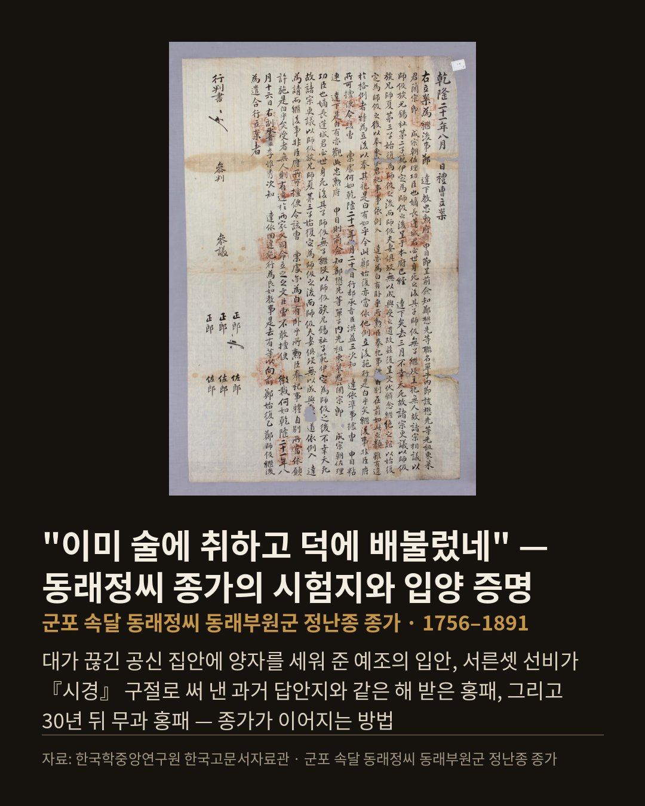
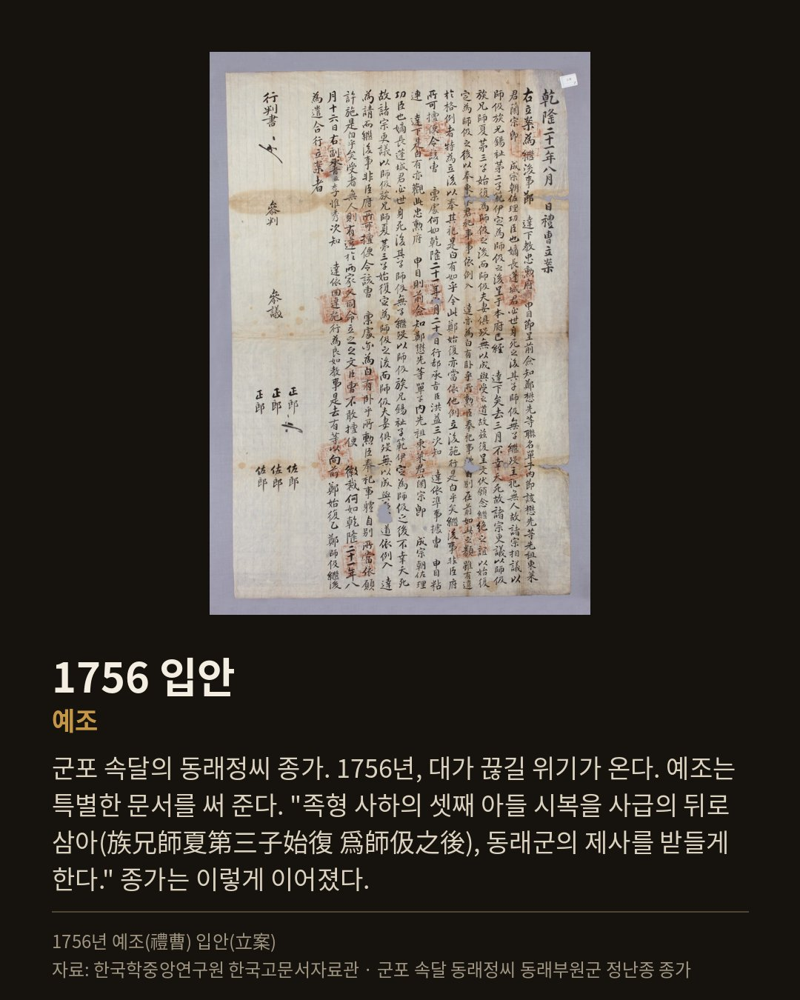
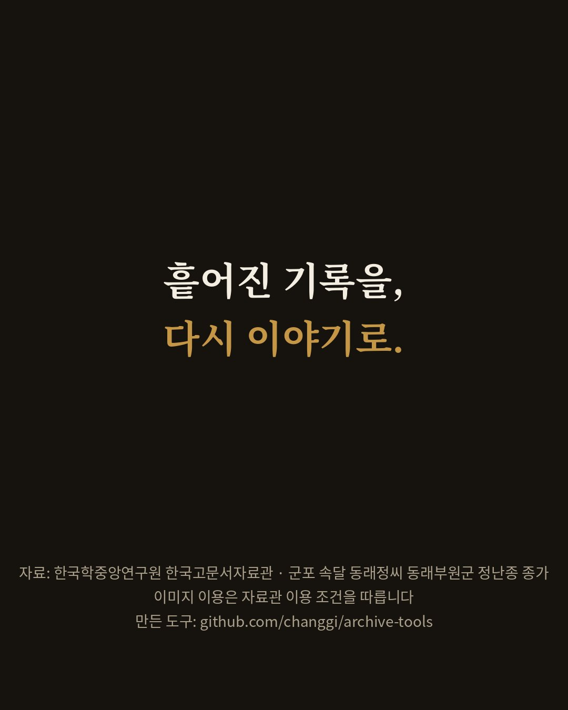

# EP.39 "이미 술에 취하고 덕에 배불렀네" — 동래정씨 종가의 시험지와 입양 증명

군포 속달 동래정씨 동래부원군 정난종 종가 (문중) · 대가 끊긴 공신 집안에 양자를 세워 준 예조의 입안, 서른셋 선비가 『시경』 구절로 써 낸 과거 답안지와 같은 해 받은 홍패, 그리고 30년 뒤 무과 홍패 — 종가가 이어지는 방법

- 🌐 [전시 웹페이지](https://changgi.github.io/archive-tools/examples/jeongnanjong/exhibit.html) (한자 위 한글 독음 · 원문 해석) · [수업 활동지](https://changgi.github.io/archive-tools/examples/jeongnanjong/handout.html)
- 🎬 영상: [릴스 9:16](https://changgi.github.io/archive-tools/examples/media/ep39-jeongnanjong_reel.mp4) · [가로 16:9](https://changgi.github.io/archive-tools/examples/media/ep39-jeongnanjong_wide.mp4) · 홍보 글: [`promo.md`](promo.md)
- 카드뉴스: [`cards/`](cards/) · SNS 글: [`sns.txt`](sns.txt) · 판독·해석 표: [`selection.csv`](selection.csv)


<!-- CURATOR -->
## 비하인드 — 큐레이터 노트

- **왜 이 문서들인가** — 채점관이 쓴 점수까지 남은 1861년 과거 시험지가 있었습니다.
- **전하고 싶은 것** — 과거 시험은 실제 답안과 평가로 이루어진, 오늘의 시험과 닮은 제도였다는 것.
- **이렇게 보이길 바랐다** — 양자 입안으로 집안을 잇는 이야기를 먼저 하고, 그 집안의 선비가 시험장에 앉는 장면으로 넘어갔습니다.
- **이렇게 써 주세요** — 과거 시험(답안지·채점), 오늘의 시험 제도와 비교하는 수업에 쓰세요.
- **남겨 둔 질문** — 그 답안지의 점수에 그는 만족했을까요?
- **제작 기록** — 문서 4건 · 1756–1891년 · 원본 사진 7면(문서 전체) · 원문 판독 4건 · 번역 4건 · 못 읽은 글자 □ 1 · 불확실 (?) 4 · 해제에 "확인 필요"를 단 문서 1건

전문: [`curator.md`](curator.md)
<!-- /CURATOR -->

## 이야기 — 사료가 말하는 대로

과거 시험지가 남아 있습니다. 채점관이 쓴 점수까지.

> **1756 입안** — 군포 속달의 동래정씨 종가. 1756년, 대가 끊길 위기가 온다. 예조는 특별한 문서를 써 준다. "족형 사하의 셋째 아들 시복을 사급의 뒤로 삼아(族兄師夏第三子始復 爲師伋之後), 동래군의 제사를 받들게 한다." 종가는 이렇게 이어졌다.
> **1861 시권** — 105년 뒤 1861년, 그 집안의 서른셋 선비가 과거장에 앉는다. 시제는 『시경』의 한 구절이었다. "이미 술에 취하고 이미 덕에 배불렀으니, 군자여 만년토록 큰 복을 누리소서(旣醉以酒 旣飽以德 君子萬年 介爾景福)." 채점관은 큰 붓으로 '三下'를 적었다.
> **1861 홍패** — 그리고 같은 달, 붉은 종이 한 장. 답안지의 붉은 띠와 같은 숫자가 적혀 있다. "유학 정학묵을 문과 병과 제8인으로 급제한 사람으로 삼는다(幼學鄭學默文科丙科第八人)." 답안지와 합격증이 짝을 이뤄 남았다.
> **1891 홍패** — 30년 뒤, 같은 종가에서 이번에는 무과 홍패가 나온다. "부사용 정규선을 무과 을과 제2인으로 급제한 사람으로 삼는다(副司勇鄭圭善武科乙科第二人)." 문(文)과 무(武), 종가는 두 길로 이어졌다.

| 표지 | 1번 카드 | 마무리 |
|---|---|---|
|  |  |  |

## 선별 문서 (4점)

| # | 연도 | 유형 | 문서명 | 원본 |
|---|---|---|---|---|
| 1 | 1756 | 입안 | 1756년 예조(禮曹) 입안(立案) | [원본 보기](https://archive.aks.ac.kr/viewer/viewer.do#imgnode.do?itemId=book&gubun=booktree&depth=6&upPath=01%5E0141%5EL014153%5EL014153F02%5EL014153F0204&dataId=G002%2BAKS%2BKSM-XD.1756.1100-20101008.B066a_097_00015_XXX&itemType=) |
| 2 | 1861 | 시권 | 1861년 국왕(國王) 시권(試券) | [원본 보기](https://archive.aks.ac.kr/viewer/viewer.do#imgnode.do?itemId=book&gubun=booktree&depth=6&upPath=01%5E0141%5EL014153%5EL014153F02%5EL014153F0204&dataId=G002%2BAKS%2BKSM-XD.1861.0000-20101008.B066a_097_00383_XXX&itemType=) |
| 3 | 1861 | 홍패 | 1861년 정학묵(鄭學黙) 문과 홍패(文科紅牌) | [원본 보기](https://archive.aks.ac.kr/viewer/viewer.do#imgnode.do?itemId=book&gubun=booktree&depth=6&upPath=01%5E0141%5EL014153%5EL014153F02%5EL014153F0201&dataId=G002%2BAKS%2BKSM-XA.1861.1100-20101008.B066a_097_00001_XXX&itemType=) |
| 4 | 1891 | 홍패 | 1891년 정규선(鄭圭善) 무과 홍패(武科紅牌) | [원본 보기](https://archive.aks.ac.kr/viewer/viewer.do#imgnode.do?itemId=book&gubun=booktree&depth=6&upPath=01%5E0141%5EL014153%5EL014153F02%5EL014153F0201&dataId=G002%2BAKS%2BKSM-XA.1891.1100-20101008.B066a_097_00002_XXX&itemType=) |

## 원문 판독과 해석

### 1. 1756년 예조(禮曹) 입안(立案)

**원문 판독**

```
乾隆二十一年八月 日 禮曹立案
右立案爲繼後事節 達下敎忠勳府 申目節 呈前僉(…)
君蘭宗卽(?) 成宗朝佐理功臣也 嫡長蓬城君必世(?)身死之後
師伋族兄錫祉第二子範伊 定爲師伋之後 呈于本府 已經
(…) 族兄師夏第三子始復 爲師伋之後 而師伋夫妻俱歿 無以
定爲師伋之後 以奉東萊君祀事 事依例入 達亦爲白有
於格例者 特爲立後 以奉其祀是白有如乎 今此鄭始復(…)
所可擅便 令該曹 稟處何如 乾隆二十一年□月二十八日 行(…)
連 達下是白有亦 觀此忠勳府 申目 則前僉知鄭懋先(…)
(왼쪽 절반 — 이어지는 사연과 예조 판서·참판·참의·정랑·좌랑 서명, 판독 필요)
```

**원문 해석** 건륭 21년(1756) 8월 일 예조 입안. 이 입안은 대를 잇는 일[계후]에 관한 것이다. [임금께] 아뢰어 내린 하교에 따라 충훈부가 올린 문서에 이르기를, 전 첨지 … 난종(蘭宗)은 성종 때의 좌리공신인데, 맏아들 … 이 죽은 뒤 … 사급(師伋)의 족형 석지(錫祉)의 둘째 아들 범이를 사급의 뒤로 정하려고 본부에 올린 적이 있으나 … 족형 사하(師夏)의 셋째 아들 시복(始復)을 사급의 뒤로 삼으려 하는데, 사급 부부가 모두 죽어 정해 줄 사람이 없으니, 동래군의 제사를 받들게 하려면 … 격례에 [맞지 않는] 경우라도 특별히 후사를 세워 그 제사를 받들게 하였으니, 이번 정시복도 … 예조가 마음대로 할 수 없으니 해당 관청이 여쭈어 처리하는 것이 어떻겠느냐 … (이하 판독 필요)

**해제** 1756년(영조 32) 8월, 예조가 발급한 계후(繼後) 입안입니다. 성종 때 좌리공신 동래군 정난종(鄭蘭宗)의 제사를 잇는 종손 정사급(鄭師伋)이 아들 없이 부부가 모두 죽자, 족형 정사하의 셋째 아들 정시복(鄭始復)을 양자로 세워 제사를 받들게 한 것으로 보입니다. 양부모가 모두 죽은 뒤의 입양은 원칙에 어긋나지만 공신 집안이라 특별히 허락한 사례로 읽힙니다. 행서에 인명이 많아 앞부분만 판독했고, 인물 관계는 원문 확인이 필요합니다.

### 2. 1861년 국왕(國王) 시권(試券)

**원문 판독**

```
(오른쪽 — 피봉, 응시자 정보)
幼學臣鄭學默 年三十三 本東萊 居廣州
父 幼學 翰東
祖 通德郞 混
曾祖 通政大夫行龍安縣監全州鎭管兵馬節制都尉 彦復
外祖 學生 李健行 本延安
(붉은 종이 띠) [辛酉]式年文科殿試丙科第八人 (…)
(큰 붓 — 등급) 三下 / (옆 글씨) 五地(?)
(본문 시작)
旣醉以酒 旣飽以德 君子萬年 介爾景福 賦
饗天保曰單厚 義二篇之用享
宴露湑則攸同 敲(?)百祿之是總
君以德而我福 (…)
(이하 답안 본문 — 판독 필요)
```

**원문 해석** (응시자) 유학 신 정학묵, 나이 33세, 본관 동래, 광주(廣州) 거주. 아버지 유학 한동, 할아버지 통덕랑 혼, 증조할아버지 통정대부 행 용안현감 전주진관 병마절제도위 언복, 외할아버지 학생 이건행, 본관 연안.
(붉은 띠) [신유] 식년 문과 전시 병과 제8인.
(채점) 삼하(三下).
(시제) '이미 술에 취하고 이미 덕에 배불렀으니, 군자여 만년토록 큰 복을 누리소서'를 부(賦)로 지어라.
(답안 첫머리) 하늘이 보우하심을 누리니 두텁고 … 두 편의 뜻으로 잔치를 베풀고, 이슬 젖은 잔치 자리는 함께하니 … 온갖 복록을 모으도다. 임금은 덕으로써, 우리는 복으로써 … (이하 판독 필요)

**해제** 1861년(철종 12, 辛酉) 식년 문과 전시에서 정학묵(鄭學默)이 써 낸 시권(試券, 답안지)입니다. 오른쪽 접힌 부분(피봉)에 응시자의 나이·본관·거주지와 4조(아버지·할아버지·증조·외조)를 적고, 채점자는 큰 붓으로 '三下'라는 등급을 매겼습니다. 붉은 종이 띠에는 '병과 제8인'이라는 최종 결과가 붙어 있습니다. 시제는 『시경』 대아 「기취(旣醉)」 편의 구절로, 이를 부(賦) 형식으로 짓는 문제입니다. 답안 본문은 앞부분만 판독했습니다.

### 3. 1861년 정학묵(鄭學黙) 문과 홍패(文科紅牌)

**원문 판독**

```
敎旨
幼學鄭學默文科丙科第
八人及第出身者
咸豐十一年四月 日 (도장)
```

**원문 해석** 교지. 유학 정학묵을 문과 병과 제8인으로 급제하여 출신한 사람으로 삼는다. 함풍 11년(1861) 4월 일.

**해제** 앞의 시권과 같은 1861년 4월, 정학묵이 받은 문과 홍패입니다. 시권의 붉은 띠에 붙은 '병과 제8인'이 홍패에도 그대로 적혀 있어, 답안지와 합격증이 한 짝으로 남은 드문 예입니다.

### 4. 1891년 정규선(鄭圭善) 무과 홍패(武科紅牌)

**원문 판독**

```
敎旨
副司勇鄭圭善武科乙科
第二人及第出身者
光緖十七年十一月 日 (도장)
```

**원문 해석** 교지. 부사용 정규선을 무과 을과 제2인으로 급제하여 출신한 사람으로 삼는다. 광서 17년(1891) 11월 일.

**해제** 1891년(고종 28) 11월, 정규선(鄭圭善)이 무과에 을과 2등으로 급제하고 받은 홍패입니다. 이름 앞 '副司勇'은 종9품 군직입니다. 붉은 물을 들인 종이가 30년 전 문과 홍패보다 선명하게 남아 있습니다.

판독·해석·이야기는 이미지에 근거한 초안이며(검토 전 "초안" 표시), 정확한 판독은 원문 확인이 필요합니다. □는 읽지 못한 글자, (?)는 불확실한 글자입니다.
이미지: 한국학중앙연구원 한국고문서자료관 소장·제공. "원본" 링크를 누르면 자료관 뷰어에서 그 문서가 열립니다. 재사용은 자료관에 문의하세요(소장처 동의 필요).
