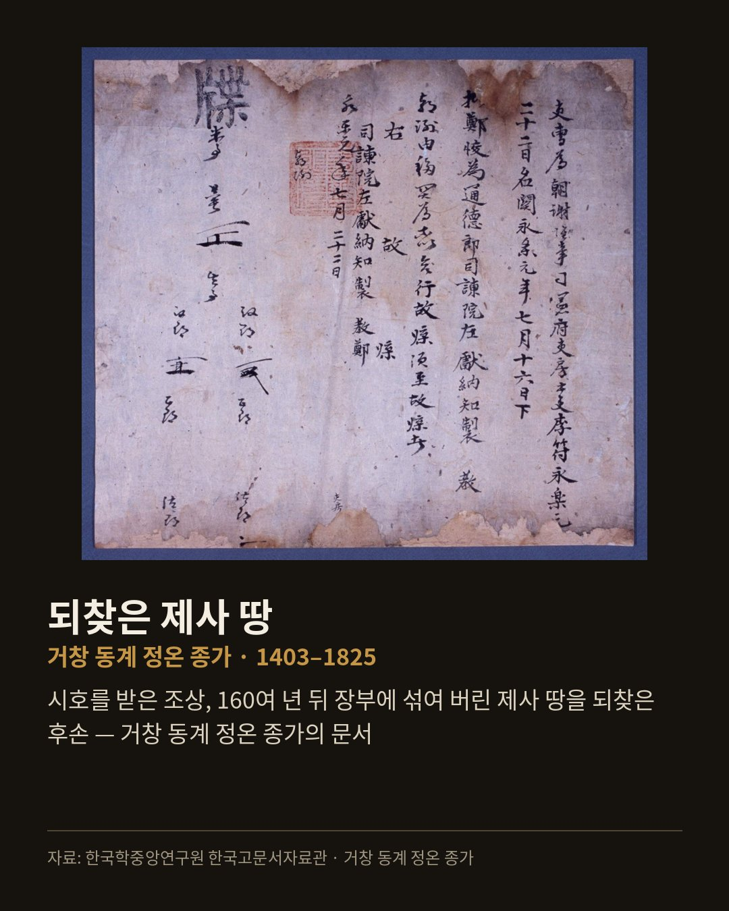
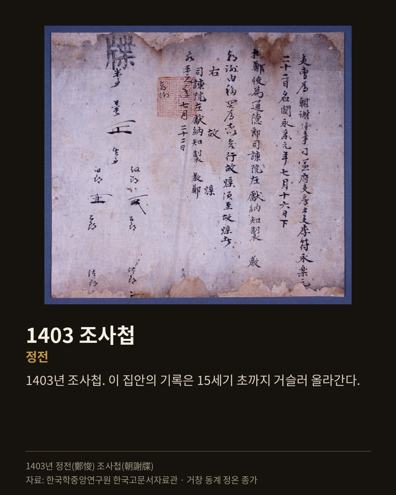
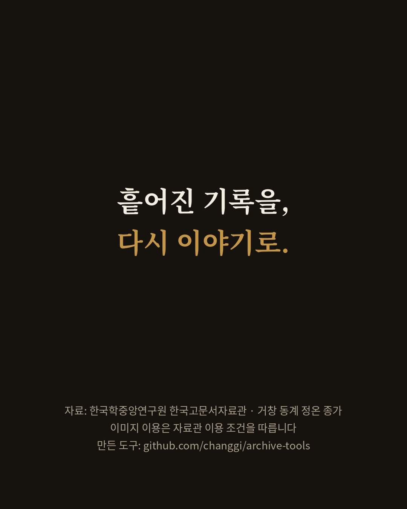

# EP.9 되찾은 제사 땅

거창 동계 정온 종가 (문중) · 시호를 받은 조상, 160여 년 뒤 장부에 섞여 버린 제사 땅을 되찾은 후손 — 거창 동계 정온 종가의 문서

- 🌐 [전시 웹페이지](https://changgi.github.io/archive-tools/examples/jeongon/exhibit.html) · [수업 활동지](https://changgi.github.io/archive-tools/examples/jeongon/handout.html)
- 🎬 영상: [릴스 9:16](https://changgi.github.io/archive-tools/examples/media/ep9-jeongon_reel.mp4) · [가로 16:9](https://changgi.github.io/archive-tools/examples/media/ep9-jeongon_wide.mp4) · 홍보 글: [`promo.md`](promo.md)
- 카드뉴스: [`cards/`](cards/) · SNS 글: [`sns.txt`](sns.txt) · 에디팅 결과: [`selection.csv`](selection.csv)

## 이야기 (영상 내레이션)

> 조상의 제사 땅이 남의 장부에 들어가 버렸다면?
> 이 집안의 기록은 1403년까지 거슬러 올라갑니다.
> 1633년, 임금은 정온에게 유지를 내리고,
> 1657년, 세상을 떠난 그에게 "문간"이라는 시호가 내려집니다.
> 그런데 160여 년 뒤, 문간공의 제사 땅이 충훈부 장부에 섞여 들어갑니다. 1820년, 땅을 되찾아 주라는 결정이 나오고,
> 1825년, 감영은 그 땅을 다시 조사해 정리합니다.
> 160년이 지나도, 후손들은 기록으로 조상의 땅을 지켜 냈습니다.

| 표지 | 1번 카드 | 마무리 |
|---|---|---|
|  |  |  |

## 선별 문서 (6점)

| # | 연도 | 유형 | 문서명 | 원본 |
|---|---|---|---|---|
| 1 | 1403 | 조사첩 | 1403년 정전(鄭悛) 조사첩(朝謝牒) | [원본 보기](https://archive.aks.ac.kr/viewer/viewer.do#imgnode.do?itemId=book&gubun=booktree&depth=6&upPath=01%5E0150%5EL015019%5EL015019F02%5EL015019F0201&dataId=G002%2BAKS%2BKSM-XA.1403.1111-20101008.B013a_023_00002_XXX&itemType=) |
| 2 | 1633 | 유지 | 1633년 정온(鄭蘊) 유지(有旨) | [원본 보기](https://archive.aks.ac.kr/viewer/viewer.do#imgnode.do?itemId=book&gubun=booktree&depth=6&upPath=01%5E0150%5EL015019%5EL015019F02%5EL015019F0201&dataId=G002%2BAKS%2BKSM-XA.1633.1111-20101008.B013a_023_00020_XXX&itemType=) |
| 3 | 1657 | 증시교지 | 1657년 정온(鄭蘊) 증시교지(贈諡敎旨) | [원본 보기](https://archive.aks.ac.kr/viewer/viewer.do#imgnode.do?itemId=book&gubun=booktree&depth=6&upPath=01%5E0150%5EL015019%5EL015019F02%5EL015019F0201&dataId=G002%2BAKS%2BKSM-XA.1657.1111-20101008.B013a_023_00023_XXX&itemType=) |
| 4 | 1694 | 추증교지 | 1694년 정온(鄭蘊) 처(妻) 윤씨(尹氏) 추증교지(追贈敎旨) | [원본 보기](https://archive.aks.ac.kr/viewer/viewer.do#imgnode.do?itemId=book&gubun=booktree&depth=6&upPath=01%5E0150%5EL015019%5EL015019F02%5EL015019F0201&dataId=G002%2BAKS%2BKSM-XA.1694.1111-20101008.B013a_023_00024_XXX&itemType=) |
| 5 | 1820 | 문간공위토추급결안 | 1820년 정종필(鄭宗弼) 문간공위토추급결안(文簡公位土推給決案) | [원본 보기](https://archive.aks.ac.kr/viewer/viewer.do#imgnode.do?itemId=book&gubun=booktree&depth=6&upPath=01%5E0150%5EL015019%5EL015019F02%5EL015019F0204&dataId=G002%2BAKS%2BKSM-XD.1820.4887-20101008.B013a_023_00197_YYY&itemType=) |
| 6 | 1825 | 문간공위토사실영초건 | 1825년 순영(巡營) 문간공위토사실영초건(文簡公位土査實營草件) | [원본 보기](https://archive.aks.ac.kr/viewer/viewer.do#imgnode.do?itemId=book&gubun=booktree&depth=6&upPath=01%5E0150%5EL015019%5EL015019F02%5EL015019F0203&dataId=G002%2BAKS%2BKSM-XC.1825.1002-20190131.B013a_000_B01800183&itemType=) |

이야기는 문서명과 이미지에서 보이는 것에 근거한 초안이며(검토 전 "초안" 표시), 판독·해석은 원문 확인이 필요합니다.
이미지: 한국학중앙연구원 한국고문서자료관 소장·제공. "원본" 링크를 누르면 자료관 뷰어에서 그 문서가 열립니다. 재사용은 자료관에 문의하세요(소장처 동의 필요).
