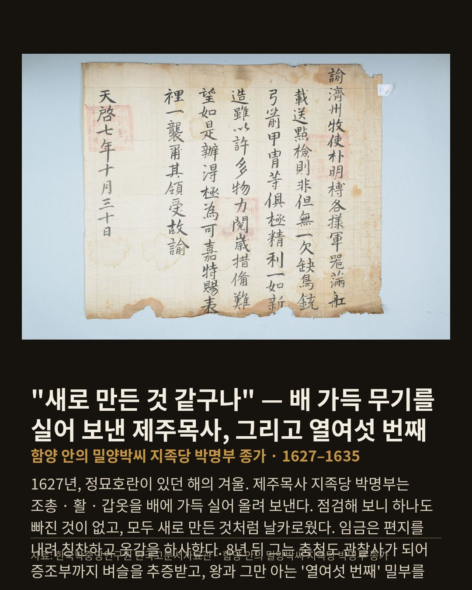
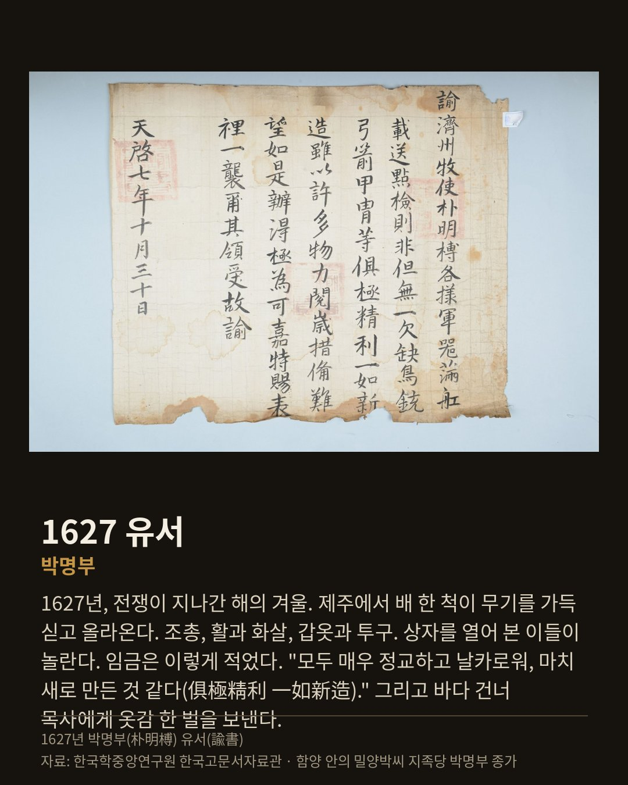
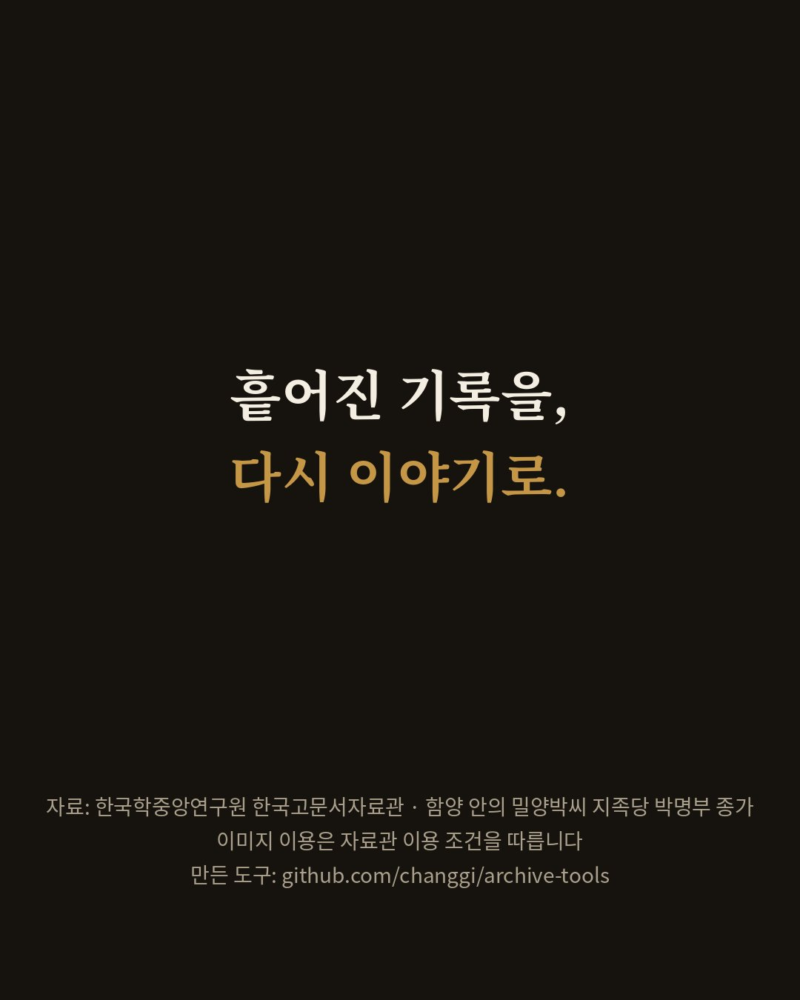

# EP.113 "새로 만든 것 같구나" — 배 가득 무기를 실어 보낸 제주목사, 그리고 열여섯 번째 밀부

함양 안의 밀양박씨 지족당 박명부 종가 (문중) · 1627년, 정묘호란이 있던 해의 겨울. 제주목사 지족당 박명부는 조총 · 활 · 갑옷을 배에 가득 실어 올려 보낸다. 점검해 보니 하나도 빠진 것이 없고, 모두 새로 만든 것처럼 날카로웠다. 임금은 편지를 내려 칭찬하고 옷감을 하사한다. 8년 뒤 그는 충청도 관찰사가 되어 증조부까지 벼슬을 추증받고, 왕과 그만 아는 '열여섯 번째' 밀부를 받는다

- 🌐 [전시 웹페이지](https://changgi.github.io/archive-tools/examples/jijokdang/exhibit.html) (한자 위 한글 독음 · 원문 해석) · [수업 활동지](https://changgi.github.io/archive-tools/examples/jijokdang/handout.html)
- 🎬 영상: [릴스 9:16](https://changgi.github.io/archive-tools/examples/media/ep113-jijokdang_reel.mp4) · [가로 16:9](https://changgi.github.io/archive-tools/examples/media/ep113-jijokdang_wide.mp4) · 홍보 글: [`promo.md`](promo.md)
- 카드뉴스: [`cards/`](cards/) · SNS 글: [`sns.txt`](sns.txt) · 판독·해석 표: [`selection.csv`](selection.csv)

<!-- DELIVERY -->
## 전달 에디팅 — 이 기록을 이렇게 전합니다

- **핵심 정서** — 뿌듯함
- **한 문장** — 성실함은 기록에 남는다 — '새로 만든 것 같다'는 한 줄이 8년 뒤의 신뢰로 이어진다.
- **열기** — 전쟁이 지나간 해, 제주에서 올라온 무기를 열어 본 사람들이 놀랐습니다.
- **펼치기** — 박명부 유서 → 박명부 증조고 박승숙 고신 (1627–1635년) — 1627년 칭찬 유서 → 1635년 증조부 추증 교지 → 열하루 뒤 '제16부' 밀부 유서 순으로, 일의 결과가 신뢰가 되고 그 신뢰가 가문에 미치는 흐름으로 구성했습니다.
- **절정** — "모두 매우 정교하고 날카로워, 마치 새로 만든 것 같다(俱極精利 一如新造)" — 화면·공간에서 이 한 줄만 크게, 소리를 줄여 집중
- **여운** — 새것처럼 정교했던 그 무기들은 어디에 쓰였을까요? — 질문으로 끝내고 답은 보는 사람에게
- **감각과 물질** — 배 한 척 가득한 무기 상자와 옷감 한 벌, 쪼갠 병부의 번호 · 역마 방울·말발굽 소리와 함께 펼치는 두루마리 · 어보·관인 탁본 스탬프를 찍어 보는 체험
- **통로와 매개** — 온라인: 릴스(열기) → 카드뉴스(펼치기) → 전시 웹페이지(절정·원문) → 비하인드 카드(여운) / 오프라인: 원본 크기 복제·낭독·참여 벽 / 남기기: 활동지·질문 카드
- **여운 장치** — 정성껏 준비한 일 하나를 떠올리기
- **전달 에디팅 전** — 3건의 문서를 1627–1635년 연대순으로 놓고 문서명 · 유형 · 해설을 붙인다 — 정확하지만, 지나가면 잊힌다.
- **전달 에디팅 후** — 핵심 정서는 「뿌듯함」. 「전쟁이 지나간 해, 제주에서 올라온 무기를 열어 본 사람들이 놀랐습니다.」로 열고, 문서를 대비와 순서로 펼친 뒤, "모두 매우 정교하고 날카로워, 마치 새로 만든 것 같다(俱極精利 一如新造)"에서 멈춘다. 배 한 척 가득한 무기 상자와 옷감 한 벌, 쪼갠 병부의 번호. 마지막엔 「정성껏 준비한 일 하나를 떠올리기」로 보는 사람이 자기 이야기를 남기고 떠나게 한다.

전문: [`delivery.md`](delivery.md)
<!-- /DELIVERY -->

<!-- CURATOR -->
## 비하인드 — 큐레이터 노트

- **왜 이 문서들인가** — 임명장이 대부분인 50건 사이에서, 보낸 무기를 칭찬하는 편지 한 장은 한 사람의 일하는 방식을 보여 주었습니다.
- **전하고 싶은 것** — 성실함은 기록에 남는다 — '새로 만든 것 같다'는 한 줄이 8년 뒤의 신뢰로 이어진다.
- **이렇게 보이길 바랐다** — 1627년 칭찬 유서 → 1635년 증조부 추증 교지 → 열하루 뒤 '제16부' 밀부 유서 순으로, 일의 결과가 신뢰가 되고 그 신뢰가 가문에 미치는 흐름으로 구성했습니다.
- **이렇게 써 주세요** — 조선의 지방관과 군기 관리, 정묘호란 전후, 추증 제도와 밀부 같은 인증 제도에 쓰세요.
- **만들며 있었던 일** — 세 장 모두 정서(正書)라 판독이 비교적 확실합니다. 군기를 올려 보낸 사정과 정묘호란과의 직접 관계는 문서에 없어 다루지 않았습니다. 같은 해 조부 · 부모 · 아내의 고신, 1623년 관향사 가자 교서는 읽지 않았습니다.
- **남겨 둔 질문** — 새것처럼 정교했던 그 무기들은 어디에 쓰였을까요?
- **제작 기록** — 문서 3건 · 1627–1635년 · 원본 사진 3면(문서 전체) · 원문 판독 3건 · 번역 3건 · 해제에 "확인 필요"를 단 문서 1건

전문: [`curator.md`](curator.md) · 비하인드 카드: [`behind/`](behind/) · 채널별 홍보안: [`channels.md`](channels.md)
<!-- /CURATOR -->

## 이야기 — 사료가 말하는 대로

전쟁이 지나간 해, 제주에서 올라온 무기를 열어 본 사람들이 놀랐습니다.

> **1627 유서** — 1627년, 전쟁이 지나간 해의 겨울. 제주에서 배 한 척이 무기를 가득 싣고 올라온다. 조총, 활과 화살, 갑옷과 투구. 상자를 열어 본 이들이 놀란다. 임금은 이렇게 적었다. "모두 매우 정교하고 날카로워, 마치 새로 만든 것 같다(俱極精利 一如新造)." 그리고 바다 건너 목사에게 옷감 한 벌을 보낸다.
> **1635 고신** — 8년 뒤, 그는 충청도 관찰사가 되어 있었다. 그러자 오래전 세상을 떠난 증조부에게도 교지가 내려온다. 그 까닭은 왼쪽 작은 글씨에 적혀 있다. "관찰사 박명부의 증조부이므로, 대전에 따라 추증한다(朴明榑曾祖考依大典追贈)." 한 사람이 오르자, 3대가 함께 올랐다.
> **1635 유서** — 그리고 열하루 뒤, 또 한 통이 온다. 이번에는 반쪽짜리 병부와 함께다. 거기에는 번호가 적혀 있었다. "제16부를 내리니, 경은 받으라(故賜押第十六符 卿其受之)." 8년 전 무기를 새것처럼 갖춰 보낸 목사는, 이제 왕과 둘만 아는 반쪽을 손에 쥔다.

| 표지 | 1번 카드 | 마무리 |
|---|---|---|
|  |  |  |

## 선별 문서 (3점)

| # | 연도 | 유형 | 문서명 | 원본 |
|---|---|---|---|---|
| 1 | 1627 | 유서 | 1627년 박명부(朴明榑) 유서(諭書) | [원본 보기](https://archive.aks.ac.kr/viewer/viewer.do#imgnode.do?itemId=book&gubun=booktree&depth=6&upPath=01%5E0150%5EL015021%5EL015021F02%5EL015021F0201&dataId=G002%2BKHD%2BKSM-XA.1627.0000-20161223.C0807_002_00003_XXX&itemType=) |
| 2 | 1635 | 고신 | 1635년 박명부(朴明榑) 증조고(曾祖考) 박승숙(朴承淑) 고신(告身) | [원본 보기](https://archive.aks.ac.kr/viewer/viewer.do#imgnode.do?itemId=book&gubun=booktree&depth=6&upPath=01%5E0150%5EL015021%5EL015021F02%5EL015021F0201&dataId=G002%2BKHD%2BKSM-XA.1635.0000-20161223.C0807_002_00041_XXX&itemType=) |
| 3 | 1635 | 유서 | 1635년 박명부(朴明榑) 유서(諭書) | [원본 보기](https://archive.aks.ac.kr/viewer/viewer.do#imgnode.do?itemId=book&gubun=booktree&depth=6&upPath=01%5E0150%5EL015021%5EL015021F02%5EL015021F0201&dataId=G002%2BKHD%2BKSM-XA.1635.0000-20161223.C0807_002_00004_XXX&itemType=) |

## 원문 판독과 해석

### 1. 1627년 박명부(朴明榑) 유서(諭書)

**원문 판독**

```
諭濟州牧使朴明榑各樣軍器滿舡
載送點檢則非但無一欠缺鳥銃
弓箭甲冑等俱極精利一如新
造雖以許多物力閱歲措備難
望如是辦得極爲可嘉特賜表
裡一襲爾其領受故諭
天啓七年十月三十日
```

**원문 해석** 제주목사 박명부에게 이른다. 여러 가지 군기(軍器)를 배에 가득 실어 보냈기에 점검해 보니, 하나도 빠지거나 모자란 것이 없을 뿐 아니라, 조총 · 활과 화살 · 갑옷과 투구 등이 모두 매우 정교하고 날카로워 마치 새로 만든 것 같았다. 비록 많은 물력을 들여 해를 넘겨 갖춘다 하더라도 이와 같기를 바라기 어려운데, 이렇게 마련해 냈으니 매우 가상하다. 특별히 옷감(表裏) 한 벌을 내리니 그대는 받으라. 그러므로 이른다. 천계 7년(1627) 10월 30일.

**해제** 1627년(인조 5, 天啓 7) 10월, 임금이 제주목사 박명부(朴明榑)에게 내린 유서(諭書)입니다. 제주에서 올려 보낸 조총(鳥銃) · 궁전(弓箭) · 갑주(甲冑) 등 군기를 점검했더니 빠진 것 없이 모두 새것처럼 정교했다며 칭찬하고, 상으로 표리(表裏, 겉감과 안감 옷감) 한 벌을 내린다는 내용입니다. 이해 정월에 후금이 침입한 정묘호란이 있었습니다. 군기를 올려 보낸 구체적인 사정은 이 문서에 적혀 있지 않습니다. 연호 위와 본문에 어보가 찍혀 있습니다.

### 2. 1635년 박명부(朴明榑) 증조고(曾祖考) 박승숙(朴承淑) 고신(告身)

**원문 판독**

```
敎旨
忠順衛勵節校尉朴承淑
贈通訓大夫通禮院左通
禮者
崇禎八年四月二十一日
通政大夫守公淸道觀察使兼兵馬
水軍節度使朴明榑曾祖考依大典
追贈
```

**원문 해석** 교지. 충순위 여절교위 박승숙에게 통훈대부 통례원 좌통례를 추증한다. 숭정 8년(1635) 4월 21일. 통정대부 수 공청도관찰사 겸 병마수군절도사 박명부의 증조부이므로 『경국대전』에 따라 추증한다.

**해제** 1635년(인조 13, 崇禎 8) 박명부의 증조부 박승숙(朴承淑)에게 벼슬을 추증(追贈)한 교지입니다. 왼쪽 작은 글씨는 추증의 근거로, '공청도(公淸道, 충청도의 다른 이름) 관찰사 박명부의 증조부이므로 대전(大典)에 따라 추증한다'고 적었습니다. 조선의 법전은 관원이 일정 품계 이상에 오르면 부모 · 조부모 · 증조부모까지 3대를 추증하도록 했습니다. 같은 해 같은 집안에 조부 · 아버지 · 어머니 · 아내의 고신도 함께 전합니다. '守'는 품계보다 높은 벼슬을 맡을 때 붙이는 말입니다.

### 3. 1635년 박명부(朴明榑) 유서(諭書)

**원문 판독**

```
諭守公淸道觀察使兼兵
馬水軍節度使巡察使
朴明榑
卿受委一方體任非輕凡
發兵應機安民制敵一
應常事自有舊章慮或
有予與卿獨斷處置事
非密符莫可施爲且意
外奸謀不可不預防如
有非常之命合符無疑
然後當就命故賜押第
十六符卿其受之故諭
崇禎八年五月初二日
```

**원문 해석** 수 공청도관찰사 겸 병마수군절도사 순찰사 박명부에게 이른다. 경은 한 지방을 맡았으니 그 임무가 가볍지 않다. 군사를 내어 형편에 맞게 움직이고, 백성을 편안히 하고 적을 제압하는 모든 일상적인 일에는 본래 정해진 규정이 있다. 다만 혹 나와 경만이 홀로 판단하여 처리해야 할 일이 있을까 염려되니, 그런 일은 밀부가 아니면 시행할 수 없다. 또 뜻밖의 간사한 꾀를 미리 막지 않을 수 없다. 만약 비상한 명령이 있거든, 부신을 맞추어 보아 의심이 없은 뒤에 명을 따르라. 그러므로 제16부를 압(押)하여 내리니 경은 받으라. 그러므로 이른다. 숭정 8년(1635) 5월 2일.

**해제** 관찰사로 부임하는 박명부에게 밀부(密符)와 함께 내린 유서입니다. 밀부는 둘로 쪼갠 병부로, 비상시 임금의 명령이 오면 두 쪽을 맞춰 진짜임을 확인했습니다. 이 유서에는 '제16부(第十六符)'라는 밀부의 번호까지 적혀 있습니다. 관찰사가 병마 · 수군절도사를 겸했기 때문에 군사권을 상징하는 밀부를 받았습니다. 추증 교지(4월 21일)보다 열하루 뒤의 날짜입니다. 문서 세 곳에 어보가 찍혀 있습니다.

판독·해석·이야기는 이미지에 근거한 초안이며(검토 전 "초안" 표시), 정확한 판독은 원문 확인이 필요합니다. □는 읽지 못한 글자, (?)는 불확실한 글자입니다.
이미지: 한국학중앙연구원 한국고문서자료관 소장·제공. "원본" 링크를 누르면 자료관 뷰어에서 그 문서가 열립니다. 재사용은 자료관에 문의하세요(소장처 동의 필요).
