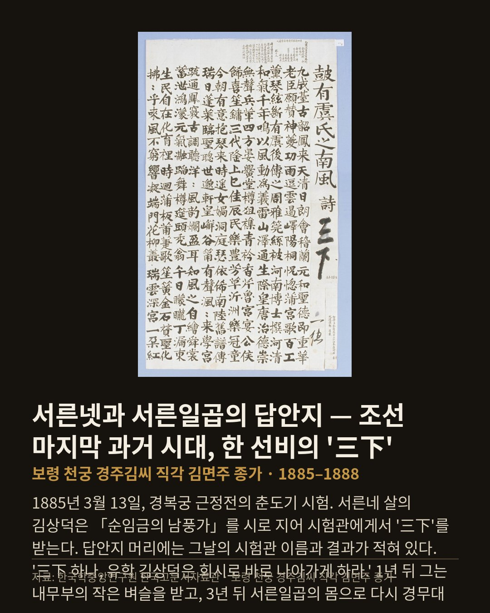
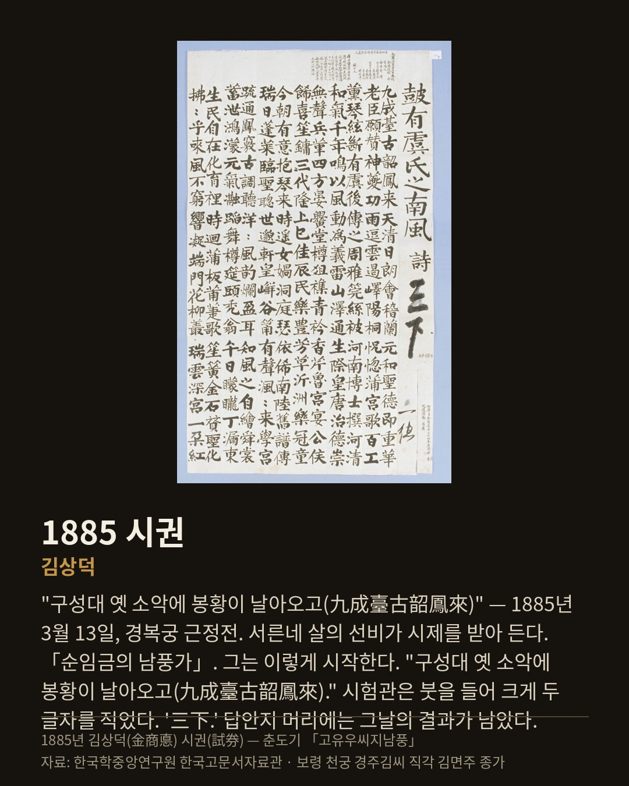
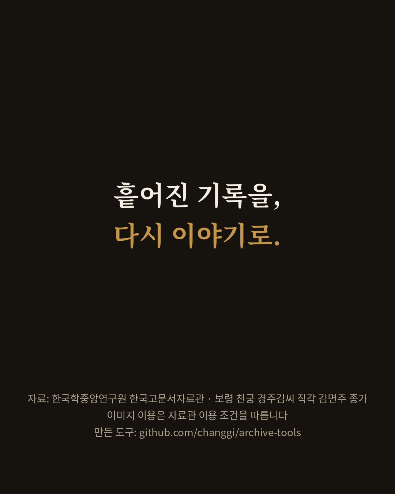

# EP.120 서른넷과 서른일곱의 답안지 — 조선 마지막 과거 시대, 한 선비의 '三下'

보령 천궁 경주김씨 직각 김면주 종가 (문중) · 1885년 3월 13일, 경복궁 근정전의 춘도기 시험. 서른네 살의 김상덕은 「순임금의 남풍가」를 시로 지어 시험관에게서 '三下'를 받는다. 답안지 머리에는 그날의 시험관 이름과 결과가 적혀 있다. '三下 하나, 유학 김상덕은 회시로 바로 나아가게 하라.' 1년 뒤 그는 내무부의 작은 벼슬을 받고, 3년 뒤 서른일곱의 몸으로 다시 경무대 시험장에 앉는다. 과거 제도가 사라지기 9년 전이었다

- 🌐 [전시 웹페이지](https://changgi.github.io/archive-tools/examples/jikgak/exhibit.html) (한자 위 한글 독음 · 원문 해석) · [수업 활동지](https://changgi.github.io/archive-tools/examples/jikgak/handout.html)
- 🎬 영상: [릴스 9:16](https://changgi.github.io/archive-tools/examples/media/ep120-jikgak_reel.mp4) · [가로 16:9](https://changgi.github.io/archive-tools/examples/media/ep120-jikgak_wide.mp4) · 홍보 글: [`promo.md`](promo.md)
- 카드뉴스: [`cards/`](cards/) · SNS 글: [`sns.txt`](sns.txt) · 판독·해석 표: [`selection.csv`](selection.csv)

<!-- DELIVERY -->
## 전달 에디팅 — 이 기록을 이렇게 전합니다

- **핵심 정서** — 뭉클함
- **한 문장** — 마지막 시대에도 사람들은 시험을 보았다 — 과거가 폐지되기 9년 전, 한 선비의 서른넷과 서른일곱.
- **열기** — 1885년 근정전, 서른네 살 선비의 답안지에 시험관이 크게 적었습니다. '三下.'
- **펼치기** — 김상덕 시권 — 춘도기 「고유우씨 → 김상덕 고신 → 김상덕 시권 — 경무대 친림 「화 (1885–1888년) — 1885년 춘도기 시권(三下, 회시 직부) → 1886년 내무부 부주사 고신 → 1888년 경무대 시권(37세) 순으로, 시험과 벼슬이 엇갈리며 이어지는 한 사람의 몇 해를 따라가게 구성했습니다.
- **절정** — "三下 하나, 유학 김상덕은 회시로 바로 나아가게 하라(單三下幼學金商悳直赴會試)" — 화면·공간에서 이 한 줄만 크게, 소리를 줄여 집중
- **여운** — 열한 장의 답안지를 모두 간직한 그는, 그 종이들을 다시 꺼내 보았을까요? — 질문으로 끝내고 답은 보는 사람에게
- **감각과 물질** — 답안지 위 시험관의 큰 붓 자국과 작은 글씨의 시험 기록, 나이 '三十四'와 '三十七' · 시험장 책상과 답안지 체험 · 어보·관인 탁본 스탬프를 찍어 보는 체험
- **통로와 매개** — 온라인: 릴스(열기) → 카드뉴스(펼치기) → 전시 웹페이지(절정·원문) → 비하인드 카드(여운) / 오프라인: 원본 크기 복제·낭독·참여 벽 / 남기기: 활동지·질문 카드
- **여운 장치** — 여러 번 도전한 일 하나를 떠올리기
- **전달 에디팅 전** — 3건의 문서를 1885–1888년 연대순으로 놓고 문서명 · 유형 · 해설을 붙인다 — 정확하지만, 지나가면 잊힌다.
- **전달 에디팅 후** — 핵심 정서는 「뭉클함」. 「1885년 근정전, 서른네 살 선비의 답안지에 시험관이 크게 적었습니다. '三下.'」로 열고, 문서를 대비와 순서로 펼친 뒤, "三下 하나, 유학 김상덕은 회시로 바로 나아가게 하라(單三下幼學金商悳直赴會試)"에서 멈춘다. 답안지 위 시험관의 큰 붓 자국과 작은 글씨의 시험 기록, 나이 '三十四'와 '三十七'. 마지막엔 「여러 번 도전한 일 하나를 떠올리기」로 보는 사람이 자기 이야기를 남기고 떠나게 한다.

전문: [`delivery.md`](delivery.md)
<!-- /DELIVERY -->

<!-- CURATOR -->
## 비하인드 — 큐레이터 노트

- **왜 이 문서들인가** — 열한 장이나 되는 한 사람의 답안지 가운데, 머리에 시험관과 결과가 적힌 한 장과, 나이가 정확히 3년 차이 나는 또 한 장을 골랐습니다.
- **전하고 싶은 것** — 마지막 시대에도 사람들은 시험을 보았다 — 과거가 폐지되기 9년 전, 한 선비의 서른넷과 서른일곱.
- **이렇게 보이길 바랐다** — 1885년 춘도기 시권(三下, 회시 직부) → 1886년 내무부 부주사 고신 → 1888년 경무대 시권(37세) 순으로, 시험과 벼슬이 엇갈리며 이어지는 한 사람의 몇 해를 따라가게 구성했습니다.
- **이렇게 써 주세요** — 조선 후기 과거와 성균관 시험(춘도기 · 전강 · 직부), 채점 등급, 개항기 관제 변화, 과거 폐지(1894)와 연결해 쓰세요.
- **만들며 있었던 일** — 시권 머리의 작은 글씨(시험관 · 합격자 이름)와 1888년 시권의 채점 표시 · '四天'은 판독이 불확실합니다. 답안은 앞부분만 읽었고, 김상덕이 문과에 급제했는지는 확인하지 않았습니다. 이 집안의 나머지 시권 아홉 장과 김면주의 문서들은 다루지 않았습니다.
- **남겨 둔 질문** — 열한 장의 답안지를 모두 간직한 그는, 그 종이들을 다시 꺼내 보았을까요?
- **제작 기록** — 문서 3건 · 1885–1888년 · 원본 사진 4면(문서 전체) · 원문 판독 3건 · 번역 3건 · 못 읽은 글자 □ 8 · 불확실 (?) 13 · 해제에 "확인 필요"를 단 문서 1건

전문: [`curator.md`](curator.md) · 비하인드 카드: [`behind/`](behind/) · 채널별 홍보안: [`channels.md`](channels.md)
<!-- /CURATOR -->

## 이야기 — 사료가 말하는 대로

1885년 근정전, 서른네 살 선비의 답안지에 시험관이 크게 적었습니다. '三下.'

> **1885 시권** — 1885년 3월 13일, 경복궁 근정전. 서른네 살의 선비가 시제를 받아 든다. 「순임금의 남풍가」. 그는 이렇게 시작한다. "구성대 옛 소악에 봉황이 날아오고(九成臺古韶鳳來)." 시험관은 붓을 들어 크게 두 글자를 적었다. '三下.' 답안지 머리에는 그날의 결과가 남았다. "三下 하나, 유학 김상덕은 회시로 바로 나아가게 하라(單三下幼學金商悳直赴會試)."
> **1886 고신** — 이듬해 여름, 그에게 첫 벼슬이 온다. "유학 김상덕을 통사랑 행 내무부 부주사로 삼는다(幼學金商悳爲通仕郞行內務府副主事者)." 내무부. 개항 뒤 새로 생긴 관청이었다. 낡은 시험과 새 관청 사이에서, 그의 이름이 처음 관직에 올랐다.
> **1888 시권** — 3년 뒤 가을, 경무대. 그는 다시 시험장에 있다. 피봉에 적힌 나이는 "서른일곱(年三十七)." 3년 전 서른넷이었던 바로 그 사람이다. 이번 시제는 축하의 노래. 그는 쓴다. "온 나라가 기뻐 서로 알리며, 팔도와 함께 즐거워하네(欣相告於擧國 與八域而同歡)." 6년 뒤, 과거 제도는 사라진다.

| 표지 | 1번 카드 | 마무리 |
|---|---|---|
|  |  |  |

## 선별 문서 (3점)

| # | 연도 | 유형 | 문서명 | 원본 |
|---|---|---|---|---|
| 1 | 1885 | 시권 | 1885년 김상덕(金商悳) 시권(試券) — 춘도기 「고유우씨지남풍」 | [원본 보기](https://archive.aks.ac.kr/viewer/viewer.do#imgnode.do?itemId=book&gubun=booktree&depth=6&upPath=01%5E0144%5EL014426%5EL014426F02%5EL014426F0204&dataId=G002%2BAKS%2BKSM-XD.0000.1111-20101008.B007a_008_00220_XXX&itemType=) |
| 2 | 1886 | 고신 | 1886년 김상덕(金商悳) 고신(告身) | [원본 보기](https://archive.aks.ac.kr/viewer/viewer.do#imgnode.do?itemId=book&gubun=booktree&depth=6&upPath=01%5E0144%5EL014426%5EL014426F02%5EL014426F0201&dataId=G002%2BAKS%2BKSM-XA.1886.1111-20101008.B007a_008_00031_XXX&itemType=) |
| 3 | 1888 | 시권 | 1888년 김상덕(金商悳) 시권(試券) — 경무대 친림 「화기환성팔역개」 | [원본 보기](https://archive.aks.ac.kr/viewer/viewer.do#imgnode.do?itemId=book&gubun=booktree&depth=6&upPath=01%5E0144%5EL014426%5EL014426F02%5EL014426F0204&dataId=G002%2BAKS%2BKSM-XD.0000.1111-20101008.B007a_008_00219_XXX&itemType=) |

## 원문 판독과 해석

### 1. 1885년 김상덕(金商悳) 시권(試券) — 춘도기 「고유우씨지남풍」

**원문 판독**

```
乙酉三月十三日春到記 勤政殿 命官爲之
命官 許傳
讀券官 趙秉世 李□夏(?)
對讀官 李鳳□(?) 朴鳳彬 李嘉元 朴永□(?)
取十人
傳曰 詩三下居首幼學閔泳□(?)直赴殿試
單三下幼學金商悳直赴會試之次 □(?)上幼學趙民熙等二人給二分(?)
鼓有虞氏之南風 詩
九成臺古韶鳳來天淸日朗會稽蘭元和聖德卽重華
老臣願贊神夔功雨逗雲過嶧陽桐怳惚蒲宮歌百工
薰琴絃斷有虞後傳之周雅莞(?)絲被河南博士撰河淸
和氣千年鳴以風動爲義雷山澤通生際皇唐治德崇 …
(채점) 三下
(피봉) 幼學臣金商悳年三十四本慶州居京 父通德郞昌載
```

**원문 해석** (답안지 머리의 기록) 을유년(1885) 3월 13일 춘도기, 근정전에서 명관이 주관함. 명관 허전, 독권관 조병세 · 이□하, 대독관 이봉□ · 박봉빈 · 이가원 · 박영□. 열 사람을 뽑음. 전교하기를, '시에서 三下로 수석을 한 유학 민영□은 전시로 바로 나아가게 하고, 三下 하나를 받은 유학 김상덕은 회시로 바로 나아가게 하며, … 유학 조민희 등 두 사람에게는 점수를 주라' 하였다. (시제) 「순임금의 남풍을 북 치며 노래하다(鼓有虞氏之南風)」, 시. (답안 앞부분) 구성대 옛 소악(韶樂)에 봉황이 날아오고, 하늘은 맑고 해는 밝아 회계의 난초 … 원화의 거룩한 덕은 곧 순임금(重華)이라. 늙은 신하는 기(夔)의 공을 기리고자 하니, 비가 머물고 구름이 지나는 역양의 오동나무 … (채점) 삼하. (피봉) 유학 신 김상덕, 나이 서른넷, 본관 경주, 서울 거주. 아버지 통덕랑 창재.

**해제** 1885년(고종 22) 3월 13일 근정전에서 치른 춘도기(春到記) 시험에 김상덕(金商悳)이 낸 시권입니다. 춘도기는 성균관 유생의 출석 점수(도기)를 바탕으로 봄에 보던 시험입니다. 답안지 오른쪽 위에 시험관(명관 허전, 독권관 · 대독관)과 합격자 처분이 적혀 있는데, 김상덕은 '三下' 하나를 받아 '회시로 바로 나아가게(直赴會試)' 되었습니다. 직부(直赴)는 초시를 거치지 않고 다음 단계 시험에 응시할 자격을 주는 특전입니다. 시제는 순임금이 오현금을 타며 남풍가를 불렀다는 고사에서 나온 「고유우씨지남풍(鼓有虞氏之南風)」입니다. 답안 오른쪽의 큰 '三下'는 채점 등급입니다. 오른쪽 아래 피봉에는 '나이 서른넷, 본관 경주, 서울 거주, 아버지 통덕랑 창재'가 적혀 있습니다. 시험관 · 합격자 이름 가운데 몇 글자는 작고 흐려 불확실합니다. 답안은 앞부분만 읽었습니다.

### 2. 1886년 김상덕(金商悳) 고신(告身)

**원문 판독**

```
吏曹光緖十二年七月十四日
奉
敎幼學金商悳爲通仕
郞行內務府副主事
者
光緖十二年七月 日
```

**원문 해석** 이조에서 광서 12년(1886) 7월 14일에 받든 교지. 유학 김상덕을 통사랑 행 내무부 부주사로 삼는다. 광서 12년 7월 일.

**해제** 1886년(고종 23, 光緖 12) 이조에서 발급한 김상덕의 고신입니다. 유학 신분이던 그를 통사랑(정8품)으로 삼아 내무부(內務府) 부주사에 임명했습니다. 내무부는 1885년 궁중과 국정의 여러 일을 맡기려 새로 설치한 관청으로, 개항기의 새 관제를 보여 줍니다. 앞의 시권 이듬해의 문서입니다. 문과 급제 여부는 이 문서만으로는 알 수 없습니다.

### 3. 1888년 김상덕(金商悳) 시권(試券) — 경무대 친림 「화기환성팔역개」

**원문 판독**

```
戊子八月初□(?)日景武臺親臨日次儒生殿講以製代講時
讀券官 判府事金□□(?) …
尹東鼎 金昌熙 鄭海崙 朴鳳彬 趙東冕
解題 睿詩(?) 年年此日慶辰回 和氣歡聲八域開 …
和氣歡聲八域開 賦
歡喜人兮均同漢日月而重歌聲氣和於化域慶重回於此日曰我儲之篤孝
續舊韵於樂府堯天地而盡在擧睿詩而頌祝欣相告於擧國與八域而同歡
三牲奉而養志開八荒而壽域今何日兮識慶拚五雲而鰲抃長奉盃兮盈盈 …
(채점) 三下(?)  四天(?)
(피봉) 幼學臣金商悳年三十七本慶州居洪州(?) 父通德郞昌載
```

**원문 해석** (머리 기록) 무자년(1888) 8월 초□일, 경무대에 임금이 친히 나와 유생 전강을 하는데, 강(講) 대신 제술로 시험함. 독권관 판부사 김□□ … (시제의 출전) 왕세자의 시(?): '해마다 이날 경사스러운 날이 돌아오니, 화기와 기쁜 소리가 팔도에 열리네 …' (시제) 「화기와 기쁜 소리가 팔도에 열리다(和氣歡聲八域開)」, 부. (답안 앞부분) 기뻐하는 사람들 모두 같아, 한(漢)의 해와 달처럼 거듭 노래하네. 소리와 기운이 교화의 땅에 화하니, 경사가 이날에 거듭 돌아왔도다. 우리 세자의 돈독한 효성이여 … 온 나라가 기뻐 서로 알리며 팔도와 함께 즐거워하네 … (채점) 삼하(?). (피봉) 유학 신 김상덕, 나이 서른일곱, 본관 경주, 홍주(?) 거주. 아버지 통덕랑 창재.

**해제** 1888년(고종 25) 8월 경무대(景武臺, 경복궁 북쪽 후원)에서 임금이 친히 임한 유생 전강(殿講)에, 강경 대신 제술로 치른 시험의 시권입니다. 시제 '和氣歡聲八域開'는 머리에 인용된 시(왕세자의 시로 보임, 추정)의 한 구절이며, 경사를 축하하는 내용입니다. 피봉에는 '나이 서른일곱'으로, 3년 전 시권의 '서른넷'과 정확히 맞습니다. 그는 1886년 내무부 부주사를 받았지만 여기서는 여전히 '유학'으로 적었습니다. 오른쪽의 옅은 먹 표시는 '三下'로 보이나 불확실하며, 아래 '四天'으로 읽은 글자의 뜻은 확인하지 못했습니다. 시험관 이름 몇 글자도 불확실합니다. 1894년 갑오개혁으로 과거 제도는 폐지됩니다.

판독·해석·이야기는 이미지에 근거한 초안이며(검토 전 "초안" 표시), 정확한 판독은 원문 확인이 필요합니다. □는 읽지 못한 글자, (?)는 불확실한 글자입니다.
이미지: 한국학중앙연구원 한국고문서자료관 소장·제공. "원본" 링크를 누르면 자료관 뷰어에서 그 문서가 열립니다. 재사용은 자료관에 문의하세요(소장처 동의 필요).
