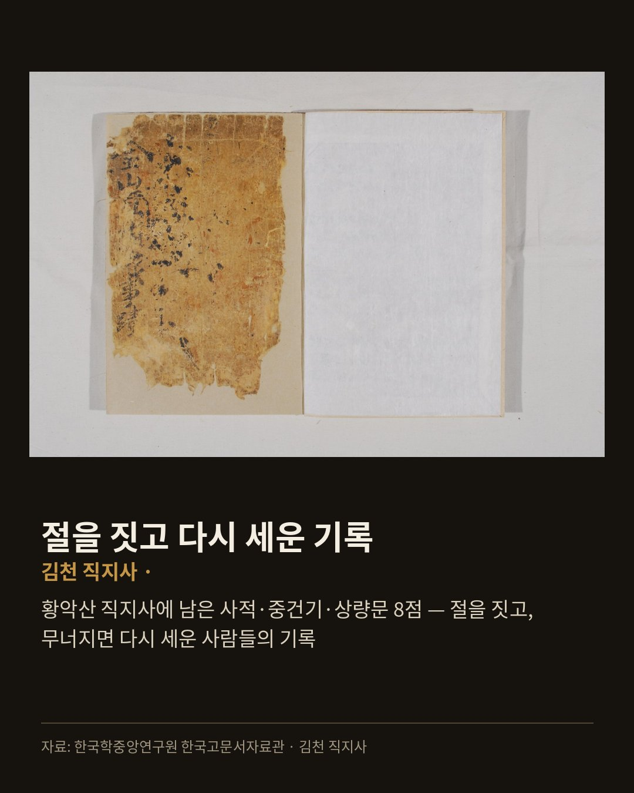
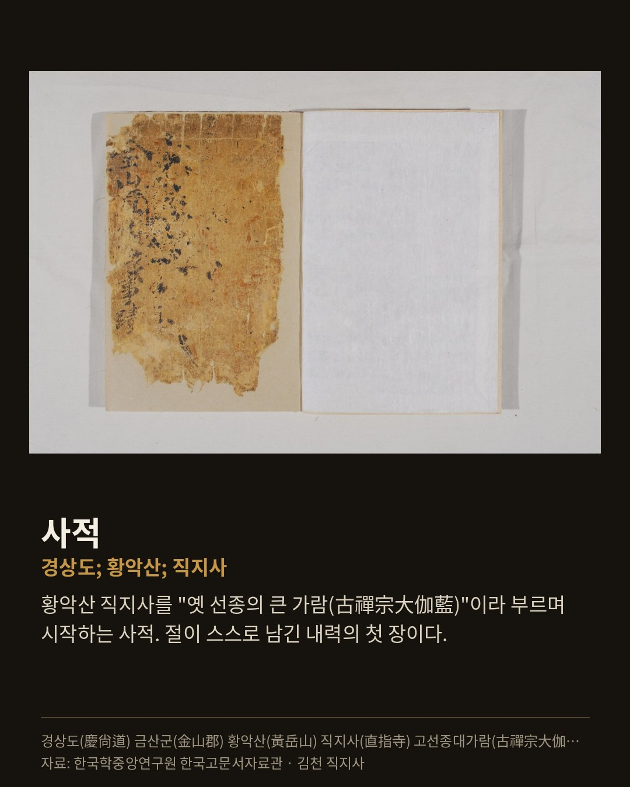
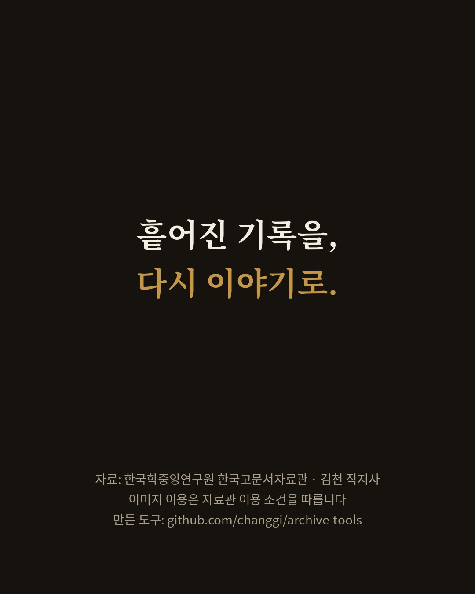

# 절을 짓고 다시 세운 기록

김천 직지사 (사찰) · ③ 에디팅 후 — Claude가 문서명과 이미지에 근거해 쓴 `이야기` 문장 사용 (검토 전 초안 표시)

- 🌐 [전시 웹페이지](https://changgi.github.io/archive-tools/examples/jikjisa-temple/exhibit.html) · [수업 활동지](https://changgi.github.io/archive-tools/examples/jikjisa-temple/handout.html)
- 🎬 영상: [릴스 9:16](https://changgi.github.io/archive-tools/examples/media/ep3-jikjisa_reel.mp4) · [가로 16:9](https://changgi.github.io/archive-tools/examples/media/ep3-jikjisa_wide.mp4) · 홍보 글: [`promo.md`](promo.md)
- 카드뉴스: [`cards/`](cards/) · SNS 글: [`sns.txt`](sns.txt) · 에디팅 결과: [`selection.csv`](selection.csv)

| 표지 | 1번 카드 | 마무리 |
|---|---|---|
|  |  |  |

## 선별 문서 (8점)

| # | 연도 | 유형 | 문서명 | 원본 |
|---|---|---|---|---|
| 1 | — | 사적 | 경상도(慶尙道) 금산군(金山郡) 황악산(黃岳山) 직지사(直指寺) 고선종대가람(古禪宗大伽藍) 사적(事蹟) | [원본 보기](https://archive.aks.ac.kr/viewer/viewer.do#imgnode.do?itemId=book&gubun=booktree&depth=6&upPath=05%5E0549%5EL054904%5EL054904F02%5EL054904F0208&dataId=G002%2BAKS%2BKSM-XG.1776.4715-20211130.B072a_100_00002_XXX&itemType=) |
| 2 | — | 사적 | 경상도(慶尙道) 금산군(金山郡) 황악산(黃岳山) 직지사(直指寺) 사적(事蹟) | [원본 보기](https://archive.aks.ac.kr/viewer/viewer.do#imgnode.do?itemId=book&gubun=booktree&depth=6&upPath=05%5E0549%5EL054904%5EL054904F02%5EL054904F0208&dataId=G002%2BAKS%2BKSM-XG.1635.4715-20211130.B072a_100_00001_XXX&itemType=) |
| 3 | — | 중건기 | 중건기(重建記) | [원본 보기](https://archive.aks.ac.kr/viewer/viewer.do#imgnode.do?itemId=book&gubun=booktree&depth=6&upPath=05%5E0549%5EL054904%5EL054904F02%5EL054904F0207&dataId=G002%2BAKS%2BKSM-XG.1800.4715-20211130.B072a_100_00015_XXX&itemType=) |
| 4 | — | 상량문 | 상량문(上樑文)－1 | [원본 보기](https://archive.aks.ac.kr/viewer/viewer.do#imgnode.do?itemId=book&gubun=booktree&depth=6&upPath=05%5E0549%5EL054904%5EL054904F02%5EL054904F0208&dataId=G002%2BAKS%2BKSM-XG.1688.4715-20211130.B072a_100_00005_XXX&itemType=) |
| 5 | — | 상량문 | 상량문(上樑文)－5 | [원본 보기](https://archive.aks.ac.kr/viewer/viewer.do#imgnode.do?itemId=book&gubun=booktree&depth=6&upPath=05%5E0549%5EL054904%5EL054904F02%5EL054904F0208&dataId=G002%2BAKS%2BKSM-XG.1791.4715-20211130.B072a_100_00009_XXX&itemType=) |
| 6 | — | 신건문 | 신건문(新建文) | [원본 보기](https://archive.aks.ac.kr/viewer/viewer.do#imgnode.do?itemId=book&gubun=booktree&depth=6&upPath=05%5E0549%5EL054904%5EL054904F02%5EL054904F0208&dataId=G002%2BAKS%2BKSM-XG.1791.4715-20211130.B072a_100_00012_XXX&itemType=) |
| 7 | — | 공덕문 | 공덕문(功德文) | [원본 보기](https://archive.aks.ac.kr/viewer/viewer.do#imgnode.do?itemId=book&gubun=booktree&depth=6&upPath=05%5E0549%5EL054904%5EL054904F02%5EL054904F0208&dataId=G002%2BAKS%2BKSM-XG.1886.4715-20211130.B072a_100_00017_XXX&itemType=) |
| 8 | — | 헌답기 | 헌답기(獻畓記) | [원본 보기](https://archive.aks.ac.kr/viewer/viewer.do#imgnode.do?itemId=book&gubun=booktree&depth=6&upPath=05%5E0549%5EL054904%5EL054904F02%5EL054904F0207&dataId=G002%2BAKS%2BKSM-XG.1850.4715-20211130.B072a_100_00018_XXX&itemType=) |

이미지: 한국학중앙연구원 한국고문서자료관 소장·제공. "원본" 링크를 누르면 자료관 뷰어에서 그 문서가 열립니다. 이미지를 다시 쓰려면 자료관에 문의하세요(소장처 동의 필요).
