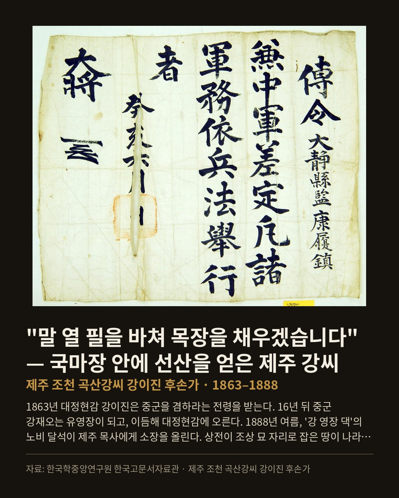
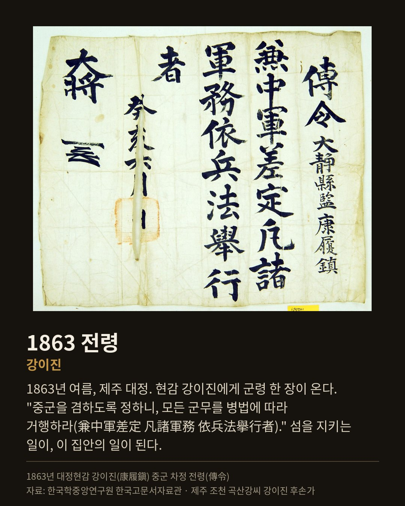

# EP.125 "말 열 필을 바쳐 목장을 채우겠습니다" — 국마장 안에 선산을 얻은 제주 강씨 집안

제주 조천 곡산강씨 강이진 후손가 (문중) · 1863년 대정현감 강이진은 중군을 겸하라는 전령을 받는다. 16년 뒤 중군 강재오는 유영장이 되고, 이듬해 대정현감에 오른다. 1888년 여름, '강 영장 댁'의 노비 달석이 제주 목사에게 소장을 올린다. 상전이 조상 묘 자리로 잡은 땅이 나라 말을 기르는 목장 안에 있으니, 대신 말 열 필을 바쳐 목장을 채우겠다고. 목사는 그 땅을 영영 떼어 준다는 입안을 내준다

- 🌐 [전시 웹페이지](https://changgi.github.io/archive-tools/examples/jocheon-kang-ij/exhibit.html) (한자 위 한글 독음 · 원문 해석) · [수업 활동지](https://changgi.github.io/archive-tools/examples/jocheon-kang-ij/handout.html)
- 🎬 영상: [릴스 9:16](https://changgi.github.io/archive-tools/examples/media/ep125-jocheon-kang-ij_reel.mp4) · [가로 16:9](https://changgi.github.io/archive-tools/examples/media/ep125-jocheon-kang-ij_wide.mp4) · 홍보 글: [`promo.md`](promo.md)
- 카드뉴스: [`cards/`](cards/) · SNS 글: [`sns.txt`](sns.txt) · 판독·해석 표: [`selection.csv`](selection.csv)

<!-- DELIVERY -->
## 전달 에디팅 — 이 기록을 이렇게 전합니다

- **핵심 정서** — 놀라움
- **한 문장** — 조상의 땅을 지키는 일에도 섬의 셈법이 있었다 — 나라 말을 기르는 목장 안에 선산을 얻으려고, 한 집안은 말 열 필을 바쳤다.
- **열기** — 조상 묘 자리를 얻으려고, 말 열 필을 바친 집안이 있습니다.
- **펼치기** — 대정현감 강이진 중군 차정 전령 → 중군 강재오 유영장 차정 전령 → 강재오 대정현감 고신 → 강 영장 댁 노 달석 소지 — 목 → 제주목 입안 — 말 열 필과 선산 → 강 영장 댁 노 달석 소지 — 세 (1863–1888년) — 1863 · 1879년 전령과 1880년 고신으로 섬을 지킨 집안을 먼저 보이고, 1888년 6월 소지 → 같은 달 입안 → 11월 소지 순으로 묘 자리 하나를 얻기까지의 반년을 따라가게 구성했습니다.
- **절정** — "말 열 필을 대신 바쳐 이 목장을 채우겠다(代納于十匹馬以補本場)" — 화면·공간에서 이 한 줄만 크게, 소리를 줄여 집중
- **여운** — 말 열 필을 내준 그해, 강씨 집안의 마구간은 얼마나 비었을까요? — 질문으로 끝내고 답은 보는 사람에게
- **감각과 물질** — 목장 담과 돌담, 말 열 필의 실루엣 위에 입안 한 장 · 어보·관인 탁본 스탬프를 찍어 보는 체험 · 연명한 이름을 벽에 길게 나열하고 관아 마당처럼 서서 읽는 동선
- **통로와 매개** — 온라인: 릴스(열기) → 카드뉴스(펼치기) → 전시 웹페이지(절정·원문) → 비하인드 카드(여운) / 오프라인: 원본 크기 복제·낭독·참여 벽 / 남기기: 활동지·질문 카드
- **여운 장치** — 우리 집 조상 묘가 거기 있게 된 사연 묻기
- **전달 에디팅 전** — 6건의 문서를 1863–1888년 연대순으로 놓고 문서명 · 유형 · 해설을 붙인다 — 정확하지만, 지나가면 잊힌다.
- **전달 에디팅 후** — 핵심 정서는 「놀라움」. 「조상 묘 자리를 얻으려고, 말 열 필을 바친 집안이 있습니다.」로 열고, 문서를 대비와 순서로 펼친 뒤, "말 열 필을 대신 바쳐 이 목장을 채우겠다(代納于十匹馬以補本場)"에서 멈춘다. 목장 담과 돌담, 말 열 필의 실루엣 위에 입안 한 장. 마지막엔 「우리 집 조상 묘가 거기 있게 된 사연 묻기」로 보는 사람이 자기 이야기를 남기고 떠나게 한다.

전문: [`delivery.md`](delivery.md)
<!-- /DELIVERY -->

<!-- CURATOR -->
## 비하인드 — 큐레이터 노트

- **왜 이 문서들인가** — 소지와 입안을 읽다가 '말 열 필'이라는 말에서 멈췄습니다. 땅값을 말로 치른 문서는 말의 섬 제주가 아니면 나오기 어렵습니다.
- **전하고 싶은 것** — 조상의 땅을 지키는 일에도 섬의 셈법이 있었다 — 나라 말을 기르는 목장 안에 선산을 얻으려고, 한 집안은 말 열 필을 바쳤다.
- **이렇게 보이길 바랐다** — 1863 · 1879년 전령과 1880년 고신으로 섬을 지킨 집안을 먼저 보이고, 1888년 6월 소지 → 같은 달 입안 → 11월 소지 순으로 묘 자리 하나를 얻기까지의 반년을 따라가게 구성했습니다.
- **이렇게 써 주세요** — 제주의 국마장과 목장 제도, 선산과 산송(묘지 다툼), 소지 · 입안 · 입지의 발급 절차, 섬 지역의 경제 수업에 쓰세요.
- **만들며 있었던 일** — 전령 · 고신은 정서라 확실하나, 소지 두 장과 입안은 행서 · 초서라 땅이름과 몇 글자를 □ · (?)로 두었고 소지의 큰 제사는 읽지 못했습니다. 고신의 연도는 종이가 덧대어져 자료관 목록(1880)을 따랐습니다. '강 영장'이 강재오인지, 강이진 · 강재오의 관계, 이소장의 정확한 자리는 확인하지 않았습니다.
- **남겨 둔 질문** — 말 열 필을 내준 그해, 강씨 집안의 마구간은 얼마나 비었을까요?
- **제작 기록** — 문서 6건 · 1863–1888년 · 원본 사진 7면(문서 전체) · 원문 판독 6건 · 번역 6건 · 못 읽은 글자 □ 7 · 불확실 (?) 7 · 해제에 "확인 필요"를 단 문서 2건

전문: [`curator.md`](curator.md) · 비하인드 카드: [`behind/`](behind/) · 채널별 홍보안: [`channels.md`](channels.md)
<!-- /CURATOR -->

## 이야기 — 사료가 말하는 대로

조상 묘 자리를 얻으려고, 말 열 필을 바친 집안이 있습니다.

> **1863 전령** — 1863년 여름, 제주 대정. 현감 강이진에게 군령 한 장이 온다. "중군을 겸하도록 정하니, 모든 군무를 병법에 따라 거행하라(兼中軍差定 凡諸軍務 依兵法擧行者)." 섬을 지키는 일이, 이 집안의 일이 된다.
> **1879 전령** — 16년 뒤, 같은 집안의 강재오가 중군으로 있다. 다시 전령이 온다. "유영장으로 정하니, 비어 있는 군영의 모든 일을 단속하라(留營將差定 空營凡務 檢飭擧行者)." 주장이 떠난 군영을, 그가 지킨다.
> **1880 고신** — 그리고 이듬해, 교지 한 장. "강재오를 통정대부 대정현감으로 삼는다(康在五爲通政大夫大靜縣監者)." 17년 전 강이진이 앉았던 그 고을이다.
> **1888 소지** — 1888년 여름. 강 영장 댁 노비 달석이 목사에게 소장을 올린다. 상전이 조상 묘 자리로 잡은 곳이, 하필 나라 말을 기르는 목장 안이었다. "사방 경계가 분명하니(四標分明), 경계를 그어 지키게 해 달라."
> **1888 입안** — 목사는 같은 달 입안을 내준다. 상전의 셈법이 그대로 적혔다. "말 열 필을 대신 바쳐 이 목장을 채우겠다(代納于十匹馬以補本場)." 목사는 그 땅을 영영 떼어 준다. 말의 섬에서, 조상의 땅은 말로 샀다.
> **1888 소지** — 다섯 달 뒤, 달석은 또 소장을 올린다. 한성부 입지까지 받았고 말 열 필도 바쳤다. 남은 것은 그 땅의 세금. "올해 매긴 석수대로 공론으로 정해 달라(依今年執卜石數 公議定給)." 묘 한 자리에 반년이 들었다.

| 표지 | 1번 카드 | 마무리 |
|---|---|---|
|  |  |  |

## 선별 문서 (6점)

| # | 연도 | 유형 | 문서명 | 원본 |
|---|---|---|---|---|
| 1 | 1863 | 전령 | 1863년 대정현감 강이진(康履鎭) 중군 차정 전령(傳令) | [원본 보기](https://archive.aks.ac.kr/viewer/viewer.do#imgnode.do?itemId=book&gubun=booktree&depth=6&upPath=01%5E0168%5EL016811%5EL016811F02%5EL016811F0203&dataId=G002%2BAKS%2BKSM-XC.1863.5011-20220125.B083a_114_00716_XXX&itemType=) |
| 2 | 1879 | 전령 | 1879년 중군 강재오(康在五) 유영장 차정 전령(傳令) | [원본 보기](https://archive.aks.ac.kr/viewer/viewer.do#imgnode.do?itemId=book&gubun=booktree&depth=6&upPath=01%5E0168%5EL016811%5EL016811F02%5EL016811F0203&dataId=G002%2BAKS%2BKSM-XC.1879.5011-20220125.B083a_114_00717_XXX&itemType=) |
| 3 | 1880 | 고신 | 1880년 강재오(康在五) 대정현감 고신(告身) | [원본 보기](https://archive.aks.ac.kr/viewer/viewer.do#imgnode.do?itemId=book&gubun=booktree&depth=6&upPath=01%5E0168%5EL016811%5EL016811F02%5EL016811F0201&dataId=G002%2BAKS%2BKSM-XA.1880.5011-20220125.B082a_114_00712_XXX&itemType=) |
| 4 | 1888 | 소지 | 1888년 강 영장 댁 노 달석 소지(所志) — 목장 안 선산 | [원본 보기](https://archive.aks.ac.kr/viewer/viewer.do#imgnode.do?itemId=book&gubun=booktree&depth=6&upPath=01%5E0168%5EL016811%5EL016811F02%5EL016811F0202&dataId=G002%2BAKS%2BKSM-XB.1888.5011-20220125.B082a_114_00713_XXX&itemType=) |
| 5 | 1888 | 입안 | 1888년 제주목 입안(立案) — 말 열 필과 선산 | [원본 보기](https://archive.aks.ac.kr/viewer/viewer.do#imgnode.do?itemId=book&gubun=booktree&depth=6&upPath=01%5E0168%5EL016811%5EL016811F02%5EL016811F0204&dataId=G002%2BAKS%2BKSM-XD.1888.5011-20220125.B083a_114_00718_XXX&itemType=) |
| 6 | 1888 | 소지 | 1888년 강 영장 댁 노 달석 소지(所志) — 세미 처리 | [원본 보기](https://archive.aks.ac.kr/viewer/viewer.do#imgnode.do?itemId=book&gubun=booktree&depth=6&upPath=01%5E0168%5EL016811%5EL016811F02%5EL016811F0202&dataId=G002%2BAKS%2BKSM-XB.1888.5011-20220125.B082a_114_00714_XXX&itemType=) |

## 원문 판독과 해석

### 1. 1863년 대정현감 강이진(康履鎭) 중군 차정 전령(傳令)

**원문 판독**

```
傳令 大靜縣監康履鎭
兼中軍差定凡諸
軍務依兵法擧行
者
癸亥六月 日
大將 (수결)
```

**원문 해석** 전령. 대정현감 강이진. 중군을 겸하도록 차정하니, 모든 군무를 병법에 따라 거행할 것. 계해년(1863) 6월 일. 대장(수결).

**해제** 1863년(철종 14, 癸亥) 대정현감 강이진(康履鎭)에게 중군(中軍)을 겸하도록 임명(차정)한 전령입니다. 중군은 군영에서 대장 다음가는 지휘관 자리입니다. 발급자는 '대장(大將)'으로, 제주에서는 목사가 군사 지휘를 겸했습니다. 대정현은 제주 서남쪽의 고을로 지금의 서귀포시 대정읍 일대입니다. 날짜 위에 관인이 찍혔습니다.

### 2. 1879년 중군 강재오(康在五) 유영장 차정 전령(傳令)

**원문 판독**

```
傳令 中軍康在五
留營將差定
空營凡務檢
飭擧行者
己卯九月 日
兼使 (수결)
```

**원문 해석** 전령. 중군 강재오. 유영장으로 차정하니, 비어 있는 군영의 모든 일을 살피고 단속하여 거행할 것. 기묘년(1879) 9월 일. 겸사(수결).

**해제** 1879년(고종 16, 己卯) 중군 강재오(康在五)를 유영장(留營將)으로 임명한 전령입니다. 유영장은 주장이 군영을 비울 때 남아서 군영을 맡는 자리로, '비어 있는 군영의 모든 일(空營凡務)'을 단속하라고 했습니다. 발급자 '겸사(兼使)'는 병마수군절제사를 겸한 제주 목사로 보입니다. 큰 글씨 위에 관인이 여러 번 찍혔습니다. 강이진과 강재오의 가계상 관계는 이번에 확인하지 않았습니다.

### 3. 1880년 강재오(康在五) 대정현감 고신(告身)

**원문 판독**

```
敎旨
康在五爲通政
大夫大靜縣監
者
光緖□年□月 日
```

**원문 해석** 교지. 강재오를 통정대부 대정현감으로 삼는다. 광서 □년 □월 일.

**해제** 강재오를 통정대부(通政大夫, 정3품 당상 문관 품계) 대정현감으로 임명한 고신입니다. 연호 '광서(光緖)' 아래 해와 달 자리에 종이가 덧대어져 읽을 수 없어, 연도는 자료관 목록의 1880년(고종 17)을 따랐습니다. 1863년 강이진에 이어 같은 집안에서 다시 대정현감이 나왔습니다. 물 얼룩이 위쪽을 따라 번져 있습니다.

### 4. 1888년 강 영장 댁 노 달석 소지(所志) — 목장 안 선산

**원문 판독**

```
康營將宅奴達石
右謹陳所志事段矣上典爲先占山於二所□場內綠(?)南洞負東向之地而東場垣及大路
西上夜岳只場垣南北(?)林藪是乎所四標分明乙仍于伏乞禁養劃界與他有異四方
步數依典立旨成給爲只爲
行下向敎是事
使道 處分
戊子六月 日
```

**원문 해석** 강 영장 댁 노비 달석. 삼가 아뢰올 일은, 저의 상전이 조상 묘 자리를 이소(二所) 목장 안 남쪽 골짜기(?)의 동쪽을 바라보는 땅에 잡았는데, 동쪽은 목장 담과 큰길, 서쪽은 윗야악(?) 목장 담, 남북은 숲으로 사방 경계가 분명합니다. 엎드려 바라오니, 나무를 기르고 함부로 베지 못하게 경계를 그어 주시되, 다른 땅과 달리 사방 걸음 수를 법전대로 적은 입지를 내주시도록 처분해 주십시오. 사또께서 처분하소서. 무자년(1888) 6월 일.

**해제** 1888년(고종 25, 戊子) 6월 '강 영장 댁' 노비 달석(達石)이 상전을 대신해 제주 목사에게 올린 소지입니다. 상전이 선산(先山)으로 잡은 땅이 '이소(二所)' 목장 안에 있다고 했습니다. 제주에는 나라의 말을 기르는 목장이 섬을 둘러 1소장에서 10소장까지 있었고, 목장 땅은 나라의 땅이었습니다. 그래서 사방 경계(四標)를 적고 법전대로 입지를 내 달라고 청했습니다. 목장 이름 한 글자와 몇 글자는 흐려 □ · (?)로 두었고, 아래의 큰 초서 제사(題辭)는 읽지 못했습니다. '강 영장'은 1879년 유영장이 된 강재오로 보이나 문서에는 이름이 없습니다.

### 5. 1888년 제주목 입안(立案) — 말 열 필과 선산

**원문 판독**

```
立案
右立案爲成給事□□康營將
宅奴達石呈狀內以爲矣上典爲
先占山於二所□場內上輔幕負
東向之地而四標段東寶文旨南
邊兵帶□西馬桶田山下輔幕
等場間有小路是如乎勢將植
松禁養是矣係是公土私難擅
便故代納于十匹馬以補本場
國畜則庶可爲公私俱便之道是乎乙
洞燭敎是後此(?)場內占山處永爲
劃給植松禁養之意立案成給
亦爲有乎叅互狀辭究或(?)無悖依
所訴十匹馬付之本場爲(?)以立案
成給者
戊子六月 日 (수결)
```

**원문 해석** 입안. 이 입안은 발급하는 일이다. 강 영장 댁 노비 달석의 소장에 이르기를, '저의 상전이 조상 묘 자리를 이소 목장 안 윗보막(上輔幕)의 동쪽을 바라보는 땅에 잡았는데, 사방 경계는 동쪽 보문지, 남쪽 변병대, □서쪽 마통전, 산 아래 보막이고 목장 사이에 작은 길이 있습니다. 소나무를 심어 기르려 하나, 이곳은 나라 땅이라 사사로이 마음대로 할 수 없습니다. 그러므로 말 열 필을 대신 바쳐 이 목장의 나라 말을 채우면, 나라와 개인 모두에게 편한 길이 될 것입니다. 살펴 주신 뒤 목장 안의 묘 자리를 영영 떼어 주어 소나무를 심어 기르게 한다는 입안을 내주십시오' 하였다. 소장의 말을 맞추어 보고 따져 보니 어긋남이 없으므로, 청한 대로 말 열 필을 이 목장에 넘기게 하고 입안을 발급한다. 무자년(1888) 6월 일. (수결)

**해제** 1888년(고종 25, 戊子) 6월, 앞의 소지에 따라 제주 목사가 내준 입안입니다. 핵심은 '말 열 필을 대신 바쳐 이 목장을 채운다(代納于十匹馬以補本場)'는 데 있습니다. 나라 말을 기르는 목장 땅을 사사로이 쓸 수 없으니, 그 대가로 말을 바쳐 국마(國畜)를 보충하겠다는 것이고, 목사는 이를 받아들여 묘 자리를 '영영 떼어 준다(永爲劃給)'고 했습니다. 땅 대신 말을 내는 셈법이 말의 섬 제주다운 대목입니다. 사방 경계의 땅이름(보문지 · 변병대 · 마통전 · 보막)은 글자대로 옮겼고, 앞부분 두 글자와 목장 이름 한 글자 등은 흐려 □ · (?)로 두었습니다. 관인이 세 군데 찍혔습니다.

### 6. 1888년 강 영장 댁 노 달석 소지(所志) — 세미 처리

**원문 판독**

```
康營將宅奴達石
右謹陳所志事段矣上典爲先占山於二所東曲(?)場內四標折授以爲植松禁養之意呈于舊(?)
營門成出立案又呈漢城府立旨與關文來到乙仍于十匹馬納于本場俾補國畜是乎旀所出稅米
段亦係公下不得私自擅便故兩張立案及關文粘連仰訴伏乞的只鄕將吏稅米代錢依今年執卜石數
公議定給則從衆論區處伏計叅商處分爲只爲
行下向敎是事
使道 處分
戊子十一月 日
```

**원문 해석** 강 영장 댁 노비 달석. 삼가 아뢰올 일은, 저의 상전이 조상 묘 자리를 이소 목장 안에 잡아 사방 경계를 떼어 받아 소나무를 심어 기르려는 뜻으로 영문(營門)에 올려 입안을 받았고, 또 한성부에 올려 입지와 관문(공문)이 내려왔습니다. 그래서 말 열 필을 이 목장에 바쳐 나라 말을 보충하게 하였습니다. 그런데 이 땅에서 나는 세미(稅米)도 나라에 매인 것이라 사사로이 처리할 수 없으므로, 입안 두 장과 관문을 붙여 아뢰오니, 엎드려 바라건대 향장과 아전들이 세미를 돈으로 대신하되 올해 매긴 석수에 따라 공론으로 정해 주시면 여러 의견에 따라 처리하겠습니다. 헤아려 처분해 주십시오. 사또께서 처분하소서. 무자년(1888) 11월 일.

**해제** 1888년(고종 25, 戊子) 11월, 같은 노비 달석이 다시 올린 소지입니다. 6월의 입안에 더해 '한성부(漢城府)에 올려 입지와 관문이 내려왔다'고 하여, 제주 목사의 입안만이 아니라 서울까지 문서를 올려 확인받았음을 알 수 있습니다. 말 열 필은 이미 목장에 바쳤고, 이제 남은 문제는 그 땅에 매겨지던 세미(稅米)였습니다. 그래서 입안 두 장과 관문을 붙여 올리며, 세미를 올해 석수에 따라 돈으로 내는 방법을 공론으로 정해 달라고 청했습니다. 행서 · 초서가 섞여 몇 글자는 (?)로 두었고, 아래 큰 제사는 읽지 못했습니다.

판독·해석·이야기는 이미지에 근거한 초안이며(검토 전 "초안" 표시), 정확한 판독은 원문 확인이 필요합니다. □는 읽지 못한 글자, (?)는 불확실한 글자입니다.
이미지: 한국학중앙연구원 한국고문서자료관 소장·제공. "원본" 링크를 누르면 자료관 뷰어에서 그 문서가 열립니다. 재사용은 자료관에 문의하세요(소장처 동의 필요).
