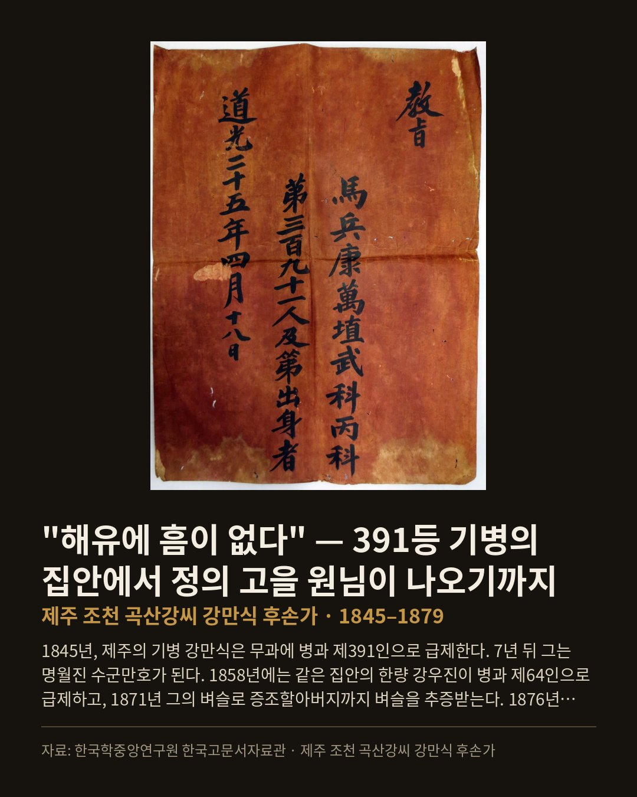
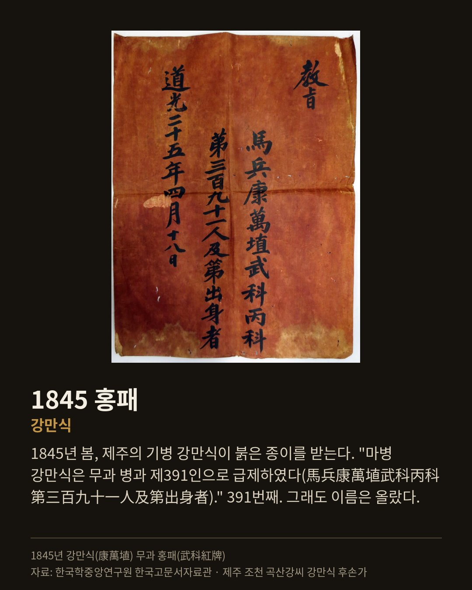
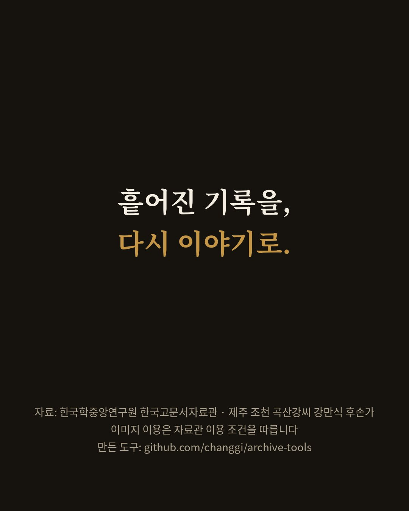

# EP.131 "해유에 흠이 없다" — 391등 기병의 집안에서 정의 고을 원님이 나오기까지

제주 조천 곡산강씨 강만식 후손가 (문중) · 1845년, 제주의 기병 강만식은 무과에 병과 제391인으로 급제한다. 7년 뒤 그는 명월진 수군만호가 된다. 1858년에는 같은 집안의 한량 강우진이 병과 제64인으로 급제하고, 1871년 그의 벼슬로 증조할아버지까지 벼슬을 추증받는다. 1876년 정의 고을을 맡은 강우진이 자리에서 물러난 뒤, 1879년 서울 호조가 공문을 보낸다. 재임 중의 회계에 흠이 없다는 해유였다

- 🌐 [전시 웹페이지](https://changgi.github.io/archive-tools/examples/jocheon-kang-ms/exhibit.html) (한자 위 한글 독음 · 원문 해석) · [수업 활동지](https://changgi.github.io/archive-tools/examples/jocheon-kang-ms/handout.html)
- 🎬 영상: [릴스 9:16](https://changgi.github.io/archive-tools/examples/media/ep131-jocheon-kang-ms_reel.mp4) · [가로 16:9](https://changgi.github.io/archive-tools/examples/media/ep131-jocheon-kang-ms_wide.mp4) · 홍보 글: [`promo.md`](promo.md)
- 카드뉴스: [`cards/`](cards/) · SNS 글: [`sns.txt`](sns.txt) · 판독·해석 표: [`selection.csv`](selection.csv)

<!-- DELIVERY -->
## 전달 에디팅 — 이 기록을 이렇게 전합니다

- **핵심 정서** — 떳떳함
- **한 문장** — 벼슬은 오르는 것만큼 깨끗하게 내려오는 것도 기록되었다 — '해유에 흠이 없다'는 네 글자가 그 증명이었다.
- **열기** — 고을 원님이 물러난 뒤, 서울에서 공문이 왔습니다. "흠이 없다."
- **펼치기** — 강만식 무과 홍패 → 강만식 명월 수군만호 고신 → 강우진 무과 홍패 → 강세현 추증교지 — 강우진의 증조 → 강우진 정의 병마동첨절제사 고신 → 호조 해유관 — 전 정의군수 강우 (1845–1879년) — 1845년 391등 기병의 홍패 → 1852년 명월 만호 → 1858년 강우진의 홍패 → 1871년 증조 추증 → 1876년 정의 고을 → 1879년 해유관 순으로, 한 집안의 오름과 한 사람의 '깨끗한 마무리'로 끝나게 구성했습니다.
- **절정** — "해유에 흠이 없다(解由無頉)" — 화면·공간에서 이 한 줄만 크게, 소리를 줄여 집중
- **여운** — '흠이 없다'는 공문을 받던 날, 강우진은 정의 고을의 무엇을 떠올렸을까요? — 질문으로 끝내고 답은 보는 사람에게
- **감각과 물질** — 붉은 홍패 두 장에서 시작해, 마지막에 담담한 흰 공문 한 장 — '解由無頉' 네 글자 · 붉은 종이를 실물 크기로 복제해 벽에 거는 연출 · 어보·관인 탁본 스탬프를 찍어 보는 체험
- **통로와 매개** — 온라인: 릴스(열기) → 카드뉴스(펼치기) → 전시 웹페이지(절정·원문) → 비하인드 카드(여운) / 오프라인: 원본 크기 복제·낭독·참여 벽 / 남기기: 활동지·질문 카드
- **여운 장치** — 내가 마친 일에 남기고 싶은 한 줄 쓰기
- **전달 에디팅 전** — 6건의 문서를 1845–1879년 연대순으로 놓고 문서명 · 유형 · 해설을 붙인다 — 정확하지만, 지나가면 잊힌다.
- **전달 에디팅 후** — 핵심 정서는 「떳떳함」. 「고을 원님이 물러난 뒤, 서울에서 공문이 왔습니다. "흠이 없다."」로 열고, 문서를 대비와 순서로 펼친 뒤, "해유에 흠이 없다(解由無頉)"에서 멈춘다. 붉은 홍패 두 장에서 시작해, 마지막에 담담한 흰 공문 한 장 — '解由無頉' 네 글자. 마지막엔 「내가 마친 일에 남기고 싶은 한 줄 쓰기」로 보는 사람이 자기 이야기를 남기고 떠나게 한다.

전문: [`delivery.md`](delivery.md)
<!-- /DELIVERY -->

<!-- CURATOR -->
## 비하인드 — 큐레이터 노트

- **왜 이 문서들인가** — 홍패와 고신 사이에 해유관 한 장이 있었습니다. 원님이 '어떻게 물러났는지'를 증명하는 문서는 처음이라, 이 집안의 벼슬길을 그 끝에서부터 다시 읽게 되었습니다.
- **전하고 싶은 것** — 벼슬은 오르는 것만큼 깨끗하게 내려오는 것도 기록되었다 — '해유에 흠이 없다'는 네 글자가 그 증명이었다.
- **이렇게 보이길 바랐다** — 1845년 391등 기병의 홍패 → 1852년 명월 만호 → 1858년 강우진의 홍패 → 1871년 증조 추증 → 1876년 정의 고을 → 1879년 해유관 순으로, 한 집안의 오름과 한 사람의 '깨끗한 마무리'로 끝나게 구성했습니다.
- **이렇게 써 주세요** — 조선의 수령 제도와 해유(인수인계 · 회계 감사), 무과와 무관 경력, 추증 제도, 제주의 진과 고을, 공직 윤리 수업에 쓰세요.
- **만들며 있었던 일** — 홍패 · 고신 · 추증교지는 정서라 확실하나, 1852년 고신의 해는 종이에 가려 자료관 목록을 따랐고, 해유관의 받는 곳과 작은 글씨는 흐립니다. 강만식 · 강우진의 관계, 강우진이 정의를 맡은 기간, 나머지 추증교지 여섯 장과 해유문서 · 해유첩정은 이번에 판독하지 않았습니다.
- **남겨 둔 질문** — '흠이 없다'는 공문을 받던 날, 강우진은 정의 고을의 무엇을 떠올렸을까요?
- **제작 기록** — 문서 6건 · 1845–1879년 · 원본 사진 6면(문서 전체) · 원문 판독 6건 · 번역 6건 · 못 읽은 글자 □ 3 · 불확실 (?) 2 · 해제에 "확인 필요"를 단 문서 2건

전문: [`curator.md`](curator.md) · 비하인드 카드: [`behind/`](behind/) · 채널별 홍보안: [`channels.md`](channels.md)
<!-- /CURATOR -->

## 이야기 — 사료가 말하는 대로

고을 원님이 물러난 뒤, 서울에서 공문이 왔습니다. "흠이 없다."

> **1845 홍패** — 1845년 봄, 제주의 기병 강만식이 붉은 종이를 받는다. "마병 강만식은 무과 병과 제391인으로 급제하였다(馬兵康萬埴武科丙科第三百九十一人及第出身者)." 391번째. 그래도 이름은 올랐다.
> **1852 고신** — 7년 뒤, 교지 한 장. "강만식을 선략장군 행 명월 수군만호로 삼는다(康萬埴爲宣略將軍行濟州鎭管明月水軍萬戶者)." 391등의 기병이, 섬 서쪽 바다를 지키는 진의 장수가 되었다.
> **1858 홍패** — 13년 뒤, 같은 집에 또 한 장. "한량 강우진은 무과 병과 제64인으로 급제하였다(閑良康祐鎭武科丙科第六十四人及第出身者)." 이번엔 64등. 이 이름이, 이야기의 주인공이 된다.
> **1871 추증교지** — 13년 뒤, 그의 벼슬은 가선대부에 이른다. 그러자 교지가 그의 증조할아버지에게 간다. 옆에 작은 글씨. "가선대부 강우진의 증조이므로 법전대로 추증한다(康祐鎭曾祖考依法典追贈)." 한 사람의 벼슬이, 세 대 위까지 거슬러 올라갔다.
> **1876 고신** — 1876년 정월, 그는 고향 섬의 한 고을을 맡는다. "강우진을 겸 정의 병마동첨절제사로 삼는다(康祐鎭爲兼濟州鎭管旌義兵馬同僉節制使者)." 섬사람이, 섬 고을의 원님이 되었다.
> **1879 해유관** — 그리고 3년 뒤. 자리에서 물러난 그에게 서울 호조의 공문이 온다. 고을의 곡식과 돈을 셈해 넘긴 결과다. "해유에 흠이 없다(解由無頉)." 391등 기병의 집안에서 나온 원님은, 깨끗하게 물러났다.

| 표지 | 1번 카드 | 마무리 |
|---|---|---|
|  |  |  |

## 선별 문서 (6점)

| # | 연도 | 유형 | 문서명 | 원본 |
|---|---|---|---|---|
| 1 | 1845 | 홍패 | 1845년 강만식(康萬埴) 무과 홍패(武科紅牌) | [원본 보기](https://archive.aks.ac.kr/viewer/viewer.do#imgnode.do?itemId=book&gubun=booktree&depth=6&upPath=01%5E0168%5EL016810%5EL016810F02%5EL016810F0201&dataId=G002%2BAKS%2BKSM-XA.1845.5011-20220125.B082a_114_00606_XXX&itemType=) |
| 2 | 1852 | 고신 | 1852년 강만식(康萬埴) 명월 수군만호 고신(告身) | [원본 보기](https://archive.aks.ac.kr/viewer/viewer.do#imgnode.do?itemId=book&gubun=booktree&depth=6&upPath=01%5E0168%5EL016810%5EL016810F02%5EL016810F0201&dataId=G002%2BAKS%2BKSM-XA.1852.5011-20220125.B082a_114_00610_XXX&itemType=) |
| 3 | 1858 | 홍패 | 1858년 강우진(康祐鎭) 무과 홍패(武科紅牌) | [원본 보기](https://archive.aks.ac.kr/viewer/viewer.do#imgnode.do?itemId=book&gubun=booktree&depth=6&upPath=01%5E0168%5EL016810%5EL016810F02%5EL016810F0201&dataId=G002%2BAKS%2BKSM-XA.1858.5011-20220125.B082a_114_00607_XXX&itemType=) |
| 4 | 1871 | 추증교지 | 1871년 강세현(康世顯) 추증교지(追贈敎旨) — 강우진의 증조 | [원본 보기](https://archive.aks.ac.kr/viewer/viewer.do#imgnode.do?itemId=book&gubun=booktree&depth=6&upPath=01%5E0168%5EL016810%5EL016810F02%5EL016810F0201&dataId=G002%2BAKS%2BKSM-XA.1871.5011-20220125.B082a_114_00641_XXX&itemType=) |
| 5 | 1876 | 고신 | 1876년 강우진(康祐鎭) 정의 병마동첨절제사 고신(告身) | [원본 보기](https://archive.aks.ac.kr/viewer/viewer.do#imgnode.do?itemId=book&gubun=booktree&depth=6&upPath=01%5E0168%5EL016810%5EL016810F02%5EL016810F0201&dataId=G002%2BAKS%2BKSM-XA.1876.5011-20220125.B082a_114_00635_XXX&itemType=) |
| 6 | 1879 | 해유관 | 1879년 호조 해유관(解由關) — 전 정의군수 강우진 | [원본 보기](https://archive.aks.ac.kr/viewer/viewer.do#imgnode.do?itemId=book&gubun=booktree&depth=6&upPath=01%5E0168%5EL016810%5EL016810F02%5EL016810F0203&dataId=G002%2BAKS%2BKSM-XC.1879.5011-20220125.B082a_114_00658_XXX&itemType=) |

## 원문 판독과 해석

### 1. 1845년 강만식(康萬埴) 무과 홍패(武科紅牌)

**원문 판독**

```
敎旨
馬兵康萬埴武科丙科
第三百九十一人及第出身者
道光二十五年四月十八日
```

**원문 해석** 교지. 마병 강만식은 무과 병과 제391인으로 급제하여 출신한 자이다. 도광 25년(1845) 4월 18일.

**해제** 1845년(헌종 11, 道光 25, 乙巳) 제주의 마병(馬兵, 기병) 강만식(康萬埴)이 무과에 병과 제391인으로 급제하고 받은 홍패입니다. 조선 후기 무과는 한 번에 수백 명을 뽑는 일이 많아 391등도 있었습니다. 이름 앞의 '마병'은 그가 이미 말을 타는 군사였음을 보여 줍니다. 아래쪽에 물 얼룩이 번졌습니다.

### 2. 1852년 강만식(康萬埴) 명월 수군만호 고신(告身)

**원문 판독**

```
敎旨
康萬埴爲宣略
將軍行濟州鎭
管明月水軍萬
戶者
咸豐□年二月　日
```

**원문 해석** 교지. 강만식을 선략장군 행 제주진관 명월 수군만호로 삼는다. 함풍 □년 2월 일.

**해제** 강만식을 선략장군(宣略將軍, 종4품 무관 품계) 행 제주진관 명월 수군만호(明月水軍萬戶)로 임명한 고신입니다. 명월진은 제주 서쪽(지금의 한림읍 명월리 일대)의 수군 진(鎭)으로, 만호는 그 책임자입니다. 연호 '咸豐' 아래 해 자리에 종이가 덧대어져 연도는 자료관 목록의 1852년(철종 3)을 따랐습니다. 급제 7년 뒤, 섬의 바다를 지키는 자리를 맡았습니다.

### 3. 1858년 강우진(康祐鎭) 무과 홍패(武科紅牌)

**원문 판독**

```
敎旨
閑良康祐鎭武科丙科
第六十四人及第出身者
咸豐八年九月　日
```

**원문 해석** 교지. 한량 강우진은 무과 병과 제64인으로 급제하여 출신한 자이다. 함풍 8년(1858) 9월 일.

**해제** 1858년(철종 9, 咸豐 8, 戊午) 같은 집안의 한량 강우진(康祐鎭)이 무과에 병과 제64인으로 급제하고 받은 홍패입니다. 강만식의 급제로부터 13년 뒤입니다. 두 사람의 가계상 관계는 이번에 확인하지 않았습니다. 연호 위 어보 자리가 흐립니다.

### 4. 1871년 강세현(康世顯) 추증교지(追贈敎旨) — 강우진의 증조

**원문 판독**

```
敎旨
學生康世顯贈
通訓大夫司僕
寺正者
同治十年正月　日
嘉善大夫同知中樞府事兼五衛將
康祐鎭曾祖考依法典追
贈
```

**원문 해석** 교지. 학생 강세현에게 통훈대부 사복시 정을 추증한다. 동치 10년(1871) 정월 일. (작은 글씨) 가선대부 동지중추부사 겸 오위장 강우진의 증조할아버지이므로 법전에 따라 추증함.

**해제** 1871년(고종 8, 同治 10, 辛未) 강우진의 증조할아버지 강세현(康世顯)에게 통훈대부 사복시 정(정3품 당하)을 추증(追贈)한 교지입니다. 왼쪽 작은 글씨가 까닭을 밝힙니다. 강우진이 가선대부(종2품) 동지중추부사 겸 오위장에 올랐으므로, 법전에 따라 그 증조까지 벼슬을 높여 준 것입니다. 이 집안에는 같은 날짜의 추증교지가 일곱 장 전해, 증조 · 조부 · 부와 그 부인들이 함께 추증된 것으로 보입니다(나머지는 이번에 판독하지 않음). 64등 급제자가 13년 만에 종2품에 이르렀습니다.

### 5. 1876년 강우진(康祐鎭) 정의 병마동첨절제사 고신(告身)

**원문 판독**

```
敎旨
康祐鎭爲兼
濟州鎭管旌
義兵馬同僉
節制使者
光緖二年正月　日
```

**원문 해석** 교지. 강우진을 겸 제주진관 정의 병마동첨절제사로 삼는다. 광서 2년(1876) 정월 일.

**해제** 1876년(고종 13, 光緖 2, 丙子) 강우진을 제주진관 정의(旌義) 병마동첨절제사로 겸임하게 한 고신입니다. 조선의 지방관은 군사 직함을 함께 지녔으므로, 이는 정의 고을의 수령을 맡으면서 겸한 군직입니다. 정의는 제주 동남쪽의 고을(지금의 서귀포시 표선 · 성산 일대)이었습니다. 3년 뒤 호조의 해유관에는 그가 '전 정의군수'로 적혀 있습니다.

### 6. 1879년 호조 해유관(解由關) — 전 정의군수 강우진

**원문 판독**

```
戶曹爲解由事背書關及粘連牒呈內乙用良前旌義郡守康祐鎭
等內解由無頉成出爲去乎相考施行向事合行移關請
照驗施行須至關者
右關
□□(?)
光緖五年閏三月　日
己卯閏三月二十三日來(?)
曹 (수결)
```

**원문 해석** 호조에서 해유하는 일. 배서한 관문과 붙여 올린 첩정의 내용에 따라, 전 정의군수 강우진 등에 대해 해유에 흠이 없음을 확인해 문서를 만들어 내니, 살펴 시행할 일로 아울러 관문을 보냅니다. 청컨대 대조하여 시행하소서. 이 관문을 보냅니다. 광서 5년(1879) 윤3월 일. (작은 글씨) 기묘년 윤3월 23일 도착(?). 호조(수결).

**해제** 1879년(고종 16, 光緖 5, 己卯) 윤3월 호조(戶曹)가 보낸 해유관(解由關)입니다. 해유(解由)는 수령이 임기를 마치고 물러날 때, 관할하던 곡식 · 돈 · 물품의 장부를 후임에게 넘기고 호조 등에서 검사해 이상이 없음을 확인해 주는 절차로, 이것이 끝나야 다음 벼슬에 나아갈 수 있었습니다. 문서의 핵심은 '해유에 흠이 없다(解由無頉)'는 네 글자입니다. 강우진은 여기서 '전 정의군수'로 적혀 있습니다. 1879년은 윤3월이 있는 해로 날짜와 맞습니다. 받는 곳과 작은 글씨 몇 글자는 흐려 □ · (?)로 두었습니다. 이 집안에는 같은 무렵의 해유문서 · 해유첩정도 전합니다.

판독·해석·이야기는 이미지에 근거한 초안이며(검토 전 "초안" 표시), 정확한 판독은 원문 확인이 필요합니다. □는 읽지 못한 글자, (?)는 불확실한 글자입니다.
이미지: 한국학중앙연구원 한국고문서자료관 소장·제공. "원본" 링크를 누르면 자료관 뷰어에서 그 문서가 열립니다. 재사용은 자료관에 문의하세요(소장처 동의 필요).
