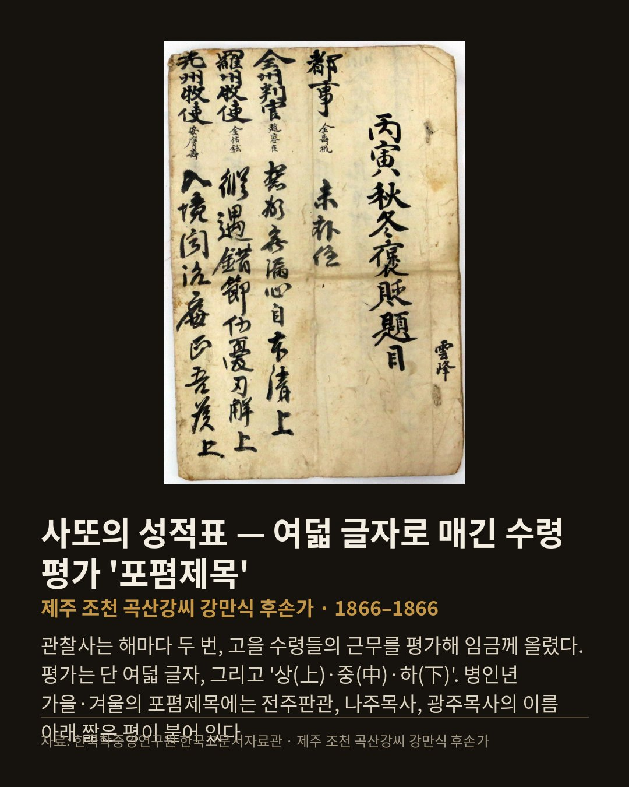
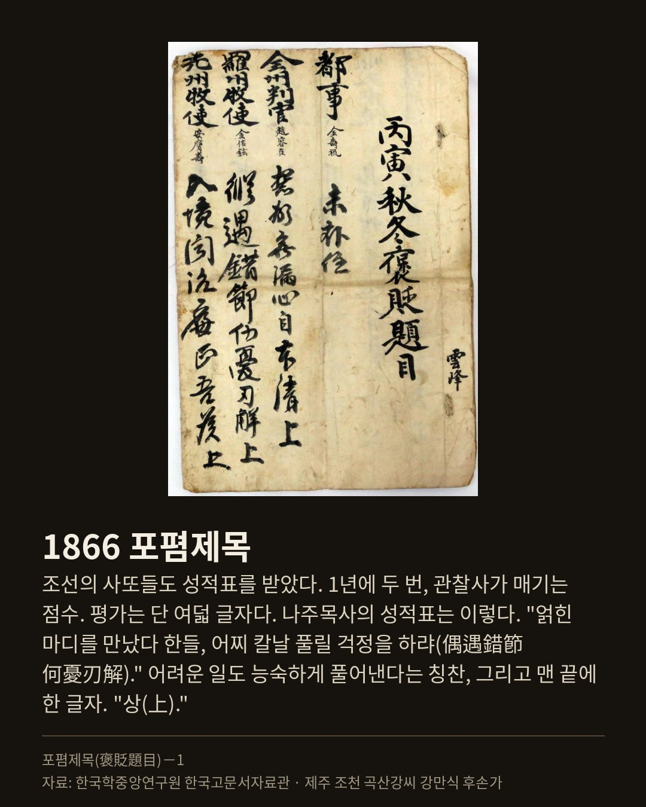
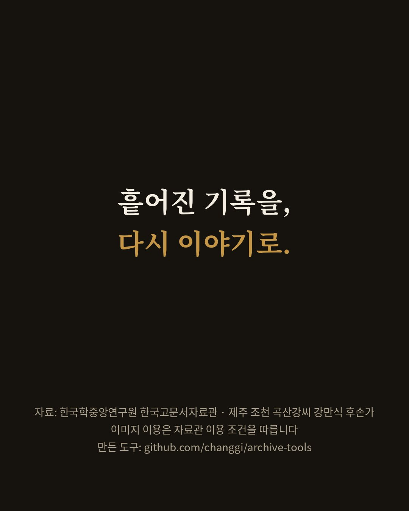

# EP.84 사또의 성적표 — 여덟 글자로 매긴 수령 평가 '포폄제목'

제주 조천 곡산강씨 강만식 후손가 (문중) · 관찰사는 해마다 두 번, 고을 수령들의 근무를 평가해 임금께 올렸다. 평가는 단 여덟 글자, 그리고 '상(上)·중(中)·하(下)'. 병인년 가을·겨울의 포폄제목에는 전주판관, 나주목사, 광주목사의 이름 아래 짧은 평이 붙어 있다

- 🌐 [전시 웹페이지](https://changgi.github.io/archive-tools/examples/jocheon-kang/exhibit.html) (한자 위 한글 독음 · 원문 해석) · [수업 활동지](https://changgi.github.io/archive-tools/examples/jocheon-kang/handout.html)
- 🎬 영상: [릴스 9:16](https://changgi.github.io/archive-tools-next/media/ep84-jocheon-kang_reel.mp4) · [가로 16:9](https://changgi.github.io/archive-tools-next/media/ep84-jocheon-kang_wide.mp4) · 홍보 글: [`promo.md`](promo.md)
- 카드뉴스: [`cards/`](cards/) · SNS 글: [`sns.txt`](sns.txt) · 판독·해석 표: [`selection.csv`](selection.csv)


<!-- DELIVERY -->
## 전달 에디팅 — 이 기록을 이렇게 전합니다

- **핵심 정서** — 웃음과 긴장
- **한 문장** — 조선의 수령도 평가받았고, 그 평가는 고사(故事)를 빌린 짧은 문장이었다는 것.
- **열기** — 조선의 사또들도 성적표를 받았습니다. 단 여덟 글자.
- **펼치기** — 포폄제목－1 (1866년) — '어찌 칼날 풀릴 걱정을 하랴'라는 평어를 풀어 주며, 고사성어의 맛을 살렸습니다.
- **절정** — "얽힌 마디를 만났다 한들, 어찌 칼날 풀릴 걱정을 하랴(偶遇錯節 何憂刃解)" — 화면·공간에서 이 한 줄만 크게, 소리를 줄여 집중
- **여운** — 여러분 직장의 평가를 여덟 글자로 쓴다면 무엇일까요? — 질문으로 끝내고 답은 보는 사람에게
- **감각과 물질** — "여덟 글자 성적표" — 관람객이 자기 상사·자신에게 여덟 글자 평 쓰기
- **통로와 매개** — 온라인: 릴스(열기) → 카드뉴스(펼치기) → 전시 웹페이지(절정·원문) → 비하인드 카드(여운) / 오프라인: 원본 크기 복제·낭독·참여 벽 / 남기기: 활동지·질문 카드
- **여운 장치** — 평어 스탬프 카드
- **전달 에디팅 전** — 1건의 문서를 1866년 연대순으로 놓고 문서명 · 유형 · 해설을 붙인다 — 정확하지만, 지나가면 잊힌다.
- **전달 에디팅 후** — 핵심 정서는 「웃음과 긴장」. 「조선의 사또들도 성적표를 받았습니다. 단 여덟 글자.」로 열고, 문서를 한 장의 집중로 펼친 뒤, "얽힌 마디를 만났다 한들, 어찌 칼날 풀릴 걱정을 하랴(偶遇錯節 何憂刃解)"에서 멈춘다. "여덟 글자 성적표" — 관람객이 자기 상사·자신에게 여덟 글자 평 쓰기. 마지막엔 「평어 스탬프 카드」로 보는 사람이 자기 이야기를 남기고 떠나게 한다.

전문: [`delivery.md`](delivery.md)
<!-- /DELIVERY -->

<!-- CURATOR -->
## 비하인드 — 큐레이터 노트

- **왜 이 문서들인가** — 관찰사가 수령에게 매긴 '여덟 글자 성적표(포폄제목)'가 제주 문중에 남아 있었습니다.
- **전하고 싶은 것** — 조선의 수령도 평가받았고, 그 평가는 고사(故事)를 빌린 짧은 문장이었다는 것.
- **이렇게 보이길 바랐다** — '어찌 칼날 풀릴 걱정을 하랴'라는 평어를 풀어 주며, 고사성어의 맛을 살렸습니다.
- **이렇게 써 주세요** — 조선의 인사 고과 제도, 공직자 평가를 오늘과 비교하는 수업에 쓰세요.
- **만들며 있었던 일** — 병인년을 1866년으로 본 것은 추정입니다. 제주 문중에 전라도 포폄제목이 남은 경위는 알 수 없습니다.
- **남겨 둔 질문** — 여러분 직장의 평가를 여덟 글자로 쓴다면 무엇일까요?
- **제작 기록** — 문서 1건 · 1866년 · 원본 사진 7면(문서 전체) · 원문 판독 1건 · 번역 1건 · 못 읽은 글자 □ 0 · 불확실 (?) 3 · 해제에 "확인 필요"를 단 문서 1건

전문: [`curator.md`](curator.md)
<!-- /CURATOR -->

## 이야기 — 사료가 말하는 대로

조선의 사또들도 성적표를 받았습니다. 단 여덟 글자.

> **1866 포폄제목** — 조선의 사또들도 성적표를 받았다. 1년에 두 번, 관찰사가 매기는 점수. 평가는 단 여덟 글자다. 나주목사의 성적표는 이렇다. "얽힌 마디를 만났다 한들, 어찌 칼날 풀릴 걱정을 하랴(偶遇錯節 何憂刃解)." 어려운 일도 능숙하게 풀어낸다는 칭찬, 그리고 맨 끝에 한 글자. "상(上)."

| 표지 | 1번 카드 | 마무리 |
|---|---|---|
|  |  |  |

## 선별 문서 (1점)

| # | 연도 | 유형 | 문서명 | 원본 |
|---|---|---|---|---|
| 1 | 1866 | 포폄제목 | 포폄제목(褒貶題目)－1 | [원본 보기](https://archive.aks.ac.kr/viewer/viewer.do#imgnode.do?itemId=book&gubun=booktree&depth=6&upPath=01%5E0168%5EL016810%5EL016810F02%5EL016810F0203&dataId=G002%2BAKS%2BKSM-XC.1866.5011-20220125.B082a_114_00706_XXX&itemType=) |

## 원문 판독과 해석

### 1. 포폄제목(褒貶題目)－1

**원문 판독**

```
丙寅秋冬褒貶題目　　(우측 소자) 雲峰
都事 金壽祺　未赴任
全州判官 趙容在　居(?)官無偏 心自本淸 上
羅州牧使 金佑鉉　偶遇錯節 何憂刃解 上
光州牧使 安膺壽　入境問治 庶臣(?)吾養(?) 上
(이하 다음 면)
```

**원문 해석** 병인년 가을·겨울 포폄 제목. 도사 김수기 — 부임하지 않음. 전주판관 조용재 — 벼슬살이에 치우침이 없고 마음이 본디 맑다: 상. 나주목사 김우현 — 우연히 얽힌 마디를 만났으나 어찌 칼날이 풀릴까 걱정하랴(어려운 일도 능히 처리한다): 상. 광주목사 안응수 — 고을에 들어서자 다스림을 물으니 … : 상.

**해제** 조선의 관찰사는 6월과 12월 두 차례 관할 수령들의 근무를 평가하는 포폄(褒貶)을 하여 임금에게 올렸고, 각 수령에 대한 짧은 평어(題目)와 등급(上·中·下)을 적었습니다. 이 문서는 병인년 가을·겨울 포폄의 제목을 베낀 것으로, 전라도 고을(전주·나주·광주)의 수령들이 보입니다. '偶遇錯節 何憂刃解'는 『후한서』의 '반근착절(盤根錯節)'과 『장자』의 포정해우(庖丁解牛) 고사를 엮어, 어려운 일도 능숙하게 처리한다는 칭찬입니다. 평어는 대개 네 글자 두 구로 짓습니다. 병인년은 수령들의 재임 시기를 고려해 1866년으로 추정했으나 확인이 필요하며, 흘림이 있어 일부 글자는 불확실합니다. 제주 문중에 전라도 포폄제목이 남은 경위는 알 수 없습니다.

판독·해석·이야기는 이미지에 근거한 초안이며(검토 전 "초안" 표시), 정확한 판독은 원문 확인이 필요합니다. □는 읽지 못한 글자, (?)는 불확실한 글자입니다.
이미지: 한국학중앙연구원 한국고문서자료관 소장·제공. "원본" 링크를 누르면 자료관 뷰어에서 그 문서가 열립니다. 재사용은 자료관에 문의하세요(소장처 동의 필요).
