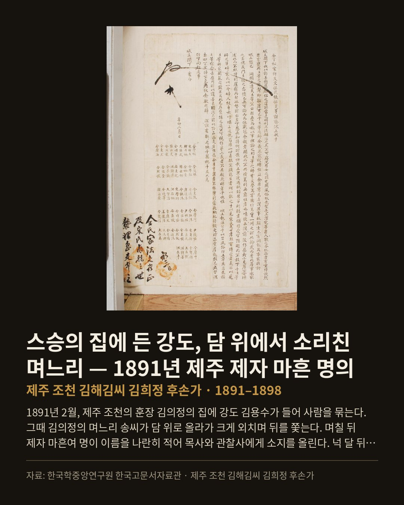
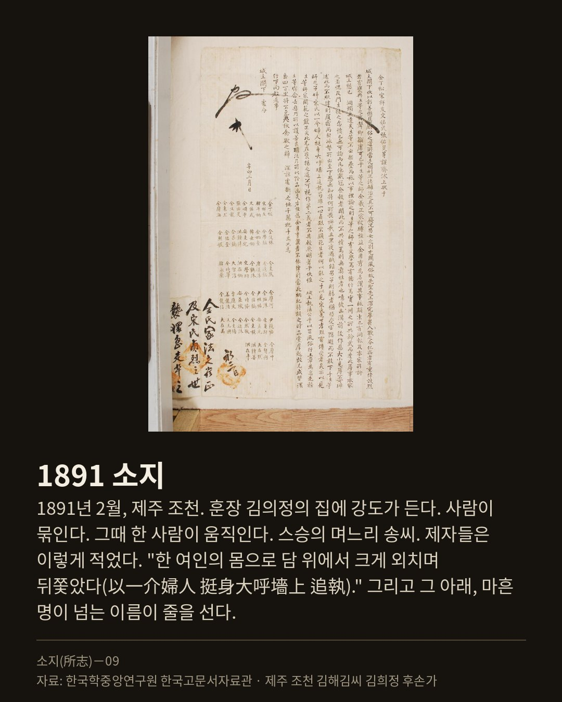
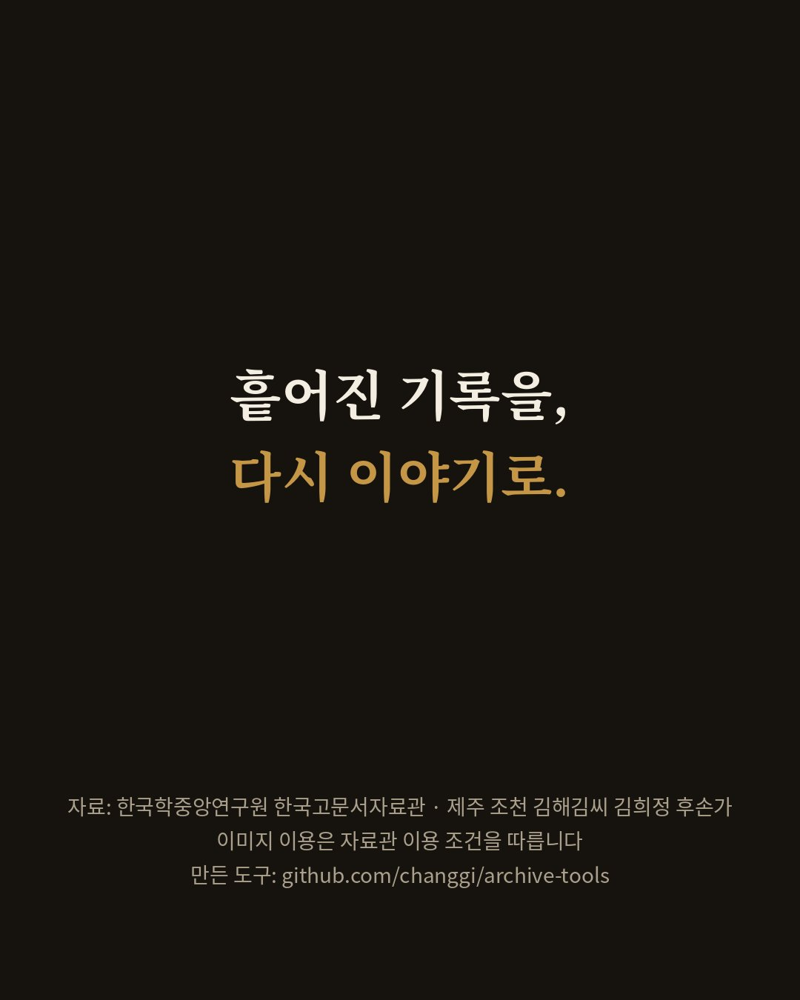

# EP.166 스승의 집에 든 강도, 담 위에서 소리친 며느리 — 1891년 제주 제자 마흔 명의 연명 소지

제주 조천 김해김씨 김희정 후손가 (문중) · 1891년 2월, 제주 조천의 훈장 김의정의 집에 강도 김용수가 들어 사람을 묶는다. 그때 김의정의 며느리 송씨가 담 위로 올라가 크게 외치며 뒤를 쫓는다. 며칠 뒤 제자 마흔여 명이 이름을 나란히 적어 목사와 관찰사에게 소지를 올린다. 넉 달 뒤 김의정은 아들과 함께 과거를 보러 가겠다고 공문을 청하고, 7년 뒤에는 늙고 병들어 훈장 자리를 내려놓겠다고 쓴다

- 🌐 [전시 웹페이지](https://changgi.github.io/archive-tools/examples/jocheon-kim-soji/exhibit.html) (한자 위 한글 독음 · 원문 해석) · [수업 활동지](https://changgi.github.io/archive-tools/examples/jocheon-kim-soji/handout.html)
- 🎬 영상: [릴스 9:16](https://changgi.github.io/archive-tools-next/media/ep166-jocheon-kim-soji_reel.mp4) · [가로 16:9](https://changgi.github.io/archive-tools-next/media/ep166-jocheon-kim-soji_wide.mp4) · 홍보 글: [`promo.md`](promo.md)
- 카드뉴스: [`cards/`](cards/) · SNS 글: [`sns.txt`](sns.txt) · 판독·해석 표: [`selection.csv`](selection.csv)

<!-- DELIVERY -->
## 전달 에디팅 — 이 기록을 이렇게 전합니다

- **핵심 정서** — 긴장
- **한 문장** — 같은 사건을 두 번 — 목사에게, 그리고 관찰사에게 — 마흔여 명의 제자가 이름을 나란히 적어 올렸다. 한 선생의 집을 지킨 것은 담 위의 며느리와, 종이 위의 제자들이었다.
- **열기** — 강도가 든 밤, 며느리는 담 위에 올라가 소리쳤습니다.
- **펼치기** — 소지－09 → 소지－10 → 소지－11 → 소지－12 (1891–1898년) — 1891년 2월 제주목사에게(제자 연명) → 같은 달 전라감사에게(같은 문장, 같은 이름) → 6월 김의정 자신의 소지(과거 응시 공문) → 1898년(훈장 사양)으로, 사건 → 일상 회복 → 노년의 흐름으로 놓았습니다.
- **절정** — "한 여인의 몸으로 담 위에서 크게 외치며 뒤쫓았다(以一介婦人 挺身大呼墻上 追執)" — 화면·공간에서 이 한 줄만 크게, 소리를 줄여 집중
- **여운** — 담 위에서 소리친 송씨의 이름 대신, 기록에는 '정열'이라는 두 글자가 남았습니다. 그는 스스로를 어떻게 기억했을까요? — 질문으로 끝내고 답은 보는 사람에게
- **감각과 물질** — 같은 문장의 소지 두 장 — 받는 사람만 '城主'와 '使相'으로 다르고, 아래로 마흔여 명의 이름이 줄을 선다 · 연명한 이름을 벽에 길게 나열하고 관아 마당처럼 서서 읽는 동선
- **통로와 매개** — 온라인: 릴스(열기) → 카드뉴스(펼치기) → 전시 웹페이지(절정·원문) → 비하인드 카드(여운) / 오프라인: 원본 크기 복제·낭독·참여 벽 / 남기기: 활동지·질문 카드
- **여운 장치** — 내가 누군가를 위해 이름을 보탠 일 떠올리기
- **전달 에디팅 전** — 4건의 문서를 1891–1898년 연대순으로 놓고 문서명 · 유형 · 해설을 붙인다 — 정확하지만, 지나가면 잊힌다.
- **전달 에디팅 후** — 핵심 정서는 「긴장」. 「강도가 든 밤, 며느리는 담 위에 올라가 소리쳤습니다.」로 열고, 문서를 대비와 순서로 펼친 뒤, "한 여인의 몸으로 담 위에서 크게 외치며 뒤쫓았다(以一介婦人 挺身大呼墻上 追執)"에서 멈춘다. 같은 문장의 소지 두 장 — 받는 사람만 '城主'와 '使相'으로 다르고, 아래로 마흔여 명의 이름이 줄을 선다. 마지막엔 「내가 누군가를 위해 이름을 보탠 일 떠올리기」로 보는 사람이 자기 이야기를 남기고 떠나게 한다.

전문: [`delivery.md`](delivery.md)
<!-- /DELIVERY -->

<!-- CURATOR -->
## 비하인드 — 큐레이터 노트

- **왜 이 문서들인가** — EP.126에서 1891년 제주 김의정 · 김항유 부자가 함께 과거를 보려 한 단자를 읽었습니다. 같은 해 그 집안의 소지를 펼쳐 보니, 과거 넉 달 전 집에 강도가 들었던 일이 있었습니다.
- **전하고 싶은 것** — 같은 사건을 두 번 — 목사에게, 그리고 관찰사에게 — 마흔여 명의 제자가 이름을 나란히 적어 올렸다. 한 선생의 집을 지킨 것은 담 위의 며느리와, 종이 위의 제자들이었다.
- **이렇게 보이길 바랐다** — 1891년 2월 제주목사에게(제자 연명) → 같은 달 전라감사에게(같은 문장, 같은 이름) → 6월 김의정 자신의 소지(과거 응시 공문) → 1898년(훈장 사양)으로, 사건 → 일상 회복 → 노년의 흐름으로 놓았습니다.
- **이렇게 써 주세요** — 조선 후기 향촌의 소지 · 등장(연명), 수령과 관찰사의 이중 호소(의송), 서당 훈장과 제자 관계, 여성의 행동이 '정열(貞烈)'로 기록되는 방식, 제주의 과거 응시 수업에 쓰세요.
- **만들며 있었던 일** — 네 장 모두 해서로 또렷하나, 관아의 큰 초서 제사와 연명자 이름 일부는 확정하지 못했습니다. 송씨가 김의정의 며느리라는 것은 '師之子婦 宋氏'에 따랐고, 강도 사건의 결말(김용수 처벌 여부)은 이 네 장으로 알 수 없습니다. '使相'은 전라도 관찰사로 보았습니다.
- **남겨 둔 질문** — 담 위에서 소리친 송씨의 이름 대신, 기록에는 '정열'이라는 두 글자가 남았습니다. 그는 스스로를 어떻게 기억했을까요?
- **제작 기록** — 문서 4건 · 1891–1898년 · 원본 사진 5면(문서 전체) · 원문 판독 4건 · 번역 4건

전문: [`curator.md`](curator.md) · 비하인드 카드: [`behind/`](behind/) · 채널별 홍보안: [`channels.md`](channels.md)
<!-- /CURATOR -->

## 이야기 — 사료가 말하는 대로

강도가 든 밤, 며느리는 담 위에 올라가 소리쳤습니다.

> **1891 소지** — 1891년 2월, 제주 조천. 훈장 김의정의 집에 강도가 든다. 사람이 묶인다. 그때 한 사람이 움직인다. 스승의 며느리 송씨. 제자들은 이렇게 적었다. "한 여인의 몸으로 담 위에서 크게 외치며 뒤쫓았다(以一介婦人 挺身大呼墻上 追執)." 그리고 그 아래, 마흔 명이 넘는 이름이 줄을 선다.
> **1891 소지** — 같은 달, 같은 문장, 같은 이름들. 이번에는 바다 건너 관찰사에게. 한 줄이 늘었다. "그놈을 잡아들여 엄히 곤장을 치고 칼을 씌워 가두셨다(捉入厥漢 嚴棍枷囚)." 강도는 잡혔다. 제자들이 바라는 것은 이제 하나 더, 담 위의 그 여인을 기억해 달라는 것.
> **1891 소지** — 넉 달 뒤, 여름. 이번에는 스승 자신이 붓을 든다. 9월에 회시가 있다. "전례대로 공문을 만들어 주십시오(依例 公文成給)." 강도가 들었던 그 집에서, 아버지와 아들은 함께 과거 길에 오를 준비를 한다.
> **1898 소지** — 그리고 7년 뒤, 1898년 가을. 마흔 명이 '우리 스승'이라 불렀던 그가 이번에는 물러나겠다고 쓴다. 훈장은 덕망과 학문이 넉넉해야 맡는 자리인데, 자기는 몸이 약하고 피를 쏟는다고. 원님의 답은 짧다. "며칠 조리하라(數日調理)." 스승은 쉽게 놓아주지 않는 자리였다.

| 표지 | 1번 카드 | 마무리 |
|---|---|---|
|  |  |  |

## 선별 문서 (4점)

| # | 연도 | 유형 | 문서명 | 원본 |
|---|---|---|---|---|
| 1 | 1891 | 소지 | 소지(所志)－09 | [원본 보기](https://archive.aks.ac.kr/viewer/viewer.do#imgnode.do?itemId=book&gubun=booktree&depth=6&upPath=01%5E0168%5EL016806%5EL016806F02%5EL016806F0202&dataId=G002%2BAKS%2BKSM-XB.1891.5011-20220125.B078a_110_00587_XXX&itemType=) |
| 2 | 1891 | 소지 | 소지(所志)－10 | [원본 보기](https://archive.aks.ac.kr/viewer/viewer.do#imgnode.do?itemId=book&gubun=booktree&depth=6&upPath=01%5E0168%5EL016806%5EL016806F02%5EL016806F0202&dataId=G002%2BAKS%2BKSM-XB.1891.5011-20220125.B078a_110_00588_XXX&itemType=) |
| 3 | 1891 | 소지 | 소지(所志)－11 | [원본 보기](https://archive.aks.ac.kr/viewer/viewer.do#imgnode.do?itemId=book&gubun=booktree&depth=6&upPath=01%5E0168%5EL016806%5EL016806F02%5EL016806F0202&dataId=G002%2BAKS%2BKSM-XB.1891.5011-20220125.B078a_110_00589_XXX&itemType=) |
| 4 | 1898 | 소지 | 소지(所志)－12 | [원본 보기](https://archive.aks.ac.kr/viewer/viewer.do#imgnode.do?itemId=book&gubun=booktree&depth=6&upPath=01%5E0168%5EL016806%5EL016806F02%5EL016806F0202&dataId=G002%2BAKS%2BKSM-XB.1898.5011-20220125.B078a_110_00590_XXX&itemType=) |

## 원문 판독과 해석

### 1. 소지(所志)－09

**원문 판독**

```
金丁松 宋祥友 文佑式 張佑旻等 謹齊沐上狀于
城主閤下 伏以彰善懲惡勵俗之道 所當先明刑正法輔治之具 不可廢 況男女之別 尤關風俗 …
… 生等之師金義正家 被縛強盜金用秀爲名漢 …
… 師之子婦宋氏 以一介婦人 挺身大呼墻上 追執 苟非一心貞烈 不顧死生者 何以能之乎 …
… 右強暴金用秀漢 若不依律 則當此綱紀將頹 …
城主閤下 處分
辛卯二月 日
(연명) 金丁松 宋祥友 韓斗柄 文佑式 金順平 張佑旻 …
(제사) 金氏家法之嚴正 及宋氏貞烈之世 …
```

**원문 해석** 김정송 · 송상우 · 문우식 · 장우민 등이 삼가 목욕재계하고 원님께 글을 올립니다. 엎드려 아뢰건대, 착함을 드러내고 악함을 벌해 풍속을 권하는 도리는 마땅히 형벌을 밝히고 법을 바르게 하는 데서 먼저 해야 하니, 다스림을 돕는 도구는 폐할 수 없습니다. 하물며 남녀의 분별은 더욱 풍속에 관계됩니다. … 저희의 스승 김의정의 집이 김용수라는 강도에게 결박당하였는데 … 스승의 며느리 송씨가 한 여인의 몸으로 담 위에서 몸을 내밀어 크게 외치며 뒤쫓아 잡으려 하였으니, 한마음으로 정렬하여 죽고 사는 것을 돌아보지 않는 이가 아니면 어찌 할 수 있었겠습니까. … 저 포악한 김용수를 법대로 다스리지 않으면 이 기강이 무너질 것이니 … 원님께서 처분하소서. 신묘년(1891) 2월 일. (연명) 김정송 · 송상우 · 한두병 · 문우식 · 김순평 · 장우민 … (관아 제사) 김씨 집안 법도의 엄정함과 송씨의 정렬은 …

**해제** 신묘년(1891, 고종 28) 2월, 제주 조천의 훈장 김의정(金義正)의 제자들이 제주목사(城主)에게 올린 연명 소지(등장)입니다. 스승의 집에 강도 김용수(金用秀)가 들어 사람을 결박했고, 스승의 며느리 송씨가 '한 여인의 몸으로 담 위에서 크게 외치며 뒤쫓았다(以一介婦人 挺身大呼墻上 追執)'고 적었습니다. 제자들은 강도를 법대로 엄히 다스리고, 송씨의 행동을 '정렬(貞烈)'로 드러내 달라고 청합니다. 끝에 마흔 명이 넘는 제자의 이름이 줄지어 적혔습니다. 관아의 큰 초서 제사는 '金氏家法之嚴正 及宋氏貞烈之世'로 시작하는 것으로 보이며 뒷부분은 확정하지 못했습니다.

### 2. 소지(所志)－10

**원문 판독**

```
金丁松 宋祥友 文佑式 張佑旻等 謹齊沐上狀于
使相閤下 伏以彰善懲惡勵俗之道 所當先明刑正法輔治之具 不可廢 …
… 有洞報及本家所訴 閤下想已 洞悉無遺矣 …
… 師之子婦宋氏 以一介婦人 挺身大呼墻上 追執 …
閤下執法公平 以正風俗 行王章爲急先務 故捉入厥漢 嚴棍枷囚
善惡勸懲之道 蓋已發其端矣 …
使相閤下 處分
辛卯二月 日
(연명 같음)
```

**원문 해석** 김정송 · 송상우 · 문우식 · 장우민 등이 삼가 목욕재계하고 사상(관찰사) 합하께 글을 올립니다. … 마을의 보고와 그 집의 호소가 이미 있었으니 합하께서도 이미 빠짐없이 아실 것입니다. … 스승의 며느리 송씨가 한 여인의 몸으로 담 위에서 크게 외치며 뒤쫓았으니 … 합하께서 법을 공평히 집행하여 풍속을 바르게 하고 왕의 법도를 행하는 것을 급선무로 삼으시어, 그놈을 잡아들여 엄히 곤장을 치고 칼을 씌워 가두셨으니, 선악을 권하고 징계하는 도리가 이미 그 실마리를 드러냈습니다. … 사상 합하께서 처분하소서. 신묘년(1891) 2월 일. (연명 같음)

**해제** 같은 달, 같은 제자들이 이번에는 '사상(使相) 합하', 곧 전라도 관찰사에게 올린 소지입니다. 제주목은 전라도 관할이어서 목사보다 위의 관찰사에게 같은 사건을 다시 호소한 것입니다. 문장은 앞 장과 거의 같고 연명자도 같으나, '이미 그놈을 잡아들여 엄히 곤장을 치고 칼을 씌워 가두셨다(捉入厥漢 嚴棍枷囚)'는 구절이 더해져, 이 사이에 강도가 붙잡혀 처벌받기 시작했음을 알 수 있습니다. 제자들은 처벌을 넘어 송씨의 정렬을 드러내는 일까지 청합니다.

### 3. 소지(所志)－11

**원문 판독**

```
幼學金義正
右謹陳所志事段 生去丁亥分 得參本州陞補 而今聞式科會試 在於九月 …
擧計料 依例 公文成給爲只爲
行下向敎是事
使相閤下 處分
辛卯六月 日
(제사) 公文 … 給向事
```

**원문 해석** 유학 김의정. 삼가 아뢰는 소지의 일은, 제가 지난 정해년(1887)에 이 고을(제주)의 승보시에 들었는데, 이제 들으니 식년 과거 회시가 9월에 있다 하므로 … 과거에 나아가려 하니, 전례대로 공문을 만들어 주시기 바랍니다. 사상 합하께서 처분하소서. 신묘년(1891) 6월 일. (관아 제사) 공문을 … 내어 줄 것.

**해제** 넉 달 뒤 1891년 6월, 이번에는 김의정 자신이 관찰사에게 올린 소지입니다. 정해년(1887) 제주 승보시(陞補試)에 들었고, 9월 식년 회시에 나아가려 하니 전례대로 공문을 내어 달라고 청했습니다. 제주 사람이 육지의 과거장에 가려면 관의 공문이 필요했습니다. EP.126에서 읽은 '아버지와 아들이 함께 시험을 봐도 되겠느냐'는 단자와, 같은 해 아들 김항유의 진사 백패가 바로 이 과거 길의 결과입니다. 강도 사건 넉 달 뒤, 집안은 다시 일상으로 돌아와 있었습니다. 관아의 큰 제사는 '公文 … 給'으로 읽힙니다.

### 4. 소지(所志)－12

**원문 판독**

```
朝天里居前參奉金義正
右謹陳所志事段 蓋訓長之任 德望足爲儒林之師表 文學足爲士類之矜式 然後可以當之
非庸儒俗士之所可擧論也 以若重任 加於民之身上 涯分已過 可謂褎然
民之無德望 少文學 尙矣勿論 素以虛弱之質 病不離身 …
… 月初 血症添劇 用藥無效 幾至委席 病狀如此 萬無隨行之勢 …
爲改遞 俾便公私之地 千萬望良爲只爲
行下向敎是事
使道 處分
戊戌十月 日
(제사) 自可勿藥向事 … 公議薦望 豈其 … 病實 數日調理
```

**원문 해석** 조천리에 사는 전 참봉 김의정. 삼가 아뢰는 소지의 일은, 대개 훈장의 소임은 덕망이 유림의 스승이 되기에 넉넉하고 학문이 선비들의 본보기가 되기에 넉넉한 뒤에야 맡을 수 있는 것이지, 평범한 선비가 감히 논할 바가 아닙니다. 이런 무거운 소임이 제 몸에 더해진 것은 분수에 넘쳐 부끄러울 따름입니다. 제가 덕망이 없고 학문이 얕은 것은 말할 것도 없고, 본디 허약한 몸이라 병이 몸을 떠나지 않는데 … 이달 초 피를 쏟는 증세가 더욱 심해져 약을 써도 효험이 없어 자리에 누울 지경에 이르렀습니다. 병세가 이러하니 결코 소임을 따라 행할 형편이 못 되므로 … 바꾸어 주시어 공사 간에 편하게 해 주시기를 간절히 바랍니다. 사또께서 처분하소서. 무술년(1898) 10월 일. (관아 제사) 약을 쓰지 않아도 저절로 나을 것이니 … 공의로 천거한 것인데 어찌 … 며칠 조리하라.

**해제** 7년 뒤 무술년(1898, 광무 2) 10월, 이제 '전 참봉'이 된 김의정이 제주 목사(사또)에게 훈장(訓長) 자리를 바꾸어 달라고 올린 소지입니다. 훈장의 소임은 '덕망이 유림의 스승이 되고 학문이 선비의 본보기가 되어야 맡을 수 있다'며 자신을 낮추고, 피를 쏟는 증세(血症)가 심해져 자리에 누울 지경이라고 적었습니다. 관아의 제사는 '약을 쓰지 않아도 나을 것(自可勿藥)', '공의로 천거한 것(公議薦望)', '며칠 조리하라(數日調理)'로 읽혀, 사직을 받아들이지 않은 것으로 보입니다. 7년 전 마흔 명의 제자가 '우리의 스승'이라 부른 그 사람입니다. 병명이나 그 뒤의 일은 이 문서로 알 수 없습니다.

판독·해석·이야기는 이미지에 근거한 초안이며(검토 전 "초안" 표시), 정확한 판독은 원문 확인이 필요합니다. □는 읽지 못한 글자, (?)는 불확실한 글자입니다.
이미지: 한국학중앙연구원 한국고문서자료관 소장·제공. "원본" 링크를 누르면 자료관 뷰어에서 그 문서가 열립니다. 재사용은 자료관에 문의하세요(소장처 동의 필요).
