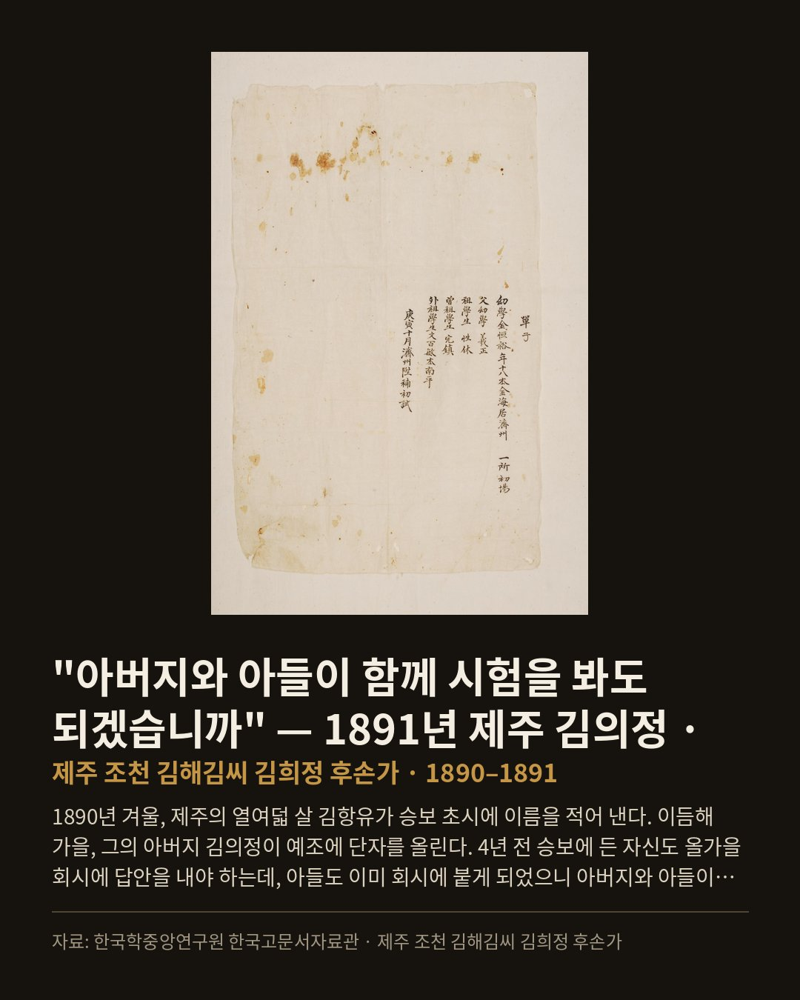
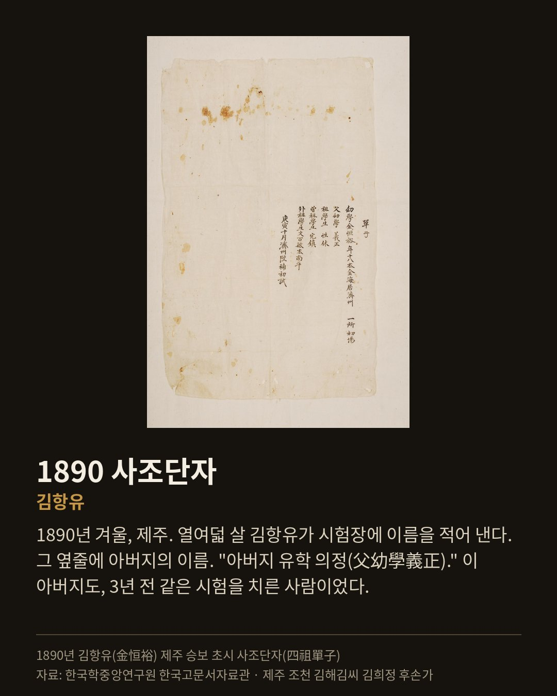
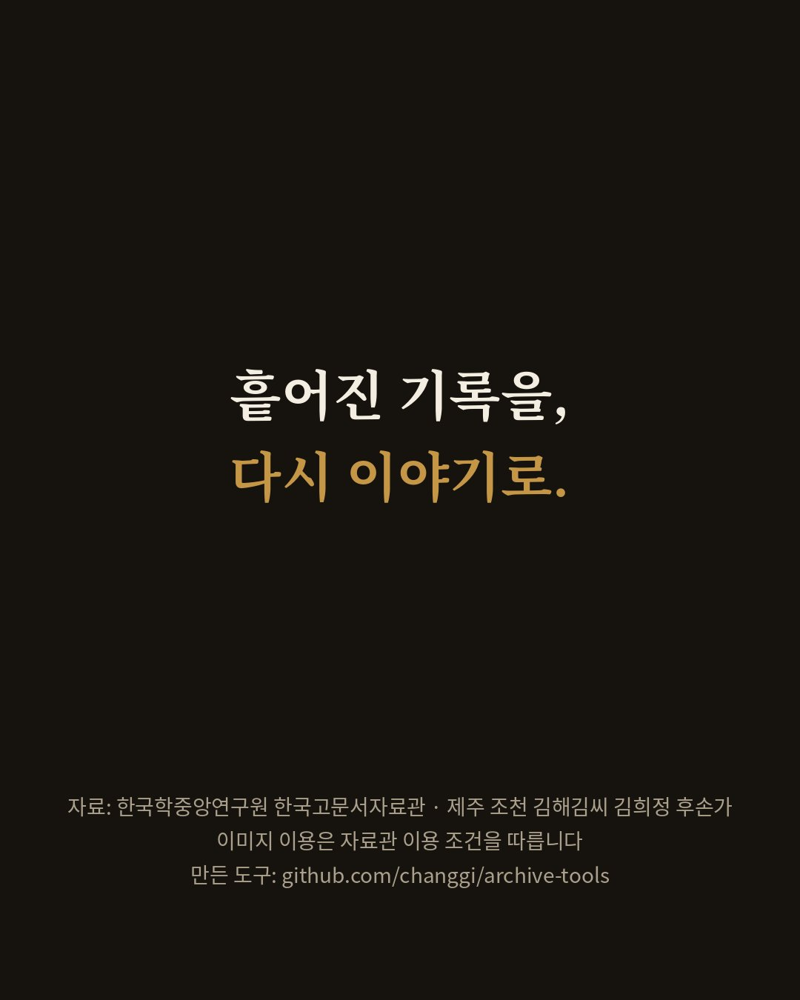

# EP.126 "아버지와 아들이 함께 시험을 봐도 되겠습니까" — 1891년 제주 김의정 · 김항유 부자의 과거

제주 조천 김해김씨 김희정 후손가 (문중) · 1890년 겨울, 제주의 열여덟 살 김항유가 승보 초시에 이름을 적어 낸다. 이듬해 가을, 그의 아버지 김의정이 예조에 단자를 올린다. 4년 전 승보에 든 자신도 올가을 회시에 답안을 내야 하는데, 아들도 이미 회시에 붙게 되었으니 아버지와 아들이 함께 응시해도 되겠느냐고. 한 달 뒤 아들은 진사 백패를 받고, 같은 달 아버지는 숭인전 참봉에 임명된다

- 🌐 [전시 웹페이지](https://changgi.github.io/archive-tools/examples/jocheon-kim/exhibit.html) (한자 위 한글 독음 · 원문 해석) · [수업 활동지](https://changgi.github.io/archive-tools/examples/jocheon-kim/handout.html)
- 🎬 영상: [릴스 9:16](https://changgi.github.io/archive-tools-next/media/ep126-jocheon-kim_reel.mp4) · [가로 16:9](https://changgi.github.io/archive-tools-next/media/ep126-jocheon-kim_wide.mp4) · 홍보 글: [`promo.md`](promo.md)
- 카드뉴스: [`cards/`](cards/) · SNS 글: [`sns.txt`](sns.txt) · 판독·해석 표: [`selection.csv`](selection.csv)

<!-- DELIVERY -->
## 전달 에디팅 — 이 기록을 이렇게 전합니다

- **핵심 정서** — 따뜻함
- **한 문장** — 섬에서 서울까지, 과거는 한 집안이 함께 나서는 먼 길이었다 — 아버지와 아들은 같은 시험 앞에서 서로의 앞길을 물었다.
- **열기** — 아버지가 서울에 물었습니다. "아들과 같은 시험을 봐도 되겠습니까?"
- **펼치기** — 김항유 제주 승보 초시 사조단자 → 김항유 시권 → 김의정 회시 응시 청원 단자 → 김항유 진사 백패 → 김의정 숭인전 참봉 고신 (1890–1891년) — 1890년 아들의 사조단자와 시권 → 1891년 9월 아버지의 단자 → 10월 아들의 백패와 아버지의 고신 순으로, 같은 시험을 사이에 둔 부자의 한 해를 따라가게 구성했습니다.
- **절정** — "제가 답안을 내는 것을 스스로 판단하지 못해(生之呈券 不能自斷)" — 화면·공간에서 이 한 줄만 크게, 소리를 줄여 집중
- **여운** — 아버지는 끝내 아들과 같은 시험장에 앉았을까요, 아니면 아들의 이름이 방에 오르는 것을 지켜보았을까요? — 질문으로 끝내고 답은 보는 사람에게
- **감각과 물질** — 흰 백패와 고신 두 장을 나란히 — 같은 '광서 17년 10월' · 시험장 책상과 답안지 체험 · 흰 종이 한 장에 조명 하나 · 어보·관인 탁본 스탬프를 찍어 보는 체험
- **통로와 매개** — 온라인: 릴스(열기) → 카드뉴스(펼치기) → 전시 웹페이지(절정·원문) → 비하인드 카드(여운) / 오프라인: 원본 크기 복제·낭독·참여 벽 / 남기기: 활동지·질문 카드
- **여운 장치** — 부모님께 '같은 출발선에 섰던 날' 물어보기
- **전달 에디팅 전** — 5건의 문서를 1890–1891년 연대순으로 놓고 문서명 · 유형 · 해설을 붙인다 — 정확하지만, 지나가면 잊힌다.
- **전달 에디팅 후** — 핵심 정서는 「따뜻함」. 「아버지가 서울에 물었습니다. "아들과 같은 시험을 봐도 되겠습니까?"」로 열고, 문서를 대비와 순서로 펼친 뒤, "제가 답안을 내는 것을 스스로 판단하지 못해(生之呈券 不能自斷)"에서 멈춘다. 흰 백패와 고신 두 장을 나란히 — 같은 '광서 17년 10월'. 마지막엔 「부모님께 '같은 출발선에 섰던 날' 물어보기」로 보는 사람이 자기 이야기를 남기고 떠나게 한다.

전문: [`delivery.md`](delivery.md)
<!-- /DELIVERY -->

<!-- CURATOR -->
## 비하인드 — 큐레이터 노트

- **왜 이 문서들인가** — 아버지가 '아들과 함께 시험을 봐도 되느냐'고 묻는 단자를 읽고, 같은 해에 남은 아들의 백패와 아버지의 고신을 나란히 놓아 보고 싶었습니다.
- **전하고 싶은 것** — 섬에서 서울까지, 과거는 한 집안이 함께 나서는 먼 길이었다 — 아버지와 아들은 같은 시험 앞에서 서로의 앞길을 물었다.
- **이렇게 보이길 바랐다** — 1890년 아들의 사조단자와 시권 → 1891년 9월 아버지의 단자 → 10월 아들의 백패와 아버지의 고신 순으로, 같은 시험을 사이에 둔 부자의 한 해를 따라가게 구성했습니다.
- **이렇게 써 주세요** — 조선 말 과거 제도(승보시 · 회시 · 진사시)와 응시 절차, 제주 사람의 과거, 부모와 자녀의 진로, 시권과 부(賦) 읽기 수업에 쓰세요.
- **만들며 있었던 일** — 사조단자 · 백패 · 고신은 정서라 확실하고, 단자 본문도 해서라 읽기 쉬우나 아래 큰 제사는 몇 글자를 읽지 못했습니다. 시권은 석 장 가운데 첫 장만 판독했습니다. 사조단자의 나이(18세)와 갑술생이 한 살 어긋나는 까닭, 제사의 허락 여부, 아버지 김의정이 회시에 응시 · 입격했는지, 참봉 임명과의 관계는 확인하지 않았습니다.
- **남겨 둔 질문** — 아버지는 끝내 아들과 같은 시험장에 앉았을까요, 아니면 아들의 이름이 방에 오르는 것을 지켜보았을까요?
- **제작 기록** — 문서 5건 · 1890–1891년 · 원본 사진 7면(문서 전체) · 원문 판독 5건 · 번역 5건 · 못 읽은 글자 □ 0 · 불확실 (?) 5 · 해제에 "확인 필요"를 단 문서 4건

전문: [`curator.md`](curator.md) · 비하인드 카드: [`behind/`](behind/) · 채널별 홍보안: [`channels.md`](channels.md)
<!-- /CURATOR -->

## 이야기 — 사료가 말하는 대로

아버지가 서울에 물었습니다. "아들과 같은 시험을 봐도 되겠습니까?"

> **1890 사조단자** — 1890년 겨울, 제주. 열여덟 살 김항유가 시험장에 이름을 적어 낸다. 그 옆줄에 아버지의 이름. "아버지 유학 의정(父幼學義正)." 이 아버지도, 3년 전 같은 시험을 치른 사람이었다.
> **1891 시권** — 그의 답안지가 남아 있다. 제목은 "벌떡 일어나 관복을 입고 천하의 일을 생각하다(蹶起著公服念天下事)." 열여덟 살 섬 소년이 쓴 문장. "뜻은 배부르고 따뜻한 데 있지 않다(志不在於溫飽)." 붉은 점수는 차하.
> **1891 단자** — 1891년 가을, 아버지 김의정이 서울의 예조판서에게 단자를 올린다. 자신도 회시에 나가야 하는데, 아들도 같은 시험에 붙게 되었다. "제가 답안을 내는 것을 스스로 판단하지 못해(生之呈券 不能自斷)" 묻는다고. 아버지와 아들이, 같은 시험장 앞에 섰다.
> **1891 백패** — 한 달 뒤, 흰 종이 한 장. "유학 김항유는 진사 3등 제254인으로 입격하였다(幼學金恒裕進士三等第二百五十四人入格者)." 섬에서 온 젊은 유학이, 진사가 되었다.
> **1891 고신** — 그리고 같은 달, 아버지에게도 한 장이 온다. "유학 김의정을 통사랑 행 숭인전 참봉으로 삼는다(幼學金義正爲通仕郞行崇仁殿參奉者)." 아들은 진사, 아버지는 첫 벼슬. 제주의 한 집에, 같은 달 두 장의 종이가 왔다.

| 표지 | 1번 카드 | 마무리 |
|---|---|---|
|  |  |  |

## 선별 문서 (5점)

| # | 연도 | 유형 | 문서명 | 원본 |
|---|---|---|---|---|
| 1 | 1890 | 사조단자 | 1890년 김항유(金恒裕) 제주 승보 초시 사조단자(四祖單子) | [원본 보기](https://archive.aks.ac.kr/viewer/viewer.do#imgnode.do?itemId=book&gubun=booktree&depth=6&upPath=01%5E0168%5EL016806%5EL016806F02%5EL016806F0202&dataId=G002%2BAKS%2BKSM-XB.1890.5011-20220125.B078a_110_00597_XXX&itemType=) |
| 2 | 1891 | 시권 | 1891년 김항유(金恒裕) 시권(試券) | [원본 보기](https://archive.aks.ac.kr/viewer/viewer.do#imgnode.do?itemId=book&gubun=booktree&depth=6&upPath=01%5E0168%5EL016806%5EL016806F02%5EL016806F0204&dataId=G002%2BAKS%2BKSM-XD.1891.5011-20220125.B078a_110_00668_XXX&itemType=) |
| 3 | 1891 | 단자 | 1891년 김의정(金義正) 회시 응시 청원 단자(單子) | [원본 보기](https://archive.aks.ac.kr/viewer/viewer.do#imgnode.do?itemId=book&gubun=booktree&depth=6&upPath=01%5E0168%5EL016806%5EL016806F02%5EL016806F0202&dataId=G002%2BAKS%2BKSM-XB.1891.5011-20220125.B078a_110_00592_XXX&itemType=) |
| 4 | 1891 | 백패 | 1891년 김항유(金恒裕) 진사 백패(進士白牌) | [원본 보기](https://archive.aks.ac.kr/viewer/viewer.do#imgnode.do?itemId=book&gubun=booktree&depth=6&upPath=01%5E0168%5EL016806%5EL016806F02%5EL016806F0201&dataId=G002%2BAKS%2BKSM-XA.1891.5011-20220125.B078a_110_00576_XXX&itemType=) |
| 5 | 1891 | 고신 | 1891년 김의정(金義正) 숭인전 참봉 고신(告身) | [원본 보기](https://archive.aks.ac.kr/viewer/viewer.do#imgnode.do?itemId=book&gubun=booktree&depth=6&upPath=01%5E0168%5EL016806%5EL016806F02%5EL016806F0201&dataId=G002%2BAKS%2BKSM-XA.1891.5011-20220125.B078a_110_00577_XXX&itemType=) |

## 원문 판독과 해석

### 1. 1890년 김항유(金恒裕) 제주 승보 초시 사조단자(四祖單子)

**원문 판독**

```
單子
幼學金恒裕年十八本金海居濟州　一所初場
父幼學　義正
祖學生　性休
曾祖學生　完鎭
外祖學生文百敏本南平
庚寅十月濟州陞補初試
```

**원문 해석** 단자. 유학 김항유, 나이 18세, 본관 김해, 제주 거주. 1소 초장. 아버지 유학 의정, 할아버지 학생 성휴, 증조할아버지 학생 완진, 외할아버지 학생 문백민(본관 남평). 경인년(1890) 10월 제주 승보 초시.

**해제** 1890년(고종 27, 庚寅) 10월 제주에서 치른 승보(陞補) 초시에 김항유(金恒裕)가 낸 사조단자(四祖單子)입니다. 사조단자는 응시자가 자신과 아버지 · 할아버지 · 증조할아버지 · 외할아버지의 이름과 신분을 적어 내는 신원 증명서로, 응시 자격을 확인하는 데 썼습니다. '1소 초장(一所初場)'은 그가 배정된 시험장과 첫 시험을 가리킵니다. 승보시는 본래 성균관 유생을 뽑는 시험이었으나 제주처럼 멀리 떨어진 곳에서는 따로 치러 그 성적으로 다음 단계에 나아갈 길을 열어 주었습니다. 나이를 18세로 적었는데, 이듬해 아버지의 단자에는 아들이 갑술생(1874)이라 하여 1890년이면 17세가 되므로 한 살 어긋납니다(원문 확인 필요).

### 2. 1891년 김항유(金恒裕) 시권(試券)

**원문 판독**

```
幼學金恒裕年十八本金海居濟州
父幼學　義正
祖學生　性休
曾祖學生　完鎭
外祖學生文百敏本南平
次下
恩
蹶起著公服念天下事　賦
居士服方袞(?)衣只宜著於無事趙不脫於
退朝范必求於計夜攬朝服而起予耿一
念而在玆旣整容於危坐故有思於經濟
自余著夫公服任大事於天下慕周贊(?)之
補闕擬韓相之措安稱其服而立朝抱需
世之經綸俄齋臥而蹶起豈曰無乎朝衣
尙留銘於布衾不宜脫於金帶退猶修吾
初服匪爲私於一己時不可以燕安所寓
念者維何憂已分於宵旰志不在於溫飽
衣之宜兮旣著曰有事於山河 …
```

**원문 해석** (겉봉) 유학 김항유, 18세, 본관 김해, 제주 거주. 아버지 유학 의정, 할아버지 학생 성휴, 증조 학생 완진, 외조 학생 문백민(본관 남평). (점수) 차하. (제목) '벌떡 일어나 관복을 입고 천하의 일을 생각하다' — 부(賦). (첫머리 풀이) 관복을 입고 조정에 서서 세상을 다스릴 뜻을 품고, 누워 있다가도 벌떡 일어나니 어찌 조복이 없다 하겠는가. … 뜻은 배부르고 따뜻한 데 있지 않다. …

**해제** 김항유의 시권(試券, 답안지)입니다. 오른쪽 겉봉에 1890년 사조단자와 같은 내용(18세, 아버지 · 할아버지 · 증조 · 외조)이 적혀 있고, 붉은 글씨로 '차하(次下)'라는 점수가 매겨져 있습니다. 시제는 '벌떡 일어나 관복을 입고 천하의 일을 생각하다(蹶起著公服念天下事)'이며, 운율을 맞춘 산문시인 부(賦)로 지었습니다. 조(趙) · 범(范) 같은 옛 신하들이 밤에도 조복을 끌어당겨 일어났다는 고사를 빌려, 벼슬하는 이의 마음가짐을 노래했습니다. 위쪽의 '恩' 한 글자가 시험의 이름(은과 등)을 가리키는지는 확인하지 못했습니다. 석 장 가운데 첫 장만 판독했고, 몇 글자는 (?)로 두었습니다. 겉봉의 나이로 보아 1890년 승보 초시 무렵의 답안으로 보입니다.

### 3. 1891년 김의정(金義正) 회시 응시 청원 단자(單子)

**원문 판독**

```
濟州會試儒生金義正單子
恐鑑伏以生去丁亥年分得叅本州陞補當爲呈券於今秋式會而生之子恒裕以甲戌生去年分亦叅本州陞補今
夏增會得蒙　天恩旣有待式會付之榜末之　傳敎是乎所生之呈券不能自斷來問于　都下科儒則皆
言　宗班李氏曾有　傳敎而付之榜末時父子或有俱爲叅榜而分先後放榜云云以此言之生之呈券乃是
舊例不爲違格伏乞　洞燭敎是後特爲許赴爲只爲千萬懇祝之至
大宗伯　閤下　處分
辛卯九月　日
(제사) 子赴 恩(?)賜(?)父赴會試 … 父子同赴 … 二十五日
```

**원문 해석** 제주 회시 유생 김의정의 단자. 삼가 살펴 주시기를 바랍니다. 저는 지난 정해년(1887)에 이 고을의 승보에 들어 올가을 식년 회시에 답안을 내야 합니다. 그런데 저의 아들 항유는 갑술생으로, 지난해 역시 이 고을 승보에 들었고, 올여름 증광 회시 때 임금의 은혜를 입어 식년 회시를 기다려 방(榜)의 끝에 붙이라는 전교가 있었습니다. 제가 답안을 내도 되는지 스스로 판단하지 못해 서울의 과거 보는 선비들에게 물으니, 모두 '종반 이씨가 일찍이 전교를 받아 방 끝에 붙을 때 아버지와 아들이 함께 방에 든 일이 있어, 앞뒤를 나누어 발표했다'고 합니다. 이로 보면 제가 답안을 내는 것은 옛 예이고 격식에 어긋나지 않습니다. 엎드려 바라건대 살피신 뒤 특별히 응시를 허락해 주시기를 간절히 빕니다. 대종백(예조판서) 합하께서 처분하소서. 신묘년(1891) 9월 일. (제사) 아들의 응시 … 아버지의 회시 응시 … 부자가 함께 응시 … 25일.

**해제** 1891년(고종 28, 辛卯) 9월 아버지 김의정(金義正)이 예조판서(大宗伯)에게 올린 단자입니다. 김의정은 1887년(丁亥) 제주 승보에 들어 1891년 가을 식년 회시에 응시할 자격이 있었는데, 아들 김항유도 1890년 승보에 들고 그해 여름 '식년 회시 때 방 끝에 붙이라'는 임금의 은혜를 받았습니다. 아버지와 아들이 한 시험에 함께 나가도 되는지 묻고, 서울 선비들에게 들은 앞선 예(종반 이씨 부자)를 들어 허락을 청했습니다. 아래 큰 글씨의 제사(題辭)에 '父赴會試' · '父子同赴' 같은 말이 보이나, 몇 글자를 읽지 못해 허락 여부는 판단하지 않았습니다. 제주에서 서울까지 과거를 보러 가는 길이 얼마나 멀었는지, 그리고 한 집안에서 부자가 함께 그 길에 나선 일을 보여 주는 드문 문서입니다.

### 4. 1891년 김항유(金恒裕) 진사 백패(進士白牌)

**원문 판독**

```
敎旨
幼學金恒裕進士三等
第二百五十四人入格者
光緖十七年十月 日
```

**원문 해석** 교지. 유학 김항유는 진사 3등 제254인으로 입격한 자이다. 광서 17년(1891) 10월 일.

**해제** 1891년(고종 28, 光緖 17, 辛卯) 10월 김항유가 진사시에 3등 제254인으로 입격하고 받은 백패(白牌)입니다. 아버지의 단자에서 말한 '방 끝에 붙인다'는 은혜와 맞물리는 등수로 보이나, 이 백패가 그 은혜로 받은 것인지는 확인하지 않았습니다. 연호 위에 어보가 찍혔고, 위아래 가장자리에 붉은 물감 자국이 있습니다. 같은 시험에서 아버지 김의정이 입격했는지는 이 집안 문서에서 찾지 못했습니다.

### 5. 1891년 김의정(金義正) 숭인전 참봉 고신(告身)

**원문 판독**

```
吏曹光緖十七年十月
日奉
敎幼學金義正爲通仕郞
行
崇仁殿參奉者
光緖十七年十月
日
行判書臣李(?)
參判
參議
正郞
佐郞
```

**원문 해석** 이조에서 광서 17년(1891) 10월 일에 교지를 받들어, 유학 김의정을 통사랑 행 숭인전 참봉으로 삼는다. 광서 17년 10월 일. 행판서 신 이□, 참판, 참의, 정랑, 좌랑.

**해제** 1891년(고종 28, 光緖 17) 10월 이조(吏曹)가 왕명을 받들어 아버지 김의정을 통사랑(通仕郞, 정8품 문관 품계) 숭인전(崇仁殿) 참봉(종9품)으로 임명한 고신입니다. 숭인전은 평양에 있던 기자(箕子)의 사당으로, 참봉은 그 제사와 관리를 맡는 첫 벼슬이었습니다. 아들이 진사 백패를 받은 바로 그달입니다. 이 임명이 회시와 어떤 관계인지(응시 대신인지, 입격의 결과인지)는 확인하지 못했습니다. 판서 이름은 '李' 한 글자만 적혔습니다.

판독·해석·이야기는 이미지에 근거한 초안이며(검토 전 "초안" 표시), 정확한 판독은 원문 확인이 필요합니다. □는 읽지 못한 글자, (?)는 불확실한 글자입니다.
이미지: 한국학중앙연구원 한국고문서자료관 소장·제공. "원본" 링크를 누르면 자료관 뷰어에서 그 문서가 열립니다. 재사용은 자료관에 문의하세요(소장처 동의 필요).
