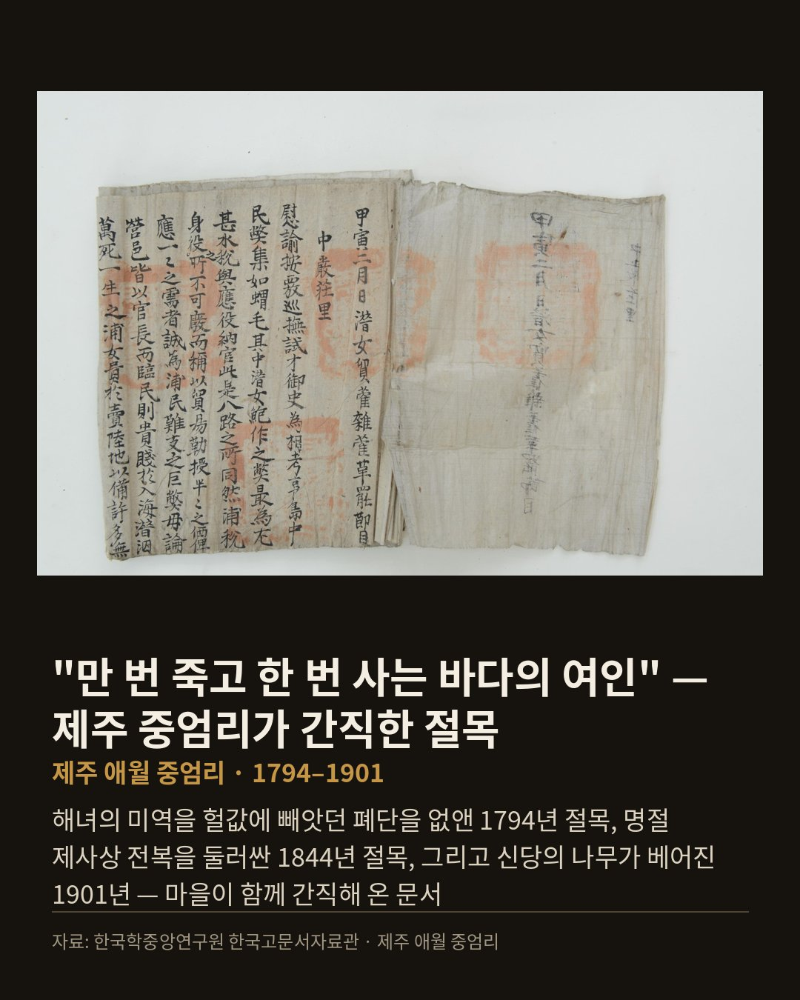
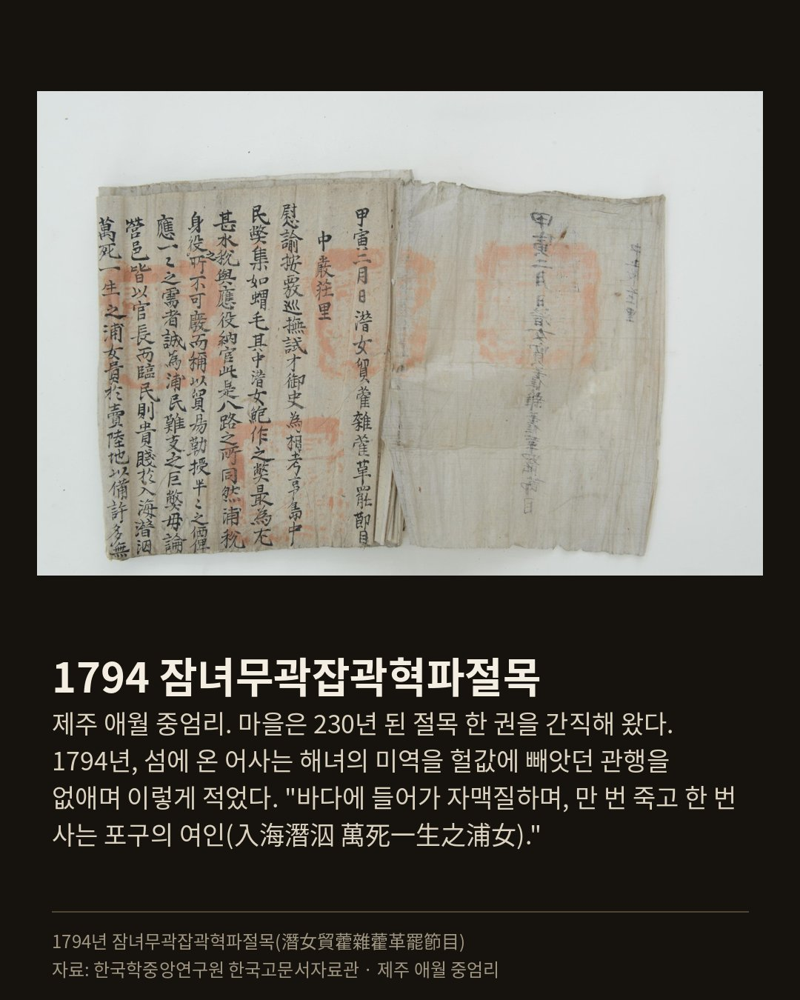
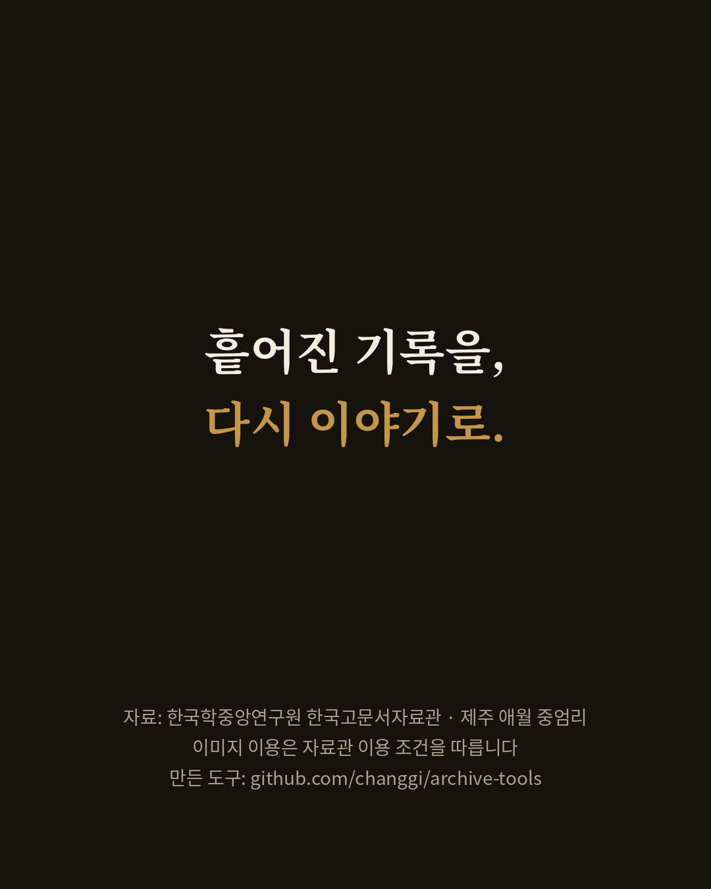

# EP.35 "만 번 죽고 한 번 사는 바다의 여인" — 제주 중엄리가 간직한 절목

제주 애월 중엄리 (마을) · 해녀의 미역을 헐값에 빼앗던 폐단을 없앤 1794년 절목, 명절 제사상 전복을 둘러싼 1844년 절목, 그리고 신당의 나무가 베어진 1901년 — 마을이 함께 간직해 온 문서

- 🌐 [전시 웹페이지](https://changgi.github.io/archive-tools/examples/jungeom/exhibit.html) (한자 위 한글 독음 · 원문 해석) · [수업 활동지](https://changgi.github.io/archive-tools/examples/jungeom/handout.html)
- 🎬 영상: [릴스 9:16](https://changgi.github.io/archive-tools/examples/media/ep35-jungeom_reel.mp4) · [가로 16:9](https://changgi.github.io/archive-tools/examples/media/ep35-jungeom_wide.mp4) · 홍보 글: [`promo.md`](promo.md)
- 카드뉴스: [`cards/`](cards/) · SNS 글: [`sns.txt`](sns.txt) · 판독·해석 표: [`selection.csv`](selection.csv)


<!-- CURATOR -->
## 비하인드 — 큐레이터 노트

- **왜 이 문서들인가** — 1794년 어사가 제주 해녀를 '만 번 죽고 한 번 사는 포구의 여인'이라 부르며 수탈을 없앤 절목이 마을에 남아 있었습니다.
- **전하고 싶은 것** — 기록은 가장 힘든 노동을 한 사람들을 보호하는 도구가 되기도 했다는 것.
- **이렇게 보이길 바랐다** — 해녀를 묘사한 원문 한 줄을 표지에 세우고, 이어지는 개혁 절목으로 따라갔습니다.
- **이렇게 써 주세요** — 제주 해녀 문화(인류무형유산), 노동과 인권 수업에 쓰세요.
- **남겨 둔 질문** — 230년 전 해녀들은 이 절목을 어떻게 받아들였을까요?
- **제작 기록** — 문서 3건 · 1794–1901년 · 원본 사진 14면(문서 전체) · 원문 판독 3건 · 번역 3건 · 못 읽은 글자 □ 2 · 불확실 (?) 10 · 해제에 "확인 필요"를 단 문서 2건

전문: [`curator.md`](curator.md)
<!-- /CURATOR -->

## 이야기 — 사료가 말하는 대로

230년 전 어사는 제주 해녀를 이렇게 불렀습니다. '만 번 죽고 한 번 사는 여인'.

> **1794 잠녀무곽잡곽혁파절목** — 제주 애월 중엄리. 마을은 230년 된 절목 한 권을 간직해 왔다. 1794년, 섬에 온 어사는 해녀의 미역을 헐값에 빼앗던 관행을 없애며 이렇게 적었다. "바다에 들어가 자맥질하며, 만 번 죽고 한 번 사는 포구의 여인(入海潛泅 萬死一生之浦女)."
> **1844 영목제복포무혁파절목** — 50년 뒤 1844년, 또 하나의 절목이 마을에 내려온다. 이번에는 명절 제사상에 올릴 전복이었다. "오직 제사용 전복만은 미처 돌보지 못하였다(惟於祭物鰒 未暇恤焉)." 값을 쳐준다는 이름 아래, 바다의 부담은 계속되고 있었다.
> **1901 신당구기가거문** — 그리고 1901년 5월. 이번 문서는 나라가 아니라 마을이 스스로 썼다. "아아, 저 교도들이 신당의 숲 나무를 베고 불태웠다(彼敎輩 神塘叢木 斫伐燒火)." 마을은 공론으로 신당을 되살리고, 그 약속을 종이에 남겼다. 같은 달, 제주에서는 민란이 일어났다.

| 표지 | 1번 카드 | 마무리 |
|---|---|---|
|  |  |  |

## 선별 문서 (3점)

| # | 연도 | 유형 | 문서명 | 원본 |
|---|---|---|---|---|
| 1 | 1794 | 잠녀무곽잡곽혁파절목 | 1794년 잠녀무곽잡곽혁파절목(潛女貿藿雜藿革罷節目) | [원본 보기](https://archive.aks.ac.kr/viewer/viewer.do#imgnode.do?itemId=book&gubun=booktree&depth=6&upPath=07%5E0747%5EL074703%5EL074703F02%5EL074703F0203&dataId=G002%2BAKS%2BKSM-XC.1794.5011-20201218.D108_00027&itemType=) |
| 2 | 1844 | 영목제복포무혁파절목 | 1844년 영목제복포무혁파절목(營牧祭鰒浦貿革罷節目) | [원본 보기](https://archive.aks.ac.kr/viewer/viewer.do#imgnode.do?itemId=book&gubun=booktree&depth=6&upPath=07%5E0747%5EL074703%5EL074703F02%5EL074703F0203&dataId=G002%2BAKS%2BKSM-XC.1844.5011-20201218.D108_00034&itemType=) |
| 3 | 1901 | 신당구기가거문 | 1901년 중엄동중(中嚴洞中) 신당구기가거문(神塘舊基可據文) | [원본 보기](https://archive.aks.ac.kr/viewer/viewer.do#imgnode.do?itemId=book&gubun=booktree&depth=6&upPath=07%5E0747%5EL074703%5EL074703F02%5EL074703F0204&dataId=G002%2BAKS%2BKSM-XD.1901.5011-20201218.D108_00075&itemType=) |

## 원문 판독과 해석

### 1. 1794년 잠녀무곽잡곽혁파절목(潛女貿藿雜藿革罷節目)

**원문 판독**

```
(표지) 甲寅二月 日 潛女貿藿雜藿革罷節目 / 中嚴住里
(본문)
甲寅二月 日 潛女貿藿雜藿革罷節目
中嚴住里
慰諭按覈巡撫試才御史爲相考事 島中
民弊集如蝟毛 其中潛女□(?)作之弊 最爲尤
甚 水稅與應役納官 此是八路之所同然 浦稅
身役之所不可廢 而稱以貿易 勒授半半之價 俾
應一一之需者 誠爲浦民難支之巨弊 毋論
營邑 皆以官長而臨民 則貴賤於入海潛泅(?)
萬死一生之浦女 貴於賣陸地以備許多無(…)
(이하 다음 면 — 이미지 미수집)
```

**원문 해석** 갑인년(1794) 2월 일. 잠녀(해녀)의 미역 강제 매입과 잡미역 [징수]를 혁파하는 절목. 중엄리에 둠.
위유·안핵·순무·시재 어사가 살펴 정하는 일. 섬 안 백성의 폐단이 고슴도치 털처럼 모였는데, 그 가운데 잠녀에게 지우는 폐단이 가장 심하다. 바다에 대한 세금과 역을 지고 관에 바치는 것은 팔도가 다 같으니, 포구의 세금과 신역은 없앨 수 없다. 그러나 '무역(사들인다)'이라 일컬으며 값의 절반만 억지로 쥐여 주고 하나하나 쓸 것을 다 대게 하는 것은 참으로 포구 백성이 견디기 어려운 큰 폐단이다. 감영이든 고을이든 모두 관장으로서 백성을 대하니, 바다에 들어가 자맥질하며 만 번 죽고 한 번 사는 포구의 여인에게 … 뭍에서 팔아 수많은 [것을] 마련하게 하는 것보다 … (이하 다음 면)

**해제** 1794년(정조 18, 甲寅) 2월, 제주에 파견된 위유·안핵·순무·시재 어사(慰諭按覈巡撫試才御史, 이때 제주에 온 어사는 심낙수로 알려져 있음 — 확인 필요)가 잠녀(潛女, 해녀)에게서 미역을 헐값에 강제로 사들이던 '무곽(貿藿)'과 잡다한 미역 징수를 없애도록 정한 절목입니다. 중엄리에 내려 보관하게 한 것입니다. 해녀를 '만 번 죽고 한 번 사는(萬死一生) 포구의 여인'이라고 적었습니다. 마을에서 촬영한 이미지로 2면까지 받아 뒷부분은 원문 확인이 필요합니다.

### 2. 1844년 영목제복포무혁파절목(營牧祭鰒浦貿革罷節目)

**원문 판독**

```
(표지) 甲辰四月 日 中嚴住里上 / 營牧祭鰒浦貿革罷節目
(본문)
營牧祭鰒浦貿革罷節目
本島處在窮(?)海之外 邑弊民瘼不一其端
而年前(?)前後 繡衣及營門 另加軫念 昔之營
役稱者 或創立(?)添設 或從貿(?)之永罷 俾
盡(?)民恃保之方 而惟於祭物鰒 未暇恤焉耳
夫祭物鰒 營牧四名日所需也 州之左右面
各浦口 鰒捭(?) □捭等處 每名日 自左庫出
給七兩 小米 責出七貼 大鰒四貼屬之營
門 三貼屬之牧官 雖云貿用 而許以時價(…)
(이하 다음 면 — 이미지 미수집, 판독 불확실 다수)
```

**원문 해석** 감영과 목의 제사용 전복을 포구에서 사들이는 일을 혁파하는 절목.
이 섬은 먼 바다 밖에 있어 고을의 폐단과 백성의 고통이 한두 가지가 아니다. 앞뒤로 어사와 감영이 특별히 마음을 써서, 예전에 감영의 역이라 하던 것을 혹은 새로 정하고 혹은 사들이는 것을 영영 없애 백성이 기대어 살 방도를 마련해 주었으나, 오직 제사용 전복만은 미처 돌보지 못하였다. 무릇 제사용 전복은 감영과 목에서 네 명절에 쓰는 것이다. 주(州)의 좌·우면 각 포구에서 … 명절마다 좌고(左庫)에서 7냥을 내어 주고 작은 [전복] … 7첩을 책임 지워 내게 하여, 큰 전복 4첩은 감영에, 3첩은 목관에 속하게 하니, 비록 사들여 쓴다고는 하나 시가로 [쳐준다고] … (이하 판독 필요)

**해제** 1844년(헌종 10, 甲辰) 4월, 제주 감영과 제주목이 네 명절 제사에 쓰는 전복을 포구에서 '사들인다'는 명목으로 거두던 일을 혁파한 절목으로, 중엄리에 내린 것입니다. 50년 전 미역 절목처럼, 값을 치른다는 형식 아래 실제로는 해녀와 포구 백성에게 부담을 지운 관행을 다루고 있습니다. 흘림이 섞인 행서에 마을에서 촬영한 이미지라 판독 불확실한 글자가 많습니다.

### 3. 1901년 중엄동중(中嚴洞中) 신당구기가거문(神塘舊基可據文)

**원문 판독**

```
光武五年辛丑五月 日 本里神塘舊基可據文
右可據文事 噫 彼敎輩 神塘叢木 斫伐燒火 故
諸鄕一致公議 更爲新定復古是乎所 新塘以下
便爲基(?)石(?) 況鄕任及諸色卒中 若有起鬧之弊
則依此可據 出洞之意 如是施行事
洞中(수결)
```

**원문 해석** 광무 5년(1901) 신축 5월 일. 우리 마을 신당 옛터에 대해 증거로 삼을 문서.
이 증거 문서를 만드는 일. 아아, 저 교도(敎徒)들이 신당의 숲 나무를 베고 불태웠다. 그러므로 마을 사람들이 한결같이 공론하여 다시 새로 정해 옛 모습을 되살리는바, 새 신당 아래는 곧 터로 삼는다. 하물며 향임이나 여러 하인 가운데 만약 소란을 일으키는 폐단이 있으면, 이 문서에 따라 마을에서 내쫓는다는 뜻으로 이와 같이 시행할 일. 마을(洞中) 수결.

**해제** 1901년(광무 5) 5월, 중엄리 마을 사람들이 신당(神堂, 제주에서 마을 수호신을 모시는 당) 옛터를 증명하려고 함께 작성한 문서입니다. '저 교도들이 신당의 숲 나무를 베고 불태웠다(彼敎輩 神塘叢木 斫伐燒火)'는 구절이 있는데, 같은 달 제주에서는 천주교 세력과 세금 문제를 둘러싼 갈등이 커져 신축민란(이재수의 난)이 일어났습니다. 이 문서의 '교도'가 누구인지는 문서만으로 단정할 수 없어 확인이 필요합니다. 흘림이 있어 몇 글자는 불확실합니다.

판독·해석·이야기는 이미지에 근거한 초안이며(검토 전 "초안" 표시), 정확한 판독은 원문 확인이 필요합니다. □는 읽지 못한 글자, (?)는 불확실한 글자입니다.
이미지: 한국학중앙연구원 한국고문서자료관 소장·제공. "원본" 링크를 누르면 자료관 뷰어에서 그 문서가 열립니다. 재사용은 자료관에 문의하세요(소장처 동의 필요).
