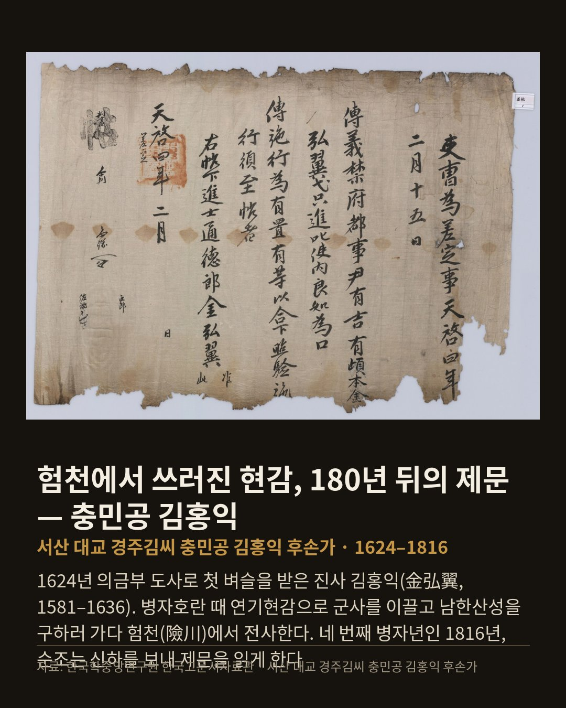
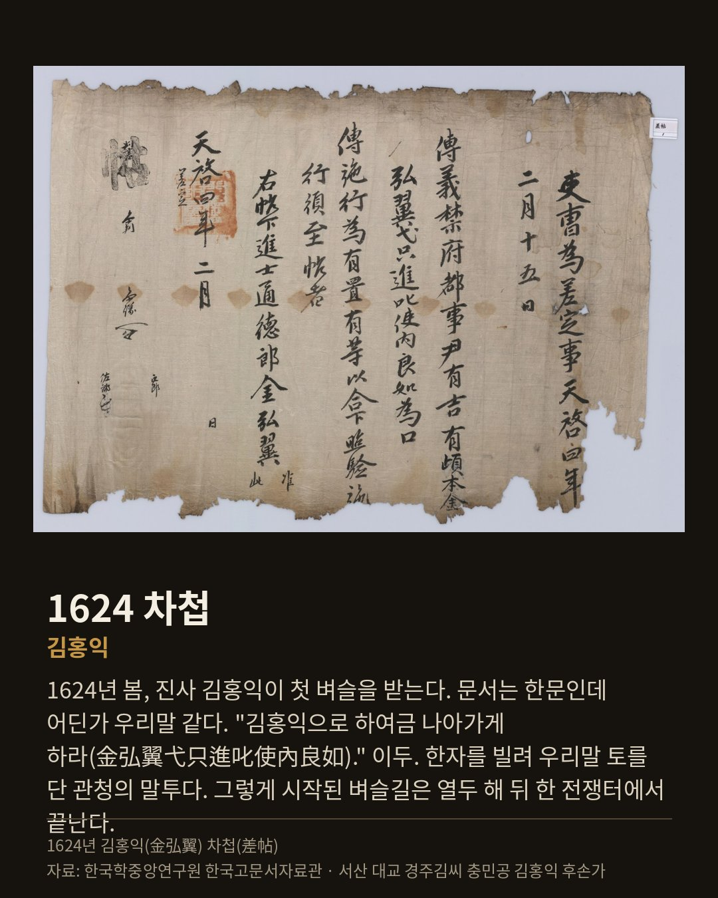
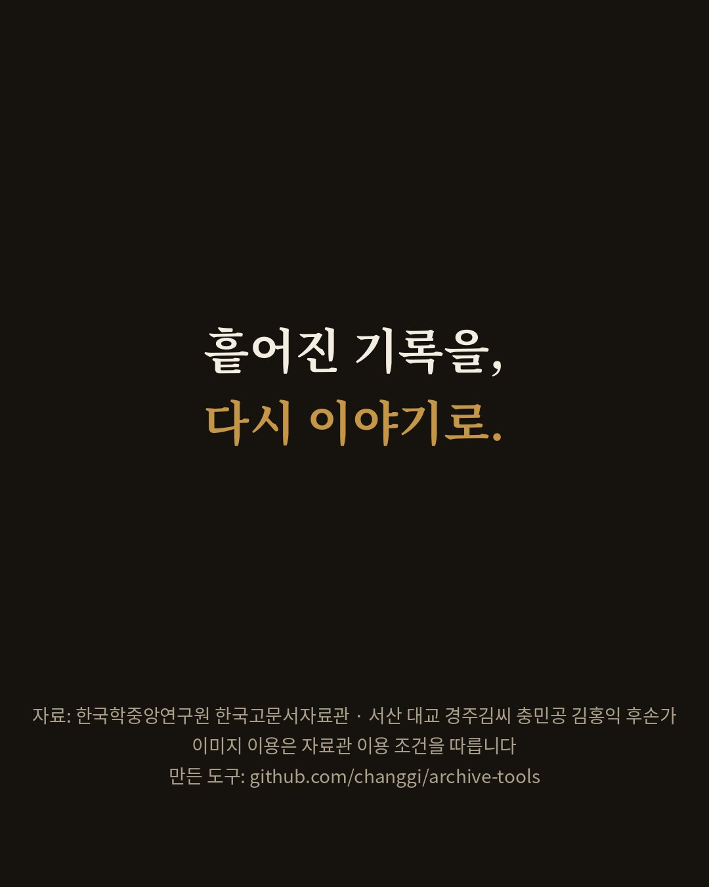

# EP.83 험천에서 쓰러진 현감, 180년 뒤의 제문 — 충민공 김홍익

서산 대교 경주김씨 충민공 김홍익 후손가 (문중) · 1624년 의금부 도사로 첫 벼슬을 받은 진사 김홍익(金弘翼, 1581–1636). 병자호란 때 연기현감으로 군사를 이끌고 남한산성을 구하러 가다 험천(險川)에서 전사한다. 네 번째 병자년인 1816년, 순조는 신하를 보내 제문을 읽게 한다

- 🌐 [전시 웹페이지](https://changgi.github.io/archive-tools/examples/kimhongik/exhibit.html) (한자 위 한글 독음 · 원문 해석) · [수업 활동지](https://changgi.github.io/archive-tools/examples/kimhongik/handout.html)
- 🎬 영상: [릴스 9:16](https://changgi.github.io/archive-tools/examples/media/ep83-kimhongik_reel.mp4) · [가로 16:9](https://changgi.github.io/archive-tools/examples/media/ep83-kimhongik_wide.mp4) · 홍보 글: [`promo.md`](promo.md)
- 카드뉴스: [`cards/`](cards/) · SNS 글: [`sns.txt`](sns.txt) · 판독·해석 표: [`selection.csv`](selection.csv)

## 이야기 — 사료가 말하는 대로

전사한 지 180년 뒤, 왕이 그에게 제문을 보냈습니다.

> **1624 차첩** — 1624년 봄, 진사 김홍익이 첫 벼슬을 받는다. 문서는 한문인데 어딘가 우리말 같다. "김홍익으로 하여금 나아가게 하라(金弘翼弋只進叱使內良如)." 이두. 한자를 빌려 우리말 토를 단 관청의 말투다. 그렇게 시작된 벼슬길은 열두 해 뒤 한 전쟁터에서 끝난다.
> **1816 치제문** — 1636년 겨울, 왕이 남한산성에 갇혔다. 김홍익은 군사를 이끌고 북으로 달렸고, 험천에서 쓰러졌다. 180년 뒤, 네 번째 병자년에 왕의 제문이 집안에 내려온다. "굽이진 험천에서 앞선 무리가 무너지자, 칼을 짚고 급히 쫓았다(一曲險川 前徒披靡 … 杖劍疾追)." 그리고 이렇게 끝난다. "옛 갑년이 네 번 돌아오니, 슬픈 마음이 더욱 크다(舊甲回四 益增愴懷)."

| 표지 | 1번 카드 | 마무리 |
|---|---|---|
|  |  |  |

## 선별 문서 (2점)

| # | 연도 | 유형 | 문서명 | 원본 |
|---|---|---|---|---|
| 1 | 1624 | 차첩 | 1624년 김홍익(金弘翼) 차첩(差帖) | [원본 보기](https://archive.aks.ac.kr/viewer/viewer.do#imgnode.do?itemId=book&gubun=booktree&depth=6&upPath=01%5E0144%5EL014429%5EL014429F02%5EL014429F0201&dataId=G002%2BAKS%2BKSM-XA.1624.1111-20101008.B060a_086_00001_XXX&itemType=) |
| 2 | 1816 | 치제문 | 1816년 김홍익(金弘翼) 치제문(致祭文) | [원본 보기](https://archive.aks.ac.kr/viewer/viewer.do#imgnode.do?itemId=book&gubun=booktree&depth=6&upPath=01%5E0144%5EL014429%5EL014429F02%5EL014429F0208&dataId=G002%2BAKS%2BKSM-XI.1816.1111-20101008.B060a_086_00047_XXX&itemType=) |

## 원문 판독과 해석

### 1. 1624년 김홍익(金弘翼) 차첩(差帖)

**원문 판독**

```
吏曹爲差定事 天啓四年
二月十五日
傳 義禁府都事尹有吉有頉 代金
弘翼弋只進叱使內良如爲口
傳施行爲有置 有等以 合下照驗施
行 須至帖者
右帖下 進士通德郞金弘翼
准此
天啓四年二月　日
(이조 인)
帖
判　參議 [수결]
正郞　佐郞 [수결]
```

**원문 해석** 이조에서 차정(差定)하는 일. 천계 4년(1624) 2월 15일 전교에, 의금부 도사 윤유길에게 탈(사고)이 있으니 대신 김홍익으로 하여금 나아가게 하라고 구전으로 시행하였으므로, 이에 아래로 내려 보내니 살펴 시행하라. 이 첩을 진사 통덕랑 김홍익에게 내리니 이대로 하라. 천계 4년 2월 일. 첩. 판서·참의·정랑·좌랑.

**해제** 이조가 진사 김홍익을 의금부 도사(종5품)로 차정한 차첩(差帖)입니다. 본문에 '弋只(-으로)', '進叱使內良如(나아가게 하라)', '爲有置(하였으므로)', '有等以(-이므로)' 같은 이두(吏讀)가 섞여 있어, 행정 문서에서 우리말 어순과 토를 한자로 적던 방식을 잘 보여 줍니다. 전임자 윤유길에게 '탈(頉)'이 생겨 그 자리를 대신하게 된 사정이 적혀 있습니다. 위·아래 가장자리가 손상되었으나 본문은 대부분 남아 있습니다. '代' 자는 손상 부분이라 문맥으로 읽었습니다.

### 2. 1816년 김홍익(金弘翼) 치제문(致祭文)

**원문 판독**

```
維崇禎百八十九年歲次丙子十月十二日
國王
遣臣洪陽縣監韓永逵
諭祭于
故忠愍公金弘翼之靈 粤昔丙年 邦國震蕩 兵燹火
烈 節義林立 歷數而想 危忠惟卿 守土之職 勤王之誠 列郡
駭竄 奮然執鞭 急君忘私 書訣萱堂 孤城暈月 慷慨
揮涕 賊霧忽蔽 腔血如沸 一曲險川 前徒披靡 斷袂
使身 杖劍疾追 猛氣獵獵 河北一義 孤憤益激 鋒鏑
不避 援絶蚍蜉 志決熊魚 忠魂毅魄 千古留名 嗟卿
樹立 如彼家聲 名祖遺範 有弟文貞 盡忠成仁 萃于一
室 官僮感義 其婦亦烈 政敎所化 一時三節 爵諡屢
加
列朝崇褒 舊甲回四 益增愴懷 睠彼漢南 英靈不昧 俾
官致侑 庶歆酒酹
```

**원문 해석** 숭정 189년 병자년(1816) 10월 12일, 국왕은 신하 홍양현감 한영규를 보내 고 충민공 김홍익의 영전에 제사하노라. 지난 병자년, 나라가 뒤흔들리고 전쟁의 불길이 타올랐을 때 절의의 선비들이 숲처럼 일어섰으니, 하나하나 헤아려 보면 위태로운 충성은 오직 경이었다. 땅을 지키는 직분에 임금을 구하려는 정성으로, 여러 고을이 놀라 달아날 때 떨쳐 일어나 채찍을 잡았다. 임금이 급하여 사사로움을 잊고 어머니께 글로 하직하였으며, 외로운 성(남한산성)에 달무리 질 때 비분강개하여 눈물을 뿌렸다. 적의 안개가 문득 덮치니 가슴의 피가 끓는 듯하였다. 굽이진 험천에서 앞선 무리가 무너지자, 소매를 끊고 몸을 던져 칼을 짚고 급히 쫓으니 사나운 기운이 펄럭였다. … 화살과 칼날을 피하지 않았고, 구원이 끊겨 개미 같은 군사였으나 뜻은 곰 발바닥과 생선 사이에서 [의를] 택하는 데 결연하였다. 충성스러운 혼과 굳센 넋은 천고에 이름을 남겼다. 아, 경이 세운 바는 그 가문의 명성과 같으니, 이름난 조상이 남긴 법도가 있고 아우 문정(김홍욱)이 있었다. 충을 다해 인을 이룬 것이 한 집안에 모였고, 관아의 아이종도 의리에 감동하였으며 그 아내 또한 열녀였으니, 교화가 미친 바 한때에 세 절개가 났다. 벼슬과 시호를 여러 번 더하고 역대 임금이 높이 기렸다. 옛 갑년이 네 번 돌아오니 슬픈 마음이 더욱 크다. 저 한수 남쪽을 돌아보니 영령은 어둡지 않으리라. 관원을 시켜 제물을 올리게 하니 부디 이 술을 흠향하라.

**해제** 1816년(순조 16), 병자호란 때 순절한 김홍익에게 왕이 지방관(홍양현감 한영규)을 보내 제사를 지내게 하며 내린 치제문(致祭文)입니다. 김홍익은 연기현감으로 근왕병을 이끌고 남한산성으로 가다 험천(지금의 성남 일대)에서 청군과 싸우다 전사했고, 시호는 충민(忠愍)입니다. '舊甲回四'는 1636년 이후 병자년이 네 번째 돌아왔다는 뜻이며, '有弟文貞'은 시호가 문정인 아우 학주 김홍욱을 가리킵니다. '一時三節'은 김홍익과 그를 따른 관노(官僮), 그리고 그의 부인을 함께 기린 표현으로 보입니다. 연호는 청이 아닌 명의 '崇禎'을 이어 써서 존명 의식을 드러냅니다. 일부 글자는 판독이 불확실합니다.

판독·해석·이야기는 이미지에 근거한 초안이며(검토 전 "초안" 표시), 정확한 판독은 원문 확인이 필요합니다. □는 읽지 못한 글자, (?)는 불확실한 글자입니다.
이미지: 한국학중앙연구원 한국고문서자료관 소장·제공. "원본" 링크를 누르면 자료관 뷰어에서 그 문서가 열립니다. 재사용은 자료관에 문의하세요(소장처 동의 필요).
