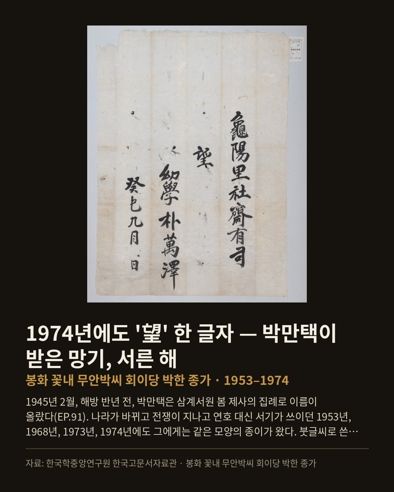
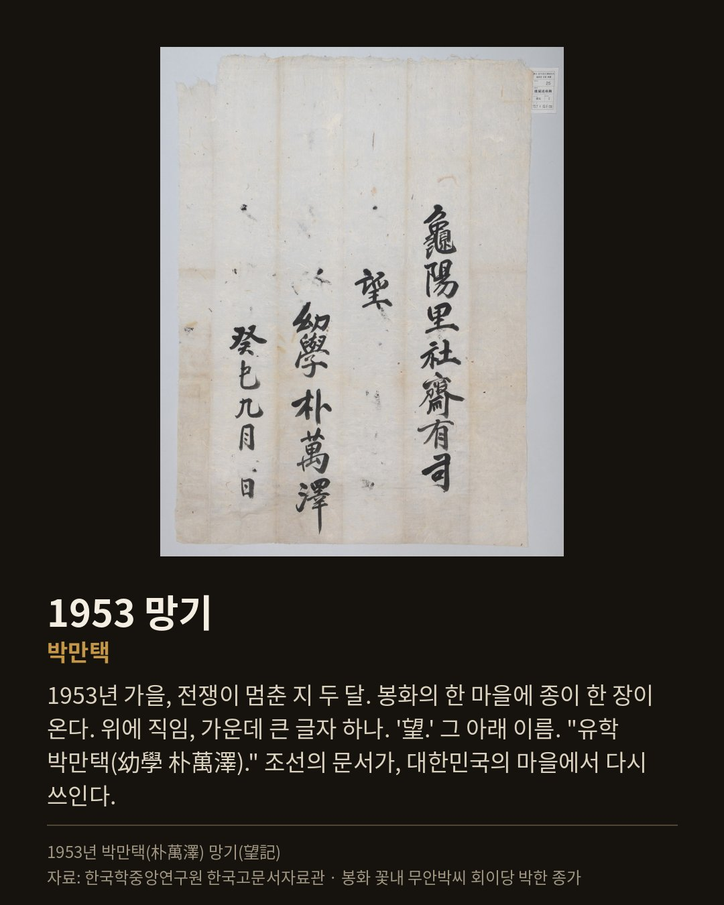
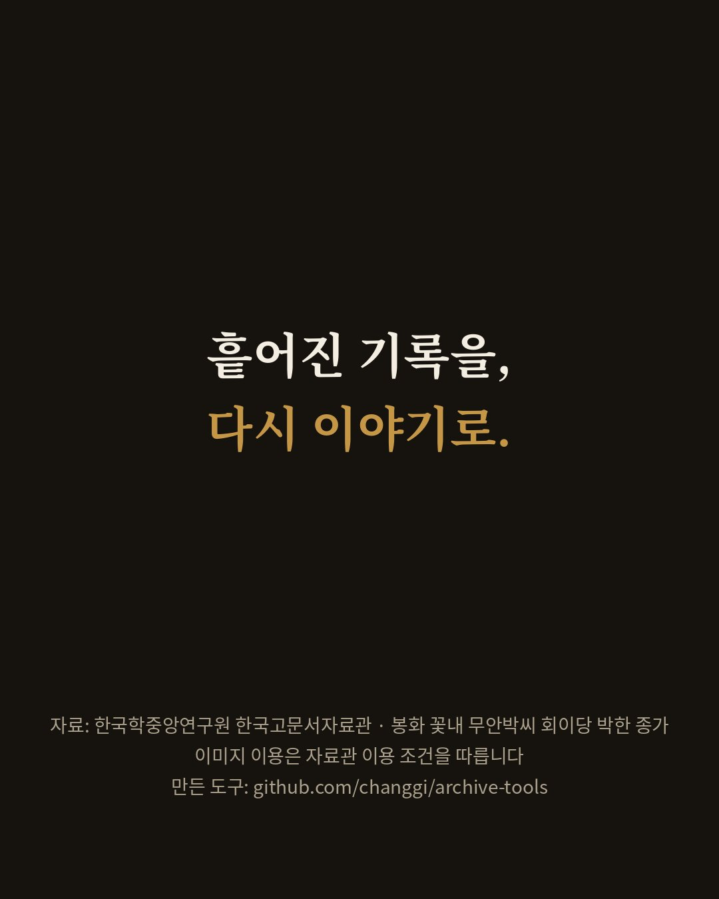

# EP.167 1974년에도 '望' 한 글자 — 박만택이 받은 망기, 서른 해

봉화 꽃내 무안박씨 회이당 박한 종가 (문중) · 1945년 2월, 해방 반년 전, 박만택은 삼계서원 봄 제사의 집례로 이름이 올랐다(EP.91). 나라가 바뀌고 전쟁이 지나고 연호 대신 서기가 쓰이던 1953년, 1968년, 1973년, 1974년에도 그에게는 같은 모양의 종이가 왔다. 붓글씨로 쓴 '望' 한 글자와 '幼學 朴萬澤', 그리고 간지. 조선의 문서 형식은 대한민국의 시골 서원에서 그렇게 이어졌다

- 🌐 [전시 웹페이지](https://changgi.github.io/archive-tools/examples/kkotnae-manggi/exhibit.html) (한자 위 한글 독음 · 원문 해석) · [수업 활동지](https://changgi.github.io/archive-tools/examples/kkotnae-manggi/handout.html)
- 🎬 영상: [릴스 9:16](https://changgi.github.io/archive-tools-next/media/ep167-kkotnae-manggi_reel.mp4) · [가로 16:9](https://changgi.github.io/archive-tools-next/media/ep167-kkotnae-manggi_wide.mp4) · 홍보 글: [`promo.md`](promo.md)
- 카드뉴스: [`cards/`](cards/) · SNS 글: [`sns.txt`](sns.txt) · 판독·해석 표: [`selection.csv`](selection.csv)

<!-- DELIVERY -->
## 전달 에디팅 — 이 기록을 이렇게 전합니다

- **핵심 정서** — 잔잔함
- **한 문장** — 조선의 인사 문서였던 망기가 1950–70년대 대한민국에서도 서원 · 향교 · 유계(儒稧)의 직임을 정하는 데 그대로 쓰였다 — 연호만 사라지고 간지와 '幼學'은 남았다.
- **열기** — 1974년, 서울에 지하철이 달리던 해에도 이 사람은 붓글씨 '望'을 받았습니다.
- **펼치기** — 박만택 망기 (1953–1974년) — 1953 마을 사재(社齋) 유사 → 1968 순흥 문묘 석채 헌관 → 1973 삼계서원 봄 제사 헌관(1945년 집례였던 곳) → 1974 구만서원 가을 제사 헌관으로, 마을 일에서 서원 제사의 첫 잔을 올리는 자리까지 오르는 흐름으로 놓았습니다.
- **절정** — "유학 박만택(幼學 朴萬澤)" — 화면·공간에서 이 한 줄만 크게, 소리를 줄여 집중
- **여운** — 평생 '유학'으로 불린 사람에게, 이 종이들은 어떤 이름표였을까요? — 질문으로 끝내고 답은 보는 사람에게
- **감각과 물질** — 같은 크기, 같은 '望', 같은 '幼學 朴萬澤' — 위쪽 기관 이름과 맨 아래 간지만 바뀐다
- **통로와 매개** — 온라인: 릴스(열기) → 카드뉴스(펼치기) → 전시 웹페이지(절정·원문) → 비하인드 카드(여운) / 오프라인: 원본 크기 복제·낭독·참여 벽 / 남기기: 활동지·질문 카드
- **여운 장치** — 집안 어른이 맡았던 '동네 역할'(계장 · 이장 · 제관 등) 물어보기
- **전달 에디팅 전** — 4건의 문서를 1953–1974년 연대순으로 놓고 문서명 · 유형 · 해설을 붙인다 — 정확하지만, 지나가면 잊힌다.
- **전달 에디팅 후** — 핵심 정서는 「잔잔함」. 「1974년, 서울에 지하철이 달리던 해에도 이 사람은 붓글씨 '望'을 받았습니다.」로 열고, 문서를 대비와 순서로 펼친 뒤, "유학 박만택(幼學 朴萬澤)"에서 멈춘다. 같은 크기, 같은 '望', 같은 '幼學 朴萬澤' — 위쪽 기관 이름과 맨 아래 간지만 바뀐다. 마지막엔 「집안 어른이 맡았던 '동네 역할'(계장 · 이장 · 제관 등) 물어보기」로 보는 사람이 자기 이야기를 남기고 떠나게 한다.

전문: [`delivery.md`](delivery.md)
<!-- /DELIVERY -->

<!-- CURATOR -->
## 비하인드 — 큐레이터 노트

- **왜 이 문서들인가** — EP.91에서 1945년 2월 박만택의 삼계서원 집례 망기 한 장을 읽었습니다. 같은 집안에 그 뒤로 1974년까지 망기가 여섯 장 더 남아 있어, 해방 뒤에도 이어진 형식을 따라가 보았습니다.
- **전하고 싶은 것** — 조선의 인사 문서였던 망기가 1950–70년대 대한민국에서도 서원 · 향교 · 유계(儒稧)의 직임을 정하는 데 그대로 쓰였다 — 연호만 사라지고 간지와 '幼學'은 남았다.
- **이렇게 보이길 바랐다** — 1953 마을 사재(社齋) 유사 → 1968 순흥 문묘 석채 헌관 → 1973 삼계서원 봄 제사 헌관(1945년 집례였던 곳) → 1974 구만서원 가을 제사 헌관으로, 마을 일에서 서원 제사의 첫 잔을 올리는 자리까지 오르는 흐름으로 놓았습니다.
- **이렇게 써 주세요** — 망기의 형식과 지속, 해방 뒤 유림 조직(서원 · 향교 · 유계)의 의례, 전통 문서 양식의 현대적 사용, 지역 공동체의 연장자 예우 수업에 쓰세요.
- **만들며 있었던 일** — 네 장 모두 큰 해서라 또렷합니다. 연도는 간지(계사 · 무신 · 계축 · 갑인)와 자료관 목록 연도를 맞추었고, 60년 앞(1893 등)일 가능성은 1945년 망기(EP.91)와 같은 인물이라는 점에서 배제했습니다. 망기를 낸 기관(서원 · 향교)의 도장 글자는 판독하지 않았습니다. 박만택의 생몰은 확인하지 않았습니다.
- **남겨 둔 질문** — 평생 '유학'으로 불린 사람에게, 이 종이들은 어떤 이름표였을까요?
- **제작 기록** — 문서 4건 · 1953–1974년 · 원본 사진 4면(문서 전체) · 원문 판독 4건 · 번역 4건

전문: [`curator.md`](curator.md) · 비하인드 카드: [`behind/`](behind/) · 채널별 홍보안: [`channels.md`](channels.md)
<!-- /CURATOR -->

## 이야기 — 사료가 말하는 대로

1974년, 서울에 지하철이 달리던 해에도 이 사람은 붓글씨 '望'을 받았습니다.

> **1953 망기** — 1953년 가을, 전쟁이 멈춘 지 두 달. 봉화의 한 마을에 종이 한 장이 온다. 위에 직임, 가운데 큰 글자 하나. '望.' 그 아래 이름. "유학 박만택(幼學 朴萬澤)." 조선의 문서가, 대한민국의 마을에서 다시 쓰인다.
> **1968 망기** — 15년 뒤, 1968년 봄. 이번에는 고을의 향교다. "순흥 문묘 석채 때의 헌관(順興文廟釋菜時獻官)." 공자에게 잔을 올리는 자리. 종이 아래에 붉은 도장이 찍힌다.
> **1973 망기** — 다시 5년 뒤, 1973년 봄. 이름이 익숙한 곳이다. "삼계서원 봄 제향 때의 헌관(三溪書院春享時獻官)." 28년 전, 해방 반년 전 바로 이 제사에서 그는 순서를 부르는 집례였다. 이제 그가 잔을 든다.
> **1974 망기** — 그리고 1974년 가을, 마지막 종이. "구만서원 가을 제향 헌관(龜灣書院秋享獻官)." 그해 서울에서는 지하철이 달리기 시작했다. 봉화의 한 선비에게는 여전히 붓으로 쓴 '望'이 왔다. 서른 해 동안 그의 이름 앞에는 늘 같은 두 글자가 있었다. 유학.

| 표지 | 1번 카드 | 마무리 |
|---|---|---|
|  |  |  |

## 선별 문서 (4점)

| # | 연도 | 유형 | 문서명 | 원본 |
|---|---|---|---|---|
| 1 | 1953 | 망기 | 1953년 박만택(朴萬澤) 망기(望記) | [원본 보기](https://archive.aks.ac.kr/viewer/viewer.do#imgnode.do?itemId=book&gubun=booktree&depth=6&upPath=01%5E0167%5EL016744%5EL016744F02%5EL016744F0203&dataId=G002%2BKHD%2BKSM-XC.1953.0000-20161223.C0806_002_00025_XXX&itemType=) |
| 2 | 1968 | 망기 | 1968년 박만택(朴萬澤) 망기(望記) | [원본 보기](https://archive.aks.ac.kr/viewer/viewer.do#imgnode.do?itemId=book&gubun=booktree&depth=6&upPath=01%5E0167%5EL016744%5EL016744F02%5EL016744F0203&dataId=G002%2BKHD%2BKSM-XC.1968.0000-20161223.C0806_002_00031_XXX&itemType=) |
| 3 | 1973 | 망기 | 1973년 박만택(朴萬澤) 망기(望記) | [원본 보기](https://archive.aks.ac.kr/viewer/viewer.do#imgnode.do?itemId=book&gubun=booktree&depth=6&upPath=01%5E0167%5EL016744%5EL016744F02%5EL016744F0203&dataId=G002%2BKHD%2BKSM-XC.1973.0000-20161223.C0806_002_00036_XXX&itemType=) |
| 4 | 1974 | 망기 | 1974년 박만택(朴萬澤) 망기(望記) | [원본 보기](https://archive.aks.ac.kr/viewer/viewer.do#imgnode.do?itemId=book&gubun=booktree&depth=6&upPath=01%5E0167%5EL016744%5EL016744F02%5EL016744F0203&dataId=G002%2BKHD%2BKSM-XC.1974.0000-20161223.C0806_002_00038_XXX&itemType=) |

## 원문 판독과 해석

### 1. 1953년 박만택(朴萬澤) 망기(望記)

**원문 판독**

```
龜陽里社齋有司
望
幼學 朴萬澤
癸巳九月 日
```

**원문 해석** 구양리 사재 유사. 후보로 올림(望): 유학 박만택. 계사년(1953) 9월 일.

**해제** 계사년(1953) 9월, 한국전쟁 정전 두 달 뒤에 박만택을 구양리 사재(社齋)의 유사(有司)로 올린 망기입니다. 사재는 마을 단위의 제사 · 강학 공간으로 보이며, 유사는 그 살림과 일을 맡는 직임입니다. 후보가 한 사람뿐인 단망(單望) 형식으로, 사실상 그를 정해 알리는 문서입니다. 조선의 망기와 형식이 같고, 연호 대신 간지만 썼습니다. 1945년 삼계서원 집례 망기(EP.91) 뒤로 처음 남은 장입니다.

### 2. 1968년 박만택(朴萬澤) 망기(望記)

**원문 판독**

```
順興文廟釋菜時獻官
望
幼學 朴萬澤
戊申二月 日
(인)
```

**원문 해석** 순흥 문묘 석채 때의 헌관. 후보로 올림: 유학 박만택. 무신년(1968) 2월 일. (도장)

**해제** 무신년(1968) 2월, 순흥 문묘(향교의 공자 사당)에서 봄 석채(釋菜, 공자에게 올리는 제사) 때 술잔을 올릴 헌관(獻官)으로 박만택을 올린 망기입니다. 헌관은 제사에서 잔을 올리는 사람으로, 지역 유림 가운데 덕망 있는 이를 뽑았습니다. 날짜 아래 기관의 붉은 도장이 찍혔습니다. 마을 유사에서 고을 향교 제사의 헌관으로 자리가 넓어졌습니다.

### 3. 1973년 박만택(朴萬澤) 망기(望記)

**원문 판독**

```
三溪書院春享時獻官
望
幼學 朴萬澤
癸丑二月 日
(인)
```

**원문 해석** 삼계서원 봄 제향 때의 헌관. 후보로 올림: 유학 박만택. 계축년(1973) 2월 일. (도장)

**해제** 계축년(1973) 2월, 삼계서원의 봄 제향 헌관으로 박만택을 올린 망기입니다. 28년 전 1945년 2월, 같은 삼계서원 봄 제사에서 그는 '집례(執禮)', 곧 의식의 순서를 부르는 사람이었습니다(EP.91). 이번에는 잔을 올리는 '헌관'입니다. 같은 서원, 같은 계절, 같은 형식의 종이에서 그의 자리만 바뀌었습니다.

### 4. 1974년 박만택(朴萬澤) 망기(望記)

**원문 판독**

```
龜灣書院秋享獻官
望
幼學 朴萬澤
甲寅九月 日
(인)
```

**원문 해석** 구만서원 가을 제향 헌관. 후보로 올림: 유학 박만택. 갑인년(1974) 9월 일. (도장)

**해제** 갑인년(1974) 9월, 구만서원의 가을 제향 헌관으로 박만택을 올린 망기로, 이 집안에 남은 그의 망기 일곱 장 가운데 마지막입니다. 1945년부터 1974년까지 서른 해 동안 그는 줄곧 '幼學', 벼슬하지 않은 선비로 적혔고, 종이의 형식도 바뀌지 않았습니다. 같은 해 서울에서는 지하철 1호선이 개통했습니다. 조선의 인사 문서가 향촌 유림 사회 안에서 20세기 후반까지 살아 있었음을 보여 주는 기록입니다.

판독·해석·이야기는 이미지에 근거한 초안이며(검토 전 "초안" 표시), 정확한 판독은 원문 확인이 필요합니다. □는 읽지 못한 글자, (?)는 불확실한 글자입니다.
이미지: 한국학중앙연구원 한국고문서자료관 소장·제공. "원본" 링크를 누르면 자료관 뷰어에서 그 문서가 열립니다. 재사용은 자료관에 문의하세요(소장처 동의 필요).
