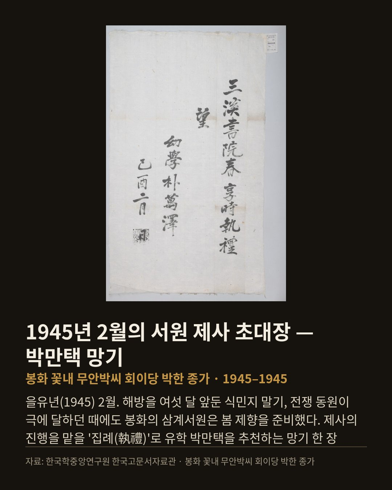
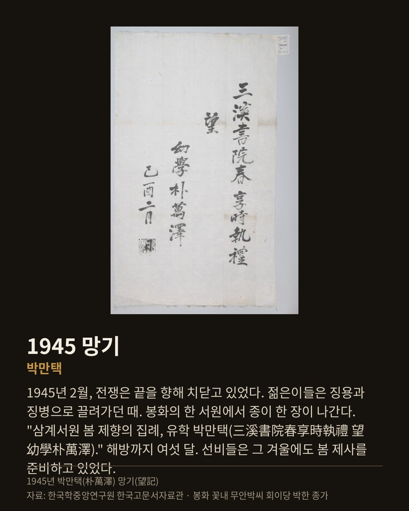
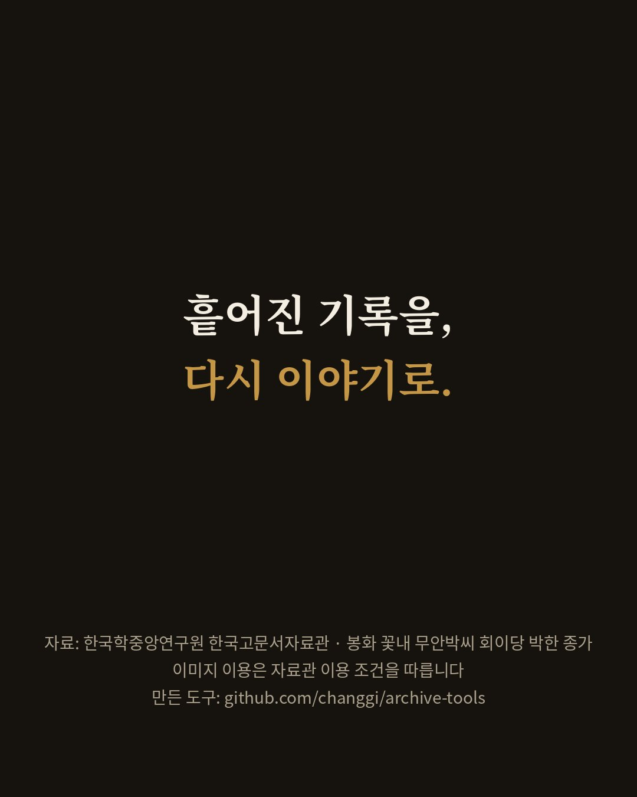

# EP.91 1945년 2월의 서원 제사 초대장 — 박만택 망기

봉화 꽃내 무안박씨 회이당 박한 종가 (문중) · 을유년(1945) 2월. 해방을 여섯 달 앞둔 식민지 말기, 전쟁 동원이 극에 달하던 때에도 봉화의 삼계서원은 봄 제향을 준비했다. 제사의 진행을 맡을 '집례(執禮)'로 유학 박만택을 추천하는 망기 한 장

- 🌐 [전시 웹페이지](https://changgi.github.io/archive-tools/examples/kkotnae/exhibit.html) (한자 위 한글 독음 · 원문 해석) · [수업 활동지](https://changgi.github.io/archive-tools/examples/kkotnae/handout.html)
- 🎬 영상: [릴스 9:16](https://changgi.github.io/archive-tools/examples/media/ep91-kkotnae_reel.mp4) · [가로 16:9](https://changgi.github.io/archive-tools/examples/media/ep91-kkotnae_wide.mp4) · 홍보 글: [`promo.md`](promo.md)
- 카드뉴스: [`cards/`](cards/) · SNS 글: [`sns.txt`](sns.txt) · 판독·해석 표: [`selection.csv`](selection.csv)


<!-- CURATOR -->
## 비하인드 — 큐레이터 노트

- **왜 이 문서들인가** — 해방 여섯 달 전 1945년 2월에도 서원이 봄 제향의 집례를 정해 망기를 보냈습니다.
- **전하고 싶은 것** — 전시 동원의 한가운데서도 이어진 일상의 의례가 있었다는 것.
- **이렇게 보이길 바랐다** — 짧은 망기 한 장에 '1945년 2월'이라는 시간을 겹쳐, 날짜가 이야기를 하게 했습니다.
- **이렇게 써 주세요** — 일제강점기 말기의 향촌 사회, 전통 의례의 지속을 다루는 수업에 쓰세요.
- **만들며 있었던 일** — 을유년을 1945년으로 본 것은 목록 연대에 따른 것입니다.
- **남겨 둔 질문** — 그해 봄 제향은 무사히 치러졌을까요?
- **제작 기록** — 문서 1건 · 1945년 · 원본 사진 1면(문서 전체) · 원문 판독 1건 · 번역 1건

전문: [`curator.md`](curator.md)
<!-- /CURATOR -->

## 이야기 — 사료가 말하는 대로

1945년 2월, 한 서원에서 봄 제사 초대장이 나갔습니다.

> **1945 망기** — 1945년 2월, 전쟁은 끝을 향해 치닫고 있었다. 젊은이들은 징용과 징병으로 끌려가던 때. 봉화의 한 서원에서 종이 한 장이 나간다. "삼계서원 봄 제향의 집례, 유학 박만택(三溪書院春享時執禮 望 幼學朴萬澤)." 해방까지 여섯 달. 선비들은 그 겨울에도 봄 제사를 준비하고 있었다.

| 표지 | 1번 카드 | 마무리 |
|---|---|---|
|  |  |  |

## 선별 문서 (1점)

| # | 연도 | 유형 | 문서명 | 원본 |
|---|---|---|---|---|
| 1 | 1945 | 망기 | 1945년 박만택(朴萬澤) 망기(望記) | [원본 보기](https://archive.aks.ac.kr/viewer/viewer.do#imgnode.do?itemId=book&gubun=booktree&depth=6&upPath=01%5E0167%5EL016744%5EL016744F02%5EL016744F0203&dataId=G002%2BKHD%2BKSM-XC.1945.0000-20161223.C0806_002_00023_XXX&itemType=) |

## 원문 판독과 해석

### 1. 1945년 박만택(朴萬澤) 망기(望記)

**원문 판독**

```
三溪書院春享時執禮
望
幼學朴萬澤
乙酉二月
(삼계서원 인 1과)
```

**원문 해석** 삼계서원 봄 제향 때의 집례. [후보로] 추천함. 유학 박만택. 을유년(1945) 2월. [서원 인]

**해제** 망기(望記)는 서원·향교에서 제향의 헌관·집례 등 소임을 맡을 사람을 정해 알리는 일종의 추천·위촉장입니다. 봉화 삼계서원이 봄 제향(春享)에서 홀기를 읽으며 의식을 진행하는 집례(執禮)로 유학 박만택(朴萬澤)을 정해 보낸 것입니다. 을유년은 같은 집안의 다른 망기와 목록 연대에 따라 1945년으로 보았습니다. 태평양전쟁 말기, 서원 철폐와 전시 동원 속에서도 향촌의 제향 전통이 이어졌음을 보여 줍니다. 같은 집안에 박만택의 망기가 14장, 그 피봉이 10장 남아 있습니다.

판독·해석·이야기는 이미지에 근거한 초안이며(검토 전 "초안" 표시), 정확한 판독은 원문 확인이 필요합니다. □는 읽지 못한 글자, (?)는 불확실한 글자입니다.
이미지: 한국학중앙연구원 한국고문서자료관 소장·제공. "원본" 링크를 누르면 자료관 뷰어에서 그 문서가 열립니다. 재사용은 자료관에 문의하세요(소장처 동의 필요).
