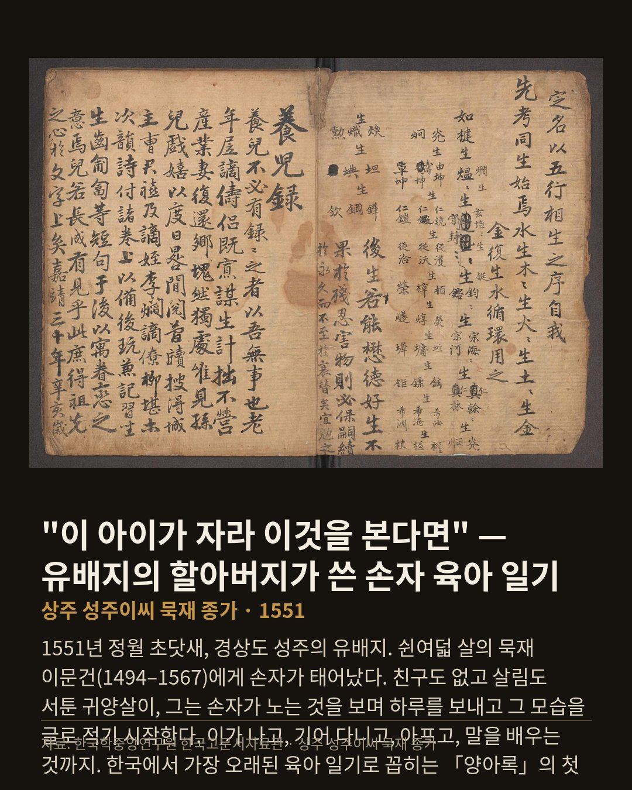
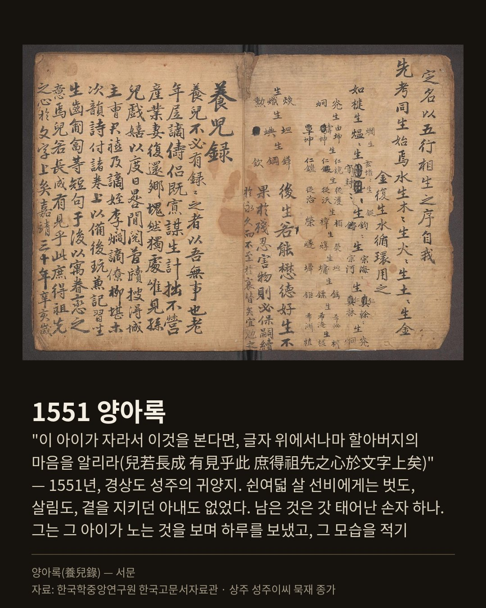

# EP.108 "이 아이가 자라 이것을 본다면" — 유배지의 할아버지가 쓴 손자 육아 일기 「양아록」

상주 성주이씨 묵재 종가 (문중) · 1551년 정월 초닷새, 경상도 성주의 유배지. 쉰여덟 살의 묵재 이문건(1494–1567)에게 손자가 태어났다. 친구도 없고 살림도 서툰 귀양살이, 그는 손자가 노는 것을 보며 하루를 보내고 그 모습을 글로 적기 시작한다. 이가 나고, 기어 다니고, 아프고, 말을 배우는 것까지. 한국에서 가장 오래된 육아 일기로 꼽히는 「양아록」의 첫 장이다

- 🌐 [전시 웹페이지](https://changgi.github.io/archive-tools/examples/mukjae/exhibit.html) (한자 위 한글 독음 · 원문 해석) · [수업 활동지](https://changgi.github.io/archive-tools/examples/mukjae/handout.html)
- 🎬 영상: [릴스 9:16](https://changgi.github.io/archive-tools-next/media/ep108-mukjae_reel.mp4) · [가로 16:9](https://changgi.github.io/archive-tools-next/media/ep108-mukjae_wide.mp4) · 홍보 글: [`promo.md`](promo.md)
- 카드뉴스: [`cards/`](cards/) · SNS 글: [`sns.txt`](sns.txt) · 판독·해석 표: [`selection.csv`](selection.csv)

<!-- DELIVERY -->
## 전달 에디팅 — 이 기록을 이렇게 전합니다

- **핵심 정서** — 다정함
- **한 문장** — 기록은 사랑의 한 방식이다 — 아무도 시키지 않은 기록이, 470년 뒤까지 한 사람의 마음을 전한다.
- **열기** — 470년 전, 귀양 간 할아버지가 손자의 육아 일기를 쓰기 시작했습니다.
- **펼치기** — 양아록 — 서문 → 양아록 — 손자가 태어난 날의 시 (1551년) — 서문의 '할 일이 없어 적는다'는 짐짓한 말 → 탄생 시의 날짜와 시각 → '네가 자라는 것을 보고 싶구나'로, 체면에서 진심으로 옮겨 가게 구성했습니다.
- **절정** — "이 아이가 자라서 이것을 본다면, 글자 위에서나마 할아버지의 마음을 알리라(兒若長成 有見乎此 庶得祖先之心於文字上矣)" — 화면·공간에서 이 한 줄만 크게, 소리를 줄여 집중
- **여운** — 할아버지는 손자가 자라는 것을 끝까지 볼 수 있었을까요? — 질문으로 끝내고 답은 보는 사람에게
- **감각과 물질** — 할아버지의 붓과 갓난아이의 울음, 정월의 봄 술 한 잔
- **통로와 매개** — 온라인: 릴스(열기) → 카드뉴스(펼치기) → 전시 웹페이지(절정·원문) → 비하인드 카드(여운) / 오프라인: 원본 크기 복제·낭독·참여 벽 / 남기기: 활동지·질문 카드
- **여운 장치** — 누군가의 성장을 한 줄씩 적어 주기
- **전달 에디팅 전** — 2건의 문서를 1551년 연대순으로 놓고 문서명 · 유형 · 해설을 붙인다 — 정확하지만, 지나가면 잊힌다.
- **전달 에디팅 후** — 핵심 정서는 「다정함」. 「470년 전, 귀양 간 할아버지가 손자의 육아 일기를 쓰기 시작했습니다.」로 열고, 문서를 대비와 순서로 펼친 뒤, "이 아이가 자라서 이것을 본다면, 글자 위에서나마 할아버지의 마음을 알리라(兒若長成 有見乎此 庶得祖先之心於文字上矣)"에서 멈춘다. 할아버지의 붓과 갓난아이의 울음, 정월의 봄 술 한 잔. 마지막엔 「누군가의 성장을 한 줄씩 적어 주기」로 보는 사람이 자기 이야기를 남기고 떠나게 한다.

전문: [`delivery.md`](delivery.md)
<!-- /DELIVERY -->

<!-- CURATOR -->
## 비하인드 — 큐레이터 노트

- **왜 이 문서들인가** — 관직 · 재산 문서 사이에서, 할아버지가 손자의 이가 나고 기어 다니는 것까지 적은 책은 전혀 다른 목소리였습니다.
- **전하고 싶은 것** — 기록은 사랑의 한 방식이다 — 아무도 시키지 않은 기록이, 470년 뒤까지 한 사람의 마음을 전한다.
- **이렇게 보이길 바랐다** — 서문의 '할 일이 없어 적는다'는 짐짓한 말 → 탄생 시의 날짜와 시각 → '네가 자라는 것을 보고 싶구나'로, 체면에서 진심으로 옮겨 가게 구성했습니다.
- **이렇게 써 주세요** — 가족사 · 생활사, 일기와 기록의 의미, '나의 성장 기록 쓰기' 활동에 쓰세요.
- **만들며 있었던 일** — 서문 가운데 몇 글자와 시의 '纘' 자는 판독이 불확실합니다. 이번에는 서문과 첫 시만 읽었고, 이후의 육아 기록(이가 남 · 기어 다님 · 병치레 등)은 읽지 않았습니다. 생몰년과 을사사화 연루는 일반적으로 알려진 내용입니다.
- **남겨 둔 질문** — 할아버지는 손자가 자라는 것을 끝까지 볼 수 있었을까요?
- **제작 기록** — 문서 2건 · 1551년 · 원본 사진 12면(문서 전체) · 원문 판독 2건 · 번역 2건 · 못 읽은 글자 □ 0 · 불확실 (?) 8

전문: [`curator.md`](curator.md) · 비하인드 카드: [`behind/`](behind/) · 채널별 홍보안: [`channels.md`](channels.md)
<!-- /CURATOR -->

## 이야기 — 사료가 말하는 대로

470년 전, 귀양 간 할아버지가 손자의 육아 일기를 쓰기 시작했습니다.

> **1551 양아록** — 1551년, 경상도 성주의 귀양지. 쉰여덟 살 선비에게는 벗도, 살림도, 곁을 지키던 아내도 없었다. 남은 것은 갓 태어난 손자 하나. 그는 그 아이가 노는 것을 보며 하루를 보냈고, 그 모습을 적기 시작한다. 왜 적는가. 서문의 마지막 줄이 답한다. "이 아이가 자라서 이것을 본다면, 글자 위에서나마 할아버지의 마음을 알리라(兒若長成 有見乎此 庶得祖先之心於文字上矣)."
> **1551 양아록** — 그 아이가 태어난 날, 할아버지는 시를 썼다. 날짜와 시각까지 적었다. 정월 초닷새, 아침 진시가 끝나 갈 무렵. 그리고 이렇게 읊었다. "오늘 기쁘게 저 갓난아이를 보니, 늘그막에 네가 자라는 것을 보고 싶구나(今日喜看渠赤子 暮年思見爾成童)." 쓸쓸하던 귀양살이가, 그날부터 조금 느긋해졌다.

| 표지 | 1번 카드 | 마무리 |
|---|---|---|
|  |  |  |

## 선별 문서 (2점)

| # | 연도 | 유형 | 문서명 | 원본 |
|---|---|---|---|---|
| 1 | 1551 | 양아록 | 양아록(養兒錄) — 서문 | [원본 보기](https://archive.aks.ac.kr/viewer/viewer.do#imgnode.do?itemId=book&gubun=booktree&depth=6&upPath=01%5E0167%5EL016793%5EL016793F01%5EL016793F0102&dataId=G002%2BAKS%2BKSM-WB.1567.4725-20250415.F27501-01-X000012&itemType=) |
| 2 | 1551 | 양아록 | 양아록(養兒錄) — 손자가 태어난 날의 시 | [원본 보기](https://archive.aks.ac.kr/viewer/viewer.do#imgnode.do?itemId=book&gubun=booktree&depth=6&upPath=01%5E0167%5EL016793%5EL016793F01%5EL016793F0102&dataId=G002%2BAKS%2BKSM-WB.1567.4725-20250415.F27501-01-X000012&itemType=) |

## 원문 판독과 해석

### 1. 양아록(養兒錄) — 서문

**원문 판독**

```
養兒錄
養兒不必有錄 錄之者以吾無事也 老
年屛謫 儔侶旣寡 謀生計拙 不營
產業 妻復還鄕 塊然獨處 惟見孫
兒戲嬉 以度日晷 間閱舊牘 披(?)得誠(?)
主曹只禧(?)及謫姪李熠(?)謫僚(?)柳堪未(?)
次韻詩 付諸卷上 以備後玩 兼記習生(?)
生齒匍匐等短句于後 以寓眷戀之
意焉 兒若長成 有見乎此 庶得祖先
之心於文字上矣 嘉靖三十年辛亥歲
```

**원문 해석** 양아록. 아이를 기르는 일을 굳이 기록할 필요는 없다. 그런데도 적는 것은 내가 할 일이 없기 때문이다. 늘그막에 귀양살이를 하니 벗도 드물고, 살아갈 꾀가 서툴러 살림을 꾸리지도 못하며, 아내마저 고향으로 돌아가 홀로 덩그러니 지낸다. 오직 손자가 노는 것을 보며 하루해를 보낸다. 이따금 옛 글들을 뒤적이다 … 차운한 시들을 얻어 책 앞에 붙여 두고 뒷날 보게 하며, 아울러 (손자가) 이가 나고 기어 다니는 일 등을 짧은 글로 뒤에 적어, 사랑하고 그리워하는 뜻을 담는다. 이 아이가 자라서 이것을 보게 된다면, 글자 위에서나마 할아버지의 마음을 알 수 있으리라. 가정 30년 신해년(1551).

**해제** 묵재(默齋) 이문건(李文楗, 1494–1567)이 유배지 성주에서 손자 이수봉(李守封)을 기르며 쓴 「양아록(養兒錄)」의 서문입니다. 1545년 을사사화에 연루되어 성주로 귀양 온 그는, 1551년(명종 6, 嘉靖 30) 손자가 태어나자 자라는 모습을 시와 글로 적어 나갔습니다. 서문은 '굳이 기록할 일이 아니지만 할 일이 없어 적는다'고 짐짓 말하면서도, 끝에서 '아이가 자라 이것을 보면 할아버지의 마음을 알리라'고 그 까닭을 밝힙니다. 가운데 몇 글자(옛 글을 뒤적여 얻은 시의 지은이 이름 등)는 판독이 불확실합니다. 「양아록」은 흔히 한국에서 가장 오래된 육아 일기로 소개됩니다. 사진의 오른쪽 면에는 이름을 오행상생의 차례로 정한다는 다른 기록이 이어지는데, 이번에는 왼쪽 서문만 읽었습니다.

### 2. 양아록(養兒錄) — 손자가 태어난 날의 시

**원문 판독**

```
嘉靖三十年辛亥歲元月初五日癸巳
子婦金氏產男兒 丙辰時向末乃生 謫
居中有喜如此 吟成七律一篇以識之
天理生生果未窮 癡兒得纘(?)繼
家風 先靈地下應多助 後
事人間庶少豐 今日喜看渠
赤子 暮年思見爾成童 謫居
蕭索翻舒泰 自酌春醪慶 …
```

**원문 해석** 가정 30년 신해년(1551) 정월 초5일 계사. 며느리 김씨가 사내아이를 낳았다. 진시(아침 7~9시)가 끝나 갈 무렵 태어났다. 귀양살이 중에 이런 기쁨이 있으니, 칠언율시 한 편을 읊어 적어 둔다. 하늘의 이치는 낳고 또 낳아 끝이 없으니, 어리석은 아이(아들)가 집안의 가풍을 이을 아이를 얻었구나. 조상의 넋도 땅 아래에서 많이 도우셨으리니, 뒷날 이 세상일이 조금은 넉넉해지리라. 오늘 기쁘게 저 갓난아이를 보니, 늘그막에 네가 자라 아이(동자)가 되는 것을 보고 싶구나. 쓸쓸하던 귀양살이가 도리어 느긋해져, 스스로 봄 술을 따라 경사를 … (이하 다음 면)

**해제** 「양아록」 첫머리에 실린 손자 탄생 시입니다. 1551년(명종 6) 정월 5일, 며느리 김씨가 아들을 낳자 이문건이 그날의 기쁨을 칠언율시로 적었습니다. 시 앞의 머리글에는 날짜와 태어난 시각(丙辰時, 진시)까지 적혀 있습니다. '癡兒(어리석은 아이)'는 몸이 약했던 아들 이온(李熅)을 겸손하게 이른 말로 보입니다(추정). 날짜의 간지 '癸巳'는 1551년 정월 5일의 일진입니다. '纘'으로 읽은 글자는 확실하지 않으며, 시의 끝 구절은 다음 면으로 이어집니다. 같은 면 오른쪽에는 뒷날 덧붙인 기록이 있는데, '嘉靖甲子十月十日 淑吉(?)改名守封 字景茂'로 읽혀 1564년(명종 19) 손자의 이름을 숙길(?)에서 수봉(守封)으로 고치고 자를 경무(景茂)로 정한 내용으로 보입니다. 이번에는 이 부분을 자세히 읽지 않았습니다.

판독·해석·이야기는 이미지에 근거한 초안이며(검토 전 "초안" 표시), 정확한 판독은 원문 확인이 필요합니다. □는 읽지 못한 글자, (?)는 불확실한 글자입니다.
이미지: 한국학중앙연구원 한국고문서자료관 소장·제공. "원본" 링크를 누르면 자료관 뷰어에서 그 문서가 열립니다. 재사용은 자료관에 문의하세요(소장처 동의 필요).
