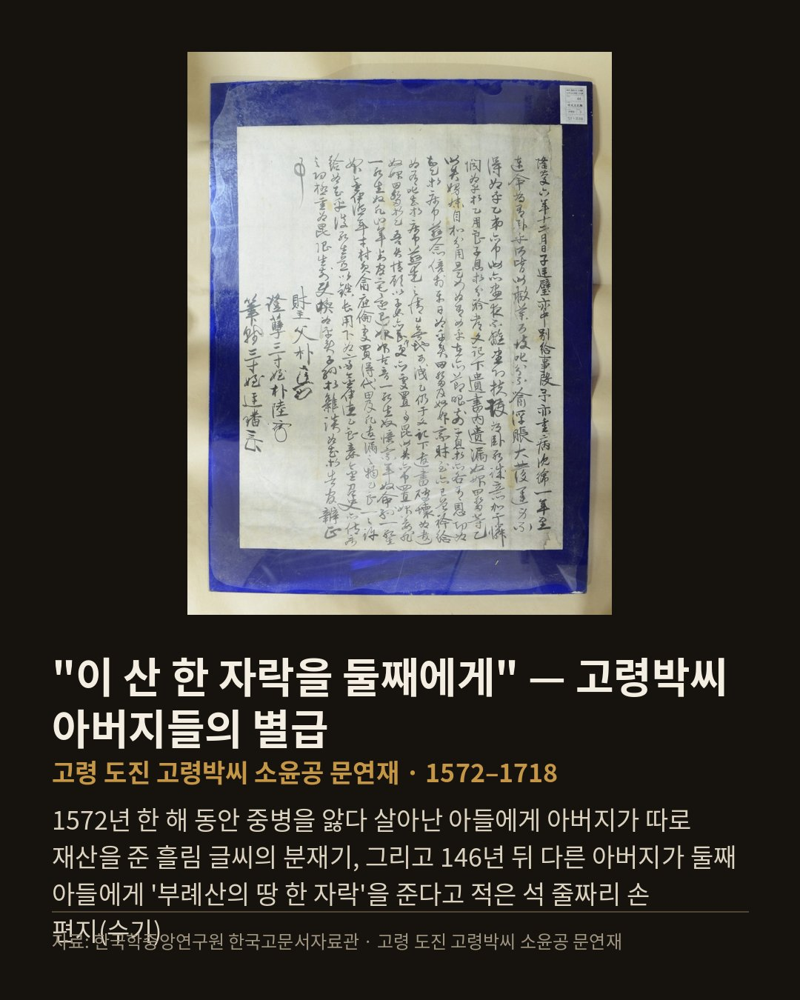
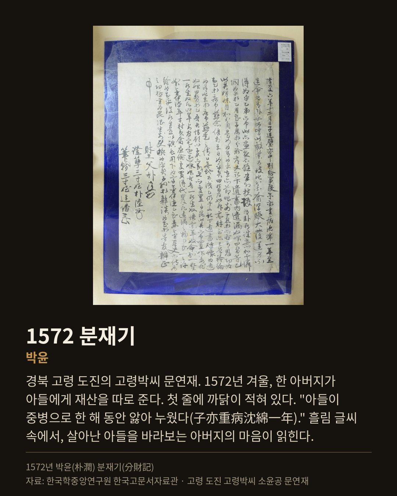
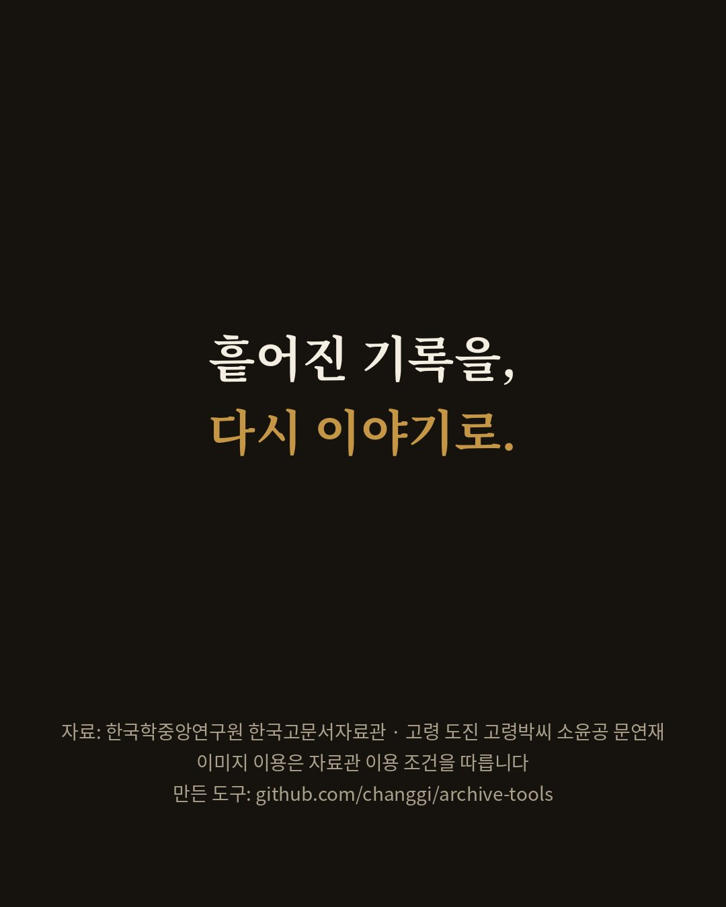

# EP.66 "이 산 한 자락을 둘째에게" — 고령박씨 아버지들의 별급

고령 도진 고령박씨 소윤공 문연재 (문중) · 1572년 한 해 동안 중병을 앓다 살아난 아들에게 아버지가 따로 재산을 준 흘림 글씨의 분재기, 그리고 146년 뒤 다른 아버지가 둘째 아들에게 '부례산의 땅 한 자락'을 준다고 적은 석 줄짜리 손 편지(수기)

- 🌐 [전시 웹페이지](https://changgi.github.io/archive-tools/examples/munyeonjae/exhibit.html) (한자 위 한글 독음 · 원문 해석) · [수업 활동지](https://changgi.github.io/archive-tools/examples/munyeonjae/handout.html)
- 🎬 영상: [릴스 9:16](https://changgi.github.io/archive-tools/examples/media/ep66-munyeonjae_reel.mp4) · [가로 16:9](https://changgi.github.io/archive-tools/examples/media/ep66-munyeonjae_wide.mp4) · 홍보 글: [`promo.md`](promo.md)
- 카드뉴스: [`cards/`](cards/) · SNS 글: [`sns.txt`](sns.txt) · 판독·해석 표: [`selection.csv`](selection.csv)


<!-- CURATOR -->
## 비하인드 — 큐레이터 노트

- **왜 이 문서들인가** — 중병에서 살아난 아들에게 준 1572년 분재기와, 둘째에게 '산 한 자락'을 준 석 줄짜리 수기가 아버지의 마음을 보여 주었습니다.
- **전하고 싶은 것** — 재산을 나누는 문서는 사랑을 표현하는 방식이기도 했다는 것.
- **이렇게 보이길 바랐다** — 흘림 글씨의 긴 분재기와 석 줄짜리 수기를 대비해, 문서의 길이와 마음의 크기는 다르다는 것을 보여 주었습니다.
- **이렇게 써 주세요** — 가족과 상속, 초서 문서 입문 수업에 쓰세요.
- **만들며 있었던 일** — 1572년 분재기는 흘림이 심해 일부 판독이 불확실합니다.
- **남겨 둔 질문** — 둘째 아들은 그 산 한 자락에서 무엇을 했을까요?
- **제작 기록** — 문서 2건 · 1572–1718년 · 원본 사진 2면(문서 전체) · 원문 판독 2건 · 번역 2건 · 못 읽은 글자 □ 3 · 불확실 (?) 15 · 해제에 "확인 필요"를 단 문서 2건

전문: [`curator.md`](curator.md)
<!-- /CURATOR -->

## 이야기 — 사료가 말하는 대로

아버지가 아들에게 쓴 단 석 줄. '이 산 한 자락을 너에게 준다.'

> **1572 분재기** — 경북 고령 도진의 고령박씨 문연재. 1572년 겨울, 한 아버지가 아들에게 재산을 따로 준다. 첫 줄에 까닭이 적혀 있다. "아들이 중병으로 한 해 동안 앓아 누웠다(子亦重病沈綿一年)." 흘림 글씨 속에서, 살아난 아들을 바라보는 아버지의 마음이 읽힌다.
> **1718 분재기** — 146년 뒤, 같은 집안의 다른 아버지가 쓴 종이는 단 석 줄이다. 증인도, 대신 쓴 사람도 없다. "부례산의 땅 한 자락을 둘째 아들 세형에게 따로 준다(扶禮山地一局 別給于次子世亨)." 끝에는 '아버지 망지가 손수 썼다'고만 적었다.

| 표지 | 1번 카드 | 마무리 |
|---|---|---|
|  |  |  |

## 선별 문서 (2점)

| # | 연도 | 유형 | 문서명 | 원본 |
|---|---|---|---|---|
| 1 | 1572 | 분재기 | 1572년 박윤(朴潤) 분재기(分財記) | [원본 보기](https://archive.aks.ac.kr/viewer/viewer.do#imgnode.do?itemId=book&gubun=booktree&depth=6&upPath=01%5E0167%5EL016727%5EL016727F02%5EL016727F0205&dataId=G002%2BKHD%2BKSM-XE.1572.0000-20180417.C1001_002_00044_XXX&itemType=) |
| 2 | 1718 | 분재기 | 1718년 박망지(朴望之) 분재기(分財記) | [원본 보기](https://archive.aks.ac.kr/viewer/viewer.do#imgnode.do?itemId=book&gubun=booktree&depth=6&upPath=01%5E0167%5EL016727%5EL016727F02%5EL016727F0205&dataId=G002%2BKHD%2BKSM-XE.1718.0000-20180417.C1001_002_00045_XXX&itemType=) |

## 원문 판독과 해석

### 1. 1572년 박윤(朴潤) 분재기(分財記)

**원문 판독**

```
隆慶六年十二月 日 子廷璧亦中 別給事段 子亦重病沈綿一年至
(…)命爲□ 卧乎所 叱(?)以(?)救(?)當(?)… 浮腫大發 運(?)…
得爲乎(?) 乙亥(?)年分 … 歲(?)不鮮 而(?)扶護爲臥乎 □(?)無(?)以加于憐
憫爲乎於(?) 乙用良 子息 於(?)分給 … 文記 下 遺書內 遺漏奴婢田畓等乙
(…)… 用是如 爲(?)… 子息於 □名… 恩 印 …
(…)… 財 … 給
(이하 여러 줄 — 흘림 초서, 판독 필요)
財主 父 朴潤 (수결)
筆執 三寸姪 朴陸(?) (수결)
```

**원문 해석** 융경 6년(1572) 12월 일, 아들 정벽(廷璧)에게 따로 주는 일. 아들이 중병으로 한 해 동안 앓아 누워 … 목숨이 … 부종이 크게 일어 … [살아] 얻었으니 … 가엾고 애처로운 마음을 더할 수 없어 … 자식들에게 나눠 준 문서와 유서에서 빠진 노비와 논밭을 … 따로 준다 … (흘림이 심해 대부분 판독 필요) 재주 아버지 박윤(수결). 필집 삼촌 조카 박륙(?)(수결).

**해제** 1572년(선조 5) 12월, 박윤(朴潤)이 아들 박정벽(朴廷璧)에게 노비와 논밭을 따로 준 별급 분재기로 보입니다. 첫 줄에 '아들이 중병으로 한 해 동안 앓았다(子亦重病沈綿一年)'는 사연이 있어, 큰 병에서 회복한 아들을 가엾게 여겨 준 것으로 읽힙니다. 다만 행초서가 심해 둘째 줄부터는 대부분 판독이 불확실하므로 원문 확인이 필요합니다. 450년 된 문서를 파란 천에 배접해 보관하고 있습니다.

### 2. 1718년 박망지(朴望之) 분재기(分財記)

**원문 판독**

```
別給
右手記段 扶禮山地一局
別給于次子世亨 永爲遵
行事
戊戌正月十七日 父望之手記
```

**원문 해석** 따로 줌. 이 손수 쓴 문서는, 부례산의 땅 한 자락을 둘째 아들 세형에게 따로 주니, 영영 지켜 행할 일. 무술년(1718) 1월 17일, 아버지 망지가 손수 씀.

**해제** 1718년(숙종 44, 戊戌) 1월, 박망지(朴望之, 1640~1718)가 둘째 아들 박세형(朴世亨)에게 부례산(扶禮山)의 땅 한 자락(一局)을 따로 준다고 손수 쓴 수기(手記)입니다. 증인이나 필집 없이 아버지가 직접 몇 줄로 쓴 간단한 형식입니다. 액자에 함께 붙은 설명에 따르면 박망지가 세상을 떠나던 해, 먼저 죽은 둘째 아들(1662~1693)의 몫으로 써 준 것입니다(설명문에 근거, 확인 필요).

판독·해석·이야기는 이미지에 근거한 초안이며(검토 전 "초안" 표시), 정확한 판독은 원문 확인이 필요합니다. □는 읽지 못한 글자, (?)는 불확실한 글자입니다.
이미지: 한국학중앙연구원 한국고문서자료관 소장·제공. "원본" 링크를 누르면 자료관 뷰어에서 그 문서가 열립니다. 재사용은 자료관에 문의하세요(소장처 동의 필요).
