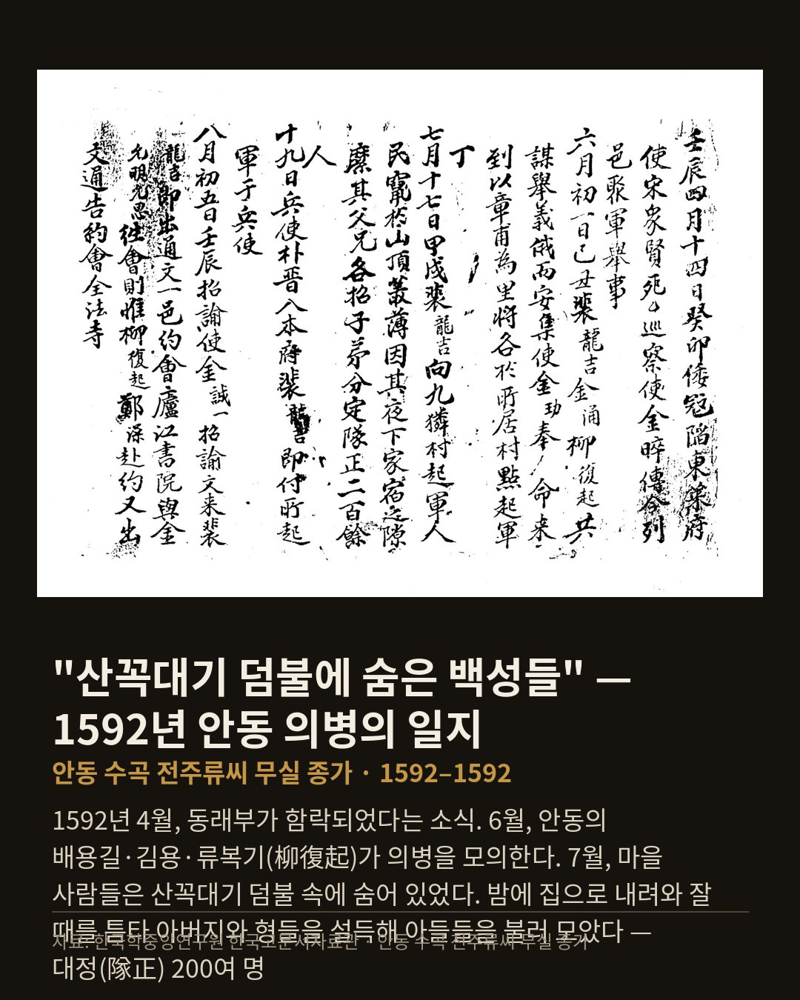
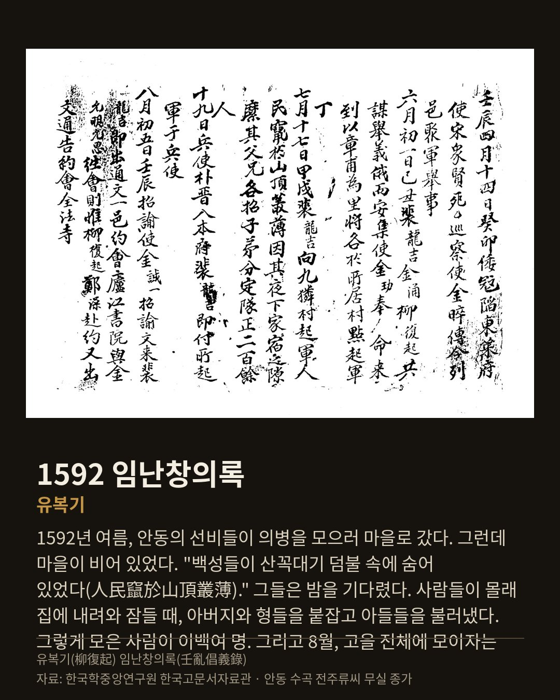
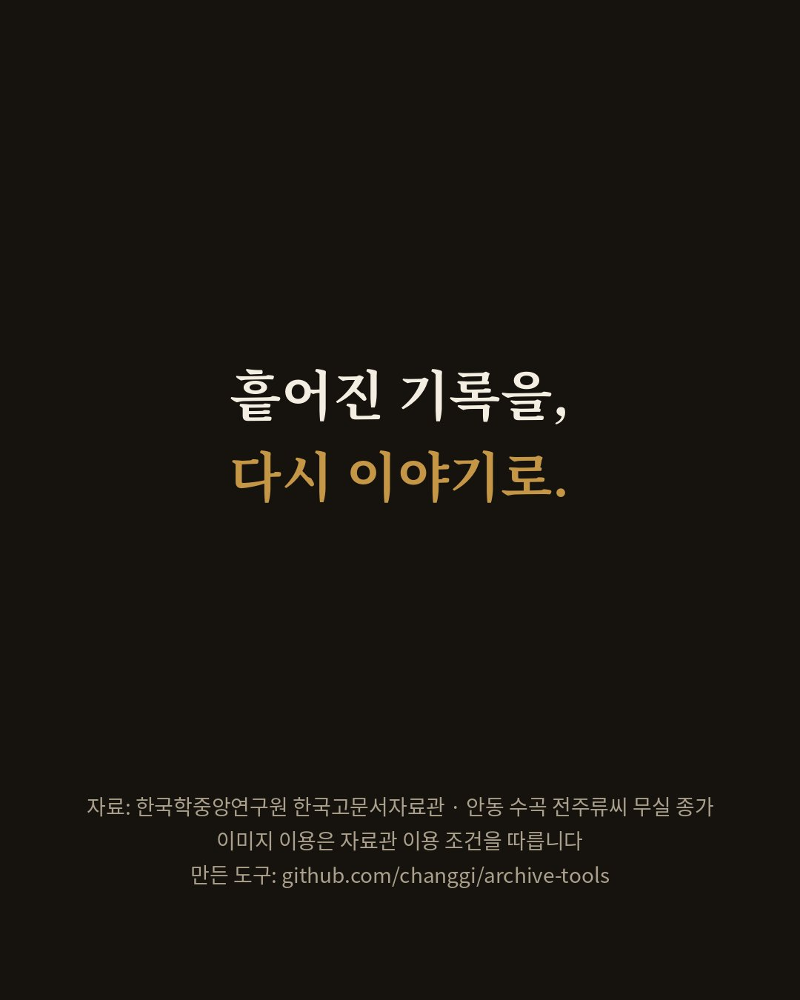

# EP.89 "산꼭대기 덤불에 숨은 백성들" — 1592년 안동 의병의 일지

안동 수곡 전주류씨 무실 종가 (문중) · 1592년 4월, 동래부가 함락되었다는 소식. 6월, 안동의 배용길·김용·류복기(柳復起)가 의병을 모의한다. 7월, 마을 사람들은 산꼭대기 덤불 속에 숨어 있었다. 밤에 집으로 내려와 잘 때를 틈타 아버지와 형들을 설득해 아들들을 불러 모았다 — 대정(隊正) 200여 명

- 🌐 [전시 웹페이지](https://changgi.github.io/archive-tools/examples/musil/exhibit.html) (한자 위 한글 독음 · 원문 해석) · [수업 활동지](https://changgi.github.io/archive-tools/examples/musil/handout.html)
- 🎬 영상: [릴스 9:16](https://changgi.github.io/archive-tools/examples/media/ep89-musil_reel.mp4) · [가로 16:9](https://changgi.github.io/archive-tools/examples/media/ep89-musil_wide.mp4) · 홍보 글: [`promo.md`](promo.md)
- 카드뉴스: [`cards/`](cards/) · SNS 글: [`sns.txt`](sns.txt) · 판독·해석 표: [`selection.csv`](selection.csv)

## 이야기 — 사료가 말하는 대로

1592년 여름, 의병을 모으러 간 마을은 텅 비어 있었습니다.

> **1592 임난창의록** — 1592년 여름, 안동의 선비들이 의병을 모으러 마을로 갔다. 그런데 마을이 비어 있었다. "백성들이 산꼭대기 덤불 속에 숨어 있었다(人民竄於山頂叢薄)." 그들은 밤을 기다렸다. 사람들이 몰래 집에 내려와 잠들 때, 아버지와 형들을 붙잡고 아들들을 불러냈다. 그렇게 모은 사람이 이백여 명. 그리고 8월, 고을 전체에 모이자는 통문을 돌렸지만, 약속 장소에 나타난 이는 몇 사람뿐이었다. "오직 류복기와 정칙만이 약속에 왔다(惟柳復起 鄭溭赴約)."

| 표지 | 1번 카드 | 마무리 |
|---|---|---|
|  |  |  |

## 선별 문서 (1점)

| # | 연도 | 유형 | 문서명 | 원본 |
|---|---|---|---|---|
| 1 | 1592 | 임난창의록 | 유복기(柳復起) 임난창의록(壬亂倡義錄) | [원본 보기](https://archive.aks.ac.kr/viewer/viewer.do#imgnode.do?itemId=book&gubun=booktree&depth=6&upPath=01%5E0167%5EL016701%5EL016701F02%5EL016701F0207&dataId=G002%2BAKS%2BKSM-XG.0000.0000-20101008.B029a_044_00309_XXX&itemType=) |

## 원문 판독과 해석

### 1. 유복기(柳復起) 임난창의록(壬亂倡義錄)

**원문 판독**

```
壬辰四月十四日癸卯 倭寇陷東萊府
使宋象賢死之 巡察使金睟傳令列
邑聚軍擧事
六月初一日己丑 裵龍吉 金涌 柳復起 共
謀擧義 餞而安集使金玏奉命來
到 以章甫爲里將 各於所居村點起軍
丁
七月十七日甲戌 裵龍吉 向九勝村起軍人
民竄於山頂叢薄 因其夜下家宿之隙
縻其父兄 各招子弟 分定隊正二百餘
人
十九日 兵使朴晉入本府 裵龍吉 卽付所起
軍于兵使
八月初五日壬辰 招諭使金誠一 招諭文來 裵
龍吉 卽出通文 一邑約會廬江書院 與金
允明 允思 往會 則惟柳復起 鄭溭 赴約 又出
文通 告約會金法寺
```

**원문 해석** 임진년(1592) 4월 14일 계묘, 왜구가 동래부를 함락하니 부사 송상현이 죽었다. 순찰사 김수가 여러 고을에 전령하여 군사를 모아 거사하게 하였다. 6월 초1일 기축, 배용길·김용·류복기가 함께 의병을 일으키기로 모의하였다. 이윽고 안집사 김륵이 왕명을 받들어 와서, 선비들을 이장(里將)으로 삼아 각자 사는 마을에서 군정을 점검해 일으키게 하였다. 7월 17일 갑술, 배용길이 구승촌으로 가서 군사를 일으키는데, 백성들이 산꼭대기 덤불 속에 숨어 있었다. 밤에 집으로 내려와 자는 틈을 타 그 아버지와 형들을 붙들어 [설득하고] 각자 자제들을 불러 모아 대정 200여 명을 나누어 정하였다. 19일, 병사 박진이 안동부에 들어오자 배용길이 곧 일으킨 군사를 병사에게 넘겼다. 8월 초5일 임진, 초유사 김성일의 초유문이 오자 배용길이 곧 통문을 내어 온 고을이 여강서원에 모이기로 약속하였다. 김윤명·김윤사와 함께 가서 모였으나 오직 류복기와 정칙만이 약속에 왔다. 또 통문을 내어 금법사에 모이기로 알렸다.

**해제** 임진왜란 때 안동 지역 의병 활동을 날짜순으로 기록한 『임난창의록(壬亂倡義錄)』 가운데 류복기(柳復起, 1555–1617) 관련 부분입니다. 동래성 함락(4.14) 소식에서 시작해, 6월 배용길·김용·류복기의 의병 모의, 안집사 김륵의 도착과 마을 단위의 군사 모집, 7월 산으로 피란한 백성들을 밤에 찾아가 아들들을 모은 일, 8월 초유사 김성일의 초유문을 받고 여강서원에서 모이기로 했으나 소수만 나타난 일까지 생생하게 적었습니다. 의병 모집이 쉽지 않았던 현실이 그대로 드러납니다. 후대에 정리·필사한 기록으로 보이며, 일부 글자는 흐려 판독이 불확실합니다. 류복기의 생몰년은 일반 인명 자료를 따랐습니다.

판독·해석·이야기는 이미지에 근거한 초안이며(검토 전 "초안" 표시), 정확한 판독은 원문 확인이 필요합니다. □는 읽지 못한 글자, (?)는 불확실한 글자입니다.
이미지: 한국학중앙연구원 한국고문서자료관 소장·제공. "원본" 링크를 누르면 자료관 뷰어에서 그 문서가 열립니다. 재사용은 자료관에 문의하세요(소장처 동의 필요).
