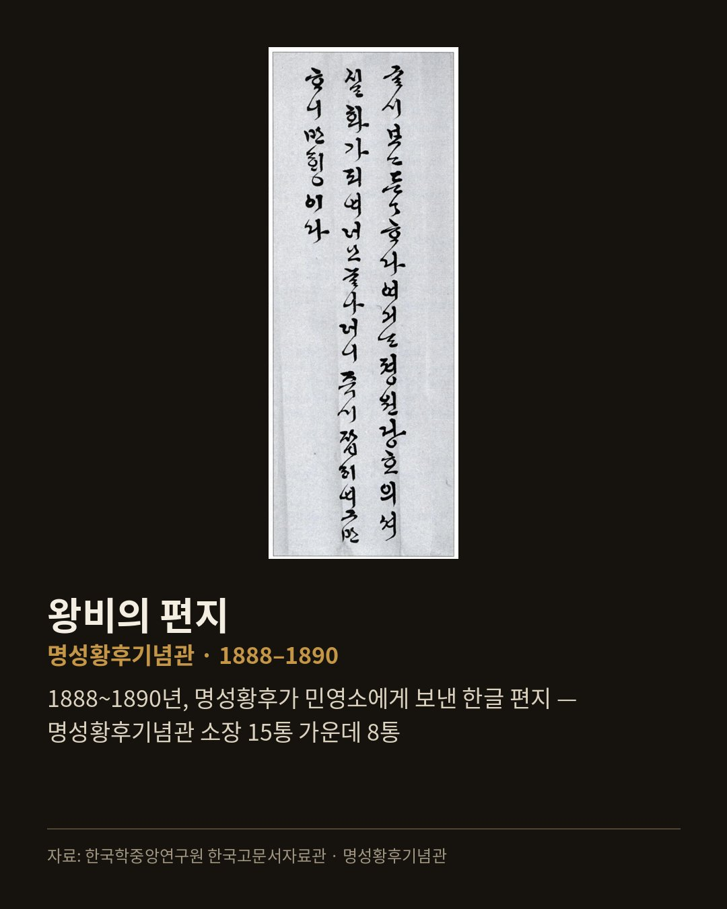
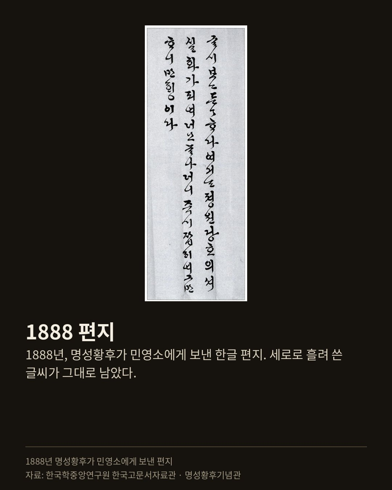
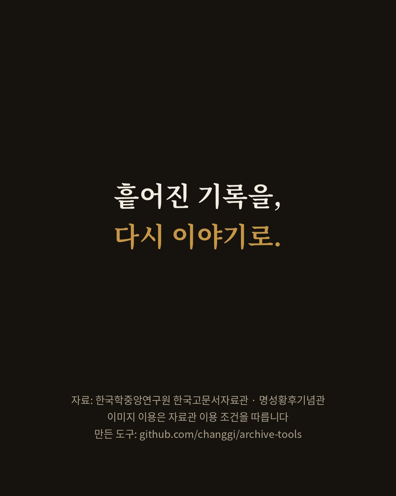

# 왕비의 편지

명성황후기념관 (박물관) · ③ 에디팅 후 — Claude가 문서명과 이미지에 근거해 쓴 `이야기` 문장 사용 (검토 전 초안 표시)

- 🌐 [전시 웹페이지](https://changgi.github.io/archive-tools/examples/myeongseong-letters/exhibit.html) · [수업 활동지](https://changgi.github.io/archive-tools/examples/myeongseong-letters/handout.html)
- 🎬 영상: [릴스 9:16](https://changgi.github.io/archive-tools/examples/media/ep6-myeongseong_reel.mp4) · [가로 16:9](https://changgi.github.io/archive-tools/examples/media/ep6-myeongseong_wide.mp4) · 홍보 글: [`promo.md`](promo.md)
- 카드뉴스: [`cards/`](cards/) · SNS 글: [`sns.txt`](sns.txt) · 에디팅 결과: [`selection.csv`](selection.csv)

| 표지 | 1번 카드 | 마무리 |
|---|---|---|
|  |  |  |

## 선별 문서 (8점)

| # | 연도 | 유형 | 문서명 | 원본 |
|---|---|---|---|---|
| 1 | 1888 | 편지 | 1888년 명성황후가 민영소에게 보낸 편지 | [원본 보기](https://archive.aks.ac.kr/viewer/viewer.do#imgnode.do?itemId=book&gubun=booktree&depth=6&upPath=03%5E0377%5EL037705%5EL037705F02%5EL037705F0206&dataId=G002%2BLET%2BKSM-XF.1888.0000-20140430.A0005_132&itemType=) |
| 2 | 1890 | 편지 | 1890년 명성황후가 민영소에게 보낸 편지－2 | [원본 보기](https://archive.aks.ac.kr/viewer/viewer.do#imgnode.do?itemId=book&gubun=booktree&depth=6&upPath=03%5E0377%5EL037705%5EL037705F02%5EL037705F0206&dataId=G002%2BLET%2BKSM-XF.1890.0000-20140430.A0005_084&itemType=) |
| 3 | 1890 | 편지 | 1890년 명성황후가 민영소에게 보낸 편지－4 | [원본 보기](https://archive.aks.ac.kr/viewer/viewer.do#imgnode.do?itemId=book&gubun=booktree&depth=6&upPath=03%5E0377%5EL037705%5EL037705F02%5EL037705F0206&dataId=G002%2BLET%2BKSM-XF.1890.0000-20140430.A0005_086&itemType=) |
| 4 | — | 편지 | 명성황후가 민영소에게 보낸 편지－065 | [원본 보기](https://archive.aks.ac.kr/viewer/viewer.do#imgnode.do?itemId=book&gubun=booktree&depth=6&upPath=03%5E0377%5EL037705%5EL037705F02%5EL037705F0206&dataId=G002%2BLET%2BKSM-XF.0000.0000-20140430.A0005_091&itemType=) |
| 5 | — | 편지 | 명성황후가 민영소에게 보낸 편지－068 | [원본 보기](https://archive.aks.ac.kr/viewer/viewer.do#imgnode.do?itemId=book&gubun=booktree&depth=6&upPath=03%5E0377%5EL037705%5EL037705F02%5EL037705F0206&dataId=G002%2BLET%2BKSM-XF.0000.0000-20140430.A0005_099&itemType=) |
| 6 | — | 편지 | 명성황후가 민영소에게 보낸 편지－079 | [원본 보기](https://archive.aks.ac.kr/viewer/viewer.do#imgnode.do?itemId=book&gubun=booktree&depth=6&upPath=03%5E0377%5EL037705%5EL037705F02%5EL037705F0206&dataId=G002%2BLET%2BKSM-XF.0000.0000-20140430.A0005_111&itemType=) |
| 7 | — | 편지 | 명성황후가 민영소에게 보낸 편지－089 | [원본 보기](https://archive.aks.ac.kr/viewer/viewer.do#imgnode.do?itemId=book&gubun=booktree&depth=6&upPath=03%5E0377%5EL037705%5EL037705F02%5EL037705F0206&dataId=G002%2BLET%2BKSM-XF.0000.0000-20140430.A0005_121&itemType=) |
| 8 | — | 편지 | 명성황후가 민영소에게 보낸 편지－098 | [원본 보기](https://archive.aks.ac.kr/viewer/viewer.do#imgnode.do?itemId=book&gubun=booktree&depth=6&upPath=03%5E0377%5EL037705%5EL037705F02%5EL037705F0206&dataId=G002%2BLET%2BKSM-XF.0000.0000-20140430.A0005_130&itemType=) |

이미지: 한국학중앙연구원 한국고문서자료관 소장·제공. "원본" 링크를 누르면 자료관 뷰어에서 그 문서가 열립니다. 이미지를 다시 쓰려면 자료관에 문의하세요(소장처 동의 필요).
