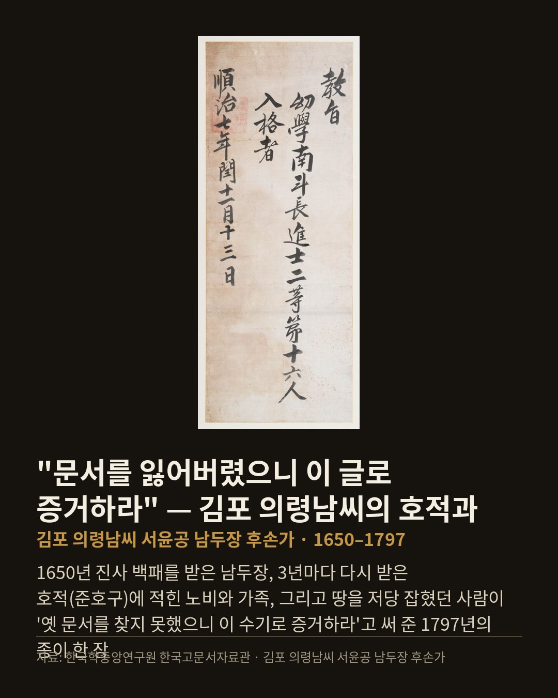
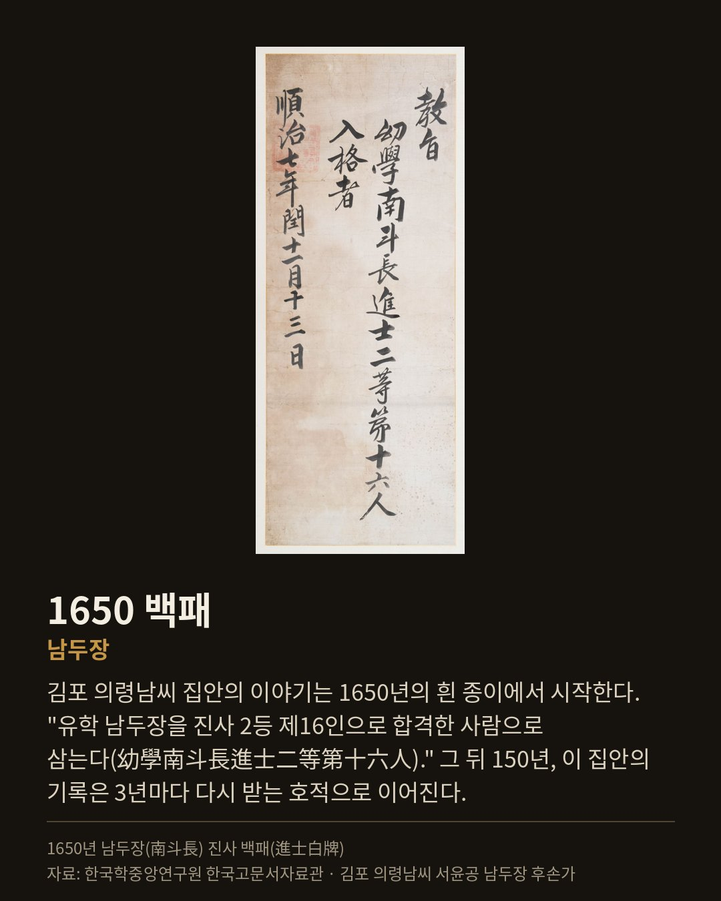
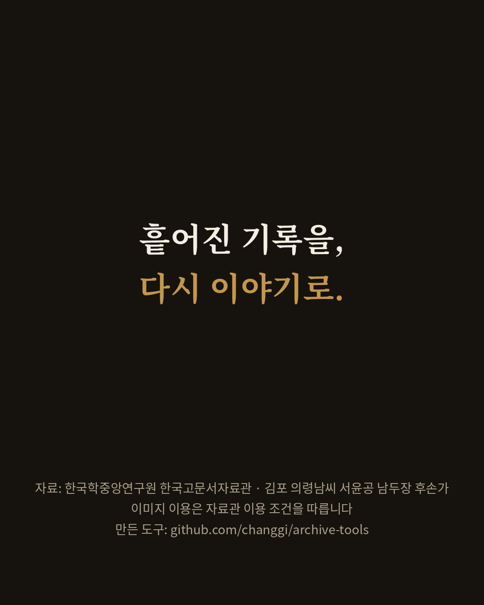

# EP.55 "문서를 잃어버렸으니 이 글로 증거하라" — 김포 의령남씨의 호적과 수기

김포 의령남씨 서윤공 남두장 후손가 (문중) · 1650년 진사 백패를 받은 남두장, 3년마다 다시 받은 호적(준호구)에 적힌 노비와 가족, 그리고 땅을 저당 잡혔던 사람이 '옛 문서를 찾지 못했으니 이 수기로 증거하라'고 써 준 1797년의 종이 한 장

- 🌐 [전시 웹페이지](https://changgi.github.io/archive-tools/examples/namdujang/exhibit.html) (한자 위 한글 독음 · 원문 해석) · [수업 활동지](https://changgi.github.io/archive-tools/examples/namdujang/handout.html)
- 🎬 영상: [릴스 9:16](https://changgi.github.io/archive-tools/examples/media/ep55-namdujang_reel.mp4) · [가로 16:9](https://changgi.github.io/archive-tools/examples/media/ep55-namdujang_wide.mp4) · 홍보 글: [`promo.md`](promo.md)
- 카드뉴스: [`cards/`](cards/) · SNS 글: [`sns.txt`](sns.txt) · 판독·해석 표: [`selection.csv`](selection.csv)


<!-- CURATOR -->
## 비하인드 — 큐레이터 노트

- **왜 이 문서들인가** — 땅 문서를 잃어버려 '이 글로 증거하라'고 써 준 1797년 수기가, 문서가 왜 중요했는지를 정면으로 말해 주었습니다.
- **전하고 싶은 것** — 문서를 잃으면 권리도 흔들렸고, 그래서 사람들은 문서를 대신할 문서를 만들었다는 것.
- **이렇게 보이길 바랐다** — 백패와 준호구(신분·가족의 증명)를 먼저 보여 주고, 마지막에 '잃어버린 문서를 대신하는 종이'로 반전을 주었습니다.
- **이렇게 써 주세요** — 기록관리 교육에서 '증거로서의 기록'과 대체 문서의 효력을 설명하는 사례로 쓰세요.
- **만들며 있었던 일** — 음성 합성(TTS) 오류로 영상 제작이 한 번 멈춰 다시 만들었습니다. 내용은 바뀌지 않았습니다.
- **남겨 둔 질문** — 오늘 우리가 잃어버리면 가장 곤란한 문서는 무엇일까요?
- **제작 기록** — 문서 3건 · 1650–1797년 · 원본 사진 3면(문서 전체) · 원문 판독 3건 · 번역 3건 · 못 읽은 글자 □ 3 · 불확실 (?) 9 · 해제에 "확인 필요"를 단 문서 1건

전문: [`curator.md`](curator.md)
<!-- /CURATOR -->

## 이야기 — 사료가 말하는 대로

빌린 돈은 갚았는데, 맡겨 둔 땅 문서가 사라졌습니다. 어떻게 했을까요?

> **1650 백패** — 김포 의령남씨 집안의 이야기는 1650년의 흰 종이에서 시작한다. "유학 남두장을 진사 2등 제16인으로 합격한 사람으로 삼는다(幼學南斗長進士二等第十六人)." 그 뒤 150년, 이 집안의 기록은 3년마다 다시 받는 호적으로 이어진다.
> **1795 준호구** — 1795년 겨울, 김포군이 이 집에 호적 한 장을 내준다. 주소, 나이, 4대 조상, 아들과 며느리, 그리고 노비들. 한 노비 이름 옆에는 두 글자가 붙어 있다. "도망(逃)." 호적은 집에 누가 사는지, 그리고 누가 떠났는지를 함께 적었다.
> **1797 수기** — 2년 뒤, 같은 남집에게 이웃이 종이 한 장을 써 준다. 땅 문서를 저당 잡고 돈을 빌려주었는데, 돈을 받고 나니 그 문서가 없었다. "그 문서 세 장을 잃어버렸으니(同文記三丈 見失), 뒷날 이 글을 가지고 관에 고하여 바로잡으라." 잃어버린 종이를 대신하는 종이였다.

| 표지 | 1번 카드 | 마무리 |
|---|---|---|
|  |  |  |

## 선별 문서 (3점)

| # | 연도 | 유형 | 문서명 | 원본 |
|---|---|---|---|---|
| 1 | 1650 | 백패 | 1650년 남두장(南斗長) 진사 백패(進士白牌) | [원본 보기](https://archive.aks.ac.kr/viewer/viewer.do#imgnode.do?itemId=book&gubun=booktree&depth=6&upPath=01%5E0141%5EL014140%5EL014140F02%5EL014140F0201&dataId=G002%2BKHD%2BKSM-XA.1650.0000-20180108.C0602_002_00001_XXX&itemType=) |
| 2 | 1795 | 준호구 | 1795년 남집(南{火+集}) 준호구(準戶口) | [원본 보기](https://archive.aks.ac.kr/viewer/viewer.do#imgnode.do?itemId=book&gubun=booktree&depth=6&upPath=01%5E0141%5EL014140%5EL014140F02%5EL014140F0204&dataId=G002%2BKHD%2BKSM-XD.1795.0000-20180108.C0602_002_00029_XXX&itemType=) |
| 3 | 1797 | 수기 | 1797년 이세정(李世延) 수기(手記) | [원본 보기](https://archive.aks.ac.kr/viewer/viewer.do#imgnode.do?itemId=book&gubun=booktree&depth=6&upPath=01%5E0141%5EL014140%5EL014140F02%5EL014140F0204&dataId=G002%2BKHD%2BKSM-XD.1797.0000-20180108.C0602_002_00036_XXX&itemType=) |

## 원문 판독과 해석

### 1. 1650년 남두장(南斗長) 진사 백패(進士白牌)

**원문 판독**

```
敎旨
幼學南斗長進士二等第十六人
入格者
順治七年閏十一月十三日 (도장)
```

**원문 해석** 교지. 유학 남두장을 진사시 2등 제16인으로 합격한 사람으로 삼는다. 순치 7년(1650) 윤11월 13일.

**해제** 1650년(효종 1) 윤11월, 남두장(南斗長)이 진사시에 합격하고 받은 백패입니다. 이 집안 문서는 그를 '서윤공(庶尹公)'으로 부르며, 그의 후손이 김포에 살며 남긴 호적·추증교지·소지가 이어집니다.

### 2. 1795년 남집(南{火+集}) 준호구(準戶口)

**원문 판독**

```
乾隆六十年十二月 日 金浦郡
考乙卯戶口帳內 蘆長面陵洞里第六統第二戶 幼學南㸚 年
五十九丁巳生 本宜寧 父通德郞 □□ 祖通德郞宗彦 曾祖
嘉善大夫戶曹參判兼同知義禁府事五衛都摠府副摠管 聖□(?)
外祖通德郞李廷佑(?) 本全州 率子幼學致年 年二十八戊子
婦安氏 齡三十一乙酉生 籍竹山 率奴婢 秋龍 仁婢 業禮 年辛丑生 一
生婢 英愛 年癸亥生 二所生奴 石壁(?) 年丙寅生 父李時金 母上同 逃律 婢英(…)
一所生婢 惟禮 年癸未生 二所生婢 福宗 年乙未生 三所生婢 福禮 年庚(…)
生父蔡大昌 母上同 婢禮化 年己亥生 父法俊 建 母班婢 二禮 奴 八月 年癸(…)
生父私奴二福 母班婢 禮化 婢八今 年乙亥 婢 九里介 年戊寅 父母上同 等(…)
子戶口 相準印(?)
行縣令(?) (수결) (관인 여럿)
```

**원문 해석** 건륭 60년(1795) 12월 일, 김포군. 을묘년 호적 대장을 살피건대, 노장면 능동리 제6통 제2호, 유학 남집, 나이 59세 정사생, 본관 의령. 아버지 통덕랑 ○○, 할아버지 통덕랑 종언, 증조할아버지 가선대부 호조참판 겸 동지의금부사 오위도총부 부총관 성○, 외할아버지 통덕랑 이정우, 본관 전주. 거느린 아들 유학 치년, 나이 28세 무자생. 며느리 안씨, 나이 31세 을유생, 본관 죽산. 거느린 노비: 추룡, 인비, 업례(신축생)의 첫째 소생 비 영애(계해생), 둘째 소생 노 석벽(병인생, 아비 이시금, 어미 위와 같음, 도망) … 비 유례(계미생), 둘째 소생 비 복종(을미생), 셋째 소생 비 복례 … 아비 채대창 … 비 예화(기해생, 아비 법준) … 비 팔금(을해생), 비 구리개(무인생), 아비·어미 위와 같음 … 호적과 대조하여 맞으므로 도장을 찍음. 현령 (수결).

**해제** 1795년(정조 19) 12월, 김포군이 남집(南㸚)에게 발급한 준호구(準戶口)입니다. 3년마다 만드는 호적 대장과 대조해 관이 확인해 준 호적 증명서로, 주소(노장면 능동리 6통 2호) → 호주와 4조(아버지·할아버지·증조·외조) → 처자와 며느리 → 노비의 이름·나이·부모·도망 여부 순으로 적습니다. 1729년 남종언(할아버지)의 준호구부터 1851년까지 같은 집안의 호적이 이어져 남아 있습니다. 작은 글씨의 노비 줄은 일부 판독이 불확실합니다.

### 3. 1797년 이세정(李世延) 수기(手記)

**원문 판독**

```
嘉慶二年丁巳十二月初十日 南㸚前 手記
右明文事段 癸丑年分 右人傳來田畓
文記三丈 典當於吾家 是遣錢文武(?)
拾兩 持去矣 今方同錢文備送是遣
同田畓文記推尋是乎尒(?) 以文記欲爲
出給 則同文記三丈 見失是乎尒 以石(?)尋(?)
已呈官立旨 成給爲去乎 日後或有子孫
中是非之端 俱緣由成文爲去乎 日後持此
文告官卞正者
財主 李世延 (수결)
```

**원문 해석** 가경 2년 정사(1797) 12월 10일, 남집에게 [써 주는] 수기. 이 명문의 일은, 계축년(1793)에 위 사람(남집)이 대대로 전해 오던 논밭 문서 세 장을 우리 집에 저당 잡히고 돈 ○○냥을 가져갔다. 이제 그 돈을 갚아 와서 그 논밭 문서를 찾아가려 하니, 문서를 내주어야 하는데 그 문서 세 장을 잃어버렸다. … 이미 관에 [분실을] 고하여 입지(立旨)를 받아 만들어 주거니와, 뒷날 혹 자손 가운데 시비를 거는 일이 있으면, 그 연유를 함께 적어 이 문서를 만들어 주니, 뒷날 이 글을 가지고 관에 고하여 바로잡을 일. 재주(문서를 써 준 사람) 이세정 (수결).

**해제** 1797년(정조 21) 12월, 이세정(李世延)이 남집에게 써 준 수기(手記)입니다. 4년 전 남집이 집안 대대로 내려오던 논밭 문서 세 장을 이세정 집에 저당 잡히고 돈을 빌렸는데, 돈을 갚으러 왔을 때 이세정이 그 문서를 잃어버린 것입니다. 그래서 관에서 분실 입지를 받고, '뒷날 시비가 생기면 이 글로 바로잡으라'는 증서를 대신 써 주었습니다. 땅 문서 자체가 저당물이던 시대의 거래 방식을 보여 줍니다. 빌린 금액의 글자는 판독이 불확실합니다.

판독·해석·이야기는 이미지에 근거한 초안이며(검토 전 "초안" 표시), 정확한 판독은 원문 확인이 필요합니다. □는 읽지 못한 글자, (?)는 불확실한 글자입니다.
이미지: 한국학중앙연구원 한국고문서자료관 소장·제공. "원본" 링크를 누르면 자료관 뷰어에서 그 문서가 열립니다. 재사용은 자료관에 문의하세요(소장처 동의 필요).
