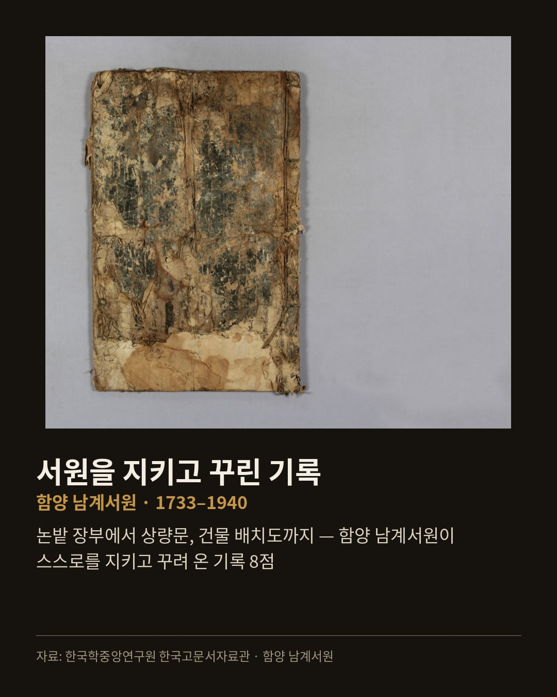
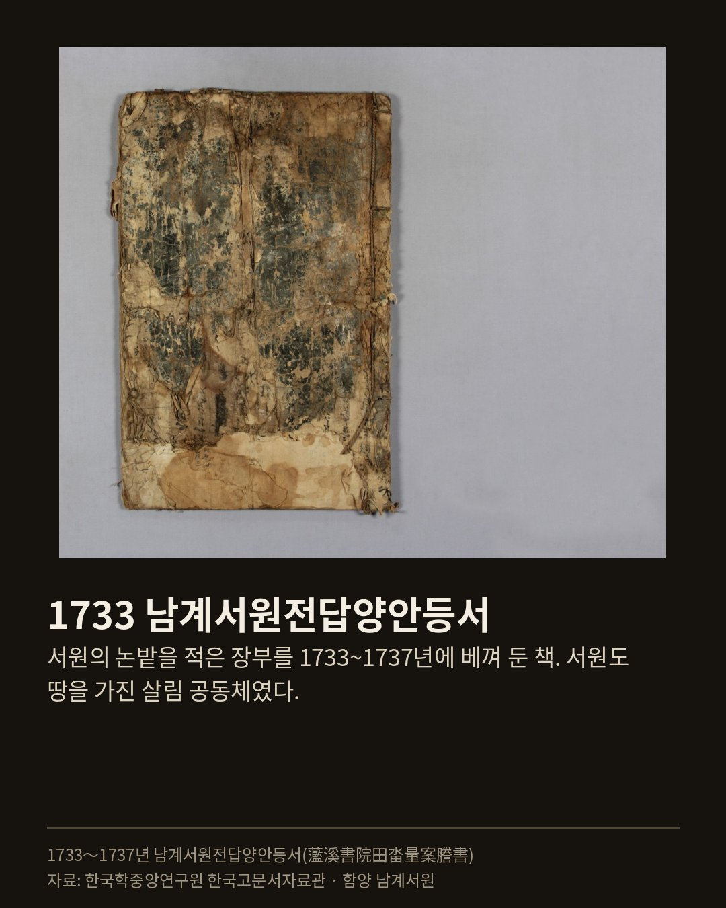

# 서원을 지키고 꾸린 기록

함양 남계서원 (서원) · ③ 에디팅 후 — Claude가 문서명과 이미지에 근거해 쓴 `이야기` 문장 사용 (검토 전 초안 표시)

- 🌐 [전시 웹페이지](https://changgi.github.io/archive-tools/examples/namgye-seowon/exhibit.html) · [수업 활동지](https://changgi.github.io/archive-tools/examples/namgye-seowon/handout.html)
- 🎬 영상: [릴스 9:16](https://changgi.github.io/archive-tools/examples/media/ep5-namgye_reel.mp4) · [가로 16:9](https://changgi.github.io/archive-tools/examples/media/ep5-namgye_wide.mp4) · 홍보 글: [`promo.md`](promo.md)
- 카드뉴스: [`cards/`](cards/) · SNS 글: [`sns.txt`](sns.txt) · 에디팅 결과: [`selection.csv`](selection.csv)

| 표지 | 1번 카드 | 마무리 |
|---|---|---|
|  |  |  |

<!-- DELIVERY -->
## 전달 에디팅 — 이 기록을 이렇게 전합니다

- **핵심 정서** — 지킴
- **한 문장** — 서원은 공부만 하는 곳이 아니라, 땅과 사람과 건물을 지키는 조직이었다는 것.
- **열기** — 서원은 공부만 하던 곳이었을까요?
- **펼치기** — 남계서원전답양안등서 → 함양군 남계서원전답양안 → 남계서원완문 → 상량시집사록 → 하용도 남계서원문루상량문 → 원규 → 민병승 풍영루 중수기 → 서원건치도 (1733–1940년) — 장부 → 보호 문서 → 건물 기록 순으로, 서원을 운영하는 일의 층위를 보여 주었습니다.
- **절정** — "침범하지 말 것(勿侵事)" — 화면·공간에서 이 한 줄만 크게, 소리를 줄여 집중
- **여운** — 서원을 지키기 위해 가장 애쓴 사람은 누구였을까요? — 질문으로 끝내고 답은 보는 사람에게
- **감각과 물질** — "물침(勿侵)" 조항을 바닥에 큰 글씨로 깔아 밟지 않고 돌아가게 하는 동선 · 규약을 판에 새기고 관람객이 자기 규칙을 써 보는 벽
- **통로와 매개** — 온라인: 릴스(열기) → 카드뉴스(펼치기) → 전시 웹페이지(절정·원문) → 비하인드 카드(여운) / 오프라인: 원본 크기 복제·낭독·참여 벽 / 남기기: 활동지·질문 카드
- **여운 장치** — 건치도를 따라 그리는 서원 배치 퍼즐
- **전달 에디팅 전** — 8건의 문서를 1733–1940년 연대순으로 놓고 문서명 · 유형 · 해설을 붙인다 — 정확하지만, 지나가면 잊힌다.
- **전달 에디팅 후** — 핵심 정서는 「지킴」. 「서원은 공부만 하던 곳이었을까요?」로 열고, 문서를 대비와 순서로 펼친 뒤, "침범하지 말 것(勿侵事)"에서 멈춘다. "물침(勿侵)" 조항을 바닥에 큰 글씨로 깔아 밟지 않고 돌아가게 하는 동선. 마지막엔 「건치도를 따라 그리는 서원 배치 퍼즐」로 보는 사람이 자기 이야기를 남기고 떠나게 한다.

전문: [`delivery.md`](delivery.md)
<!-- /DELIVERY -->

<!-- CURATOR -->
## 비하인드 — 큐레이터 노트

- **왜 이 문서들인가** — 서원의 논밭 장부, '침범하지 말 것'이 줄지어 적힌 완문, 상량문, 건치도가 함께 있어 서원의 살림이 보였습니다.
- **전하고 싶은 것** — 서원은 공부만 하는 곳이 아니라, 땅과 사람과 건물을 지키는 조직이었다는 것.
- **이렇게 보이길 바랐다** — 장부 → 보호 문서 → 건물 기록 순으로, 서원을 운영하는 일의 층위를 보여 주었습니다.
- **이렇게 써 주세요** — 서원의 경제·조직, 세계유산 서원 교육에 쓰세요.
- **만들며 있었던 일** — 예시 세트(EP.03–06)의 셋째 편입니다. 처음에는 문서명으로 캡션 초안만 만들었고, 뒤에 원문 전문 판독(v0.3.6)과 원문 해석(v0.4.0)을 더해 지금 모습이 되었습니다.
- **남겨 둔 질문** — 서원을 지키기 위해 가장 애쓴 사람은 누구였을까요?
- **제작 기록** — 문서 8건 · 1733–1940년 · 원본 사진 48면(문서 전체) · 원문 판독 7건 · 번역 7건 · 못 읽은 글자 □ 2 · 불확실 (?) 2 · 해제에 "확인 필요"를 단 문서 1건

전문: [`curator.md`](curator.md)
<!-- /CURATOR -->

## 선별 문서 (8점)

| # | 연도 | 유형 | 문서명 | 원본 |
|---|---|---|---|---|
| 1 | 1733 | 남계서원전답양안등서 | 1733〜1737년 남계서원전답양안등서(蘫溪書院田畓量案謄書) | [원본 보기](https://archive.aks.ac.kr/viewer/viewer.do#imgnode.do?itemId=book&gubun=booktree&depth=6&upPath=02%5E0248%5EL024803%5EL024803F02%5EL024803F0207&dataId=G002%2BAKS%2BKSM-XG.1733.4887-20101008.B014a_024_00017_YYY&itemType=) |
| 2 | 1740 | 남계서원전답양안 | 1740년 함양군(咸陽郡) 남계서원전답양안(蘫溪書院田畓量案) | [원본 보기](https://archive.aks.ac.kr/viewer/viewer.do#imgnode.do?itemId=book&gubun=booktree&depth=6&upPath=02%5E0248%5EL024803%5EL024803F02%5EL024803F0207&dataId=G002%2BAKS%2BKSM-XG.1740.4887-20101008.B014a_024_00018_YYY&itemType=) |
| 3 | 1843 | 남계서원완문 | 1843년 남계서원완문(蘫溪書院完文) | [원본 보기](https://archive.aks.ac.kr/viewer/viewer.do#imgnode.do?itemId=book&gubun=booktree&depth=6&upPath=02%5E0248%5EL024803%5EL024803F02%5EL024803F0204&dataId=G002%2BAKS%2BKSM-XD.1843.4887-20101008.B014a_024_00031_YYY&itemType=) |
| 4 | 1849 | 상량시집사록 | 1849년 상량시집사록(上樑時執事錄) | [원본 보기](https://archive.aks.ac.kr/viewer/viewer.do#imgnode.do?itemId=book&gubun=booktree&depth=6&upPath=02%5E0248%5EL024803%5EL024803F02%5EL024803F0207&dataId=G002%2BAKS%2BKSM-XG.1849.4887-20101008.B014a_024_00033_XXX&itemType=) |
| 5 | 1849 | 남계서원문루상량문 | 1849년 하용도(河龍圖) 남계서원문루상량문(蘫溪書院門樓上樑文) | [원본 보기](https://archive.aks.ac.kr/viewer/viewer.do#imgnode.do?itemId=book&gubun=booktree&depth=6&upPath=02%5E0248%5EL024803%5EL024803F02%5EL024803F0208&dataId=G002%2BAKS%2BKSM-XI.1849.4887-20101008.B014a_024_00032_XXX&itemType=) |
| 6 | 1923 | 원규 | 1923년 원규(院規) | [원본 보기](https://archive.aks.ac.kr/viewer/viewer.do#imgnode.do?itemId=book&gubun=booktree&depth=6&upPath=02%5E0248%5EL024803%5EL024803F02%5EL024803F0207&dataId=G002%2BAKS%2BKSM-XG.1923.4887-20101008.B014a_024_00037_XXX&itemType=) |
| 7 | 1940 | 중수기 | 1940년 민병승(閔丙承) 풍영루 중수기(風詠樓重修記) | [원본 보기](https://archive.aks.ac.kr/viewer/viewer.do#imgnode.do?itemId=book&gubun=booktree&depth=6&upPath=02%5E0248%5EL024803%5EL024803F02%5EL024803F0207&dataId=G002%2BAKS%2BKSM-XG.1940.4887-20101008.B014a_024_00034_XXX&itemType=) |
| 8 | — | 서원건치도 | 서원건치도(書院建置圖) | [원본 보기](https://archive.aks.ac.kr/viewer/viewer.do#imgnode.do?itemId=book&gubun=booktree&depth=6&upPath=02%5E0248%5EL024803%5EL024803F02%5EL024803F0207&dataId=G002%2BAKS%2BKSM-XG.0000.4887-20101008.B014a_024_00039_XXX&itemType=) |

이미지: 한국학중앙연구원 한국고문서자료관 소장·제공. "원본" 링크를 누르면 자료관 뷰어에서 그 문서가 열립니다. 이미지를 다시 쓰려면 자료관에 문의하세요(소장처 동의 필요).
