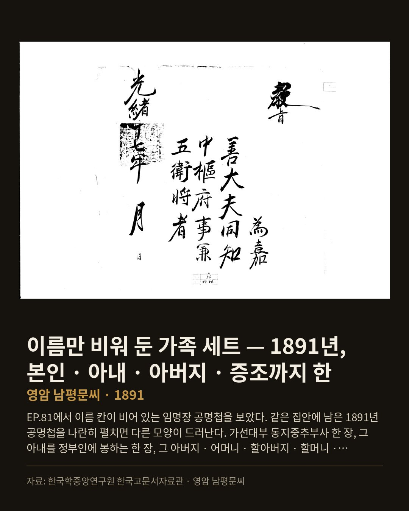
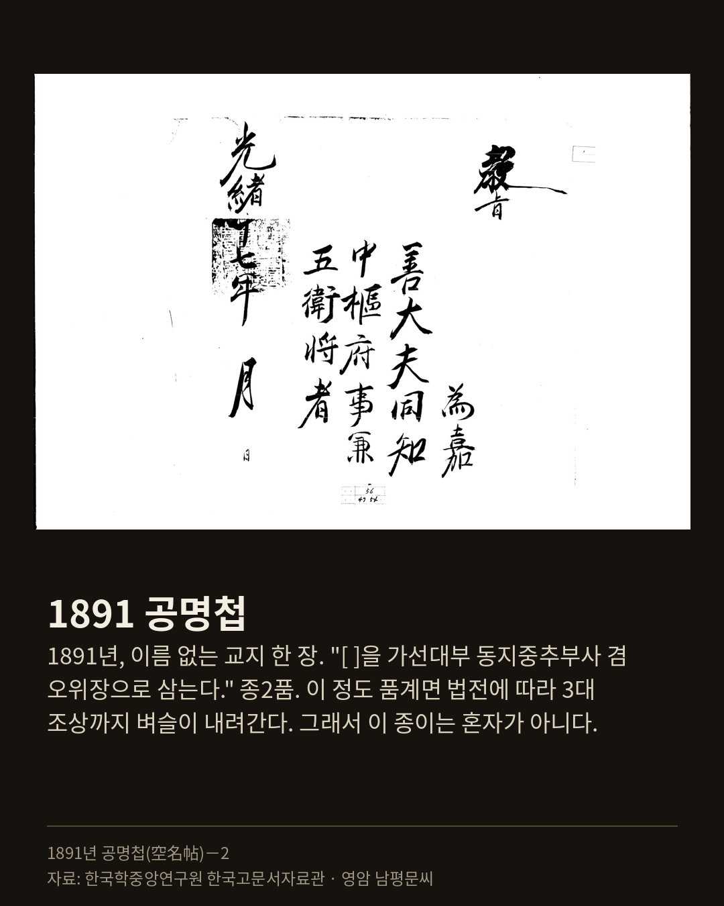
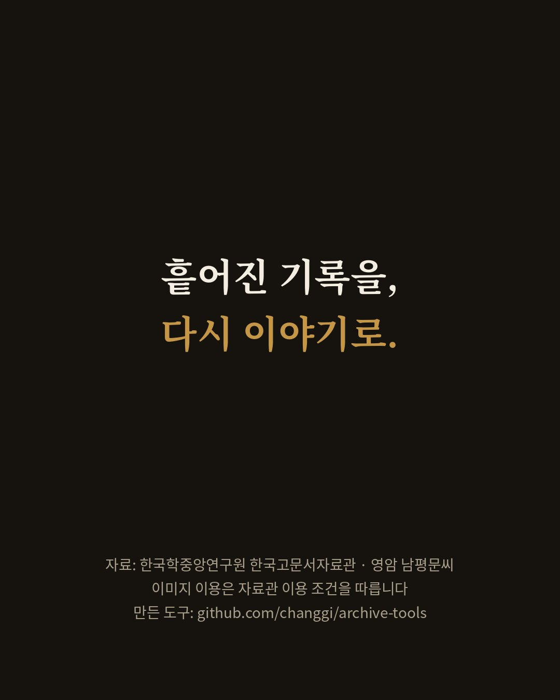

# EP.168 이름만 비워 둔 가족 세트 — 1891년, 본인 · 아내 · 아버지 · 증조까지 한 묶음의 공명첩

영암 남평문씨 (문중) · EP.81에서 이름 칸이 비어 있는 임명장 공명첩을 보았다. 같은 집안에 남은 1891년 공명첩을 나란히 펼치면 다른 모양이 드러난다. 가선대부 동지중추부사 한 장, 그 아내를 정부인에 봉하는 한 장, 그 아버지 · 어머니 · 할아버지 · 할머니 · 증조할아버지 · 증조할머니에게 벼슬을 추증하는 여섯 장. 모두 이름 자리가 비어 있다. 한 사람이 높은 품계를 사면, 3대 조상의 이름까지 함께 채워 넣을 수 있게 짜인 '세트'였다

- 🌐 [전시 웹페이지](https://changgi.github.io/archive-tools/examples/nampyeong-gongmyeong/exhibit.html) (한자 위 한글 독음 · 원문 해석) · [수업 활동지](https://changgi.github.io/archive-tools/examples/nampyeong-gongmyeong/handout.html)
- 🎬 영상: [릴스 9:16](https://changgi.github.io/archive-tools-next/media/ep168-nampyeong-gongmyeong_reel.mp4) · [가로 16:9](https://changgi.github.io/archive-tools-next/media/ep168-nampyeong-gongmyeong_wide.mp4) · 홍보 글: [`promo.md`](promo.md)
- 카드뉴스: [`cards/`](cards/) · SNS 글: [`sns.txt`](sns.txt) · 판독·해석 표: [`selection.csv`](selection.csv)

<!-- DELIVERY -->
## 전달 에디팅 — 이 기록을 이렇게 전합니다

- **핵심 정서** — 씁쓸함
- **한 문장** — EP.156에서 최경로가 종2품이 되자 3대 조상이 같은 날 추증된 것을 보았다 — 공명첩은 그 '법전대로의 추증'까지 미리 찍어 두고 이름만 비워, 돈이나 곡식을 낸 사람이 가족 전체의 명예를 한꺼번에 얻게 했다.
- **열기** — 이름만 비어 있는 교지가, 3대 조상 몫까지 한 벌로 묶여 있었습니다.
- **펼치기** — 공명첩－2 → 공명첩－3 → 공명첩－4 → 공명첩－8 (1891년) — 본인(가선대부 동지중추부사 겸 오위장) → 아내(정부인에 봉함) → 아버지(가선대부 호조참판 추증) → 증조(통훈대부 사복시정 추증)로, EP.156과 같은 계단을 이름 없이 다시 놓았습니다.
- **절정** — "…의 아내이므로 법전에 따라(妻 依法典)" — 화면·공간에서 이 한 줄만 크게, 소리를 줄여 집중
- **여운** — 이름이 끝내 채워지지 않은 이 교지들은, 누구의 명예였을까요? — 질문으로 끝내고 답은 보는 사람에게
- **감각과 물질** — '敎旨' 바로 아래 하얀 칸 — 그리고 왼쪽 작은 글씨 '○○ 妻 · ○○ 考 依法典' · 책장을 넘기는 소리, 확대 열람대
- **통로와 매개** — 온라인: 릴스(열기) → 카드뉴스(펼치기) → 전시 웹페이지(절정·원문) → 비하인드 카드(여운) / 오프라인: 원본 크기 복제·낭독·참여 벽 / 남기기: 활동지·질문 카드
- **여운 장치** — 가족 이름을 '빈칸 서식'에 채워 넣어야 했던 서류 떠올리기
- **전달 에디팅 전** — 4건의 문서를 1891년 연대순으로 놓고 문서명 · 유형 · 해설을 붙인다 — 정확하지만, 지나가면 잊힌다.
- **전달 에디팅 후** — 핵심 정서는 「씁쓸함」. 「이름만 비어 있는 교지가, 3대 조상 몫까지 한 벌로 묶여 있었습니다.」로 열고, 문서를 대비와 순서로 펼친 뒤, "…의 아내이므로 법전에 따라(妻 依法典)"에서 멈춘다. '敎旨' 바로 아래 하얀 칸 — 그리고 왼쪽 작은 글씨 '○○ 妻 · ○○ 考 依法典'. 마지막엔 「가족 이름을 '빈칸 서식'에 채워 넣어야 했던 서류 떠올리기」로 보는 사람이 자기 이야기를 남기고 떠나게 한다.

전문: [`delivery.md`](delivery.md)
<!-- /DELIVERY -->

<!-- CURATOR -->
## 비하인드 — 큐레이터 노트

- **왜 이 문서들인가** — EP.81에서 1891년 공명첩 두 장(참봉 · 오위장)을 읽었습니다. 같은 집안의 나머지 공명첩을 나란히 펼쳐 보니, 서로 짝이 맞는 한 벌이라는 것이 보였습니다.
- **전하고 싶은 것** — EP.156에서 최경로가 종2품이 되자 3대 조상이 같은 날 추증된 것을 보았다 — 공명첩은 그 '법전대로의 추증'까지 미리 찍어 두고 이름만 비워, 돈이나 곡식을 낸 사람이 가족 전체의 명예를 한꺼번에 얻게 했다.
- **이렇게 보이길 바랐다** — 본인(가선대부 동지중추부사 겸 오위장) → 아내(정부인에 봉함) → 아버지(가선대부 호조참판 추증) → 증조(통훈대부 사복시정 추증)로, EP.156과 같은 계단을 이름 없이 다시 놓았습니다.
- **이렇게 써 주세요** — 조선 후기 공명첩과 납속(곡식 · 돈으로 벼슬 사기), 추증 제도의 형식화, 재정 위기와 신분 질서의 변화, 문서 위조와 실첩(實帖)의 경계 수업에 쓰세요.
- **만들며 있었던 일** — 자료관 이미지가 흑백 복사본이라 작은 글씨(왼쪽의 '○○ 妻 · 考 依法典追贈' 메모)는 행서 일부를 확정하지 못해 …로 두었습니다. 이 묶음이 실제로 팔려 누구의 이름이 채워졌는지, 왜 빈 채로 남았는지는 이 문서들로 알 수 없습니다. 품계 · 칭호의 등급은 EP.156의 추증 규정(아버지는 본인과 같게, 할아버지 · 증조는 한 등씩 낮게)과 맞추어 풀었습니다.
- **남겨 둔 질문** — 이름이 끝내 채워지지 않은 이 교지들은, 누구의 명예였을까요?
- **제작 기록** — 문서 4건 · 1891년 · 원본 사진 4면(문서 전체) · 원문 판독 4건 · 번역 4건

전문: [`curator.md`](curator.md) · 비하인드 카드: [`behind/`](behind/) · 채널별 홍보안: [`channels.md`](channels.md)
<!-- /CURATOR -->

## 이야기 — 사료가 말하는 대로

이름만 비어 있는 교지가, 3대 조상 몫까지 한 벌로 묶여 있었습니다.

> **1891 공명첩** — 1891년, 이름 없는 교지 한 장. "[ ]을 가선대부 동지중추부사 겸 오위장으로 삼는다." 종2품. 이 정도 품계면 법전에 따라 3대 조상까지 벼슬이 내려간다. 그래서 이 종이는 혼자가 아니다.
> **1891 공명첩** — 둘째 장. 이번에 비어 있는 것은 성 한 글자다. "숙인 [ ]씨를 정부인에 봉한다." 왼쪽 작은 글씨가 짝을 알려 준다. "…의 아내이므로 법전에 따라(妻 依法典)." 남편의 이름도, 아내의 성도 아직 없다.
> **1891 공명첩** — 셋째 장, 아버지. 벼슬 없이 세상을 떠난 '학생'에게 높은 벼슬이 내려간다. 가선대부 호조참판. 작은 글씨가 이유를 말한다. "…의 아버지이므로 법전에 따라 추증한다(考 依法典追贈)." 아들이 이름을 채우는 순간, 아버지도 함께 오른다.
> **1891 공명첩** — 그리고 증조할아버지. 통훈대부 사복시정. 135년 전 경주에서 최동윤이 받은 것과 같은 이름이다. 그때는 한 사람을 위해 쓴 교지였다. 이번에는 이름 칸이 비어 있다. 본인 한 장, 아내 한 장, 그리고 3대 조상 여섯 장. 누군가 값을 치르면, 한 집안의 4대가 한꺼번에 채워진다.

| 표지 | 1번 카드 | 마무리 |
|---|---|---|
|  |  |  |

## 선별 문서 (4점)

| # | 연도 | 유형 | 문서명 | 원본 |
|---|---|---|---|---|
| 1 | 1891 | 공명첩 | 1891년 공명첩(空名帖)－2 | [원본 보기](https://archive.aks.ac.kr/viewer/viewer.do#imgnode.do?itemId=book&gubun=booktree&depth=6&upPath=01%5E0148%5EL014812%5EL014812F02%5EL014812F0201&dataId=G002%2BAKS%2BKSM-XA.1891.1111-20101008.B012f_022_00242_XXX&itemType=) |
| 2 | 1891 | 공명첩 | 1891년 공명첩(空名帖)－3 | [원본 보기](https://archive.aks.ac.kr/viewer/viewer.do#imgnode.do?itemId=book&gubun=booktree&depth=6&upPath=01%5E0148%5EL014812%5EL014812F02%5EL014812F0201&dataId=G002%2BAKS%2BKSM-XA.1891.1111-20101008.B012f_022_00243_XXX&itemType=) |
| 3 | 1891 | 공명첩 | 1891년 공명첩(空名帖)－4 | [원본 보기](https://archive.aks.ac.kr/viewer/viewer.do#imgnode.do?itemId=book&gubun=booktree&depth=6&upPath=01%5E0148%5EL014812%5EL014812F02%5EL014812F0201&dataId=G002%2BAKS%2BKSM-XA.1891.1111-20101008.B012f_022_00244_XXX&itemType=) |
| 4 | 1891 | 공명첩 | 1891년 공명첩(空名帖)－8 | [원본 보기](https://archive.aks.ac.kr/viewer/viewer.do#imgnode.do?itemId=book&gubun=booktree&depth=6&upPath=01%5E0148%5EL014812%5EL014812F02%5EL014812F0201&dataId=G002%2BAKS%2BKSM-XA.1891.1111-20101008.B012f_022_00248_XXX&itemType=) |

## 원문 판독과 해석

### 1. 1891년 공명첩(空名帖)－2

**원문 판독**

```
敎旨
[ ] 爲嘉善大夫同知
中樞府事兼
五衛將者
光緖十七年 月 日
```

**원문 해석** 교지. [이름]을 가선대부 동지중추부사 겸 오위장으로 삼는다. 광서 17년(1891) ○월 ○일.

**해제** 1891년(고종 28)에 만든 공명첩(空名帖)으로, '敎旨' 아래 받는 사람의 이름 자리가 비어 있습니다. 직함은 가선대부(종2품) 동지중추부사 겸 오위장입니다. 동지중추부사는 실무가 없는 명예직으로 노인직 · 납속직에 자주 쓰였습니다. 월 · 일도 비어 있고 연호 위에 어보가 찍혀, 정식 교지의 효력을 갖추고 이름만 채우면 되게 만든 문서입니다. 종2품이면 『경국대전』에 따라 3대 조상이 추증되므로, 같은 묶음에 그 조상들 몫의 공명첩이 함께 있습니다. EP.81에서 이 집안의 참봉 · 오위장 공명첩을 먼저 보았습니다.

### 2. 1891년 공명첩(空名帖)－3

**원문 판독**

```
敎旨
淑人 [ ] 氏
封貞夫人
者
光緖十七年 月 日
(작은 글씨) 嘉善大夫同知中樞府事兼五衛將 … 妻 依法典 …
```

**원문 해석** 교지. 숙인 [ ]씨를 정부인에 봉한다. 광서 17년(1891) ○월 ○일. (작은 글씨) 가선대부 동지중추부사 겸 오위장 …의 아내이므로 법전에 따라 ….

**해제** 같은 해의 공명첩으로, 이번에는 성(姓) 자리가 비어 있습니다. '숙인 [ ]씨를 정부인(貞夫人, 정 · 종2품 관원의 아내 칭호)에 봉한다(封)'는 내용입니다. 살아 있는 아내에게는 '봉(封)', 세상을 떠난 이에게는 '증(贈)'을 씁니다. 왼쪽 작은 글씨는 '가선대부 동지중추부사 겸 오위장 …의 아내(妻)이므로 법전에 따라'로 읽혀, 앞 장의 '본인'과 짝이 되는 아내 몫임을 밝힙니다. 남편 이름이 들어갈 자리도 비어 있습니다.

### 3. 1891년 공명첩(空名帖)－4

**원문 판독**

```
敎旨
學生 [ ] 贈嘉善
大夫戶曹參判兼五
衛都摠府副摠管者
光緖十七年 月 日
(작은 글씨) 嘉善大夫同知中樞府事兼五衛將 … 考 依法典追贈
```

**원문 해석** 교지. 학생 [이름]에게 가선대부 호조참판 겸 오위도총부 부총관을 추증한다. 광서 17년(1891) ○월 ○일. (작은 글씨) 가선대부 동지중추부사 겸 오위장 …의 아버지이므로 법전에 따라 추증한다.

**해제** 같은 묶음의 아버지 몫 공명첩입니다. 벼슬 없이 세상을 떠난 '학생' 아버지에게 가선대부(종2품) 호조참판 겸 오위도총부 부총관을 추증(贈)합니다. 『경국대전』은 종2품 이상 관원의 아버지를 본인과 같은 품계로 추증하게 했으므로, 아들의 가선대부와 같은 등급입니다. 작은 글씨 '… 考 依法典追贈(…의 아버지이므로 법전에 따라 추증)'은 EP.156의 최경로 추증교지와 같은 문구입니다. 다만 거기서는 이름이 모두 채워져 있었고, 여기서는 비어 있습니다.

### 4. 1891년 공명첩(空名帖)－8

**원문 판독**

```
敎旨
學生 [ ] 贈通訓大夫
司僕寺正者
光緖十七年 月 日
(작은 글씨) … 曾祖考 依法典追贈
```

**원문 해석** 교지. 학생 [이름]에게 통훈대부 사복시정을 추증한다. 광서 17년(1891) ○월 ○일. (작은 글씨) …의 증조할아버지이므로 법전에 따라 추증한다.

**해제** 같은 묶음의 증조할아버지 몫 공명첩입니다. '학생'에게 통훈대부(정3품 당하) 사복시정을 추증합니다. 할아버지 몫(통정대부 승정원 좌승지, 정3품 당상)보다 한 등 낮아, 추증 규정이 그대로 반영되었습니다. 이 품계와 관직은 EP.156에서 1756년 최경로의 증조할아버지 최동윤이 받은 '통훈대부 사복시정'과 똑같습니다. 135년 전에는 한 사람의 이름으로 내려진 교지가, 1891년에는 이름 칸이 빈 채로 미리 찍혀 있었습니다. 이 묶음에는 어머니 · 할아버지 · 할머니 · 증조할머니 몫까지 모두 여덟 장이 함께 있습니다.

판독·해석·이야기는 이미지에 근거한 초안이며(검토 전 "초안" 표시), 정확한 판독은 원문 확인이 필요합니다. □는 읽지 못한 글자, (?)는 불확실한 글자입니다.
이미지: 한국학중앙연구원 한국고문서자료관 소장·제공. "원본" 링크를 누르면 자료관 뷰어에서 그 문서가 열립니다. 재사용은 자료관에 문의하세요(소장처 동의 필요).
