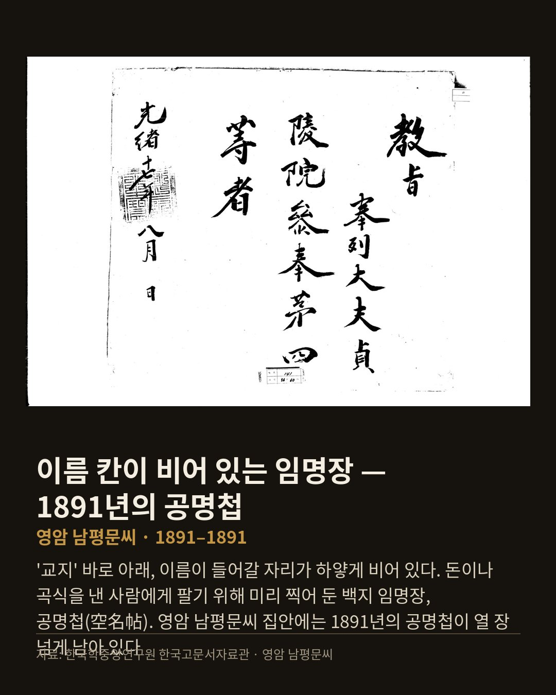
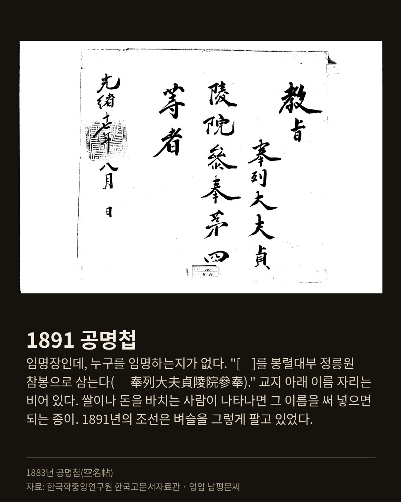
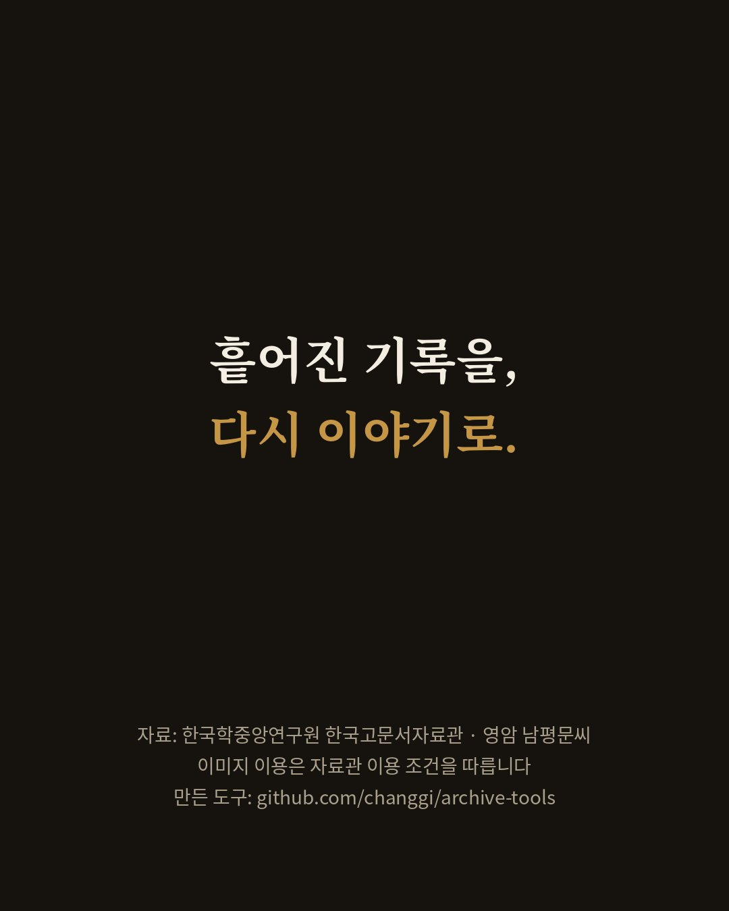

# EP.81 이름 칸이 비어 있는 임명장 — 1891년의 공명첩

영암 남평문씨 (문중) · '교지' 바로 아래, 이름이 들어갈 자리가 하얗게 비어 있다. 돈이나 곡식을 낸 사람에게 팔기 위해 미리 찍어 둔 백지 임명장, 공명첩(空名帖). 영암 남평문씨 집안에는 1891년의 공명첩이 열 장 넘게 남아 있다

- 🌐 [전시 웹페이지](https://changgi.github.io/archive-tools/examples/nampyeong-mun/exhibit.html) (한자 위 한글 독음 · 원문 해석) · [수업 활동지](https://changgi.github.io/archive-tools/examples/nampyeong-mun/handout.html)
- 🎬 영상: [릴스 9:16](https://changgi.github.io/archive-tools-next/media/ep81-nampyeong-mun_reel.mp4) · [가로 16:9](https://changgi.github.io/archive-tools-next/media/ep81-nampyeong-mun_wide.mp4) · 홍보 글: [`promo.md`](promo.md)
- 카드뉴스: [`cards/`](cards/) · SNS 글: [`sns.txt`](sns.txt) · 판독·해석 표: [`selection.csv`](selection.csv)


<!-- DELIVERY -->
## 전달 에디팅 — 이 기록을 이렇게 전합니다

- **핵심 정서** — 빈칸
- **한 문장** — 벼슬을 팔던 조선 말기의 현실, 그리고 끝내 주인을 얻지 못한 이름표들.
- **열기** — 임명장인데, 이름이 없습니다.
- **펼치기** — 공명첩 → 절충장군용양위부호군겸오위장 공명첩 (1891년) — 빈칸을 그대로 보여 주어, 보는 사람이 '누구의 이름이 들어갔을까'를 상상하게 했습니다.
- **절정** — "[    ]를 행 절충장군 용양위 부호군 겸 오위장으로 삼는다(行折衝將軍龍驤衛副護軍兼五衛將者)" — 화면·공간에서 이 한 줄만 크게, 소리를 줄여 집중
- **여운** — 빈칸에 이름이 적혔다면, 그 사람의 삶은 정말 달라졌을까요? — 질문으로 끝내고 답은 보는 사람에게
- **감각과 물질** — 이름 칸이 빈 공명첩 위에 관람객이 이름을 써 보기(체험용 복제) · 책장을 넘기는 소리, 확대 열람대
- **통로와 매개** — 온라인: 릴스(열기) → 카드뉴스(펼치기) → 전시 웹페이지(절정·원문) → 비하인드 카드(여운) / 오프라인: 원본 크기 복제·낭독·참여 벽 / 남기기: 활동지·질문 카드
- **여운 장치** — "돈으로 산 벼슬이 바꾼 것" 토론
- **전달 에디팅 전** — 2건의 문서를 1891년 연대순으로 놓고 문서명 · 유형 · 해설을 붙인다 — 정확하지만, 지나가면 잊힌다.
- **전달 에디팅 후** — 핵심 정서는 「빈칸」. 「임명장인데, 이름이 없습니다.」로 열고, 문서를 대비와 순서로 펼친 뒤, "[    ]를 행 절충장군 용양위 부호군 겸 오위장으로 삼는다(行折衝將軍龍驤衛副護軍兼五衛將者)"에서 멈춘다. 이름 칸이 빈 공명첩 위에 관람객이 이름을 써 보기(체험용 복제). 마지막엔 「"돈으로 산 벼슬이 바꾼 것" 토론」로 보는 사람이 자기 이야기를 남기고 떠나게 한다.

전문: [`delivery.md`](delivery.md)
<!-- /DELIVERY -->

<!-- CURATOR -->
## 비하인드 — 큐레이터 노트

- **왜 이 문서들인가** — '교지' 아래 이름 칸이 비어 있는 공명첩이 한 집안에 열 장 넘게 남아 있었습니다.
- **전하고 싶은 것** — 벼슬을 팔던 조선 말기의 현실, 그리고 끝내 주인을 얻지 못한 이름표들.
- **이렇게 보이길 바랐다** — 빈칸을 그대로 보여 주어, 보는 사람이 '누구의 이름이 들어갔을까'를 상상하게 했습니다.
- **이렇게 써 주세요** — 조선 말기 재정과 신분제 동요, 매관매직을 다루는 수업에 쓰세요.
- **만들며 있었던 일** — 목록 연도(1883)와 문서 연호(1891)가 달라 문서를 따랐습니다. '제4등'의 뜻은 확인이 필요합니다.
- **남겨 둔 질문** — 빈칸에 이름이 적혔다면, 그 사람의 삶은 정말 달라졌을까요?
- **제작 기록** — 문서 2건 · 1891년 · 원본 사진 2면(문서 전체) · 원문 판독 2건 · 번역 2건 · 해제에 "확인 필요"를 단 문서 1건

전문: [`curator.md`](curator.md)
<!-- /CURATOR -->

## 이야기 — 사료가 말하는 대로

임명장인데, 이름이 없습니다.

> **1891 공명첩** — 임명장인데, 누구를 임명하는지가 없다. "[    ]를 봉렬대부 정릉원 참봉으로 삼는다(　 奉列大夫貞陵院參奉)." 교지 아래 이름 자리는 비어 있다. 쌀이나 돈을 바치는 사람이 나타나면 그 이름을 써 넣으면 되는 종이. 1891년의 조선은 벼슬을 그렇게 팔고 있었다.
> **1891 공명첩** — 한 달 뒤의 또 한 장. 이번에는 장군이다. "[    ]를 행 절충장군 용양위 부호군 겸 오위장으로 삼는다(行折衝將軍龍驤衛副護軍兼五衛將者)." 정3품 당상관, 장군의 이름표. 그러나 이 장군 역시 끝내 이름을 얻지 못했다. 집안에는 주인 없는 벼슬이 열 장 넘게 남았다.

| 표지 | 1번 카드 | 마무리 |
|---|---|---|
|  |  |  |

## 선별 문서 (2점)

| # | 연도 | 유형 | 문서명 | 원본 |
|---|---|---|---|---|
| 1 | 1891 | 공명첩 | 1883년 공명첩(空名帖) | [원본 보기](https://archive.aks.ac.kr/viewer/viewer.do#imgnode.do?itemId=book&gubun=booktree&depth=6&upPath=01%5E0148%5EL014812%5EL014812F02%5EL014812F0201&dataId=G002%2BAKS%2BKSM-XA.1883.1111-20101008.B012j_022_00311_XXX&itemType=) |
| 2 | 1891 | 공명첩 | 1891년 절충장군용양위부호군겸오위장(折衝將軍龍驤衛副護軍兼五衛將) 공명첩(空名帖) | [원본 보기](https://archive.aks.ac.kr/viewer/viewer.do#imgnode.do?itemId=book&gubun=booktree&depth=6&upPath=01%5E0148%5EL014812%5EL014812F02%5EL014812F0201&dataId=G002%2BAKS%2BKSM-XA.1891.1111-20101008.B012j_022_00318_XXX&itemType=) |

## 원문 판독과 해석

### 1. 1883년 공명첩(空名帖)

**원문 판독**

```
敎旨
　　　　 奉列大夫貞
陵院參奉第四
等者
光緖十七年八月　日
(시명지보 1과 · 이름 칸 공란)
```

**원문 해석** 교지. [ ]를 봉렬대부(정4품) 정릉원 참봉 제4등으로 삼는다. 광서 17년(1891) 8월 일.

**해제** 받는 사람의 이름 칸을 비워 둔 채 발급한 공명첩(空名帖)입니다. 나라 재정이 어려울 때 곡식이나 돈을 바친 사람(납속)에게 주려고 미리 만들어 지방에 내려보냈고, 받는 사람이 정해지면 이름을 채워 넣었습니다. 실제 직무가 없는 명예직이어서 신분 상승이나 군역 면제의 수단으로 쓰였습니다. 이 장은 이름이 끝내 채워지지 않은 채 남았습니다. 목록 연도는 1883년이나 문서의 연호는 '光緖十七年(1891)'으로 읽혀 문서를 따랐습니다. '第四等'의 의미는 확인이 필요합니다.

### 2. 1891년 절충장군용양위부호군겸오위장(折衝將軍龍驤衛副護軍兼五衛將) 공명첩(空名帖)

**원문 판독**

```
敎旨
　　　　 行折衝
將軍龍驤衛
副護軍兼五
衛將者
光緖十七年九月　日
(시명지보 1과 · 이름 칸 공란)
```

**원문 해석** 교지. [ ]를 행 절충장군(정3품 당상) 용양위 부호군 겸 오위장으로 삼는다. 광서 17년(1891) 9월 일.

**해제** 한 달 뒤에 만들어진 무관직 공명첩으로, 정3품 당상관인 절충장군에 용양위 부호군 겸 오위장이라는 그럴듯한 직함이 붙어 있습니다. 조선 후기 공명첩은 흉년 구휼·군비 마련 등을 위해 대량으로 발행되어, '절충장군'이 시골 마을에도 흔해질 정도였습니다. 한 집안에 같은 해의 공명첩이 여러 장 남은 것은, 이를 사고팔거나 나누어 주는 중개 역할을 했을 가능성도 시사합니다(추정).

판독·해석·이야기는 이미지에 근거한 초안이며(검토 전 "초안" 표시), 정확한 판독은 원문 확인이 필요합니다. □는 읽지 못한 글자, (?)는 불확실한 글자입니다.
이미지: 한국학중앙연구원 한국고문서자료관 소장·제공. "원본" 링크를 누르면 자료관 뷰어에서 그 문서가 열립니다. 재사용은 자료관에 문의하세요(소장처 동의 필요).
