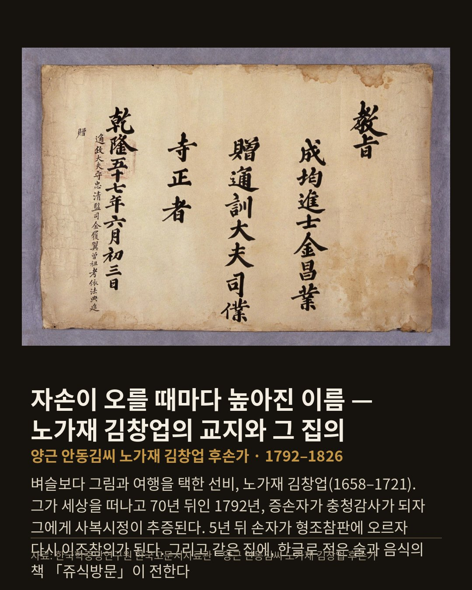
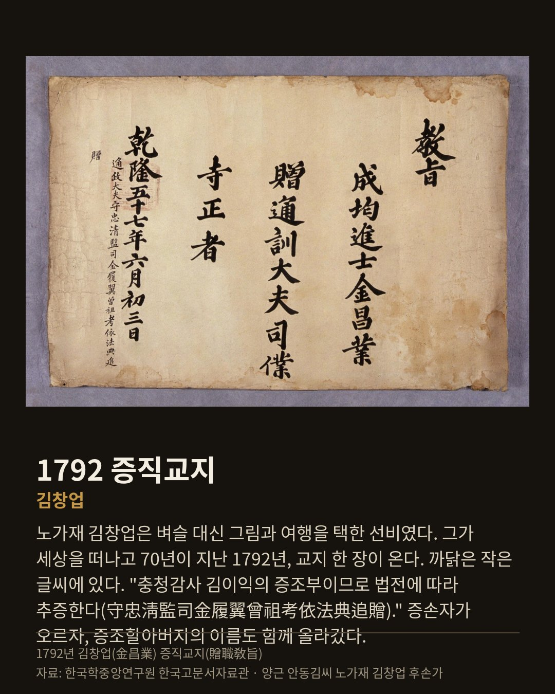
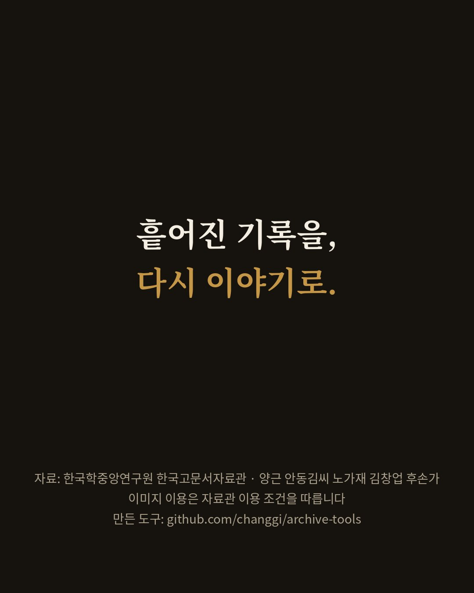

# EP.107 자손이 오를 때마다 높아진 이름 — 노가재 김창업의 교지와 그 집의 「쥬식방문」

양근 안동김씨 노가재 김창업 후손가 (문중) · 벼슬보다 그림과 여행을 택한 선비, 노가재 김창업(1658–1721). 그가 세상을 떠나고 70년 뒤인 1792년, 증손자가 충청감사가 되자 그에게 사복시정이 추증된다. 5년 뒤 손자가 형조참판에 오르자 다시 이조참의가 된다. 그리고 같은 집에, 한글로 적은 술과 음식의 책 「쥬식방문」이 전한다

- 🌐 [전시 웹페이지](https://changgi.github.io/archive-tools/examples/nogaje/exhibit.html) (한자 위 한글 독음 · 원문 해석) · [수업 활동지](https://changgi.github.io/archive-tools/examples/nogaje/handout.html)
- 🎬 영상: [릴스 9:16](https://changgi.github.io/archive-tools/examples/media/ep107-nogaje_reel.mp4) · [가로 16:9](https://changgi.github.io/archive-tools/examples/media/ep107-nogaje_wide.mp4) · 홍보 글: [`promo.md`](promo.md)
- 카드뉴스: [`cards/`](cards/) · SNS 글: [`sns.txt`](sns.txt) · 판독·해석 표: [`selection.csv`](selection.csv)

<!-- DELIVERY -->
## 전달 에디팅 — 이 기록을 이렇게 전합니다

- **핵심 정서** — 따뜻함
- **한 문장** — 한 집안의 기록은 두 갈래로 남는다 — 교지는 남자들의 이름을, 한글 조리서는 부엌의 손맛을 기억했다.
- **열기** — 증손자가 승진하자, 70년 전에 떠난 증조할아버지의 벼슬이 올랐습니다.
- **펼치기** — 김창업 증직교지 → 쥬식방문[주식방문] (1792–1826년) — 1792년(증손자 덕) → 1797년(손자 덕), 이름이 쌓이는 두 장 뒤에 「쥬식방문」 표지의 '宗家遺品'으로 장면을 바꿨습니다.
- **절정** — "충청감사 김이익의 증조부이므로 법전에 따라 추증한다(守忠淸監司金履翼曾祖考依法典追贈)" — 화면·공간에서 이 한 줄만 크게, 소리를 줄여 집중
- **여운** — 이 요리책을 쓴 사람의 이름은, 어디에 남아 있을까요? — 질문으로 끝내고 답은 보는 사람에게
- **감각과 물질** — 교지 두 장의 차곡차곡 쌓이는 벼슬 줄과 한글 조리서의 손글씨, 오이 한 개 · 어보·관인 탁본 스탬프를 찍어 보는 체험
- **통로와 매개** — 온라인: 릴스(열기) → 카드뉴스(펼치기) → 전시 웹페이지(절정·원문) → 비하인드 카드(여운) / 오프라인: 원본 크기 복제·낭독·참여 벽 / 남기기: 활동지·질문 카드
- **여운 장치** — 우리 집 레시피 한 장 한글로 적어 남기기
- **전달 에디팅 전** — 3건의 문서를 1792–1826년 연대순으로 놓고 문서명 · 유형 · 해설을 붙인다 — 정확하지만, 지나가면 잊힌다.
- **전달 에디팅 후** — 핵심 정서는 「따뜻함」. 「증손자가 승진하자, 70년 전에 떠난 증조할아버지의 벼슬이 올랐습니다.」로 열고, 문서를 대비와 순서로 펼친 뒤, "충청감사 김이익의 증조부이므로 법전에 따라 추증한다(守忠淸監司金履翼曾祖考依法典追贈)"에서 멈춘다. 교지 두 장의 차곡차곡 쌓이는 벼슬 줄과 한글 조리서의 손글씨, 오이 한 개. 마지막엔 「우리 집 레시피 한 장 한글로 적어 남기기」로 보는 사람이 자기 이야기를 남기고 떠나게 한다.

전문: [`delivery.md`](delivery.md)
<!-- /DELIVERY -->

<!-- CURATOR -->
## 비하인드 — 큐레이터 노트

- **왜 이 문서들인가** — 김창업은 『연행일기』로 유명하지만, 집안 문서함에는 그가 죽은 뒤 자손 덕에 받은 벼슬과, 이름 없는 누군가가 쓴 요리책이 함께 있었습니다.
- **전하고 싶은 것** — 한 집안의 기록은 두 갈래로 남는다 — 교지는 남자들의 이름을, 한글 조리서는 부엌의 손맛을 기억했다.
- **이렇게 보이길 바랐다** — 1792년(증손자 덕) → 1797년(손자 덕), 이름이 쌓이는 두 장 뒤에 「쥬식방문」 표지의 '宗家遺品'으로 장면을 바꿨습니다.
- **이렇게 써 주세요** — 추증 제도, 조선 후기 한글 조리서와 음식사, '기록에 남는 사람과 남지 않는 사람'을 다루는 수업에 쓰세요.
- **만들며 있었던 일** — 「쥬식방문」은 표지와 첫 장만 보았고, 본문 흘림 · 표지 일부(표찰에 가려진 글자)는 판독이 불확실합니다. 쓴 사람은 알 수 없고, 1826년은 자료관이 매긴 연대입니다. 생몰년(1658–1721)은 일반적으로 알려진 값입니다.
- **남겨 둔 질문** — 이 요리책을 쓴 사람의 이름은, 어디에 남아 있을까요?
- **제작 기록** — 문서 3건 · 1792–1826년 · 원본 사진 4면(문서 전체) · 원문 판독 3건 · 번역 3건 · 못 읽은 글자 □ 6 · 불확실 (?) 1

전문: [`curator.md`](curator.md) · 비하인드 카드: [`behind/`](behind/) · 채널별 홍보안: [`channels.md`](channels.md)
<!-- /CURATOR -->

## 이야기 — 사료가 말하는 대로

증손자가 승진하자, 70년 전에 떠난 증조할아버지의 벼슬이 올랐습니다.

> **1792 증직교지** — 노가재 김창업은 벼슬 대신 그림과 여행을 택한 선비였다. 그가 세상을 떠나고 70년이 지난 1792년, 교지 한 장이 온다. 까닭은 작은 글씨에 있다. "충청감사 김이익의 증조부이므로 법전에 따라 추증한다(守忠淸監司金履翼曾祖考依法典追贈)." 증손자가 오르자, 증조할아버지의 이름도 함께 올라갔다.
> **1797 증직교지** — 5년 뒤에는 손자 덕분이었다. "고 형조참판 김양행의 조부이므로 법전에 따라 추증한다(故嘉善大夫刑曹參判金亮行祖考依法典追贈)." 생전에 그가 지낸 벼슬은 아이들을 가르치는 동몽교관 하나뿐이었다. 그 이름 위에, 자손들의 벼슬이 차곡차곡 쌓였다.
> **1826 주식방문** — 같은 집안에 한글로 쓴 책 한 권이 남아 있다. 이름은 「쥬식방문」, 술과 음식을 만드는 법이다. 표지에는 누군가 이렇게 적어 두었다. "종가의 유품(宗家遺品)." 첫 장은 늙은 오이를 고르는 일부터 시작한다. 교지가 남자들의 이름을 기억하는 동안, 이 책은 누군가의 손맛을 기억했다.

| 표지 | 1번 카드 | 마무리 |
|---|---|---|
|  |  |  |

## 선별 문서 (3점)

| # | 연도 | 유형 | 문서명 | 원본 |
|---|---|---|---|---|
| 1 | 1792 | 증직교지 | 1792년 김창업(金昌業) 증직교지(贈職敎旨) | [원본 보기](https://archive.aks.ac.kr/viewer/viewer.do#imgnode.do?itemId=book&gubun=booktree&depth=6&upPath=01%5E0141%5EL014154%5EL014154F02%5EL014154F0201&dataId=G002%2BAKS%2BKSM-XA.1792.1111-20101008.B042b_064_00018_XXX&itemType=) |
| 2 | 1797 | 증직교지 | 1797년 김창업(金昌業) 증직교지(贈職敎旨) | [원본 보기](https://archive.aks.ac.kr/viewer/viewer.do#imgnode.do?itemId=book&gubun=booktree&depth=6&upPath=01%5E0141%5EL014154%5EL014154F02%5EL014154F0201&dataId=G002%2BAKS%2BKSM-XA.1797.1111-20101008.B042b_064_00023_XXX&itemType=) |
| 3 | 1826 | 주식방문 | 쥬식방문[주식방문(酒食方文)] | [원본 보기](https://archive.aks.ac.kr/viewer/viewer.do#imgnode.do?itemId=book&gubun=booktree&depth=6&upPath=01%5E0141%5EL014154%5EL014154F01%5EL014154F0102&dataId=G002%2BAKS%2BKSM-WZ.1826.4183-20261020.B042b_064_00131_YYY&itemType=) |

## 원문 판독과 해석

### 1. 1792년 김창업(金昌業) 증직교지(贈職敎旨)

**원문 판독**

```
敎旨
成均進士金昌業
贈通訓大夫司僕
寺正者
乾隆五十七年六月初三日 (도장)
(작은 글씨) 通政大夫守忠淸監司金履翼曾祖考依法典追
贈
```

**원문 해석** 교지. 성균진사 김창업에게 통훈대부 사복시정을 추증한다. 건륭 57년(1792) 6월 초3일. (작은 글씨) 통정대부 수 충청감사 김이익의 증조부이므로 법전에 따라 추증함.

**해제** 1792년(정조 16, 乾隆 57) 6월 3일, 노가재(老稼齋) 김창업(金昌業, 1658–1721)에게 정3품 당하 통훈대부 사복시정(司僕寺正)을 추증한 교지입니다. 이름 앞의 '성균진사'는 그가 생전에 진사시에 합격했다는 뜻으로, 그는 벼슬보다 그림 · 시 · 여행을 택해 1712년 형 김창집을 따라 청나라에 다녀와 『노가재연행일기』를 남겼습니다. 왼쪽 작은 글씨는 추증의 근거로, 증손자 김이익(金履翼)이 충청감사(통정대부)가 되었기 때문에 법전에 따라 증조부에게 벼슬을 내렸다는 것입니다.

### 2. 1797년 김창업(金昌業) 증직교지(贈職敎旨)

**원문 판독**

```
敎旨
贈通訓大夫司僕
寺正行童蒙敎官
通德郞金昌業贈
通政大夫吏曹參
議者
嘉慶二年　月　日 (도장)
(작은 글씨) 故嘉善大夫刑曹參判金亮行祖考依法典追　贈
```

**원문 해석** 교지. 통훈대부 사복시정에 추증되었고 동몽교관을 지낸 통덕랑 김창업에게 통정대부 이조참의를 추증한다. 가경 2년(1797) 월 일. (작은 글씨) 고 가선대부 형조참판 김양행의 조부이므로 법전에 따라 추증함.

**해제** 1797년(정조 21, 嘉慶 2), 김창업에게 정3품 당상 통정대부 이조참의를 다시 추증한 교지입니다. 5년 전의 '증 통훈대부 사복시정'이 이름 앞에 그대로 적히고, 생전의 벼슬 '행 동몽교관 통덕랑'(아이들을 가르치는 종9품 자리)도 함께 적혔습니다. 이번 근거는 손자 김양행(金亮行)이 가선대부 형조참판(종2품)이었다는 것입니다. '故'가 붙은 것으로 보아 김양행은 이미 세상을 떠난 뒤였습니다. 한 사람의 벼슬이 자손의 승진을 따라 두 번 올라간 것을 두 장의 교지가 나란히 보여 줍니다.

### 3. 쥬식방문[주식방문(酒食方文)]

**원문 판독**

```
(표지 왼쪽 제첨) 쥬식방문
(표지 오른쪽 글씨, 일부는 소장처 표찰에 가려짐)
□동김씨 노가재공댁
□와공 종가 유품
□窩公宗家遺品
(본문 첫 장)
쥬식방문
□동외 □히 법(?)
늘근 외 굴근 이의 씨 □ 말고 … (이하 흘림, 판독 불확실)
```

**원문 해석** (표지) 주식방문(술과 음식 만드는 법). 안동김씨 노가재공 댁, □와공 종가의 유품. (본문 첫 장) 주식방문. □□ 오이 □□ 법(?). 늙은 오이 굵은 것의 씨를 … (이하 판독 불확실)

**해제** 노가재 김창업 집안에 전하는 한글 조리서 「쥬식방문(酒食方文)」입니다. '주식방문'은 술(酒)과 음식(食)을 만드는 방법(方文)이라는 뜻으로, 조선 후기 양반가 여성들이 한글로 적어 집안에 전한 조리서의 한 갈래입니다. 표지에 '노가재공댁'과 '□와공 종가 유품(□窩公宗家遺品)'이라고 적어, 이 책이 노가재 후손 집안의 물려받은 물건임을 밝혔습니다. 첫 번째 항목은 오이(외)로 무엇인가를 담그는 법으로 보이나, 제목과 본문이 흘림이라 판독이 불확실합니다. 쓴 사람과 시기는 책에 적혀 있지 않습니다. 연도 1826년은 자료관이 매긴 연대입니다.

판독·해석·이야기는 이미지에 근거한 초안이며(검토 전 "초안" 표시), 정확한 판독은 원문 확인이 필요합니다. □는 읽지 못한 글자, (?)는 불확실한 글자입니다.
이미지: 한국학중앙연구원 한국고문서자료관 소장·제공. "원본" 링크를 누르면 자료관 뷰어에서 그 문서가 열립니다. 재사용은 자료관에 문의하세요(소장처 동의 필요).
