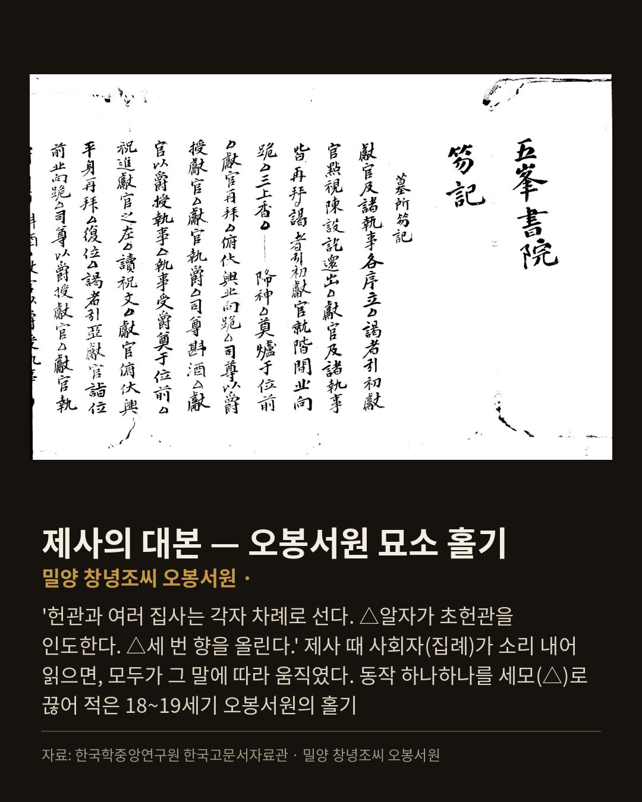
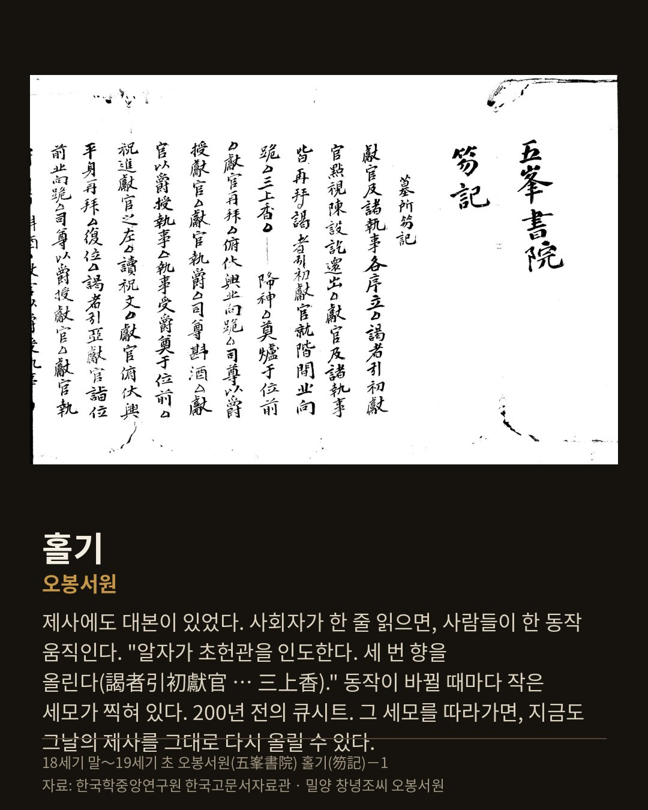
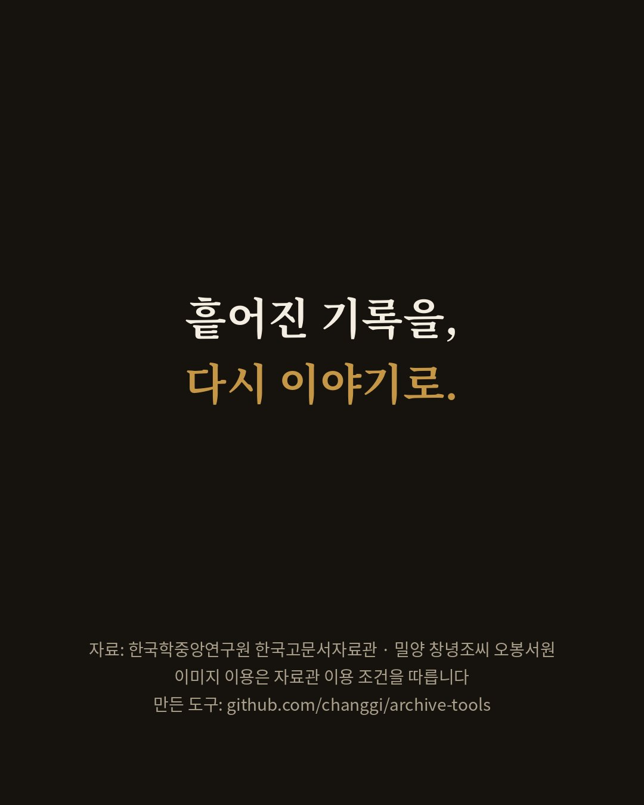

# EP.92 제사의 대본 — 오봉서원 묘소 홀기

밀양 창녕조씨 오봉서원 (서원) · '헌관과 여러 집사는 각자 차례로 선다. △알자가 초헌관을 인도한다. △세 번 향을 올린다.' 제사 때 사회자(집례)가 소리 내어 읽으면, 모두가 그 말에 따라 움직였다. 동작 하나하나를 세모(△)로 끊어 적은 18~19세기 오봉서원의 홀기

- 🌐 [전시 웹페이지](https://changgi.github.io/archive-tools/examples/obong-seowon/exhibit.html) (한자 위 한글 독음 · 원문 해석) · [수업 활동지](https://changgi.github.io/archive-tools/examples/obong-seowon/handout.html)
- 🎬 영상: [릴스 9:16](https://changgi.github.io/archive-tools/examples/media/ep92-obong-seowon_reel.mp4) · [가로 16:9](https://changgi.github.io/archive-tools/examples/media/ep92-obong-seowon_wide.mp4) · 홍보 글: [`promo.md`](promo.md)
- 카드뉴스: [`cards/`](cards/) · SNS 글: [`sns.txt`](sns.txt) · 판독·해석 표: [`selection.csv`](selection.csv)


<!-- CURATOR -->
## 비하인드 — 큐레이터 노트

- **왜 이 문서들인가** — 동작마다 '△'를 찍어 끊어 읽게 한 묘소 홀기가, 200년 전 제사의 진행을 그대로 재현할 수 있게 해 주었습니다.
- **전하고 싶은 것** — 의례에도 대본(큐시트)이 있었고, 그 대본 덕분에 전통이 정확히 이어졌다는 것.
- **이렇게 보이길 바랐다** — 홀기를 한 줄씩 읽어 주는 방식으로, 보는 사람이 제사에 참여하는 느낌이 들게 했습니다.
- **이렇게 써 주세요** — 제례 절차 재현, 무형문화 기록화 교육에 쓰세요.
- **만들며 있었던 일** — 마이크로필름 흑백 이미지이고, 연대는 목록의 18세기 말~19세기 초를 따랐습니다.
- **남겨 둔 질문** — 오늘 우리 행사의 큐시트는 200년 뒤 무엇을 말해 줄까요?
- **제작 기록** — 문서 1건 · 원본 사진 13면(문서 전체) · 원문 판독 1건 · 번역 1건

전문: [`curator.md`](curator.md)
<!-- /CURATOR -->

## 이야기 — 사료가 말하는 대로

200년 전 제사에도 대본이 있었습니다.

> ** 홀기** — 제사에도 대본이 있었다. 사회자가 한 줄 읽으면, 사람들이 한 동작 움직인다. "알자가 초헌관을 인도한다. 세 번 향을 올린다(謁者引初獻官 … 三上香)." 동작이 바뀔 때마다 작은 세모가 찍혀 있다. 200년 전의 큐시트. 그 세모를 따라가면, 지금도 그날의 제사를 그대로 다시 올릴 수 있다.

| 표지 | 1번 카드 | 마무리 |
|---|---|---|
|  |  |  |

## 선별 문서 (1점)

| # | 연도 | 유형 | 문서명 | 원본 |
|---|---|---|---|---|
| 1 | — | 홀기 | 18세기 말〜19세기 초 오봉서원(五峯書院) 홀기(笏記)－1 | [원본 보기](https://archive.aks.ac.kr/viewer/viewer.do#imgnode.do?itemId=book&gubun=booktree&depth=6&upPath=01%5E0150%5EL015026%5EL015026F02%5EL015026F0207&dataId=G002%2BAKS%2BKSM-XG.0000.4827-20101008.B045b_070_00021_YYY&itemType=) |

## 원문 판독과 해석

### 1. 18세기 말〜19세기 초 오봉서원(五峯書院) 홀기(笏記)－1

**원문 판독**

```
五峯書院
笏記
　墓所笏記
獻官及諸執事各序立 △謁者引初獻
官點視陳設訖還出 △獻官及諸執事
皆再拜 △謁者引初獻官就階間北向
跪 △三上香 △ ─ 降神 △奠爐于位前
△獻官再拜 △俯伏興北向跪 △司尊以爵
授獻官 △獻官執爵 △司尊斟酒 △獻
官以爵授執事 △執事受爵奠于位前 △
祝進獻官之左 △讀祝文 △獻官俯伏興
平身再拜 △復位 △謁者引亞獻官詣位
前北向跪 △司尊以爵授獻官 △獻官執 …
(이하 다음 면)
```

**원문 해석** 오봉서원 홀기. 묘소 홀기. 헌관과 여러 집사는 각자 차례대로 선다. △알자가 초헌관을 인도하여 제물 차림을 살펴보게 하고, 마치면 돌아 나온다. △헌관과 여러 집사가 모두 두 번 절한다. △알자가 초헌관을 인도하여 계단 사이로 나아가 북쪽을 향해 꿇어앉게 한다. △세 번 향을 올린다. △(강신) 향로를 신위 앞에 올린다. △헌관이 두 번 절한다. △엎드렸다 일어나 북쪽을 향해 꿇어앉는다. △사준이 잔을 헌관에게 준다. △헌관이 잔을 잡는다. △사준이 술을 따른다. △헌관이 잔을 집사에게 준다. △집사가 잔을 받아 신위 앞에 올린다. △축관이 헌관의 왼쪽으로 나아간다. △축문을 읽는다. △헌관이 엎드렸다 일어나 몸을 펴고 두 번 절한다. △제자리로 돌아간다. △알자가 아헌관을 인도하여 신위 앞에 나아가 북쪽을 향해 꿇어앉게 한다. △사준이 잔을 헌관에게 준다. △헌관이 잡고 …

**해제** 홀기(笏記)는 제례나 의식의 진행 순서를 적은 문서로, 집례가 이를 소리 내어 읽으면 헌관과 집사들이 그대로 따라 움직였습니다. 오늘날 행사 '큐시트'나 연극 대본과 비슷합니다. 동작이 바뀌는 곳마다 '△' 표를 하여 끊어 읽기 쉽게 했습니다. 이 홀기는 밀양 오봉서원에서 쓴 것 가운데 '묘소 홀기'로, 서원 제향이 아니라 묘소에서 지내는 제사의 순서입니다. 알자(謁者, 헌관 안내), 사준(司尊, 술 담당), 축(祝, 축문 낭독) 등 집사의 역할이 드러납니다. 목록에서는 18세기 말~19세기 초로 보았습니다. 마이크로필름 흑백 이미지입니다.

판독·해석·이야기는 이미지에 근거한 초안이며(검토 전 "초안" 표시), 정확한 판독은 원문 확인이 필요합니다. □는 읽지 못한 글자, (?)는 불확실한 글자입니다.
이미지: 한국학중앙연구원 한국고문서자료관 소장·제공. "원본" 링크를 누르면 자료관 뷰어에서 그 문서가 열립니다. 재사용은 자료관에 문의하세요(소장처 동의 필요).
