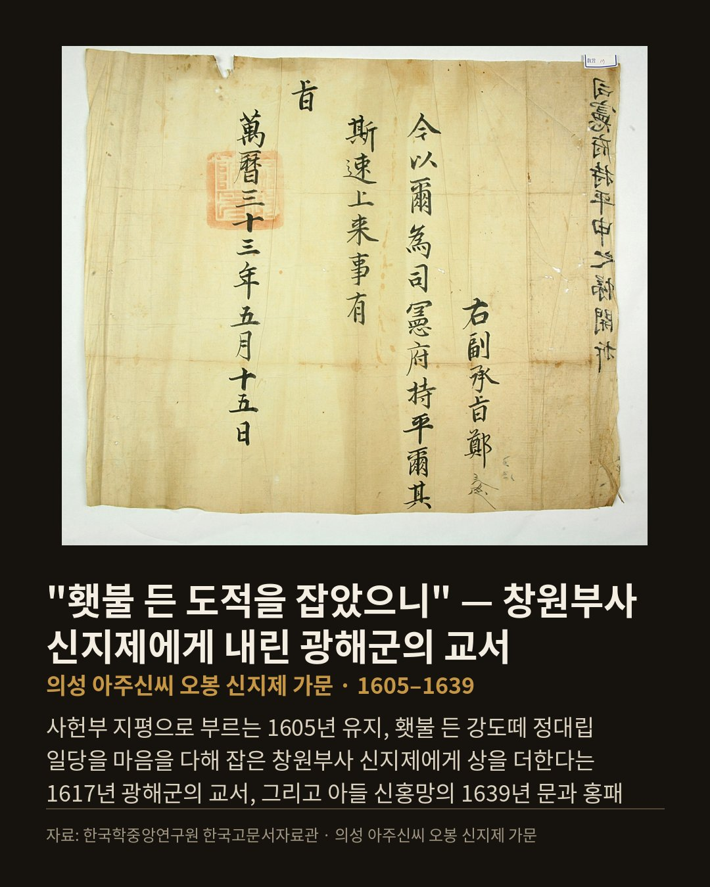
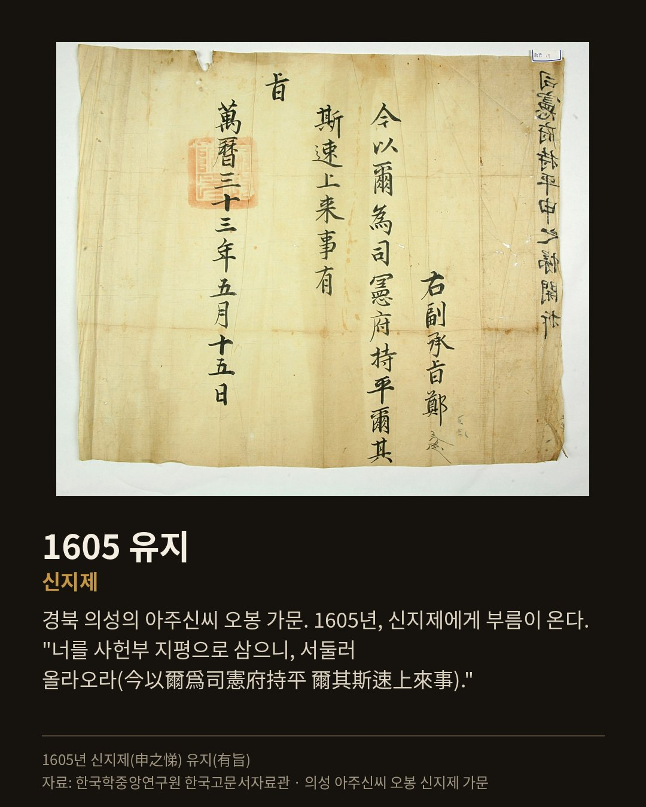

# EP.69 "횃불 든 도적을 잡았으니" — 창원부사 신지제에게 내린 광해군의 교서

의성 아주신씨 오봉 신지제 가문 (문중) · 사헌부 지평으로 부르는 1605년 유지, 횃불 든 강도떼 정대립 일당을 마음을 다해 잡은 창원부사 신지제에게 상을 더한다는 1617년 광해군의 교서, 그리고 아들 신홍망의 1639년 문과 홍패

- 🌐 [전시 웹페이지](https://changgi.github.io/archive-tools/examples/obong/exhibit.html) (한자 위 한글 독음 · 원문 해석) · [수업 활동지](https://changgi.github.io/archive-tools/examples/obong/handout.html)
- 🎬 영상: [릴스 9:16](https://changgi.github.io/archive-tools-next/media/ep69-obong_reel.mp4) · [가로 16:9](https://changgi.github.io/archive-tools-next/media/ep69-obong_wide.mp4) · 홍보 글: [`promo.md`](promo.md)
- 카드뉴스: [`cards/`](cards/) · SNS 글: [`sns.txt`](sns.txt) · 판독·해석 표: [`selection.csv`](selection.csv)


<!-- DELIVERY -->
## 전달 에디팅 — 이 기록을 이렇게 전합니다

- **핵심 정서** — 평온
- **한 문장** — '마을이 편안함을 얻고 북소리가 울리지 않았다' — 좋은 다스림의 기준은 평온이었다는 것.
- **열기** — 임금이 한 고을 원님에게 교서를 내렸습니다. 강도떼를 잡았기 때문입니다.
- **펼치기** — 신지제 유지 → 광해군 교서 → 신홍망 문과 홍패 (1605–1639년) — 도적 체포 장면을 중심에 두고, 앞뒤로 아버지의 부름(유지)과 아들의 급제(홍패)를 놓았습니다.
- **절정** — "나머지 무리가 저절로 평정되어 마을이 편안함을 얻고, 북소리가 울리지 않게 되었다(餘黨自平 閭里獲安 桴鼓不警)" — 화면·공간에서 이 한 줄만 크게, 소리를 줄여 집중
- **여운** — 북소리가 울리지 않는 마을이란, 오늘로 치면 어떤 곳일까요? — 질문으로 끝내고 답은 보는 사람에게
- **감각과 물질** — 북소리가 멈추고 고요해지는 음향 · 역마 방울·말발굽 소리와 함께 펼치는 두루마리 · 두루마리를 실제 길이로 펼친 복제 · 붉은 종이를 실물 크기로 복제해 벽에 거는 연출
- **통로와 매개** — 온라인: 릴스(열기) → 카드뉴스(펼치기) → 전시 웹페이지(절정·원문) → 비하인드 카드(여운) / 오프라인: 원본 크기 복제·낭독·참여 벽 / 남기기: 활동지·질문 카드
- **여운 장치** — "우리 마을의 평온"을 지키는 일
- **전달 에디팅 전** — 3건의 문서를 1605–1639년 연대순으로 놓고 문서명 · 유형 · 해설을 붙인다 — 정확하지만, 지나가면 잊힌다.
- **전달 에디팅 후** — 핵심 정서는 「평온」. 「임금이 한 고을 원님에게 교서를 내렸습니다. 강도떼를 잡았기 때문입니다.」로 열고, 문서를 대비와 순서로 펼친 뒤, "나머지 무리가 저절로 평정되어 마을이 편안함을 얻고, 북소리가 울리지 않게 되었다(餘黨自平 閭里獲安 桴鼓不警)"에서 멈춘다. 북소리가 멈추고 고요해지는 음향. 마지막엔 「"우리 마을의 평온"을 지키는 일」로 보는 사람이 자기 이야기를 남기고 떠나게 한다.

전문: [`delivery.md`](delivery.md)
<!-- /DELIVERY -->

<!-- CURATOR -->
## 비하인드 — 큐레이터 노트

- **왜 이 문서들인가** — 횃불 든 강도떼를 잡은 창원부사에게 광해군이 상을 더한 교서가, 지방관의 치안 업무를 생생하게 보여 주었습니다.
- **전하고 싶은 것** — '마을이 편안함을 얻고 북소리가 울리지 않았다' — 좋은 다스림의 기준은 평온이었다는 것.
- **이렇게 보이길 바랐다** — 도적 체포 장면을 중심에 두고, 앞뒤로 아버지의 부름(유지)과 아들의 급제(홍패)를 놓았습니다.
- **이렇게 써 주세요** — 조선의 치안·지방 행정 수업에 쓰세요.
- **남겨 둔 질문** — 북소리가 울리지 않는 마을이란, 오늘로 치면 어떤 곳일까요?
- **제작 기록** — 문서 3건 · 1605–1639년 · 원본 사진 6면(문서 전체) · 원문 판독 3건 · 번역 3건 · 못 읽은 글자 □ 0 · 불확실 (?) 3 · 해제에 "확인 필요"를 단 문서 1건

전문: [`curator.md`](curator.md)
<!-- /CURATOR -->

## 이야기 — 사료가 말하는 대로

임금이 한 고을 원님에게 교서를 내렸습니다. 강도떼를 잡았기 때문입니다.

> **1605 유지** — 경북 의성의 아주신씨 오봉 가문. 1605년, 신지제에게 부름이 온다. "너를 사헌부 지평으로 삼으니, 서둘러 올라오라(今以爾爲司憲府持平 爾其斯速上來事)."
> **1617 교서** — 12년 뒤 1617년, 신지제는 창원부사가 되어 있었다. 그 고을에 횃불을 든 강도떼가 있었다. 그는 끝까지 쫓아 잡았고, 임금이 교서를 내린다. "나머지 무리가 저절로 평정되어 마을이 편안함을 얻고, 북소리가 울리지 않게 되었다(餘黨自平 閭里獲安 桴鼓不警)."
> **1639 홍패** — 그리고 1639년, 아들 신홍망이 붉은 종이를 받는다. 날짜 자리에 연호가 없다. "기묘년 9월 10일(己卯九月初十日)." 병자호란 3년 뒤였다.

| 표지 | 1번 카드 | 마무리 |
|---|---|---|
|  |  |  |

## 선별 문서 (3점)

| # | 연도 | 유형 | 문서명 | 원본 |
|---|---|---|---|---|
| 1 | 1605 | 유지 | 1605년 신지제(申之悌) 유지(有旨) | [원본 보기](https://archive.aks.ac.kr/viewer/viewer.do#imgnode.do?itemId=book&gubun=booktree&depth=6&upPath=01%5E0167%5EL016741%5EL016741F02%5EL016741F0201&dataId=G002%2BAKS%2BKSM-XA.1605.1111-20101008.B052b_077_00141_XXX&itemType=) |
| 2 | 1617 | 교서 | 1617년 광해군(光海君) 교서(敎書) | [원본 보기](https://archive.aks.ac.kr/viewer/viewer.do#imgnode.do?itemId=book&gubun=booktree&depth=6&upPath=01%5E0167%5EL016741%5EL016741F02%5EL016741F0201&dataId=G002%2BAKS%2BKSM-XA.1617.1111-20101008.B052b_077_00139_XXX&itemType=) |
| 3 | 1639 | 홍패 | 1639년 신홍망(申弘望) 문과 홍패(文科紅牌) | [원본 보기](https://archive.aks.ac.kr/viewer/viewer.do#imgnode.do?itemId=book&gubun=booktree&depth=6&upPath=01%5E0167%5EL016741%5EL016741F02%5EL016741F0201&dataId=G002%2BAKS%2BKSM-XA.1639.1111-20101008.B052b_077_00186_XXX&itemType=) |

## 원문 판독과 해석

### 1. 1605년 신지제(申之悌) 유지(有旨)

**원문 판독**

```
(겉) 司憲府持平申 開拆
右副承旨鄭(押)
今以爾爲司憲府持平 爾其
斯速上來事 有
旨
萬曆三十三年五月十五日 (도장)
```

**원문 해석** 우부승지 정(鄭)이 씀. 이제 너를 사헌부 지평으로 삼으니, 너는 서둘러 올라오라는 유지. 만력 33년(1605) 5월 15일.

**해제** 1605년(선조 38) 5월, 의성의 신지제(申之悌, 1562~1624)를 사헌부 지평으로 삼아 부른 유지입니다. 신지제의 호는 오봉(梧峯)으로, 임진왜란 때 의병 활동을 했고 뒤에 창원부사 등을 지냈습니다.

### 2. 1617년 광해군(光海君) 교서(敎書)

**원문 판독**

```
敎昌原府使申之悌明火作賊鄭大立
等盡心跟捕賞加書
王若曰 凡民罔不憝 旣姦宄之就誅 懋
賞待有功 宜勉勵而增秩 玆循舊
典 用霈殊恩 惟爾剛以濟柔 學而爲
政 昔秉驄於憲府 凜凜生風 逮割雞
於名城 恢恢游刃 尤善鉤距 寔稱神
明 從容若治(?)絲 … 斯得 談笑一校(?)
足 餘黨自平 閭里獲安 桴鼓不警
禁暴除害 雖職分之當爲 紀績酬
勞 豈賴(?)笑之人愛 用加爾通政大夫(…)
(이하 왼쪽 — 이어지는 글과 날짜, 판독 필요)
```

**원문 해석** 창원부사 신지제가 횃불 든 도적(명화적) 정대립 등을 마음을 다해 뒤쫓아 잡았으므로 상을 더하는 교서. 왕은 이르노라. 무릇 백성 가운데 [도적을] 미워하지 않는 이가 없으니, 간악한 무리가 이미 처형되었고, 상을 힘써 주어 공 있는 이를 기다리니 마땅히 권면하여 품계를 올려야 한다. 이에 옛 법을 따라 특별한 은혜를 베푼다. 생각건대 너는 굳셈으로 부드러움을 돕고, 배운 것으로 정사를 하였다. 예전 사헌부에서 [어사의] 말을 탔을 때는 늠름하게 바람이 일었고, 이름난 고을(창원)을 다스리게 되자 넉넉하게 칼날을 놀렸다. 더욱 [도적의 정황을] 캐어 묻는 데 뛰어나 참으로 신명하다 일컬어졌으니, 차분하게 실타래를 풀듯 … 마침내 잡았고, 담소하는 사이에 … 나머지 무리가 저절로 평정되어 마을이 편안함을 얻고 [경보의] 북소리가 울리지 않게 되었다. 포악을 막고 해를 없애는 것이 비록 직분상 마땅히 할 일이나, 공적을 적고 수고에 보답하는 것을 어찌 … 이에 너에게 통정대부를 더하노라. … (이하 판독 필요)

**해제** 1617년(광해군 9), 창원부사 신지제가 명화적(明火賊, 횃불을 들고 떼로 다니는 강도) 정대립(鄭大立) 일당을 끝까지 쫓아 잡은 공으로 품계를 올려 준 광해군의 상가(賞加) 교서입니다. '쇠 닭을 잡는 데 소 잡는 칼(割雞)'이라는 고사, '칼날을 넉넉히 놀린다(游刃)'는 장자의 고사로 그의 고을 다스림을 칭찬했습니다. 해서로 반듯해 앞부분을 판독했고, 오른쪽 위에 '昌原府使' 위로 관인이 찍혀 있습니다. 왼쪽 끝은 판독이 필요합니다.

### 3. 1639년 신홍망(申弘望) 문과 홍패(文科紅牌)

**원문 판독**

```
敎旨
宣敎郞前行 康陵
參奉申弘望文科丙
科第一人及第出身者
己卯九月初十日 (도장)
```

**원문 해석** 교지. 선교랑 전 행 강릉 참봉 신홍망을 문과 병과 제1인으로 급제하여 출신한 사람으로 삼는다. 기묘년(1639) 9월 10일.

**해제** 1639년(인조 17, 己卯) 9월, 신지제의 아들 신홍망(申弘望)이 문과에 급제하고 받은 홍패입니다. 이미 강릉(康陵, 명종의 능) 참봉을 지낸 상태였습니다. 연호 대신 간지(己卯)만 쓴 것은 병자호란 뒤 청의 연호를 쓰기를 꺼린 당시 사정을 보여 주는 것으로 알려져 있습니다(확인 필요).

판독·해석·이야기는 이미지에 근거한 초안이며(검토 전 "초안" 표시), 정확한 판독은 원문 확인이 필요합니다. □는 읽지 못한 글자, (?)는 불확실한 글자입니다.
이미지: 한국학중앙연구원 한국고문서자료관 소장·제공. "원본" 링크를 누르면 자료관 뷰어에서 그 문서가 열립니다. 재사용은 자료관에 문의하세요(소장처 동의 필요).
